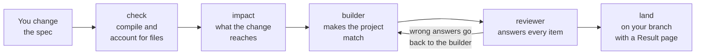

<h1 align="center">
  <picture>
    <source media="(prefers-color-scheme: dark)" srcset="docs/assets/markitect-lockup.svg">
    
  </picture>
</h1>

<p align="center">
  Markitect keeps one spec of your project in Markdown, checks it like code,<br>
  and has an agent build every change while a fresh agent checks it.
</p>

<p align="center">
  <a href="https://github.com/Glacius-Labs/Markitect/actions/workflows/ci.yaml"></a>
  <a href="go.mod"></a>
  <a href="LICENSE"></a>
  <a href="#status"></a>
</p>

<p align="center">
  <a href="#why-markitect">Why</a> ·
  <a href="#how-it-works">How it works</a> ·
  <a href="#quick-start">Quick start</a> ·
  <a href="#example-one-rule-changes">Example</a> ·
  <a href="#status">Status</a> ·
  <a href="#documentation">Documentation</a>
</p>

> [!IMPORTANT]
> Main carries the build of [draft concept 4.0](docs/concepts/v4-concept.md), which the owner is trying by using it. Markitect is in active development, and its releases are builds of that draft. Every command on this page exists on `main`.

## Why Markitect

When AI agents build most of a project, its design, rules, documentation, code, tests and configuration drift apart. A decision about behavior has to reach the code, the tests, the documentation and the agents' own instructions. An agent finishes its task and misses a rule two folders away. Consistency passes take hours and find more each time.

Markitect moves the knowledge of what belongs together out of the agents' memory and into one place you own: the spec. You describe the project once, as typed documentation in Markdown. Code, tests, configuration and documentation are built from it. When you want something different, you change the spec; Markitect works out what the change reaches, an agent brings the project in line, a fresh agent checks every item, and the work lands with a record of every answer.

It is a way of agentic coding, not a platform: the agents are ordinary Claude Code agents in your own session and your own folder, and the tool keeps a few clear guarantees around them.

## Features

- **Typed documentation.** One Markdown file per Definition, its Kind in the front matter, links by path such as `[[members/member]]`. Projects define their own Kinds; the standard Libraries `std`, `rest` and `cli` ship in the binary.
- **A compiler for intent.** `markitect check` resolves every Kind and link, keeps internal Definitions inside their subtree and refuses dependency cycles between Packages, as Go does. If the spec does not compile, no agent starts.
- **Every file accounted for.** One registry page per Package names the paths it owns and lists each file with the Definitions it builds. A file that is neither registered nor ignored is an error.
- **Impact like an incremental build.** `markitect impact` shows which Definitions and files a change reaches, and why. `markitect lint` measures the spec like code: coupling, size, unused Definitions.
- **A builder and a fresh reviewer.** `/markitect-apply` has your Claude Code session start a builder agent. When it is done, a reviewer agent with fresh context answers every item of the checklist, and a wrong answer goes back to the builder.
- **One door.** The builder calls `markitect submit`, which refuses changes to the spec or the harness, files the review has not seen and anything `check` rejects, and lands the work only when every item has passed.
- **Lands as a commit.** The work lands on your branch as one commit, with a Result page under `.markitect/results/`. Nothing is pushed.

## How it works



1. **You change the spec,** by hand or with your coding agent through the modeling skill, which asks first when something is open. You read the Markdown diff.
2. **You run `/markitect-apply` in Claude Code.** Markitect checks the spec and commits it. An error in it stops here, before any agent starts.
3. **Impact makes the list.** The change reaches the Definitions it edits, the Definitions that link to them and the files that build them. Each becomes an item of the checklist.
4. **A builder agent does the work,** in your folder. It reads the list from `markitect checklist`, changes the code, tests and documentation, and calls `markitect submit` when it thinks it is done.
5. **A fresh reviewer checks it.** `submit` tells the builder to start the reviewer, which sees only the spec, the list and the code. It answers each item with `ok`, `wrong` or `spec problem` and points to where it looked. Wrong items go back to the builder, at most twice.
6. **The work lands.** When nothing is left, `submit` commits the work with its Result page on your branch. A real problem in the spec ends the run instead, and the Result names the decision for you.

`/markitect-verify` runs a reviewer alone over the last commit and changes nothing. Its Findings feed the next `markitect apply --findings`.

## Quick start

### Install

Markitect needs Git 2.38 or newer and Claude Code. Pick one way to get the `markitect` command.

**With the Claude Code plugin.** One step, and nothing else to install:

```bash
claude plugin marketplace add Glacius-Labs/Markitect
claude plugin install markitect@glacius-labs
```

The plugin puts `markitect` on the `PATH` of Claude Code's shell and tells every session what Markitect is. It downloads the binary of its own version the first time, checking it against the release's checksums, and a plugin update brings the matching binary: `claude plugin update markitect@glacius-labs`. That `markitect` exists inside Claude Code only. For your own terminal, use one of the next two.

Release 0.15.0 named the marketplace `markitect`. If you added it then, nothing breaks: the plugin keeps its old id, `markitect@markitect`, and `claude plugin update markitect@markitect` brings it to the newest release. To get the new name, run `claude plugin uninstall markitect@markitect` and `claude plugin marketplace remove markitect`, then the two commands above; the uninstall also removes the binary the old plugin downloaded.

**With a binary.** Download the file for your system from the [releases](https://github.com/Glacius-Labs/Markitect/releases), check it against the checksums file, name it `markitect` and put it on your `PATH`. Then run `markitect install` once: it writes a personal skill, so that a Claude Code session in any folder knows what Markitect is and how to begin. (The plugin brings that skill itself.)

**From source.** With Go 1.27.1 or newer: `go install github.com/Glacius-Labs/Markitect/cmd/markitect@main`, then `markitect install`.

The skills and agents call `markitect` by name, so the folder of the binary must be on your `PATH`; `version`, `init`, `install` and `update` warn when it is not. `markitect version` shows which build you have and whether the personal skill and the current project match it.

To upgrade, run `markitect update`. It installs the newest release over the binary, then lets the new binary bring what Markitect wrote earlier in line: the personal skill and, in a project, the skills, agents, hook and lock that `init` wrote; it commits all but the lock, which it leaves for you to read. It changes no spec file, and `markitect update --check` only reports. A binary the plugin brought is updated with the plugin instead, and a build from source is replaced only with `markitect update --force`.

### Set up a project

```bash
cd your-project
markitect init --name "Your project"
markitect check
```

`init` creates `.markitect/` with the manifest, the lock, a project anchor and Root's registry page, writes `AGENTS.md` and `CLAUDE.md`, and installs the skills, the builder and reviewer agents, and a hook in `.claude/settings.json` that lets only the reviewer answer. It works in an empty folder too, and makes it a Git repository. It never changes an existing spec file, so it is safe to run again after an upgrade. In a new project, `check` says that nothing is built yet. Open Claude Code and run `/markitect-start`, which asks what the project is and starts the spec with you.

In a repository that already has files, the first `check` fails by design, because every file must belong somewhere:

```text
README.md: file.unregistered: neither registered nor ignored: list it on .markitect/registry.md, the page of its owner Root, or add it to the ignore file
1 errors
```

List the file on Root's registry page, `.markitect/registry.md`, with the Definitions it builds:

```markdown
| File | Realizes | Why |
|---|---|---|
| `README.md` | [[project]] | What the project is for |
```

### Write the spec

Ask your coding agent to use the `markitect-modeling` skill and describe the project with you. For an existing code base, the `markitect-extract` skill drafts a first spec from the code. Then look around:

```bash
markitect lint                   # coupling, size, unused Definitions
markitect graph                  # the Package dependency graph as a Mermaid diagram
markitect impact --base HEAD~1   # what the change since HEAD~1 reaches
```

None of these commands starts an agent.

### Let an agent build it

Commit what is not part of the spec, then run this in Claude Code, in the project's folder:

```text
/markitect-apply
```

Your session starts the builder and waits for it; leave the folder alone meanwhile. The first run builds the whole spec; later runs take the last landing as their base and build only what changed since. `/markitect-verify` reviews the last commit. The [project workflow](docs/guides/project-workflow.md) covers every option, limit and exit code.

## Example: one rule changes

A small library allows each member five open loans. The limit lives in one Rule of the spec (excerpt from the [Library example](tools/evaluation-tasks/library/m1/model/lending/loan-policy.md)):

```markdown
---
kind: std/Rule
---
# Loan policy

…

| Value | Setting | Meaning |
| --- | --- | --- |
| Loan limit | `5` | The maximum resulting count of currently open loans per member when admitting a new loan. … |
| Loan period | `14` days | The number of calendar days added to the borrowing date to determine a new loan's due date. … |

For [[lending/borrow]], the resulting current open-loan count of the member must not exceed the loan limit.
Count every open [[lending/loan]], including overdue loans, and exclude closed loans. …
```

You change `5` to `3`. `markitect impact` lists the Rule itself, every Definition that links to it, such as borrowing, returning and the overdue reminders, and the files that build them. The `catalog` and `members` Packages are not reached. `/markitect-apply` gives the builder that list; a conforming result refuses a fourth open loan, updates the tests and the documentation, keeps every existing loan and every return working, and leaves the files that already conform untouched. The reviewer then checks each item against the spec.

## Concepts

| Term | Meaning |
| --- | --- |
| **Spec** | The Markdown files under `.markitect/model/`: the project's documentation and its authority. Where code and spec differ, the spec is right. |
| **Definition** | One Markdown file of the spec, with its Kind in the front matter. Its path is its ID, its heading its title, its body the documentation. |
| **Kind** | The type of a Definition, itself a Definition of Kind `Kind`. A project writes its own Kinds, one small file each. |
| **Library** | A set of Kinds for one area: `std` (Project, Rule, Concept, Feature, Decision), `rest` (Endpoint) and `cli` (Command). |
| **Package** | A folder of the spec. Packages nest, and everything a Package defines reaches its whole subtree. The spec's root folder is the Root Package. |
| **Registry** | One page per Package: the path patterns it owns and every file with the Definitions it builds. |
| **Run** | One `apply` or `verify`: a builder and a fresh reviewer, or a reviewer alone, working in your folder. |
| **Result** | The page the tool writes for every run: the outcome, every answer with its pointers, and the decisions left to you. |

A project keeps all of it under `.markitect/`:

```text
.markitect/
├── manifest.yaml     # the Libraries the project uses, with their versions
├── lock.yaml         # the digest of each Library
├── model/            # Packages and Definitions; this folder is Root
├── registry.md       # Root's registry page
├── registry/         # one registry page per Package
├── ignore            # files that deliberately belong to no Package, if any
├── libraries/        # Libraries that do not ship with markitect
└── results/          # one Result page per run
```

The [model language guide](docs/guides/model-language.md) gives the exact format and every diagnostic.

## Status

Main carries [draft concept 4.0](docs/concepts/v4-concept.md), which the owner tries by using it; the accepted target is still [concept 3.0](docs/concepts/v3-concept.md) until that is decided. The [delivery plan](docs/implementation-plan.md) holds the current step.

| Area | State |
| --- | --- |
| The spec language and the commands `init`, `check`, `lock`, `refs`, `graph`, `impact` and `lint` | Available |
| Runs with `/markitect-apply` and `/markitect-verify` | Available on Claude Code. Tested end to end by hand and in tests; the owner's first real projects are the next evidence |
| Codex | Not yet: it needs subagents with their own agent files and a hook that names the agent |
| Release | None yet; install from source |

## FAQ

<details>
<summary><b>Does the compiler prove that the code is correct?</b></summary>

It checks structure: Kinds, links, visibility, cycles and file accounting. Agents judge meaning. Every item on the list needs an answer from a reviewer with fresh context, who points to where it looked. The bar is today's practice, one strong agent with ordinary documentation.

</details>

<details>
<summary><b>How much do I have to write?</b></summary>

As much as good documentation of the project would state: domain concepts, features, interfaces such as REST endpoints and CLI commands, rules, decisions and the architecture. Loops, data structures and algorithms stay with the agents. One file may build several Definitions, and every file is registered or explicitly ignored.

</details>

<details>
<summary><b>Can agents change my spec?</b></summary>

A run never changes the spec: `submit` refuses any change to it, to the manifest, the lock or the harness. Agents propose spec changes in conversation through the modeling skill, and you accept each one. A real problem in the spec ends the run without landing, and the Result names the decision for you.

</details>

<details>
<summary><b>Can I adopt it on an existing code base?</b></summary>

Yes. The `markitect-extract` skill drafts a spec from the code with you, and you accept it like any other change. From then on, `/markitect-verify` with `--full` reports where the code deviates, and its Findings go into `markitect apply --findings`.

</details>

<details>
<summary><b>Which agents and models does it use?</b></summary>

Claude Code agents, started by your own session. The builder and the reviewer use Claude Sonnet unless the manifest names another `model`. They work under your session's permission mode; the builder edits files without asking.

</details>

<details>
<summary><b>Where does the name come from?</b></summary>

Markitect = Markdown + Architect. The idea grew out of a project documented in Markdown rules, skills and agent instructions that drifted away from its code. Markitect governs the whole project, and agent instructions are one of its realizations.

</details>

## Documentation

| Guide | Covers |
| --- | --- |
| [Project workflow](docs/guides/project-workflow.md) | Using Markitect on a project, command by command, with troubleshooting |
| [Model language](docs/guides/model-language.md) | Definitions, Kinds, Libraries, links, the registry and every diagnostic |
| [Draft concept 4.0](docs/concepts/v4-concept.md) | What Main builds: runs in your own session, and why |
| [Concept 3.0](docs/concepts/v3-concept.md) | The accepted target |
| [Vision](docs/vision.md) | Why Markitect exists, what it promises and what it leaves to people |
| [Architecture](docs/architecture.md) | Packages, layers and the product flow |
| [Delivery plan](docs/implementation-plan.md) | What is built and what comes next |
| [Documentation map](docs/README.md) | Everything else |

## Contributing

Markitect is developed as an ordinary Go project, with tests and documentation. [CONTRIBUTING.md](CONTRIBUTING.md) has the checks, the import boundaries and the review rules. Report defects and propose changes in [GitHub Issues](https://github.com/Glacius-Labs/Markitect/issues); [SUPPORT.md](SUPPORT.md) says where questions go. Report vulnerabilities privately, as [SECURITY.md](SECURITY.md) describes.

## License

Apache-2.0. See [LICENSE](LICENSE) and the [third-party notices](internal/buildinfo/notices.md).
