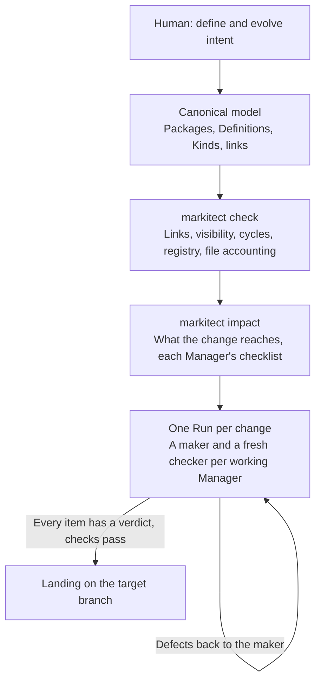

<h1>
  <picture>
    <source media="(prefers-color-scheme: dark)" srcset="docs/assets/markitect-wordmark-dark.svg">
    
  </picture>
</h1>

**Don't chase the code. Let the code chase you.**

**Model-first software engineering with a compiler-checked canonical model and AI teams derived from your architecture.**

[](https://github.com/Glacius-Labs/Markitect/actions/workflows/ci.yaml)
[](LICENSE)
[](docs/implementation-plan.md)

[The idea](#the-idea) · [How it works](#how-it-works) · [A concrete example](#a-concrete-example) · [Try it](#try-it-from-source) · [Current status](#current-status) · [Documentation](#documentation)

---

## The idea

AI can write code. Keeping **an entire project aligned with what it is supposed to be** is harder.

A decision about behavior or architecture rarely lives in one place. Its consequences appear in source code, tests, documentation, configuration, dependencies, and sometimes the instructions given to coding agents. As those representations evolve, an agent can complete its immediate task while missing a rule elsewhere, introducing a contradiction, or leaving previously correct behavior broken.

Markitect starts from a different premise:

> **Define the intended system once. Treat code, tests, configuration, documentation, and agent guidance as realizations of that intent.**

You maintain a **canonical project model**. Markitect checks the model's structure, accounts for every repository file, derives a team of responsible Managers from the modeled architecture, and has them bring the repository into alignment. Independent checkers and deterministic checks stand between their work and the target branch.

The goal is not to generate more documentation or orchestrate more agents. It is to make **long-lived consistency and trustworthy change** achievable without requiring a human to rediscover every obligation and inspect every routine diff.

**Markitect = Markdown + Architect.** The name reflects its origins in engineering documentation, Rules, Skills, Workflows, and agent instructions. The model is **typed documentation**: Markdown files with a small front matter that names each one's Kind, which the compiler reads directly.

## Beyond prompt files and linters

An `AGENTS.md` file can tell one agent how to behave. A linter can validate a known rule. **Neither alone establishes which project facts are authoritative, which artifacts realize them, who owns each area, or whether independently reviewed changes still conform after integration.**

Markitect connects those responsibilities: **the canonical model defines intent; deterministic software checks explicit structure; model-derived AI Managers perform and review semantic work.** These layers complement ordinary agent tools rather than replacing them. The promise of greater reliability remains a hypothesis to test, not an automatic consequence of adding structure.

## How it works

This is the design of [concept 2.0](docs/concepts/v2-concept.md). Steps 1 and 2 exist today; steps 3 and 4 are being built ([plan](docs/implementation-plan.md#concept-20-build)).



### 1. Describe the intended project

Every Definition is one Markdown file: a Kind in its front matter, a title and documentation with links such as `[[members/member]]`. A Package is a folder, and Packages nest. Kinds come from small Libraries or from the project itself. The model states what good documentation of the project would state: domain concepts, features, interfaces, rules, decisions and the architecture.

**The model is the architecture; the agent organization follows it.** Every Package is a Manager, and the Package tree is the Manager tree. You do not maintain an independent manager chart that can silently disagree with the system design.

### 2. Compile what can be checked deterministically

Before any agent starts, Markitect checks the model like code: every Kind and link resolves, internal Definitions are only linked from their own subtree, and Packages form no dependency cycle. It also checks the **realization record**: one registry page per Package names the path patterns it owns and lists every file with the Definitions it realizes.

Every repository file must be registered or explicitly ignored. One file may realize several Definitions; one Definition need not correspond to one file. `markitect lint` measures the model like code, and `markitect impact` shows what a change reaches and gives each Manager its checklist.

The compiler does **not** prove that natural-language requirements have been correctly implemented.

### 3. A maker and a checker for every working Manager

Impact decides who works, like an incremental build. Every working Manager is a maker, which gives each item on its checklist a verdict with evidence, and a fresh checker, which sees the model, the repository at the submission and its diff, but not the Shared Notes, and sends defects back. Parents review and integrate their children's approved work. Each Run has its own Git remote, and server-side hooks enforce that a Manager pushes only its own paths and that every submission compiles and passes the required checks.

A real defect in the model ends the Run without landing; agents never rewrite accepted intent.

### 4. Land, and keep the record

The result lands on the target branch like a colleague's push, and the host writes a Result page under `.markitect/results/`. Markitect never touches your working tree.

## A concrete example

Suppose a small library allows each member to borrow **five books**. Later, the limit changes to **three**.

A Rule in the model states the limit and its meaning:

```markdown
---
kind: std/Rule
---
# Loan limit

A [[members/member]] may have at most `5` open loans, overdue loans included.
A lower limit neither deletes existing loans nor forces their return; while at
or above the limit, the member cannot borrow another copy. Returning a copy is
always possible.
```

Changing `5` to `3` is a change of **accepted intent**, not a request to edit a particular source file. A conforming realization must reflect the new boundary in behavior, tests, and relevant documentation **without** deleting existing loans or breaking returns. Already-correct artifacts should remain correct, not be rewritten merely because an agent prefers a different style.

The [Library model](testdata/library/README.md) is this example in full; it is still in V1's form until step T2 converts it. The [measurement guide](docs/guides/measurement.md) describes how Markitect is compared with ordinary agentic coding. A reliable preservation result across successive changes is **not yet established**.

## The project model

A Markitect project keeps its model and its realization record under `.markitect/`:

```text
.markitect/
├── manifest.yaml     # the Libraries the project uses, with their versions
├── lock.yaml         # the digest of each Library
├── execution.yaml    # the required checks
├── model/            # Packages and Definitions; this folder is Root
├── registry.md       # Root's registry page
├── registry/         # one registry page per Package
└── ignore.md         # files that deliberately belong to no Package
```

The model is **not a mirror of the file tree**. You choose the level of conceptual detail; the registry says how real files implement those concepts. The [model language guide](docs/guides/model-language.md) gives the exact format.

<a id="run-the-current-source"></a>

## Try it from source

**Prerequisites:** Git and the Go version declared in [`go.mod`](go.mod) (currently Go **1.27.1**). There is no supported binary release yet.

```bash
git clone https://github.com/Glacius-Labs/Markitect.git
cd Markitect

go run ./cmd/markitect help
go run ./cmd/markitect init   --repo /path/to/your-project
go run ./cmd/markitect check  --repo /path/to/your-project
go run ./cmd/markitect lint   --repo /path/to/your-project
go run ./cmd/markitect impact --repo /path/to/your-project --base HEAD~1
```

These commands **do not launch agents**. `init` sets up `.markitect/` and installs the modeling and Extract skills for coding agents; it never changes an existing model file. The [project workflow](docs/guides/project-workflow.md) walks through them. Markitect's own repository is developed as an ordinary software project and keeps no such model.

## Current status

**Active development: source available, not a supported release.** Main is being rebuilt to concept 2.0 with no compatibility to V1 ([plan](docs/implementation-plan.md#concept-20-build)).

| Capability | Current evidence and limits |
| --- | --- |
| Model language, compiler, registry and file accounting | Built in step T1, with source tests and the architecture gate. |
| `init`, `check`, `lock`, `refs`, `graph`, `impact`, `lint` | Implemented in the current CLI. |
| Runs with makers and checkers; `apply` and `verify` | Being built (T3, T4). V1's Apply was removed with T1; its native evidence is in the [qualification record](docs/validation/v1-qualification-20261024.md) and applies only to the V1 source it names. |
| Native host on Windows, Linux and macOS | Built in T5, with the target branch's lock and the cleanup of Run branches. The Library smoke landed and verified natively on Windows ([record](docs/validation/t5-native-host-20261029.md)); Linux and macOS are not yet observed. |
| Provider support | None on Main until T4, which brings Claude Code and Codex with account login. |
| Reliability across changes | **Not yet established.** Steps T6 and T7 measure it against one strong agent with ordinary documentation. |

The compiler can reject malformed structure and missing declared relationships. **It cannot know whether the model omitted a real user need, whether an AI correctly understood prose, or whether green agent-written tests actually test the right thing.** Independent review, integration, project checks, and outside evaluation are intended to improve trust, not to turn agent work into a formal proof.

Read the [delivery plan](docs/implementation-plan.md) for up-to-date status and [Measurement](docs/guides/measurement.md) for how the method is compared with ordinary agentic coding. Fewer tokens, more agents, or one successful demonstration are not acceptance criteria by themselves.

## Direction

Markitect first makes a project conform to its accepted model, change by change. After acceptance come further commands over the same mechanism, such as `improve`, `bughunt`, `security` and `cleanup`, and continuous change, in which issues and incidents become Findings or model proposals and autonomy grows in steps the owner decides. Those are **directions, not current CLI capabilities**.

The measure of success is whether projects remain consistent through real changes with **less routine human supervision**, while people retain responsibility for architecture, requirements, material exceptions, and acceptance.

## Documentation

- [Product vision](docs/vision.md): the thesis, responsibilities, and limitations
- [Origin and rationale](docs/vision.md#origin-and-rationale): why the idea emerged
- [Concept 2.0](docs/concepts/v2-concept.md): the target design
- [Model language](docs/guides/model-language.md): the model format and the model commands
- [Project workflow](docs/guides/project-workflow.md): using Markitect on a project
- [Architecture](docs/architecture.md): packages, layers and the product flow
- [Measurement](docs/guides/measurement.md): evaluation against conventional agentic work
- [Documentation map](docs/README.md): all maintained references

## Contributing

See [CONTRIBUTING.md](CONTRIBUTING.md) for source checks, import boundaries, and independent review. Use [GitHub Issues](https://github.com/Glacius-Labs/Markitect/issues) for concrete defects or proposals. The project currently prioritizes fidelity to modeled intent, a small coherent architecture, and honest evidence over feature breadth.

## Distribution

The earlier Project/Domain downloads were retired. There is currently no supported binary release of the model-first product. The release evidence remains on Main and the former tags are mapped to commits in the [retired release mapping](docs/validation/retired-releases-20261017.json); see the [retirement record](docs/validation/distribution-retirement-20261017.md).

### Installation

Build from the current reviewed source using the Go version in `go.mod`. Published binary installation instructions will be added only after source-bound release qualification.

### Examples and evaluation

Start with the [project workflow](docs/guides/project-workflow.md). The [Library model](testdata/library/README.md) and its [independent oracle](tools/library-oracle/README.md) are the evaluation's small project; the model is converted to the 2.0 form in step T2.

## License

Apache-2.0. See [LICENSE](LICENSE) and [third-party notices](internal/buildinfo/notices.md).
