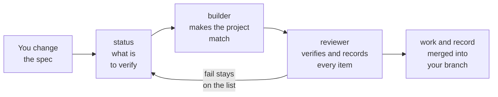

<h1 align="center">
  <picture>
    <source media="(prefers-color-scheme: dark)" srcset="docs/assets/markitect-lockup.svg">
    
  </picture>
</h1>

<p align="center">
  A programming language for documentation. Markitect keeps one typed spec of your project<br>
  in Markdown, checks it like code, and has an agent build every change while a fresh agent verifies it.
</p>

<p align="center">
  <a href="https://github.com/Glacius-Labs/Markitect/actions/workflows/ci.yaml"></a>
  <a href="go.mod"></a>
  <a href="LICENSE"></a>
  <a href="#status"></a>
</p>

<p align="center">
  <a href="#why-markitect">Why</a> ·
  <a href="#quick-start">Quick start</a> ·
  <a href="#how-it-works">How it works</a> ·
  <a href="#skills-and-roles">Skills and roles</a> ·
  <a href="#commands">Commands</a> ·
  <a href="#status">Status</a> ·
  <a href="#documentation">Documentation</a>
</p>

> [!IMPORTANT]
> Main carries the build of [concept 4.0](docs/concepts/v4-concept.md), Markitect's target. Markitect is in active development; the latest release is 0.22.0. Every command on this page exists in it.

## Why Markitect

When AI agents build most of a project, its design, rules, documentation, code, tests and configuration drift apart. A decision about behavior has to reach the code, the tests, the documentation and the agents' own instructions. An agent finishes its task and misses a rule two folders away. Consistency passes take hours and find more each time.

Markitect moves the knowledge of what belongs together out of the agents' memory and into one place you own: the spec. You describe the project once, as typed prose in Markdown: Definitions of a Kind, in Packages, with links that work like imports. Code, tests, configuration and documentation are built from it. When you want something different, you change the spec; Markitect says which Definitions the change puts back on the list to verify, an agent brings the project in line, and a fresh agent verifies each one and records its verdict, until nothing is left.

Code has always been a precise description for a limited executor. An AI executor is intelligent, but it still has to be told what is meant and what holds, or it guesses. So documentation becomes the programming language, and we expect coding to move from Go, C# or Python towards documentation and meaning. What matters in code stays: architecture, consistency, cleanliness, an overview without reading the code, and knowing what should be against what is. Markitect builds on proven practice for that:

- **Requirements traceability.** Tools such as IBM DOORS and Polarion link requirements to what realizes them in both directions and flag a "suspect" link when either end changes; DO-178C, ISO 26262 and IEC 62304 require such traceability. Markitect's registry is that matrix, `markitect status` lists the suspect items, and `markitect mark` records a verdict on each; an `ok` with evidence clears it.
- **Architecture metrics.** The spec is judged like code: the Dependency Rule, bounded contexts, cohesion, coupling and stability ([what makes a good spec](docs/guides/good-spec.md)).
- **Go's conventions.** `vet`, `list`, `doc` and `tidy` work like their Go namesakes, and the record of what was verified works like Go's test cache.

What is new: the traceability is plain text in your repository, typed and checked deterministically; agents do the realization and gather the evidence, which makes a traceability matrix affordable where keeping it by hand was not; and only what a change reaches is verified again.

It is a way of agentic coding, not a platform. It works with Claude Code's own skills, subagents, hooks, worktrees and plugins: the agents are ordinary Claude Code agents started by your own session, and the tool keeps a few clear guarantees around them. The [vision](docs/vision.md#markitect-in-brief) says more.

## Quick start

Install the Claude Code plugin:

```bash
claude plugin marketplace add Glacius-Labs/Claude-Plugins
claude plugin install markitect@glacius-labs
```

Then open Claude Code in your project's folder. The build runs in a Git worktree, so a new folder needs `git init` first; Markitect itself uses no Git.

1. **Set it up.** Ask Claude to set up Markitect. It runs `markitect init --name "Your project"`, which writes `.markitect/`, the skills, the four agents and the hook that holds their rights. It commits nothing.
2. **Design the spec.** Run `/markitect-design`; if the session does not offer it yet, because the skills folder is new, run `/reload-skills` or start a new session. It asks what the project is and writes the spec with you, or drafts a first spec from the code that is there. Read the Markdown diff and commit it.
3. **Build it.** Run `/markitect-build`. Your session starts a builder in a worktree of its own, and a fresh reviewer verifies each Definition. When nothing is left to verify, the work and its record come back to your branch. In a folder without Git the builder works in your folder instead.

[Install and set up](#install-and-set-up) has the other ways to install, upgrades and an existing code base.

## How it works



1. **You change the spec,** by hand or with your coding agent through `/markitect-design`, which asks first when something is open. You read the Markdown diff and commit it.
2. **You run `/markitect-build` in Claude Code.** Your session starts a builder agent in a worktree of its own, so you can go on designing.
3. **`markitect status` makes the list.** It lists the Definitions the change reaches: those it edits, those that link to them, and those whose files changed, each with where to look. A spec that does not compile gives no list.
4. **A builder agent does the work.** It changes the code, tests and documentation for what the list holds and keeps the registry current. A hook keeps it out of the spec and the record.
5. **A fresh reviewer verifies it.** The builder starts the reviewer, which reads the spec, the list and the code, and treats what the builder tells it as claims to check. It records each item with `ok` and its evidence, `fail` with why, `skip` with why, or `spec-problem` with the question for you. The builder repairs what failed and has it verified again, and stops when the list has not got shorter for three rounds.
6. **Nothing left.** When `status` lists nothing, your session commits the work with the record and merges it into your branch. Nothing is pushed.

Markitect itself starts no agent, steers no work and uses no Git. It computes and checks; the skills and your session do the rest.

### Features

- **Typed documentation.** One Markdown file per Definition, its Kind in the front matter, links by path such as `[[members/member]]`. Projects define their own Kinds; the standard Libraries `std`, `rest` and `cli` ship in the binary.
- **A compiler for intent.** `markitect check` resolves every Kind and link, keeps internal Definitions inside their subtree and refuses dependency cycles between Packages, as Go does.
- **Every file accounted for.** One registry page per Package names the paths it owns and lists each file with the Definitions it builds. A file that is neither registered nor ignored is an error.
- **A cache of what was verified.** Like `go test`, which runs a test again only when something it depends on changed, Markitect records for each Definition the state at which a reviewer verified it: its text, its Kind and links, its files and the evidence. `markitect status` lists every Definition whose state changed.
- **Design measured like code.** `markitect vet` warns about coupling, size, how far a change reaches and dependencies on less stable Packages.
- **Verdicts bound to what was read.** A verdict names the item as `status` printed it, such as `members/limit@3f9a1c`, and `mark` refuses it when anything changed since. Only the reviewer records.
- **The record, committed.** `.markitect/review.sum` holds one line per Definition, and your session commits it with the work. A CI job can run `markitect status` and fail on any item.
- **In parallel when the work is large.** On a long list Claude has a shipped workflow run one builder and its reviewer per Package, in waves along the spec's dependencies, and merges their work. You choose per skill: `auto`, `sequential`, `parallel` or a workflow of your own.

## Skills and roles

Skills are named after the activity, agents after the role ([DEC-100](docs/concepts/register.md#dec-100-skills-are-named-after-the-activity-agents-after-the-role)).

| Skill | Who starts it | Does |
| --- | --- | --- |
| `/markitect-design` | You, or Claude | Designs the spec with you: starts a new project, drafts a first spec from existing code, or changes the spec. For a large code base it can have the architect draft |
| `/markitect-build` | You | A builder in a worktree of its own makes the project match what `status` lists, and a reviewer verifies each item, until the list is empty; on a long list one builder and reviewer per Package, in parallel. Then the work comes back to your branch |
| `/markitect-review` | You, or Claude | A reviewer verifies what `status` lists, or every Definition with `--all`, one reviewer per Package on a long list, and changes no code |
| `/markitect-cleanup` | You | The builder refactors without changing behaviour, and the reviewer verifies again what that puts on the list |
| `/markitect-bughunt` | You | The reviewer hunts for bugs beyond the list and records them, the builder repairs them, and the reviewer verifies again |
| `/markitect-audit` | You, or Claude | The auditor reads the spec fresh for contradictions, gaps, unclear and duplicated statements, and reports to you |
| `/markitect-schedule` | You | Sets up cleanup, bug hunts and a full review as routines through Claude Code's own scheduling. Each routine works on a branch of its own and lands only when it leaves nothing worse |
| `/markitect-config` | You, or Claude | Changes the agents' model and effort and each skill's strategy, for this project or for all of yours, with `markitect config` ([DEC-103](docs/concepts/register.md#dec-103-claude-chooses-the-parallelism-per-run-through-a-shipped-workflow)) |

Four agents, in a 2×2 of rights that a hook holds for subagents. Your own session stays free to change anything, but it does not record verdicts either:

| | Writes | Judges |
| --- | --- | --- |
| **The code** | `markitect-builder`: code and the registry pages, not the spec; may start only the reviewer | `markitect-reviewer`: changes nothing, and is the only one that records verdicts with `markitect mark` |
| **The spec** | `markitect-architect`: drafts the spec when your session delegates it, and writes no code | `markitect-auditor`: reads only, and reports to you |

The agents use Claude Sonnet with effort `high` unless `harness.yaml` says otherwise: the project's `.markitect/harness.yaml`, committed, beats your own `~/.markitect/harness.yaml`. They work under your session's permission mode.

## Commands

None of these starts an agent or uses Git. With `--json`, `check`, `vet`, `list`, `doc`, `status`, `mark` and `config --list` print one JSON document for scripts. Exit codes follow Go's tools: 0 when all is well, 1 when the command found something, 2 when it could not run.

| Command | Does |
| --- | --- |
| `markitect init` | Sets up a project: `.markitect/`, `AGENTS.md`, `CLAUDE.md`, the skills, the four agents and the hook. Run again, it refreshes the harness and never touches a spec page |
| `markitect check` | Compiles the spec and the registry: Kinds, links, Packages, Libraries against the lock, and every file listed or ignored |
| `markitect vet` | Measures the spec's design: coupling, size, reach and unstable dependencies. It warns, and exits 1 only with `--strict` |
| `markitect list` | The Packages and their Definitions; with `--deps`, what each Package depends on |
| `markitect doc TARGET` | A Definition with its text, its links both ways, the files that realize it and its record; or a Package |
| `markitect status` | What is to verify, each item as `DEFINITION@FINGERPRINT`, with what changed and where to look |
| `markitect mark` | Records a verdict at the state the reviewer read: `ok`, `fail`, `skip` or `spec-problem`, with evidence. Only the reviewer agent runs it |
| `markitect tidy` | Brings the lock in line with the manifest, as `go mod tidy` does |
| `markitect config` | Reads or sets the harness configuration: the agents' model and effort per role, the strategy per skill and custom workflows, in the project's `.markitect/harness.yaml` or with `--user` in yours; `--list` shows each value and where it comes from |
| `markitect update` | Installs the newest release over the binary, then brings the personal skill, the project's harness and its lock in line. It commits nothing and changes no spec file |
| `markitect install` | Writes the personal skill once per machine, so that a Claude Code session in any folder knows what Markitect is |
| `markitect version` | The build, and whether the personal skill and the current project match it |

`markitect licenses` prints the third-party notices. The [model language guide](docs/guides/model-language.md#commands) has every flag and diagnostic.

## Install and set up

### Install

Markitect needs Claude Code; the tool itself uses no Git, and your session commits with whatever you use. Pick one way to get the `markitect` command.

**With the Claude Code plugin,** as in the [quick start](#quick-start). The plugin puts `markitect` on the `PATH` of Claude Code's shell and tells every session what Markitect is. It downloads the binary of its own version the first time, checking it against the release's checksums, and a plugin update brings the matching binary: `claude plugin update markitect@glacius-labs`. That `markitect` exists inside Claude Code only. For your own terminal, use one of the next two. The marketplace is the small repository [Claude-Plugins](https://github.com/Glacius-Labs/Claude-Plugins); it names the release that users get, so the plugin changes for you only when a release is published there.

**With a binary.** Download the file for your system from the [releases](https://github.com/Glacius-Labs/Markitect/releases), check it against the checksums file, name it `markitect` and put it on your `PATH`. Then run `markitect install` once: it writes a personal skill, so that a Claude Code session in any folder knows what Markitect is and how to begin. (The plugin brings that skill itself.)

**From source.** With Go 1.27.1 or newer: `go install github.com/Glacius-Labs/Markitect/cmd/markitect@main`, then `markitect install`.

The skills and agents call `markitect` by name, so the folder of the binary must be on your `PATH`; `version`, `init`, `install` and `update` warn when it is not.

To upgrade, run `markitect update`. It installs the newest release over the binary, then lets the new binary bring what Markitect wrote earlier in line: the personal skill and, in a project, the skills, agents, hooks and lock that `init` wrote, and the record of a project from 0.20.0, written from its newest certificate. It commits nothing; read the change of the lock before you commit it. `markitect update --check` only reports. A binary the plugin brought is updated with the plugin instead, and a build from source is replaced only with `markitect update --force`.

### Set up a project

```bash
cd your-project
markitect init --name "Your project"
markitect check
```

`init` creates `.markitect/` with the manifest, the lock, a project anchor and Root's registry page, writes `AGENTS.md` and `CLAUDE.md`, and installs the skills, the four agents, the parallel workflow and the hooks in `.claude/settings.json`. It works in an empty folder too. In a new project, `check` says that nothing is built yet; open Claude Code and run `/markitect-design`.

In a repository that already has files, the first `check` fails by design, because every file must belong somewhere:

```text
README.md: file.unregistered: neither registered nor ignored: list it on .markitect/registry.md, the page of its owner Root, or add it to the ignore file
1 error: 0 in the spec, for the owner to settle; 1 in the realization, so spec and code do not match yet, which /markitect-build settles
```

`/markitect-design` drafts a first spec from the code with you and registers the files with the Definitions they build; you accept it like any other change. From then on, `/markitect-review --all` verifies every Definition and records where the code deviates, and `/markitect-build` repairs it. To look around:

```bash
markitect vet                    # coupling, size, how far a change reaches
markitect list --deps            # the Packages, their Definitions and what each depends on
markitect doc members/member     # one Definition: text, links both ways, files, record
markitect status                 # what is to verify, and what changed
```

The [project workflow](docs/guides/project-workflow.md) covers every option, limit and exit code.

## Example: one rule changes

A small library allows each member five open loans. The limit lives in one Rule of the spec (excerpt from the [Library example](https://github.com/Glacius-Labs/Markitect/blob/b8fd2c94722af066ba4ff6337aeba0459cb804ec/tools/evaluation-tasks/library/m1/model/lending/loan-policy.md)):

```markdown
---
kind: std/Rule
---
# Loan policy

…

| Value | Setting | Meaning |
| --- | --- | --- |
| Loan limit | `5` | The maximum resulting count of currently open loans per member when admitting a new loan. … |
| Loan period | `14` days | The number of calendar days added to the borrowing date to determine a new loan's due date. … |

For [[lending/borrow]], the resulting current open-loan count of the member must not exceed the loan limit.
Count every open [[lending/loan]], including overdue loans, and exclude closed loans. …
```

You change `5` to `3`. `markitect status` lists the Rule itself and every Definition that links to it, such as borrowing, returning and the overdue reminders, each with the files that build them. The `catalog` and `members` Packages are not reached. `/markitect-build` has the builder work on that list; a conforming result refuses a fourth open loan, updates the tests and the documentation, keeps every existing loan and every return working, and leaves the files that already conform untouched. The reviewer then checks each item against the spec.

## Concepts

| Term | Meaning |
| --- | --- |
| **Spec** | The Markdown files under `.markitect/model/`: the project's documentation and its authority. Where code and spec differ, the spec is right. |
| **Definition** | One Markdown file of the spec, with its Kind in the front matter. Its path is its ID, its heading its title, its body the documentation. |
| **Kind** | The type of a Definition, itself a Definition of Kind `Kind`. A project writes its own Kinds, one small file each. |
| **Library** | A set of Kinds for one area: `std` (Project, Rule, Concept, Feature, Decision), `rest` (Endpoint) and `cli` (Command). |
| **Package** | A folder of the spec. Packages nest, and everything a Package defines reaches its whole subtree. The spec's root folder is the Root Package. |
| **Link** | `[[path]]` to another Definition, a Kind or a Package. A link is a declared dependency, as an import is in code; `check` resolves it. |
| **Registry** | One page per Package: the path patterns it owns and every file with the Definitions it builds. |
| **Record** | `.markitect/review.sum`: for each Definition, the verdict, its evidence and the hash of every input at which it was verified. `markitect status` compares it with the folder. |
| **Verdict** | What the reviewer records: `ok`, `fail`, `skip` or `spec-problem`, with evidence or why. |

A project keeps all of it under `.markitect/`:

```text
.markitect/
├── manifest.yaml     # the Libraries the project uses, with their versions
├── lock.yaml         # the digest of each Library
├── model/            # Packages and Definitions; this folder is Root
├── registry.md       # Root's registry page
├── registry/         # one registry page per Package
├── ignore            # files that deliberately belong to no Package, if any
├── libraries/        # Libraries that do not ship with markitect
├── review.sum        # the record of what was verified
└── .gitattributes    # merges the record by keeping both sides
```

The [model language guide](docs/guides/model-language.md) gives the exact format and every diagnostic.

## Status

Main carries [concept 4.0](docs/concepts/v4-concept.md), the target the owner accepted on 7 November 2026. The [delivery plan](docs/implementation-plan.md) holds the current step.

| Area | State |
| --- | --- |
| The spec language and the commands `init`, `check`, `tidy`, `vet`, `list` and `doc` | Available since 0.22.0 (0.21.0 had `lock`, `lint`, `graph` and `refs`) |
| Work with `/markitect-build` and `/markitect-review`, over `status`, `mark` and the record | Available on Claude Code since 0.21.0, covered by tests. The flow before it, with `gate`, was tried on three changes of one project ([trials](docs/validation/lean-trials-20261107.md)) |
| The skills `/markitect-design`, `/markitect-cleanup`, `/markitect-bughunt`, `/markitect-audit` and `/markitect-schedule`, the four roles and the build in a worktree of its own | Available on Claude Code since 0.22.0, covered by tests only ([DEC-100](docs/concepts/register.md#dec-100-skills-are-named-after-the-activity-agents-after-the-role)) |
| The strategies, the parallel workflow, `harness.yaml`, `markitect config` and `/markitect-config` | On Main for 0.23.0, covered by tests, the workflow by a test against stub agents; no real run yet ([DEC-103](docs/concepts/register.md#dec-103-claude-chooses-the-parallelism-per-run-through-a-shipped-workflow)) |
| A real run of 0.22.0's skills with planted defects | Next: step 3 of the [tooling plan](docs/concepts/tooling-plan.md#order-of-work), under a bounded dispatch the owner approves |
| Further `vet` measures, such as unlinked mentions and hubs | Proposed in the [`vet` plan](docs/concepts/vet-plan.md); not decided |
| Codex | Not yet: it needs subagents with their own agent files and a hook that names the agent |
| Release | On GitHub, with the Claude Code plugin ([install](#install)) |

## FAQ

<details>
<summary><b>Does the compiler prove that the code is correct?</b></summary>

It checks structure: Kinds, links, visibility, cycles and file accounting. Agents judge meaning. Every Definition a change reaches needs a verdict from a reviewer with fresh context, with the evidence it read. The bar is today's practice, one strong agent with ordinary documentation.

</details>

<details>
<summary><b>Isn't this requirements traceability?</b></summary>

It is built on it. The registry is the traceability matrix, `markitect doc` shows links both ways, and `markitect status` lists the suspect items after a change. What differs is that it lives as plain, typed text beside the code, is checked deterministically, and has agents do the realization and the evidence. It is complete for the declared links only: prose that names a Definition without linking it is a gap, which the [`vet` plan](docs/concepts/vet-plan.md) proposes to flag.

</details>

<details>
<summary><b>How much do I have to write?</b></summary>

As much as good documentation of the project would state: domain concepts, features, interfaces such as REST endpoints and CLI commands, rules, decisions and the architecture. Loops, data structures and algorithms stay with the agents. One file may build several Definitions, and every file is registered or explicitly ignored. [What makes a good spec](docs/guides/good-spec.md) says how to cut it.

</details>

<details>
<summary><b>Can agents change my spec?</b></summary>

The agents that build don't: a hook refuses their edits under `.markitect/`, except the registry pages the builder keeps. Agents propose spec changes in conversation through `/markitect-design`, and you accept each one; the architect agent, which only your session starts, drafts a spec you then review. A real problem in the spec is recorded as `spec-problem`, with the question for you, and stays on the list until you settle it.

</details>

<details>
<summary><b>Does Markitect run Git, containers or background sessions?</b></summary>

The tool uses no Git, no container and no network except for `markitect update`. Your own Claude Code session starts the agents and makes every commit and merge. The exception is the routines you set up with `/markitect-schedule`: they run as scheduled tasks of the desktop app or as cloud routines, work on a branch of their own, and land on the source branch by a push when that branch tracks a remote; a cloud routine that cannot land pushes its own branch so the work is not lost. Nothing else is pushed.

</details>

<details>
<summary><b>Where does the name come from?</b></summary>

Markitect = Markdown + Architect. The idea grew out of a project documented in Markdown rules, skills and agent instructions that drifted away from its code. Markitect governs the whole project, and agent instructions are one of its realizations.

</details>

## Documentation

| Guide | Covers |
| --- | --- |
| [Project workflow](docs/guides/project-workflow.md) | Using Markitect on a project, command by command, with troubleshooting |
| [Model language](docs/guides/model-language.md) | Definitions, Kinds, Libraries, links, the registry and every diagnostic |
| [What makes a good spec](docs/guides/good-spec.md) | Placement, coupling, stability and size: designing a spec like code |
| [Concept 4.0](docs/concepts/v4-concept.md) | The target, which Main builds: work in your own session, and why |
| [Vision](docs/vision.md) | What Markitect is, what it builds on, what it promises and what it leaves to people |
| [Architecture](docs/architecture.md) | Packages, layers and the product flow |
| [Delivery plan](docs/implementation-plan.md) | What is built and what comes next |
| [Documentation map](docs/README.md) | Everything else |

## Contributing

Markitect is developed as an ordinary Go project, with tests and documentation. [CONTRIBUTING.md](CONTRIBUTING.md) has the checks, the import boundaries and the review rules. Report defects and propose changes in [GitHub Issues](https://github.com/Glacius-Labs/Markitect/issues); [SUPPORT.md](SUPPORT.md) says where questions go. Report vulnerabilities privately, as [SECURITY.md](SECURITY.md) describes.

## License

Apache-2.0. See [LICENSE](LICENSE) and the [third-party notices](internal/buildinfo/notices.md).
