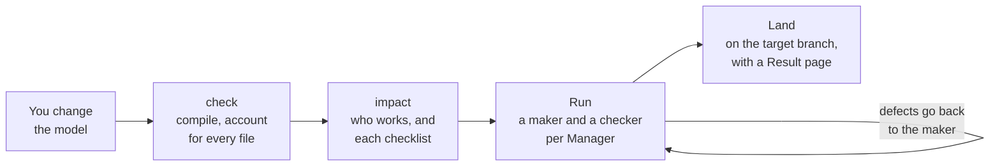

<h1 align="center">
  <picture>
    <source media="(prefers-color-scheme: dark)" srcset="docs/assets/markitect-lockup.svg">
    
  </picture>
</h1>

<p align="center">
  Markitect keeps one canonical model of your project in Markdown, checks it like code,<br>
  and has a team of AI agents derived from its architecture realize and check every change.
</p>

<p align="center">
  <a href="https://github.com/Glacius-Labs/Markitect/actions/workflows/ci.yaml"></a>
  <a href="go.mod"></a>
  <a href="LICENSE"></a>
  <a href="#status"></a>
</p>

<p align="center">
  <a href="#why-markitect">Why</a> ·
  <a href="#how-it-works">How it works</a> ·
  <a href="#quick-start">Quick start</a> ·
  <a href="#example-one-rule-changes">Example</a> ·
  <a href="#status">Status</a> ·
  <a href="#documentation">Documentation</a>
</p>

> [!IMPORTANT]
> Markitect is in active development and runs from source; there is no release yet. Every command on this page exists on `main`. Whether its Runs keep a project at least as consistent as one strong agent with ordinary documentation, with fewer defects left for people to repair, is being measured now ([status](#status)).

## Why Markitect

When AI agents build most of a project, its design, rules, documentation, code, tests and configuration drift apart. A decision about behavior rarely lives in one file: its consequences reach the code, the tests, the documentation and the agents' own instructions. An agent finishes its task and misses a rule two folders away. Consistency passes take hours and find more each time, and a pull request that one AI wrote, another reviewed and a person approved almost blind carries the gap to `main`.

Markitect moves the knowledge of what belongs together out of the agents' memory and into one place you own: the canonical model. You describe the project once, as typed documentation in Markdown. Code, tests, configuration and documentation are its realizations. When intent changes, you change the model; Markitect works out what the change reaches, has the responsible agents bring the repository in line, checks every step independently and lands the result with a record of every verdict.

## Features

- **Typed documentation.** One Markdown file per Definition, its Kind in the front matter, links by path such as `[[members/member]]`. Projects define their own Kinds; the standard Libraries `std`, `rest` and `cli` ship in the binary.
- **A compiler for intent.** `markitect check` resolves every Kind and link, keeps internal Definitions inside their subtree and refuses dependency cycles between Packages, as Go does. If the model does not compile, no agent starts.
- **Every file accounted for.** One registry page per Package names the paths it owns and lists each file with the Definitions it realizes. A file that is neither registered nor ignored is a compile error.
- **Impact like an incremental build.** `markitect impact` shows which Definitions, files and Packages a change reaches and gives each responsible Manager its checklist. `markitect lint` measures the model like code: coupling, size, unused Definitions.
- **An organization derived from the architecture.** Every Package is a Manager, and the Package tree is the Manager tree. There is no separate agent chart to keep in sync.
- **A maker and a checker for every Manager.** The maker gives each checklist item a verdict with evidence. A fresh checker re-checks every verdict without the maker's notes and sends defects straight back.
- **Guarantees in Git.** Each Run has its own Git remote. Server-side hooks refuse a push outside a Manager's paths, a submission that does not compile, a merged state that fails the required checks and a checklist with an item left open.
- **Lands like a merge queue.** Root's approved result lands on your target branch like a colleague's push, with a Result page under `.markitect/results/`. Markitect never touches your working tree.
- **Native, with your own account.** The host runs on Windows, Linux and macOS with Docker. Every maker and checker runs Claude Code or Codex in its own container and logs in with your normal account; API keys are refused.

## How it works



1. **You change the model,** by hand or with your coding agent through the modeling skill, which asks first when something is open. You read the Markdown diff and commit it.
2. **Markitect compiles it.** An unresolved link, a dependency cycle or an unregistered file is a compile error, and no agent starts.
3. **Impact decides who works.** The change reaches the Definitions it edits, the Definitions that link to them, the files that realize them and their Packages up to Root. Packages the change does not reach do not start.
4. **One Run realizes the change.** Each working Manager's maker works in its own container and Git branch; its checker approves the submission or sends it back. A parent with work of its own submits first, its children start from that approved commit, and the parent integrates their approved work. A real defect in the model ends the Run at Root, and the Result names the decision for you.
5. **The result lands.** When Root's checker approves, the host lands the work on the target branch. If the branch moved during the Run, the work lands only if the merge is clean, the required checks pass on the merged state and the incoming commits touch nothing in the Run's impact. Either way the host writes a Result page with every verdict, its evidence and its checker.

`markitect verify` runs the same way with checkers only and changes nothing. Its Findings feed the next `markitect apply --findings`.

## Quick start

### Install

Markitect needs Git and Go 1.27.1 or newer.

```bash
go install github.com/Glacius-Labs/Markitect/cmd/markitect@main
```

### Set up a project

```bash
cd your-project
markitect init --name "Your project"
markitect check
```

`init` creates `.markitect/` with the manifest, the lock, the required checks, a project anchor and Root's registry page, and installs the modeling and Extract skills for Claude Code and Codex. It never changes an existing model file, so it is safe to run again after an upgrade.

In a repository that already has files, the first `check` fails by design, because every file must belong somewhere:

```text
README.md: file.unregistered: neither registered nor ignored: list it on .markitect/registry.md, the page of its owner Root, or add it to the ignore page
1 errors
```

List the file on Root's registry page, `.markitect/registry.md`, with the Definitions it realizes:

```markdown
| File | Realizes | Why |
|---|---|---|
| `README.md` | [[project]] | What the project is for |
```

```text
$ markitect check
ok: 1 Definitions in 1 Packages, 1 files accounted
```

### Write the model

Ask your coding agent to use the `markitect-modeling` skill and describe the project with you. For an existing code base, the `markitect-extract` skill drafts a first model from the code. Then look around:

```bash
markitect lint                   # coupling, size, unused Definitions
markitect graph                  # the Package dependency graph as a Mermaid diagram
markitect impact --base HEAD~1   # what the change since HEAD~1 reaches, and each checklist
```

None of these commands starts an agent.

### Let the agents realize it

`apply` and `verify` need Docker 28 or newer, a Manager image with your project's toolchain, and a Claude Code or Codex login on this machine. Build the image once from a Markitect checkout; the Go example adds the Go toolchain:

```bash
docker build -f packaging/runtime/Dockerfile -t markitect-runtime .
docker build -f packaging/runtime/examples/go/Dockerfile -t markitect-runtime-go .
export MARKITECT_MANAGER_IMAGE=markitect-runtime-go
```

A Run starts from the pushed target branch and lands by pushing to it:

```bash
git push
markitect apply --full     # the first Run realizes the whole model
git pull                   # the result arrives like a colleague's push
markitect verify --full    # checkers only: does everything still conform?
```

Later Runs need no flag: `markitect apply` takes the last landing as its base and realizes only what changed since. Set `MARKITECT_PROVIDER=codex` to run Codex instead of Claude Code. The [project workflow](docs/guides/project-workflow.md) covers every option, limit and exit code.

## Example: one rule changes

A small library allows each member five open loans. The limit lives in one Rule of the model (abridged from the [Library example](tools/evaluation-tasks/library/m1/model/lending/loan-policy.md)):

```markdown
---
kind: std/Rule
---
# Loan policy

| Value | Setting | Meaning |
| --- | --- | --- |
| Loan limit | `5` | The maximum count of open loans per member when admitting a new loan. |
| Loan period | `14` days | The number of calendar days added to the borrowing date. |

For [[lending/borrow]], the resulting open-loan count of the member must not exceed
the loan limit. Count every open [[lending/loan]], including overdue loans.
[[lending/return]] remains possible regardless of the current limit: a lower limit
neither deletes existing loans nor forces their return.
```

You change `5` to `3` and commit. `markitect impact` shows who works:

```text
# Impact since 0f6ccd95e503

## Changed Definitions

- [[lending/loan-policy]] modified

## Checklists

### Root

No items of its own; it reviews and integrates its children.

### lending

Own:

- [[lending/borrow]]: links [[lending/loan-policy]], which changed
- [[lending/inspect-loans]]: links [[lending/loan-policy]], which changed
- [[lending/loan]]: links [[lending/loan-policy]], which changed
- [[lending/loan-policy]]: modified
- [[lending/return]]: links [[lending/loan-policy]], which changed

### lending/reminders

Own:

- [[lending/reminders/assess-overdue]]: links [[lending/loan-policy]], which changed

Inherited:

- [[lending/loan-policy]]: modified
```

With code in place, impact also lists the files that realize these Definitions and their owners. The `catalog` and `members` Packages do not start. `markitect apply` gives `lending` and `lending/reminders` a maker and a checker each, and Root reviews and integrates their work. A conforming result refuses a fourth open loan, updates the tests and the documentation, keeps every existing loan and every return working, and leaves the files that already conform untouched.

The Library is the smallest project of the evaluation, with a [series of five changes](tools/evaluation-tasks/README.md).

## Concepts

| Term | Meaning |
| --- | --- |
| **Definition** | One Markdown file of the model, with its Kind in the front matter. Its path is its ID, its heading its title, its body the documentation. |
| **Kind** | The type of a Definition, itself a Definition of Kind `Kind`. A project writes its own Kinds, one small file each. |
| **Library** | A set of Kinds for one area: `std` (Project, Rule, Concept, Feature, Decision), `rest` (Endpoint) and `cli` (Command). |
| **Package** | A folder of the model. Packages nest, and everything a Package defines reaches its whole subtree. The model's root folder is the Root Package. |
| **Manager** | The agents responsible for one Package: in each Run, a maker and a fresh checker. |
| **Registry** | One page per Package: the path patterns it owns and every file with the Definitions it realizes. |
| **Run** | One change, realized by the Managers its impact reaches, on its own Git remote with server-side hooks. |
| **Result** | The page the host writes for every Run: the outcome, every verdict with its evidence and checker, and the decisions left to you. |

A project keeps all of it under `.markitect/`:

```text
.markitect/
├── manifest.yaml     # the Libraries the project uses, with their versions
├── lock.yaml         # the digest of each Library
├── execution.yaml    # the required checks
├── model/            # Packages and Definitions; this folder is Root
├── registry.md       # Root's registry page
├── registry/         # one registry page per Package
├── ignore.md         # files that deliberately belong to no Package
└── results/          # one Result page per Run
```

The [model language guide](docs/guides/model-language.md) gives the exact format and every diagnostic.

## Status

Markitect is being rebuilt to [concept 2.0](docs/concepts/v2-concept.md), its accepted target design, without compatibility to its first version. The [delivery plan](docs/implementation-plan.md#concept-20-build) holds the current step.

| Area | State |
| --- | --- |
| Model language and the commands `init`, `check`, `lock`, `refs`, `graph`, `impact` and `lint` | Available |
| Runs with `apply` and `verify` | Available. The Library example lands and verifies natively on Windows and on Linux with Claude Code ([record](docs/validation/t5-native-host-20261029.md)); macOS is not yet observed |
| Codex | Wired in; its first native smoke did not land yet |
| Evaluation against ordinary agentic coding | The pilot runs; the counted series follows |
| Release | None yet; install from source |

Concept 2.0 counts as achieved when the [evaluation suite](docs/guides/evaluation-suite.md) shows, on a small and a larger project over a series of changes, that:

1. every landed change passes hidden behavior tests that no agent saw;
2. an independent `verify --full` after the series finds nothing left over;
3. every checklist item in every Result has a verdict with evidence;
4. planted model defects stop the Run without landing, and harmless gaps do not;
5. the results are at least as consistent as one strong agent with ordinary documentation.

Cost is reported, not judged. Whether people save time is measured on its own, after the series.

After acceptance come more commands over the same mechanism, `improve`, `bughunt`, `security` and `cleanup`, and continuous change, in which issues and incidents become Findings or model proposals.

## FAQ

<details>
<summary><b>Does the compiler prove that the code is correct?</b></summary>

It checks structure: Kinds, links, visibility, cycles and file accounting. Agents judge meaning. Every reached item needs a verdict with evidence from its maker, a fresh checker re-checks it, parents review their children's work and the required checks run on every merged state. The bar is today's practice, one strong agent with ordinary documentation, and the evaluation measures Markitect against it.

</details>

<details>
<summary><b>How much do I have to model?</b></summary>

As much as good documentation of the project would state: domain concepts, features, interfaces such as REST endpoints and CLI commands, rules, decisions and the architecture. Loops, data structures and algorithms stay with the agents. One file may realize several Definitions, and every file is registered or explicitly ignored.

</details>

<details>
<summary><b>Can agents change my model?</b></summary>

A Run never changes the model: the hooks refuse any change to the model, the manifest, the lock and the required checks. Agents propose model changes in conversation through the modeling skill, and you accept each one. A real defect in the model ends the Run without landing, and the Result names the decision for you.

</details>

<details>
<summary><b>Can I adopt it on an existing code base?</b></summary>

Yes. The `markitect-extract` skill drafts a model from the code with you; its binding part is the contract callers rely on. You accept it like any other model change. From then on, `markitect verify --full` reports where the code deviates, and its Findings go into `markitect apply --findings`.

</details>

<details>
<summary><b>Which agents and models does it run?</b></summary>

Claude Code with Claude Sonnet 5.5 by default, or Codex with `MARKITECT_PROVIDER=codex`. Every maker and checker runs in its own container, logged in with your normal account. No folder of yours is mounted into a container.

</details>

<details>
<summary><b>Where does the name come from?</b></summary>

Markitect = Markdown + Architect. The idea grew out of a project documented in Markdown rules, skills and agent instructions that drifted away from its code. Agent instructions are one kind of realization; Markitect governs the whole project.

</details>

## Documentation

| Guide | Covers |
| --- | --- |
| [Project workflow](docs/guides/project-workflow.md) | Using Markitect on a project, command by command, with troubleshooting |
| [Model language](docs/guides/model-language.md) | Definitions, Kinds, Libraries, links, the registry and every diagnostic |
| [Concept 2.0](docs/concepts/v2-concept.md) | The target design: model, organization, Runs and acceptance |
| [Vision](docs/vision.md) | Why Markitect exists, what it promises and what it leaves to people |
| [Architecture](docs/architecture.md) | Packages, layers and the product flow |
| [Evaluation suite](docs/guides/evaluation-suite.md) | How Markitect is measured against ordinary agentic coding |
| [Delivery plan](docs/implementation-plan.md) | What is built and what comes next |
| [Documentation map](docs/README.md) | Everything else |

## Contributing

Markitect is developed as an ordinary Go project, with tests and documentation. [CONTRIBUTING.md](CONTRIBUTING.md) has the checks, the import boundaries and the review rules. Report defects and propose changes in [GitHub Issues](https://github.com/Glacius-Labs/Markitect/issues); [SUPPORT.md](SUPPORT.md) says where questions go. Report vulnerabilities privately, as [SECURITY.md](SECURITY.md) describes.

## License

Apache-2.0. See [LICENSE](LICENSE) and the [third-party notices](internal/buildinfo/notices.md).
