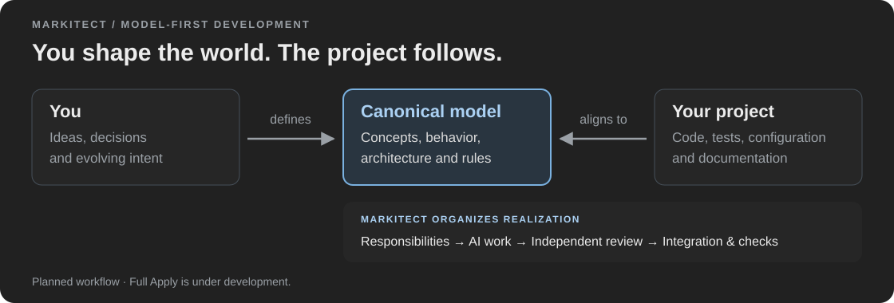
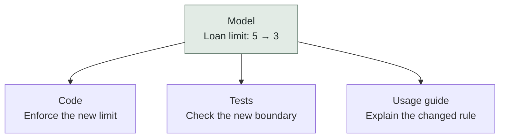

<h1>
  <picture>
    <source media="(prefers-color-scheme: dark)" srcset="assets/markitect-wordmark-dark.svg">
    
  </picture>
</h1>

**Don't chase the code. Let the code chase you.**

You shape the idea. Markitect organizes the work that brings your project into alignment.

[](https://github.com/Glacius-Labs/Markitect/actions/workflows/ci.yaml)
[](LICENSE)
[](docs/implementation-plan.md)

[Why Markitect](#why-markitect) · [Working with a model](#working-with-a-model) · [An example](#let-the-project-do-the-catching-up) · [Development status](#development-status) · [Explore the source](#run-the-current-source)

Markitect is model-first development with delegated AI realization. You describe your project's intended world in a canonical model: its behavior, concepts, architecture and rules. Markitect is being built to organize its realization across code, tests, configuration and documentation.

Think of it as programming through documentation: the model defines what the project should be, and becomes the starting point for making it so.



## Why Markitect

The difficult question after an AI implementation is:

> Does what the AI built actually match what I intended?

A feature can work while an existing rule is overlooked, another area breaks or the documentation describes something different. You have to find the gap, prompt again and check the repair. Some omissions may never be noticed.

The bottleneck is **human attention**. Another agent can check the work, but it can overlook things too. Markitect aims to make that checking a dependable part of the organization, so you can concentrate on the intended system and decisions that need your judgment.

The goal is a clean, uniform and understandable repository, without drift, forgotten rules or contradictions.

## Working with a model

1. **Shape the idea.** Work with AI to explore and author the model, or edit it directly. Make the decisions that define your project.
2. **Apply it.** The planned realization workflow assigns work to responsible agents, brings their contributions together and verifies the result.
3. **Evolve the model.** Change your intent as your understanding develops. The next realization carries that change through while preserving the obligations that still apply. Deviations can also be repaired against unchanged intent.

## Let the project do the catching up.

Imagine a library where a member may borrow five books. The rule changes: members may now borrow three.

You change the rule in the model. The intended result reaches every affected part of the project:



Existing rules, including returning books and handling suspended members, still hold.

This is the [two-Apply library demonstration](docs/design/canonical-model/manager-apply-playground.md) we are building toward: realize the original model, then apply the changed policy to that actual result.

## Where trust should come from

Markitect combines **AI judgment with deterministic structure**. Its method draws on familiar practices from human teams: clear responsibilities, delegation, escalation, the four-eyes principle and integration of independently reviewed work. Focused context helps each agent attend to its own obligations; explicit relationships and required checks make the process inspectable.

The ambition is to make routine human implementation review unnecessary. Implementation, tests and review can still share a mistaken assumption, so the effectiveness of this organization must be demonstrated in use.

Agent calls, elapsed time and human attention are different costs. Lower-cost models can make focused collaboration practical; reducing spending is not the product goal. Parallel execution is a later opportunity to reduce elapsed time.

For the full explanation, read [Markitect in brief](docs/vision.md#markitect-in-brief) and [origin and rationale](docs/concepts/origin-and-rationale.md).

## Development status

**Markitect is under active development. Full Apply is not available yet.**

Current source supports model compilation, repository file accounting, context preparation and a guarded readable model view. Session, workspace, check and publication foundations are integrated, while the core realization workflow and its public Apply entrypoint are being completed.

Real runtime probes and small single-agent library baselines have passed. They establish their [recorded scope](docs/validation/runtime-capabilities-20261017.md); they do not demonstrate the complete Manager organization or the two-Apply workflow.

We plan to compare this approach with an agent given ordinary documentation containing the same intent and the instruction to implement it. [Evaluation](docs/measurement.md) will examine fidelity and required human correction through successive changes. Follow the [delivery plan](docs/implementation-plan.md) for scope and dependencies.

## Run the current source

Use Git and the Go version in `go.mod`, then run from this checkout:

```text
go run ./cmd/markitect help
go run ./cmd/markitect check --repo .
go run ./cmd/markitect context product/model --repo .
go run ./cmd/markitect docs --repo .
```

These commands inspect and prepare the model. They do not start a realization. The [project workflow](docs/project-workflow.md) explains current commands, and the [self-model](.markitect/README.md) provides a complete authoring example.

## Contribute

Start with [CONTRIBUTING](CONTRIBUTING.md), the [delivery plan](docs/implementation-plan.md) and the [documentation map](docs/README.md). Concrete feedback about the model, workflow and missing obligations is useful alongside implementation contributions.

## Distribution status

The previous Project/Domain releases and their binary downloads were retired by the owner on 17 October 2026. There is currently no supported binary release of the new model-first product. Build the current source as described above; an old version tag is a historical source reference.

<!-- markitect-release:install:start -->

## Install Markitect

Build from current reviewed source. A future published release needs its own source-bound verification before installation instructions are added here.

<!-- markitect-release:install:end -->

<!-- markitect-release:try:start -->

## Examples

Use the [canonical Library model](docs/design/canonical-model/library-example/README.md), current [source workflow](docs/project-workflow.md) and [independent Playground](experiments/library-playground/README.md). A complete Apply remains the delivery target.

<!-- markitect-release:try:end -->

Historical Git tags remain unchanged. The [retirement record](docs/history/distribution-retirement-20261017.md) preserves release identities, asset digests and attestations. The [distribution guide](integration/README.md) describes local packaging and future publication.

## Documentation

[Vision](docs/vision.md) · [Origin](docs/concepts/origin-and-rationale.md) · [Workflow](docs/project-workflow.md) · [Design](docs/design/canonical-model/README.md) · [Evidence](docs/validation/README.md) · [All documentation](docs/README.md)

## License

Markitect is licensed under [Apache-2.0](LICENSE). Third-party notices are available through `markitect licenses` and [the canonical notice file](internal/tooling/licenses/notices.md).
