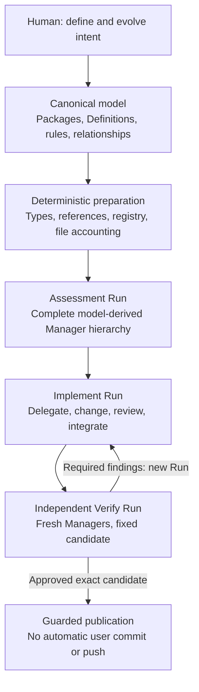

<h1>
  <picture>
    <source media="(prefers-color-scheme: dark)" srcset="docs/assets/markitect-wordmark-dark.svg">
    
  </picture>
</h1>

**Don't chase the code. Let the code chase you.**

**Model-first software engineering with a compiler-checked canonical model and AI teams derived from your architecture.**

[](https://github.com/Glacius-Labs/Markitect/actions/workflows/ci.yaml)
[](LICENSE)
[](docs/implementation-plan.md)

[The idea](#the-idea) · [How it works](#how-it-works) · [A concrete example](#a-concrete-example) · [Try it](#try-it-from-source) · [Current status](#current-status) · [Documentation](#documentation)

---

## The idea

AI can write code. Keeping **an entire project aligned with what it is supposed to be** is harder.

A decision about behavior or architecture rarely lives in one place. Its consequences appear in source code, tests, documentation, configuration, dependencies, and sometimes the instructions given to coding agents. As those representations evolve, an agent can complete its immediate task while missing a rule elsewhere, introducing a contradiction, or leaving previously correct behavior broken.

Markitect starts from a different premise:

> **Define the intended system once. Treat code, tests, configuration, documentation, and agent guidance as realizations of that intent.**

You maintain a **canonical project model**. Markitect checks the model's expressible structure, accounts for repository files, derives a team of responsible Managers from the modeled architecture, and coordinates AI work to bring the repository into alignment. Independent verification and deterministic checks stand between the resulting candidate and publication.

The goal is not to generate more documentation or orchestrate more agents. It is to make **long-lived consistency and trustworthy change** achievable without requiring a human to rediscover every obligation and inspect every routine diff.

**Markitect = Markdown + Architect.** The name reflects its origins in engineering documentation, Rules, Skills, Workflows, and agent instructions. The canonical v1 language uses **typed YAML Definitions with normative Markdown prose**; Markdown itself is not the compiler's input format.

## Beyond prompt files and linters

An `AGENTS.md` file can tell one agent how to behave. A linter can validate a known rule. **Neither alone establishes which project facts are authoritative, which artifacts realize them, who owns each area, or whether independently reviewed changes still conform after integration.**

Markitect connects those responsibilities: **the canonical model defines intent; deterministic software validates explicit structure; model-derived AI Managers perform and review semantic work.** These layers complement ordinary agent tools rather than replacing them. The promise of greater reliability remains a hypothesis to test, not an automatic consequence of adding structure.

## How it works



### 1. Describe the intended project

The model expresses concepts, use cases, rules, architectural boundaries, responsibilities, and development obligations. Definitions have stable identities, declared Kinds and typed fields; Markdown bodies state the meaning that cannot be reduced to a type. Explicit imports and `[[Definition]]` links connect related statements.

**The model is the architecture; the agent organization follows it.** Markitect derives Root and one Manager for every local modeled Package, including intermediate and empty Packages. You do not maintain an independent manager chart that can silently disagree with the system design.

### 2. Compile what can be checked deterministically

Before AI work begins, Markitect validates supplied model sources, identities, Kinds, property contracts, imports, references, and fixed inputs. It also checks the repository's **realization registry**: the explicit relationship between files, their owners, and the Definitions they implement.

Every observed file must be accounted for as a protected input, a registered artifact, an operational file, or an explicitly explained exception. **`.gitignore` is not an exemption from accounting.** One artifact may realize several Definitions; one Definition need not correspond to one file.

This is the type-system analogy: catch *expressible structural errors* before spending agent time. The compiler does **not** prove that arbitrary natural-language requirements have been correctly implemented.

### 3. Give each Manager a bounded responsibility

Every Run uses the **complete hierarchy derived from the checked model**. Each Manager receives its relevant model context, a fresh isolated environment, and its own Git working copy. Parents delegate to direct children, answer questions, review fixed child results, and integrate accepted changes. Children can receive concrete corrections without restarting unrelated work within that Run.

The host handles technical coordination, finite limits, Git identities, and checks. **AI Managers judge meaning and integration.** The host does not script their work step by step.

### 4. Assess, implement, verify — independently

`apply` composes three distinct mandates using the same Run executor:

| Mandate | Responsibility |
| --- | --- |
| **Assessment** | Determine whether the fixed model is sufficiently coherent to realize. Missing or outdated code is not, by itself, a model defect. |
| **Implement** | Bring artifacts into conformity while preserving what already conforms. Each parent reviews and integrates its children's work. |
| **Verify** | Have a **fresh** complete Manager hierarchy assess the exact integrated candidate independently; do not reuse Implement conversations or modify the candidate being judged. |

A Verify rejection with actionable realization findings starts a **new Implement Run**, followed by a new Verify Run, under the original finite command budget. A material contradiction or missing decision in the model stops the command for human resolution; agents do not silently rewrite accepted intent.

Deterministic checks occur before execution, on fixed child handoffs where applicable, at successful Implement Root completion, and before publication. A provider reporting “done” is not equivalent to an accepted result.

### 5. Keep results, not running containers

Each Run closes its Manager environments and Git Workspace Service. Exact candidates survive independently as retained Git objects; mandatory Run results record decisions, findings, checks, and cleanup observations. **Shared Notes** preserve attributed observations across Runs and commands, but never replace the model or turn optional ideas into required work.

Only the independently approved, reloaded candidate can be published. Markitect checks the target for intervening changes and reports conflicts or partial transfers rather than silently inheriting a previous approval. It does **not** commit or push the user's repository.

## A concrete example

Suppose a small library allows each member to borrow **five books**. Later, the limit changes to **three**.

The [canonical Library example](testdata/library/README.md) represents the limit and its meaning in a real YAML Definition:

```yaml
id: loan-policy
kind: LendingPolicy
body: >-
  For [[borrow]], the resulting current open-loan count of the member must not
  exceed the value of [[maxOpenLoans]] in this definition's spec. Count every
  open [[loan]], including overdue loans, and exclude closed loans. An overdue
  loan adds no separate borrowing restriction. A new loan's due date is its
  borrowing date plus the value of [[loanPeriodDays]] in this definition's spec.
  [[return]] remains possible regardless of the current limit or overdue state.
  A lower limit neither deletes existing loans nor forces their return; while
  at or above that limit, the member cannot start another loan.
spec:
  maxOpenLoans: 5
  loanPeriodDays: 14
```

Changing `maxOpenLoans: 5` to `maxOpenLoans: 3` is a change of **accepted intent**, not a request to edit a particular source file. A conforming realization must reflect the new boundary in behavior, tests, and relevant documentation **without** deleting existing loans or breaking returns. Already-correct artifacts should remain correct, not be rewritten merely because an agent prefers a different style.

The [measurement guide](docs/guides/measurement.md) describes how Markitect is compared with ordinary agentic coding on this example. A reliable preservation result across successive changes is **not yet established**.

## The project model

A Markitect project explicitly owns its inputs and file relationships under `.markitect/`:

```text
.markitect/
├── model.yaml            # Canonical model manifest
├── model-lock.yaml       # Exact external dependency bindings
├── model/                # Packages and typed Definitions
├── registry/             # Artifact paths, owners and Definition links
├── execution.yaml        # Ownership areas and declared project checks
└── ignore.yaml           # Explicit, justified exceptions
```

The model is **not a mirror of the file tree**. You choose the level of conceptual detail. The registry describes how real files implement those concepts; Package structure determines responsibility; declared checks provide executable evidence where available.

See [Markitect's own model](.markitect/README.md), the [canonical language v1 contract](docs/design/language-contract.md), and the [Library model](testdata/library/README.md) for the actual format.

<a id="run-the-current-source"></a>

## Try it from source

**Prerequisites:** Git and the Go version declared in [`go.mod`](go.mod) (currently Go **1.27.1**). There is no supported V1 binary release yet.

```bash
git clone https://github.com/Glacius-Labs/Markitect.git
cd Markitect

go run ./cmd/markitect help
go run ./cmd/markitect check --repo .
go run ./cmd/markitect context product --repo .
go run ./cmd/markitect docs --repo .
```

These commands inspect the repository's own canonical model; they **do not launch agents**. `docs` previews the readable model view. To write a view, use `docs --expect PREVIEW_DIGEST --write` with the digest returned by a current preview.

### Running Apply (advanced, experimental)

The current source includes `apply`, but it is **not** a one-command install or an automatic brownfield migration. It requires a reviewed and committed project model, explicit registry/ownership declarations, a clean target on an isolated non-protected Git branch, a pinned Linux container/runtime setup, normal Codex account credentials, and finite invocation limits.

Start from [the runtime profile example](examples/runtime-profile.example.yaml) and [invocation example](examples/run.example.json). Copy them **outside** the repository and replace all placeholders, using actual runtime/image/build identities. Then invoke:

```bash
go run ./cmd/markitect apply \
  --repo . \
  --runtime-profile /absolute/path/runtime-profile.yaml \
  --run-config /absolute/path/run.json
```

`apply` starts real provider and check processes and may modify files in the selected repository after verified publication. Read the [exact execution and safety requirements](docs/guides/project-workflow.md#execute-verify-and-apply) before using it. No general-purpose `init`, setup wizard, or Extract path is currently provided.

## Current status

**Active development — source available, not a supported V1 release.**

| Capability | Current evidence and limits |
| --- | --- |
| Canonical v1 language, compiler and explicit file accounting | Implemented with source tests and model/architecture checks. |
| `check`, `context` and guarded `docs` | Implemented in the current CLI. |
| Standalone hierarchical Run and stored Git candidates/results/Notes | Implemented, with controlled tests and a bounded native Codex hierarchy proof. |
| `apply`: Assessment → Implement → Verify → guarded publication | Implemented. With native Codex, the [qualification record](docs/validation/v1-qualification-20261024.md) holds complete Library M1 and M2 (loan limit 5 → 3) Applies with independent outside oracles, a strict no-change Apply and a seeded defect repaired by an ordinary Implement. |
| Reliability across changes | **Not yet established.** That evidence predates the final collaboration contract. Requalification on the frozen source, repetition for stability, the public Verify-rejection branch with publication, account refresh and owner acceptance remain open ([plan](docs/implementation-plan.md)). |
| Provider support | Native Codex with dedicated normal-account login, with bounded evidence. V1 carries no other provider path; Claude follows later as its own adapter ([D18](docs/concepts/v1-concept.md#23-provider-scope-d18)). |
| Other product surfaces | Extract, Cockpit/UI, interactive model authoring and the former Setup command are outside this narrow V1 scope. |

The compiler can reject malformed structure and missing declared relationships. **It cannot know whether the model omitted a real user need, whether an AI correctly understood prose, or whether green agent-written tests actually test the right thing.** Independent review, integration, project checks, and outside evaluation are intended to improve trust—not to turn agent work into a formal proof.

Read the [live implementation plan](docs/implementation-plan.md) for up-to-date source/evidence status and [Measurement](docs/guides/measurement.md) for how the method will be compared with ordinary agentic coding. Fewer tokens, more agents, or one successful demonstration are not acceptance criteria by themselves.

## Direction

The present V1 focuses on **Model → Artifacts**: making a project conform to its accepted model. The longer-term idea reaches further: the same canonical source can govern engineering processes and AI-facing rules, while separately authorized agents could eventually help propose or maintain parts of the model itself. Those are **directions, not current CLI capabilities**.

The measure of success is whether projects remain consistent through real changes with **less routine human supervision**—while people retain responsibility for architecture, requirements, material exceptions, and acceptance.

## Documentation

- [Product vision](docs/vision.md) — the thesis, responsibilities, and limitations
- [Origin and rationale](docs/concepts/origin-and-rationale.md) — why the idea emerged
- [Canonical language v1](docs/design/language-contract.md) — the authoritative model format
- [Project workflow](docs/guides/project-workflow.md) — exact commands and runtime prerequisites
- [V1 execution architecture](docs/design/v1-execution-architecture.md) — Run, Workflow, Harness, storage, and publication boundaries
- [Library example](testdata/library/README.md) — the worked model and policy-change scenario
- [Measurement](docs/guides/measurement.md) — evaluation against conventional agentic work
- [Documentation map](docs/README.md) — all maintained references

## Contributing

See [CONTRIBUTING.md](CONTRIBUTING.md) for source checks, import boundaries, artifact registration, and independent review. Use [GitHub Issues](https://github.com/Glacius-Labs/Markitect/issues) for concrete defects or proposals. The project currently prioritizes fidelity to modeled intent, a small coherent architecture, and honest evidence over feature breadth.

## Distribution

The earlier Project/Domain downloads were retired. There is currently no supported binary release of this model-first V1. The release evidence remains on Main and the former tags are mapped to commits in the [retired release mapping](docs/validation/retired-releases-20261017.json); see the [retirement record](docs/validation/distribution-retirement-20261017.md).

<!-- markitect-release:install:start -->

### Installation

Build from the current reviewed source using the Go version in `go.mod`. Published binary installation instructions will be added only after source-bound release qualification.

<!-- markitect-release:install:end -->

<!-- markitect-release:try:start -->

### Examples and evaluation

Start with the [canonical Library model](testdata/library/README.md), [project workflow](docs/guides/project-workflow.md), and [independent Library oracle](tools/library-oracle/README.md). The complete two-Apply policy-change demonstration remains a separate acceptance target.

<!-- markitect-release:try:end -->

## License

Apache-2.0. See [LICENSE](LICENSE) and [third-party notices](internal/tooling/licenses/notices.md).
