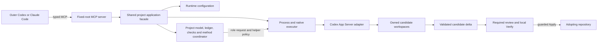

# Architecture

Markitect is model-first development with delegated realization ([Markitect in brief](vision.md#markitect-in-brief)). This page describes how current source implements it: the product flow, the layers, what each layer does and its known problems. The [code map](development/code-map.md) lists every package. [Modules and static composition](development/modules.md) owns the dependency rules.

## Product flow

- People keep one canonical model of the project under `.markitect/` ([project workflow](project-workflow.md)).
- An outer Codex or Claude Code client calls typed operations on a local stdio MCP server, or uses the CLI. The server is fixed to one project root at startup; tool arguments cannot change it.
- CLI and MCP call the same application facade, which owns the product composition root ([application layer](#application-layer)).
- Markitect compiles the selected model, binds work to fixed Git snapshots and records plans, runs and receipts.
- Managers, reviewers and verifiers run as inner roles in owned candidate workspaces. By default every role runs through the Codex App Server; setup can select another profile per role, including a process executor ([provider adapters](provider-adapters.md#role-profiles)).
- RUN-02 also exports deterministic Manager/reviewer packets and stores externally produced responses or fixed Git candidates. A later explicit scheduler continuation validates the submission and advances Manager/review work. Verify uses the existing local path; guarded Apply is separate ([external packets](project-operations.md)).
- Markitect validates and integrates the candidate deltas, verifies the result and writes the checkout only through guarded Apply.

The default native path uses the same coordinator, candidate validation and local Verify as the configured process and external packet paths:

## Authority and evidence

- The committed model is the accepted specification for its revision under the repository's policy. Drafts are proposals.
- Revisions, digests, reports and supplied provenance bind bytes. They do not authenticate human approval.
- A write that needs a preview is bound to the preview's digest and uses compare-and-swap. `deliver` carries an authorized scope through plan, run, verify, preflight and Apply. It grants no merge, release, deployment or acceptance authority.
- Owned workspaces and agent settings are not an operating-system sandbox. Telemetry of native child processes is partial ([candidate workspaces](project-operations.md#candidate-workspaces-and-recovery)).
- Technical checks, semantic evidence and owner acceptance stay separate. The [A01 validation record](validation/a01-native-smoke-20261010.md) holds the native result.

## Layers

Current source has four product layers:

- **Core** compiles the model and derives views from fixed inputs.
- **Infrastructure** reads Git and writes the working tree under guard.
- **Application** holds the use cases and their CLI and MCP surfaces.
- **Runtime** runs the inner roles and records what they did.

Executables under `src/cmd`, maintainer tooling, harnesses and fixtures have their own layers in the code map. The import gate checks each package against its layer ([mechanical dependency gate](development/modules.md#mechanical-dependency-gate)). Package IDs below refer to the [backlog](work-items/backlog.yaml), which owns their status.

The import gate enforces direction between all four product layers and validates code-map completeness before relying on layer labels (ARCH-12). [Dependency direction](development/modules.md#dependency-direction) defines the permitted imports; ARCH-13 separates the Core I/O and Runtime/Application responsibilities.

Product package directories name their layers: `src/internal/core`, `infrastructure`, `application` and `runtime`. The project-model family stays nested under `core/projectmodel`; capability checks, executables and maintainer tooling retain their separate directories. Relocation preserves the existing import boundaries and guarded-write API.

Known problems across layers:

- Small utilities remain package-local across layers: production `sameStrings` definitions exist in two packages, `equalStrings` in three and `containsString` in four. ARCH-05 consolidated the identical comparison within `projectrun`; it introduced no shared cross-layer utility abstraction.
- Four packages keep their own record store, each with its own file layout and write path: `projectrun` (`store.go`), `projectexplore` (`store.go`), `projecthistory` (`store.go`) and `projectadoption` (`session.go`; `manager_run_ledger.go` retains read-only historical parsing) (ARCH-14).

## Core layer

The core turns explicit inputs into deterministic results. The same model and snapshot give the same result, and unknown impact stays conservative.

- `src/internal/core` compiles explicitly supplied Schemas and Definitions into a structural model with a semantic digest ([Core README](../src/internal/core/README.md)). It has no engineering assertion language, no providers and no I/O.
- `core/snapshot` holds fixed sets of files and compares them ([source snapshots](source-snapshots.md#current-value)).
- `core/projectmodel` derives Manager, artifact and impact views from the compiled model.
- `core/projectmodel/projectcoverage` classifies an explicitly supplied repository census and overlays candidate snapshots ([DEC-006](concepts/register.md#dec-006-every-file-is-covered-or-explicitly-ignored)). Git and working-tree acquisition belong to the Application adapter.
- `core/projectmodel/projectbriefing` derives events, briefing digests and historical Manager visibility from supplied committed model/report values ([briefing design](design/project-world/operation-scopes-and-model-briefings.md)). Its pure resolution-status view gives accepted resolutions precedence over non-persisted delivered hints; a hint leaves the event unresolved.
- `core/projectmodel/projectvalue` holds the actual project/config/edit and exploration-binding values shared by Application and Runtime. A full acquired census remains an in-memory input. Source selection, executable build identity and the project digest remain in the Application frontend.

Known problems:

- The binding size limit of `core.Compile` is its preflight budget: 100,000 value nodes, with every input string byte charged six times (`MaxPreflightNodes` and `preflightStringCost` in `compile.go`). It rejects input with `model.input-limit` well before `MaxDefinitions` (10,000) or `MaxTotalInputBytes` (128 MiB) is reached. For example, 10,000 Definitions with two one-byte fields already exceed it.
- `core.Compile` checks `MaxDefinitionBytes` and `MaxTotalInputBytes` on the input as written, before each reference gains its target `apiVersion` and `kind`. A Schema with a long target Kind name can therefore make the normalized model and its edges far larger than these limits. The host compiles only the fixed project Schema, whose names are short. Charge the expansion during validation once a second or untrusted Schema becomes possible.
- `core/projectmodel` assumes the project Schema is the only one. `Analyze` groups Definitions by Kind name without checking their `apiVersion`, so another Schema's `Statement` would be projected as a project Statement. A change to a Definition of another Schema widens impact only when nothing else changed. Production compiles only the project Schema; multi-schema support would have to fix both.

## Infrastructure layer

Infrastructure reads Git and the working tree, and writes the working tree under guard.

- `infrastructure/source` loads fixed snapshots from the working tree or a commit with hardened Git processes ([source snapshots](source-snapshots.md#adapter-and-use-case-ownership)).
- `infrastructure/guardedwrite` applies selected changes only while repository, branch, HEAD and captured bytes are unchanged. Product packages may use only its guarded API: `CaptureFiles`, `Apply`, `ApplyChecked`, `ApplyOrderedChecked`, the bounded exploration-record operation `ApplyRecordChecked`, the read-only name check `NewStoredNames` for their private copies, and the types `Capture`, `Change`, `File`, `Result` and `StoredNames`.

Writes bind the inspected root and parent directories through opened handles; a path check alone does not authorize a write. A partial failure is reported as such, because a multi-file write is not a transaction. The [Host write identity contract](design/host-write-identity.md) defines the details. Guarded writes are not an operating-system sandbox.

Known problems:

- `guardedwrite` still exports low-level primitives alongside the guarded API. Keep product callers on the explicitly permitted guarded operations; the import gate rejects direct use of lower-level primitives.
- Each selected source call identifies the Git repository at its start and again at its end (`identifyGit` and `confirmGitIdentity` in `source/selective.go`). One `projectwork.Load` makes several such calls (`projectwork/project.go`) (ARCH-11).

## Operational record storage

`infrastructure/recordstore` owns the closed `.markitect/records/<kind>/<id>/` physical namespace, pinned read/list operations, byte preimages, publication outcomes and finite leases. It imports no domain codec, Git authorization, Runtime scheduling or application lifecycle. Domain owners keep their existing JSON, digests, revision chains and transition rules:

| Kind | Canonical records | Owner and writer lease |
| --- | --- | --- |
| `run` | `<hex32>/plan.json`, `states/`, `candidates/`, `reports/`, `verification/`, `apply/`, `external/packets/` and `external/responses/`; `full-<hex64>/record.json` for Full Verify | Runtime projectrun; one kind-wide `.write.lock` for every ID and Full Verify |
| `exploration` | `<id>/record.json` | Application projectexplore; the existing shared `.markitect/write.lock`, sealed source Capture and `ApplyRecordChecked` |
| `briefing` | `accepted/record.json`, the complete existing History Store snapshot | Application projecthistory; `.briefings.lock`, at most ten seconds of waiting and no automatic stale reclamation |
| `brownfield` | `<id>/record.json`, including sealed discovery | Application projectadoption; persistent empty `session.lock` and `manager-runs.lock` kernel leases |

The first authorized Brownfield Session write establishes both control leaves. Strict Load and phase previews open existing leases only and refuse missing, unsafe or nonempty controls and temp/previous remnants without healing them. Overview uses a separate nonlocking, noncreating display reader. The outer Manager lease precedes short Session reads and Runtime's kind lease; Runtime releases before Session CAS. Its captured physical Store and control identity are borrowed through preparation, Host validation, dispatch and the actual Session CAS guard. A substitution before CAS retains the original Runtime evidence and leaves Session unchanged; a release failure after an observed Session publication reports that publication rather than replaying it. Historical `manager-runs.json` keeps its legacy basename/schema as a bounded, pinned, read-only refusal input inside the NEW Brownfield container. Prior drafts data independently triggers cutover refusal; neither input supplies a second execution authority.

Every write first checks old-layout refusal and supported write capability, before container/lease creation or role admission. It pins each approved parent, exclusively creates and flushes a private temporary file, validates exact target/temp identities and bytes plus owner authorization, publishes one leaf, flushes its destination parent and checks exact bytes and domain expectations. New POSIX directories are0700 and records/leases/temps0600; broad existing record permissions refuse without repair, and canonical ancestor modes stay unchanged. Each new ancestor's child and parent are flushed before descending. Windows domain records use inherited/default DACLs; numeric0600 does not imply owner-only access.

A known prepublication ancestor-create collision permits one strict observation of the other creator's exact directory spelling, type, mode and pinned identity, followed by validated child/parent flush. It never repeats mkdir, repairs permissions or claims the other caller's creation. Only a terminal collision on the actual exclusive lease leaf is reported as a held lease. Common reads never retry: a safe regular-leaf identity transition returns a distinct conflict only after root, parent, spelling, type, mode and bounds remain valid. History alone retries that full observation in its existing ten-second backoff; root/parent, generic I/O, codec, CAS and publication failures remain immediate errors.

POSIX operation requires a cooperative namespace: all record mutators honor their owning leases. Final parent/temp/lease identity, type, mode and byte checks reject observed substitutions and retain replacements. POSIX link/rename/unlink selects names and has no atomic inode predicate against same-UID or privileged mutation bypassing those leases between the last check and operation. This is not an OS sandbox. Windows writes support only the measured API10.0.26100.0/amd64/localNTFS tuple, required current parent rights and an actual parent flush. Native relative creation and source-handle rename use held objects: immutable Create uses flags0; Replace uses flags3 (`REPLACE_IF_EXISTS | POSIX_SEMANTICS`). Rooted readers with delete sharing retain the old object while the name refers to the replacement; plain readers without that sharing may still cause a native failure and retained Unknown outcome. No read-only attribute or ACL bypass is added. Cleanup deletes an identity-verified held object. Other tuples or unavailable rights/flush fail closed, without a mutation probe or pathname fallback.

Publication is per record, without a cross-file transaction or power-loss proof. The complete parent chain is checked immediately before temp creation; the source stays held through publication, flush and exact identity/byte readback. After its normal successful close, a final parent-chain check precedes parent/root release. Namespace drift after known publication remains a qualified published error with retained bytes. Failures distinguish definite refusal, created/published but unobserved state, and unknown publication. Preserve created entries and uncertain/published evidence; no rollback, silent success, retry or agent replay follows an ambiguous error. Domain success requires exact readback bytes and its decoder/digest/revision checks. Only a validated missing-child observation beneath unchanged safe parents is directory absence; root/parent guard or post-observation open failures never become empty records. See [operational setup and cutover](project-operations.md#record-layout-and-cutover).

## Application layer

`projectcoverage` is the census acquisition adapter: it reuses the frontend's source acquisition and retains identity rechecks while returning pure coverage values. `projecthistory` owns accepted Git history, actual store reads, dismissal/resolution policy and whole-store digest CAS and the common physical record writer. `ReadAcceptedHistory` computes a hint-free preview without writing; actual `Read` additionally supplies display-only delivery status and the raw persisted digest. Guided notifications retain their separate accepted preview and matching persisted-read status overlay. Core receives no Git or persistence dependency.

The application layer holds the product's use cases and the surfaces that expose them.

- `projectwork` loads the selected model from the working tree or a commit, and plans and writes model edits under guard.
- `projectexplore` stores explorations, open decisions, scope readiness and Apply receipts.
- `projectadoption` runs Brownfield adoption: fixed-snapshot evidence, Manager proposals and a model-only adoption plan.
- `projectonboarding` writes project-local guidance and skills for Codex and Claude Code.
- `projectapp` is the shared facade over these use cases and the runtime. `NewOperations` is their shared composition factory for the Host, local workspace service and transport invoker. CLI and MCP delegate product operations, including briefing history and the read-only status overview, to this facade. Lightweight read helpers may construct another instance; construction itself starts no provider or workspace.
- `projectcli` holds the verb table behind the `markitect` command line and its MCP tools, and `mcp` is the stdio MCP adapter ([project operations](project-operations.md)).
- `releasecli` is the command interface of `markitect-release`.

Brownfield discovery, accepted target context, Manager evidence assignment, typed proposal/integration validation, human resolution and Session CAS remain in Application. `projectapp.BrownfieldRun` prepares the existing domain request and calls Runtime's finite `PreviewManagerStage`, `RunManagerStage`, `ReviewManagerStage` and `CompleteManagerStage` ports. It holds the existing per-session process-file lease from admission through the Session CAS. Historical `manager-runs.json` records remain readable under their original digest meaning; any nonempty or budget-sealed legacy journal blocks new Runtime admission without conversion or rewriting.

## Runtime layer

The runtime runs Manager, review, integration and verify roles and records what happened.

Application composes Runtime with finite typed Host callbacks for project loading, candidate classification/rendering, history and exploration operations. Runtime retains scheduling, quotas, independent review, verification, guarded Apply and exact-turn recovery; Application performs the required record observations and CAS writes. A read-only Full Verify audits its captured accepted-history input throughout that invocation; writing paths read persisted history at their existing freshness gates. The callbacks preserve each lifecycle gate, including the logical readiness precondition under the Apply writer lock and captured-file checks before each changed path. Completion follows successful Verify and journalled Apply, and recovery does not replay work.

- `projectrun` plans, runs, resumes, repairs, verifies and applies bounded Manager work over fixed snapshots. Ordinary Manager work, integration, rework and independent reviews share its durable attempt and role-reservation lifecycle with Brownfield Manager stages. Brownfield uses a disjoint planless binding in the existing run store under `.markitect/records/run/`; it creates no synthetic plan, task or implementation candidate. Runtime retains immutable original report bytes and exact-turn recovery before Application attaches a typed result. Verify, Full Verify and guarded Apply retain their existing lower-role lifecycles.
- Brownfield freezes cumulative starts, explicit retries, duration and reported-cost ceilings at first admission and persists tightening without refill. Input and output costs round upward separately; ordinary pricing and wall-clock deadlines keep their existing meaning. Configured report review is independent and required; nil review keeps the disabled policy. `MaxRounds` bounds cumulative reviewer rounds per Manager/phase, while `MaxManagerRounds` remains the ordinary Manager-directed rework ceiling. Brownfield performs no automatic Manager rework.
- Brownfield process and exchange calls audit both canonical source and target roots, with private invocation/log directories outside them. Ordinary transport options and parallel batches stay unchanged. Empty regular audit inputs retain their complete facts and read-access/identity/type/size/mode/time checks without a DATA read, so the unchanged Windows session byte-range lock can remain held. This is an input-change check, not an operating-system sandbox or a claim to detect transient rewrites restored before observations.
- `projectconfig` owns runtime types, strict bounded loading and validation, agent projection and strictness profiles. Setup and MCP schema reflection consume it directly; accepted Manager references and cumulative policy enforcement remain in the method coordinator.
- `projectexecutor` composes process/native dispatch, request-aware fingerprints and private transport journals. Application composition injects the method's helper policy; exact-turn recovery retains the existing no-replay boundary.
- `agentexec` is the provider-neutral process boundary for one role invocation and its receipt.
- `codexappserver` is the transport to the native Codex App Server.
- `exchangecli` is the reference bring-your-own executor. It hands each invocation to an outside party through request and response files ([provider adapters](provider-adapters.md#bring-your-own-executor)).
- `projectworkspace` creates, harvests and recovers owned candidate workspaces.
- `projectsetup` builds configuration and prerequisites from explicit project facts and discovers concrete tools. `projectapp` plans the `config` model edit and applies its exact preview under the existing expected-digest/write guard; discovery starts no roles.

[ARCH-06 / PR250](https://github.com/Glacius-Labs/Markitect/pull/250) delivered the configuration/executor boundary and focused Plan, Full Verify and Run phases at Main `4c260449009d115333d2f9af4cdf09564d7dde0b`. A production AST gate covers declarations and anonymous functions in `projectrun`, `projectconfig` and `projectexecutor`, including supported-platform files, with an inclusive 300-line maximum. Existing E2E assertions and normal untagged CI coverage are preserved. The [integration record](validation/integration-round-20261012.md#arch-06-closure-and-arch-13-preparation) separates required/actual-Main Linux proof from the original Windows subset expiry.

Known problems:

- ARCH-05 removed five proven unused `projectrun/run.go` helpers (`ownedPath`, `addCost`, `estimateCost`, `resolvesConflicts`, `resolveObligations`) and its duplicate `sameStrings` comparison in [PR248](https://github.com/Glacius-Labs/Markitect/pull/248). Existing cost, obligation, repair and comparison behavior is retained; the subsequent ARCH-06 extraction is integrated.
- Plan and Apply call `git check-attr --source` (`plan.go`, `apply.go`), which needs Git 2.40 or later. Doctor reports the installed version and a failed prerequisite below 2.40, before model or provider inspection (CLI-04, #235). Doctor does not automatically guard later Plan or Apply calls; their operation-time Git failures remain separate.
- A helper whose Close fails stays `cleanup-pending` (`helper.go`). `validateReportClosure` (`obligations.go`) then blocks Verify and Apply, and nothing reconciles the state (BUG-01).
- Bring-your-own executor gaps (RUN-05):
  - `maxCostMicros` is required even when every role is unmetered (`projectconfig/validate.go`).
  - Setup rejects script shims only for the native provider, not for process executors (`discoverProcess` in `projectsetup/setup.go`).
  - The exchange adapter has no deadline of its own (`exchangecli/exchange.go`).
  - Declared checks see only the owning agent's environment allowlist (`explicitEnvironment` in `verify.go`).
- The process end-to-end cases re-execute the test binary with isolated per-test child descriptors and run in parallel after the serial cases finish (TEST-03, #232). The process scenarios follow their Runtime and Application owners. The normal untagged Quality/Race suites include all scenarios; `runtime_unit` remains a focused selection, not a complete source gate. The dated [tests and CI survey](work-items/surveys/tests-and-ci-20261010.md) recorded `projectrun` at 1,467 s on Windows against 112 s on Linux before that change. Windows validation remains nightly or on demand and does not block ordinary merges ([DEC-013](concepts/register.md#dec-013-linux-first-for-tests-and-the-playground)); CI-05 still owns the future support decision.

## Historical Project/Domain architecture

The earlier Project/Domain architecture shipped in v0.14.1 and is preserved in a [dated history record](history/architecture-legacy-sections-20261010.md) and the [immutable release source](https://github.com/Glacius-Labs/Markitect/tree/v0.14.1). It is not part of current source or its checks.

## Project artifact boundary

Markitect treats an adopting project's files, including source code, schemas, configuration, CI and documentation, as exact paths and opaque bytes.

- The model declares which Manager is responsible for which files. Markitect does not infer that from file names, syntax, Markdown links or code.
- When a project selects full coverage, every repository file is covered by the model or explicitly ignored ([DEC-006](concepts/register.md#dec-006-every-file-is-covered-or-explicitly-ignored)).
- Markitect does not parse an adopting project's programming language, infer symbols, call graphs or dependencies, or generate documentation from code.
- Project-owned checks may run specialized analyzers. Their result is evidence for their declared scope only.
- A changed file can show that dependent knowledge needs review. It cannot show that the knowledge is wrong or that revised prose is right.

## Fixed inputs and evidence

- A Git commit resolves to one snapshot of paths, modes and bytes. Later working-tree edits do not change it ([source snapshots](source-snapshots.md)).
- A plan binds its base revision, snapshot and model digest. A changed model, source, runtime or candidate makes it stale and needs a fresh preview.
- Independent reviewers assess each candidate and each integration result during the run. Verify then runs the declared checks and the verify role against the integrated candidate.
- Apply writes only the latest verified integrated candidate and requires its verification digest.
- A passing check, digest or report establishes its declared scope. It is not human acceptance and does not prove semantic correctness.

## Distribution and product boundary

This repository owns Markitect's source, schemas, authoring guidance, examples and release process. An adopting repository owns its content, its checks and its approval policy. A source change does not update an installed release; a release is built and published through the [release process](operations.md#release-operations). Published releases stay immutable records.

## Historical architecture links

These retained anchors route existing links to the [history record](history/architecture-legacy-sections-20261010.md) of the earlier line.

The [Project/Domain compatibility architecture](history/architecture-legacy-sections-20261010.md#historical-projectdomain-and-projection-compatibility-architecture) is historical.

The [compiler and evidence model](history/architecture-legacy-sections-20261010.md#compiler-and-evidence-model) of the Domain kernel is historical.

The [v0.11.0 implementation boundary](history/architecture-legacy-sections-20261010.md#current-implementation-boundary) is historical.

The [v0.12.0 resolved-target equality](history/architecture-legacy-sections-20261010.md#v0120-bounded-resolved-target-equality) is historical.

The [v0.13.0 policy failure analysis](history/architecture-legacy-sections-20261010.md#policy-failure-analysis-in-v0130) is historical.

The [v0.13.0 selective adoption preparation](history/architecture-legacy-sections-20261010.md#selective-adoption-preparation-in-v0130) is historical.

The [projection-first reconciliation preview](history/architecture-legacy-sections-20261010.md#projection-first-reconciliation-experimental-preview) is historical.

The [v0.13 resource model](history/architecture-legacy-sections-20261010.md#resource-model) is historical.

The [deterministic core and adapters](history/architecture-legacy-sections-20261010.md#deterministic-core-and-adapters) of the Domain kernel are historical.

The [earlier Go ownership table](history/architecture-legacy-sections-20261010.md#go-ownership-and-final-dependency-model) is historical; current ownership is in [Layers](#layers) and the [code map](development/code-map.md).

The [v0.13 authoring and queries](history/architecture-legacy-sections-20261010.md#authoring-and-queries) are historical.

The [v0.13.0 Markitect-first workflow and artifact coverage](history/architecture-legacy-sections-20261010.md#markitect-first-and-artifact-coverage-published-v0130) are historical.

The [canonical reset alpha](history/architecture-legacy-sections-20261010.md#canonical-reset-alpha-removed) was removed from source.
