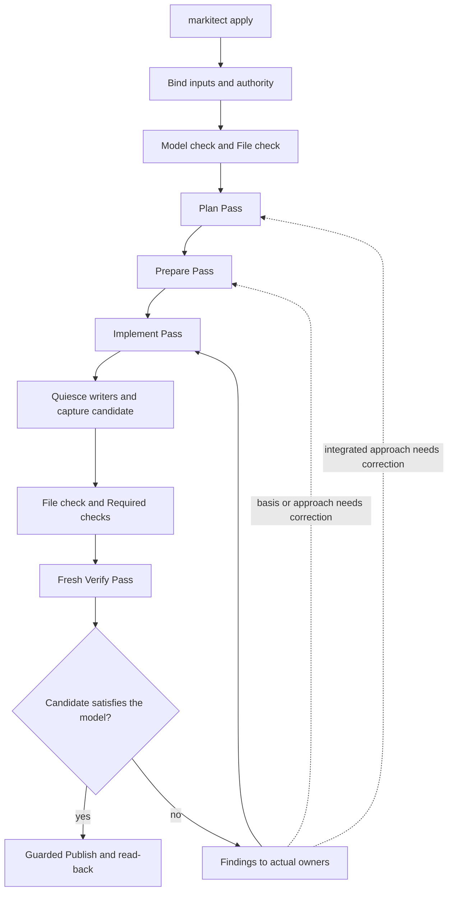
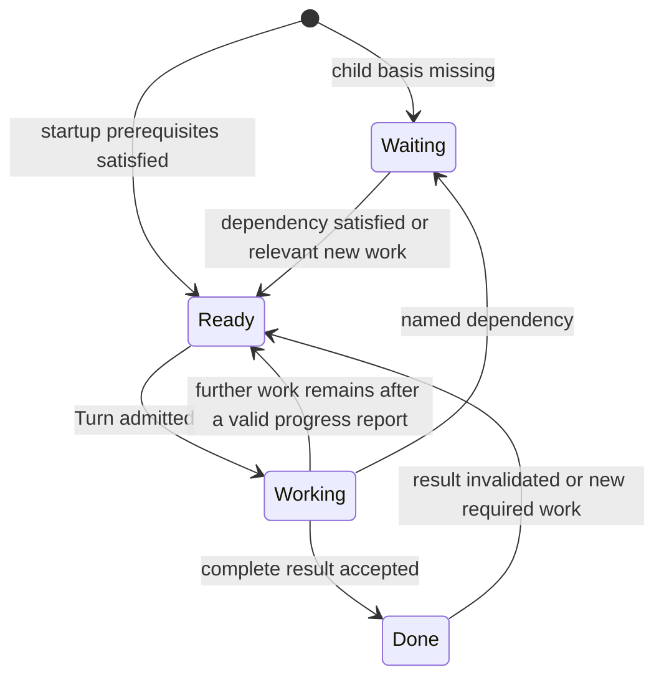

# Apply passes, results and tools — discussion draft

**Status:** local design draft, 20 October 2026. The owner requested elaboration, not implementation. Accepted directions and original wording are in the [conversation record](../../concepts/sources/terminology-and-file-accounting-20261020.md). The proposed state names, Pass contract, Execute decomposition and tool surface below are not yet accepted. No canonical model, runtime, issue, PR or integrated process is changed.

Inspected source baseline: Main `0c28097c030bc5d031b501002bc85634cd66a4c8`. The [implemented contract](manager-apply-runtime.md) remains the owner of that source's behavior; it does not implement this draft. The discussion explicitly changes the desired initial File check and owner-question policies. Preserve historical records and distinguish new direction from runtime evidence.

## 1. Purpose and accepted boundaries

The goal is complete, faithful realization of the bound model with better-supported trust than a single unconstrained Agent prompt. Time, turn count and implementation effort do not outweigh required fidelity. More passes or green structural checks alone establish no such trust.

The following directions are already accepted in this chat:

- Apply is the complete Command/workflow. Model check and File check are separate deterministic prerequisites. Invalid initial inputs stop before Manager work; no repairable-start exception remains in the desired behavior.
- The model remains binding. Questions and underspecification go through parents to Root and, if needed, the initiating AI and user. Root ends Apply if it judges the model erroneous or contradictory. No answer can override an existing model rule.
- Every required local Package has its Manager. All project files are readable to all Agents; writes are restricted to owned areas and the local registry. Communication is only between direct parent and child.
- Local registries are the authored sources. Repository-relative paths and directory entries are supported directions. A checked project-wide registry view is derived by the Orchestrator, not maintained by Managers.
- A semantic readiness report, scoped File check and refreshed checked registry view precede dependent child release. Turn termination is not completion.
- Independent fresh Verify, required checks on the exact candidate, guarded Publish/read-back and honest finite incomplete outcomes remain necessary.

The most-specific-path ownership rule is still a candidate mapping design. This draft relies on an unambiguous checked ownership mapping without selecting its final schema or silently granting the current Runtime general exact-file write support.

## 2. One vocabulary

| Term | Meaning in this draft |
| --- | --- |
| Workflow | The ordered composition of work and gates; Apply is a Workflow. No user-programmable workflow language is implied. |
| Run | One invocation of `markitect apply`, bound to one model/starting stand, explicit authority and limits. |
| Pass | One recursive execution of a named purpose across the required Manager tree, with a defined result and acceptance condition. Proposed English name for Durchlauf. |
| Turn | One provider interaction/admission within a Manager's work. A Pass can require several Turns of the same Manager. |
| Event | An observed occurrence or accepted state transition recorded by the Orchestrator. |
| Candidate | One immutable captured project stand, with the model and registry bindings its checks and Verify assess. |

Use Pass for the recursive unit, rather than alternating between round, phase and step. Use the established operation names Model check, File check, Execute, Verify and Publish. Execute groups the candidate Plan, Prepare and Implement Passes; it is not another name for the whole Apply. Exact code identifiers are a later implementation matter under the accepted naming requirement.

## 3. Proposed Apply workflow

Initial check failure ends the Run without Agent repair. Root's model-error decision ends it without Publish from any Pass. Cancellation, exhausted limits or unresolved required work produce an explicit unsuccessful outcome. The correction arrows do not authorize unbounded retries, model edits or arbitrary workflow invention by an Agent.

Plan/Prepare/Implement are proposed here, not existing product behavior. Every required Manager participates; existing conforming work may be examined and preserved. A pass with no artifact delta is valid when its required result is supported. Missing participation is not no-change evidence.

## 4. Common Pass contract

Every Pass declares:

1. Its purpose and the concrete result expected from each responsibility, including parent integration.
2. Its Run/model/input binding, Manager tree, contexts, checked ownership and local/derived registry stand.
3. Its rights: whether project artifacts may change, in which owned paths, and which result submissions require checks.
4. The basis needed before children may begin, and the evidence that accepts that basis.
5. Its completion and success conditions, required checks, unresolved blockers and limits.

The Orchestrator delivers the mandate and complete applicable obligations; an Agent does not choose the participant set or narrow its duty by returning a smaller plan. Own obligations and other Managers' context are labeled separately. Root receives explicit project-boundary and delivery obligations as context, attributed to their actual model owner; the draft should not rely solely on Required checks' `requiredBy` links to discover Root's foundation context. The exact binding of that project context to existing Definitions is still open.

Downward propagation supplies context and accepted basis. Upward integration examines actual results and interactions. Questions, answers and partial basis notifications may move along direct parent/child edges between those boundaries. Independent branches can work concurrently once their prerequisites are accepted.

A parent first completes the own contribution/basis that its current Pass requires. Its explicit report, required checks and valid registry update precede child release. It then waits for children or questions, but remains responsible for later integration. This is Waiting in the proposed lifecycle, not a new Standby state and not Done for the whole subtree. A parent can ask its children questions as well as receive them; an incoming relevant question makes an idle waiting Manager Ready. A Turn ending by itself releases nobody.

Cross-branch questions travel through the least common ancestor: branch A -> parent(s) -> common parent -> child path to branch B, and the answer returns along the tree. For Library: lending -> Root -> catalog -> Root -> lending. The request/answer association is retained. No direct sibling session channel is created. Once their local work is accepted, parents still wake for questions and integrate results when children complete. Delegation does not remove their own artifact ownership or integration duty.

### Common execution mechanism and the separate Verify Pass

The owner's later annotation proposes one common mechanism for planning/reviewing a plan, preparing/reviewing a foundation, and implementing/reviewing a realization. The target of the work changes; routing, ownership, explicit result submission, recursive integration, checks and review acceptance should not become three unrelated process implementations.

The owner's next clarification fixes the independent final assessment as a separate Verify Pass after Implement. It is not folded into Implement or replaced by the parent's author-side integration. The common mechanism is parent own contribution, checked child release, child work with bidirectional routed questions, upward integration and explicit Pass completion. Work and review Passes can share that mechanism while having different mandates, results and write rights.

Parents still review plans and prepared bases for cross-area fit as part of their responsibility. That does not automatically add an extra independent Verify Pass after every Plan and Prepare. Such additional review Passes remain an option requiring an explicit purpose. The final independent Verify assesses the immutable integrated realization after Implement. Structural Model check/File check cannot establish semantic adequacy of any result.

On findings, Root and the responsible Managers select the necessary correction through Plan, Prepare and/or Implement. A dedicated repair Pass is an owner-proposed option, not adopted by this draft. After correction a new immutable candidate receives a new independent Verify Pass. The owner's stated objective is a Verify with no remaining findings; the exact treatment of nonbinding improvement suggestions versus findings still needs an explicit definition and must not silently inherit the old blocking-only criterion. Successful Verify is followed by guarded Publish/read-back before Apply can report complete success.

## 5. Manager lifecycle and results

### Proposed lifecycle: Ready, Working, Waiting, Done

These states belong to one Manager's work in the current Pass; they are not provider exit codes or the entire Run's outcome.

| State | Meaning | What the Orchestrator does |
| --- | --- | --- |
| Ready | There is admitted-purpose work with satisfied startup prerequisites, ready to be scheduled. | Automatically dispatch when resources and the explicit Run limits permit; keep at most one active Turn for that Manager. |
| Working | The Manager is processing its work or a submitted result is being checked. | Route allowed messages, observe the Turn and evaluate semantic reports. |
| Waiting | The next required action depends on a named answer, child result, accepted basis or other explicit dependency. | Register the dependency and react to the relevant arrival/change. No blind polling Turn. |
| Done | A complete result for this Manager's assigned Pass responsibility, including required child integration, has been accepted. | Record its stand and notify the parent; do not infer success of the whole Run. |

Initially Root is Ready. Children wait for the basis their Pass declares. Reaching Ready triggers scheduling automatically; it is no longer the word for an Agent's completion proposal.

The last transition is explicit and retains the earlier result as historical evidence. A changed relied-on basis or a concrete finding can reopen work; elapsed time or a newer unrelated repository revision cannot silently invalidate everything. Semantic impact is identified by Managers and declared dependencies; the Orchestrator does not pretend to infer arbitrary code semantics.

### Problem is a report/event, not a fifth scheduling state

This is a recommendation in response to the owner's proposed Working/Waiting/Ready/Problem states. A Problem by itself does not tell the scheduler whether its Manager should run, wait, finish or stop the Run. Keep the scheduling state small and put the issue and intended action in its report.

- A Manager diagnoses/classifies the problem and decides whether to resolve it locally or escalate within its authority.
- A locally solvable problem can leave the Manager Working; remaining work can make it Ready for another Turn.
- An escalation identifies the direct parent and needed decision; dependent work becomes Waiting. The parent receives work and becomes Ready if idle. It does not automatically become an owner question.
- A model problem is one possible problem category, not a lifecycle state. It escalates to Root, whose judgment of a model error ends Apply under the accepted rule.
- Deterministic check failures keep their actual code, source and blocking force. An Agent may explain/fix an authorized artifact defect but cannot reclassify away a failed mandatory gate.
- A Verify finding remains open until the appropriate fresh independent assessment closes it on the corrected candidate. A local claim of resolution is not that closure.

No separate special-purpose state is needed for every issue category. A `problem.raised` event records observation; a `manager.state_changed` event records any resulting accepted lifecycle transition. Exact event identifiers remain illustrative.

### Semantic reports and technical Turn results

An Agent reports progress, a dependency/question, a prepared basis, a completion proposal or a problem. A completion proposal includes the actual result and evidence against its assigned obligations. The Orchestrator checks it and then changes lifecycle state; the Agent has no unconditional `set_state(Done)` authority.

An ordinary Turn exit produces no implicit completion report. A missing/invalid report is visible and may require correction within limits. Provider error, timeout and an uncertain container stop are technical outcomes. In particular, no new writer may start against an uncertain still-running writer merely because a semantic status changed.

When work changes files or a local registry, accepting a basis/completion proposal requires a scoped File check of the exact owned files and registry, and a coherent updated derived registry view. Other Managers can still work in disjoint owned areas. The view identifies which local versions it includes; it is not proof of a globally quiescent candidate.

### Completion, verdict and Run outcome are different

`Done` means the assigned work has been completely performed and reported. It cannot mean the assessed artifact is always correct: a valid, completed Verify can find a defect.

- A Pass finishes when every required responsibility and parent integration has an accepted complete result.
- Its aggregate verdict determines whether its objective is satisfied. A negative Verify verdict returns findings for correction; it does not mean the reviewer failed to do its job.
- The next forward Pass begins only when the current Pass's required gates and success condition hold. A completed negative assessment follows the correction route instead.
- Run `Success` requires fresh successful Verify and an applied/no-change Publish receipt with read-back. `Failed` denotes a definite failure such as Root's model-error decision or an unsafe/invalid invocation. `Incomplete` denotes an unmet result, unresolved dependency, cancellation or limits. Exact executable status mapping is not chosen by this draft.

Retain one outcome/assessment field for the substantive verdict rather than adding Success and Fail to every Manager scheduling state. Source validation, local readiness, independent Verify, actual Publish and human acceptance remain distinct observations.

## 6. Plan Pass

**Input:** the checked model, current artifacts, known findings and ownership. **Purpose:** decide a coherent realization approach within the model, before shared interfaces and foundation work diverge.

Root first supplies project constraints, responsibility boundaries and the cross-area questions to settle. In Plan, that basis is context; it does not require an application module to exist already. Children identify their own approach and needs. Parents settle cross-child interfaces by having the actual owning child propose/provide them. They do not author a detailed global file plan on behalf of the children.

Each Manager's result covers:

- How its own applicable obligations will be realized or preserved, and how correctness will be assessed. Grouping is allowed; one Definition does not require one file or one artificial test.
- Which owner-provided interfaces or foundations it needs and what it provides to others.
- The intended use of its own areas and registry, plus concrete integration questions and unresolved uncertainty.
- For a parent, the agreed interaction and remaining conflicts between its children.

Each Manager must have its own concrete plan, not merely have contributed to a discussion. It states what that Manager will do and how within its own responsibility, the ordering/start conditions, the required inputs and their owners, the outputs it supplies, current blockers and the intended evidence of completion. A shared high-level summary cannot substitute for a missing local plan. This is a meaningful realization plan, not a mandatory per-file task inventory or fixed implementation script.

Parents review their direct children's plans against their model duties and check that the plans fit together and into the parent's integration approach: compatible contracts, complete responsibilities, workable dependencies and no takeover of another owner. They return gaps to the child that owns the plan; they do not write the child plan for it. A child needs its own duties and relevant parent/neighbor contracts and decisions, not every other full plan in its initial context. Additional plan details may be consulted when useful.

A parent with its own artifacts plans and implements those artifacts itself, alongside coordinating its children. Leaf Managers are not the only Managers permitted to implement. The restriction is ownership, not position in the tree.

The integrated plans should make it possible to identify who can start, on what accepted basis, and which named dependency blocks whom. The Orchestrator may enforce explicit readiness/dependency conditions deterministically. It does not invent the approach, prove arbitrary dependency semantics or freeze Agents into an inflexible script. New information returns through the same planning/integration mechanism and makes affected accepted plans visible as needing reassessment.

**Project write rights:** the existing project stand is read-only in this proposed Pass. Plan results live in Run evidence, not a new authoritative model or mandatory generated project document. Any later requirement to retain a project planning artifact needs its own owned and registered path; that is not selected here.

**Exit condition:** every required Manager has an explicit concrete plan for its own responsibility; direct parents have examined child plans and their integrated fit; required dependencies/start conditions and ownership are coherent; relevant assumptions are settled within the model or through answered escalation; and Root's integrated result has no unresolved blocker. Review acceptance is tied to the exact plan stand. Model check and File check remain valid on the bound project stand. A plan that merely promises to examine unknown interfaces later has not settled the dependency it relies on.

**Library example:** members provides eligibility; catalog provides availability; lending uses both owners' realizations. The library Manager owns the JSON Lines entry/wiring. Root coordinates the approach and the module foundation. The plan does not move domain rules into Root or impose a framework absent from the model.

## 7. Prepare Pass

**Input:** the accepted Plan result and current checked project. **Purpose:** provide actual, usable, registered foundations for dependent work.

Root creates or assesses its owned project scaffolding, then explicitly reports its prepared basis. Scoped File check and the checked registry view precede its acceptance and child release. Each parent follows the same rule for its own children's prerequisites.

Shared domain types/interfaces are provided by their actual owning child. The parent coordinates consumers to use them and resolves dependency cycles. It does not gain permission to implement the child's Definitions. Some sibling prerequisites require further messages and Turns; automatic startup does not claim all sibling services are already finished.

The result identifies concrete paths/contracts, responsible owners, how consumers use them and their actual readiness. A declared shell or interface is not mislabeled as completed domain behavior. Any local check whose purpose is to establish this foundation's usability is named; a green build alone is not semantic completion.

**Write rights:** only owned artifacts and the local registry. Root's files and all child files are registered by their respective owners; existing valid foundations may remain unchanged.

**Exit condition:** all declared prerequisites are usable for Implement, integrated through parents, correctly registered and within the model. Root accepts the whole Pass only after the complete required tree has contributed. Model check/protected inputs and File check pass on a coherent closing stand. The exact additional foundation checks remain part of the Pass's explicit contract; do not demand final end-to-end behavior from intentionally incomplete scaffolding.

**Library example:** Root supplies the modeled Go module location. The interface owners supply usable APIs; library prepares the boundary/wiring basis it owns. Required `go test ./...` and the final program behavior are not falsely declared satisfied merely because signatures now exist.

## 8. Implement Pass

**Input:** accepted Plan and prepared bases, checked starting artifacts and retained findings. **Purpose:** realize all model obligations in code, tests, documentation and configuration, with recursive integration.

Managers inspect their areas, preserve matching work, implement missing behavior and repair owned realization defects. They maintain local registries and use parent/child communication for dependencies. Parents examine how their children's actual results fit together, including behavior across areas, duplicated rules and misleading documentation.

**Write rights:** only owned artifacts and the local registry. Protected model/control inputs remain unchanged. A necessary change in a prepared interface is signaled through its owner and parent; affected accepted results are reassessed. This may require another Prepare or Plan Pass when the integrated basis or approach no longer holds, rather than silently proceeding under a stale claim.

**Exit condition:** each obligation is realized/preserved with evidence, the whole tree is integrated, required implementation checks pass and no known implementation blocker remains. File check and protected model validity hold. This is a delivery for independent assessment, not a self-issued Verify pass.

**Library example:** lending implements limit/date/refusal behavior using members and catalog, reminders implements its own overdue assessment, library integrates the callable program, and each owner supplies relevant tests and docs. A model-only first Apply and an unchanged-model drift repair use the same responsibility model. An already conforming area can submit a supported no-change result.

## 9. Capture, Required checks and Verify

Stop every writer, observe container termination and capture an immutable candidate. Full File check and Required checks examine that same candidate. Preserve exact check receipts and failures. An execution-time local File check is not this closing whole-project evidence.

Verify uses fresh conversations without author-session history. In the proposed common parent-first mechanism, a parent begins its own assessment/basis, releases child assessment after the applicable acceptance gate, waits/reacts to questions, and then integrates the children's assessments upward. Its complete integration verdict follows the children. This differs from the frozen implementation's child-first one-Turn Verify scheduling and is an unimplemented design direction. All Verify sessions remain read-only on the same immutable candidate.

**Result:** supported assessment of obligations, actual artifacts, required evidence, child interaction and open findings. A complete assessment with a defect is a successful assessment activity with a negative candidate verdict. Findings retain owner, raiser, obligation and observed evidence; a later fresh assessment must confirm the repair.

No candidate publishes while a mandatory check failed, a required assessment is missing or an unresolved finding violates the selected clean-Verify criterion. The owner's latest wording asks for no remaining findings; how optional suggestions are classified is an open detail rather than permission to weaken that target. A fresh corrected candidate receives full independent Verify again. Scope, runtime evidence, external oracle results and human acceptance are not interchangeable.

## 10. Small Markitect tool surface and Skills

The user's look-up/check/escalate direction describes useful Agent methods. The Runtime/provider already supplies reading, editing and shell/build abilities; do not duplicate all of those as Markitect tools. Markitect tools expose authoritative project facts and controlled process actions.

Proposed core responsibilities, with final names/wire shapes open:

| Method/tool | Purpose and authority |
| --- | --- |
| `look_up` | Read model obligations/provenance, owner/write boundaries, registry contents, available bases, declared checks and relevant Pass/Manager state. Return the source and stand; infer no new rule or authority. |
| `check` | Run the named permitted deterministic check over an explicit scope/stand. The Orchestrator fixes mandatory checks; an Agent cannot redefine them or turn a live advisory result into a closing candidate pass. |
| `send` | Send a question, answer, basis notification or coordination message to the direct parent/child only. Reading another branch's files or learning its owner grants no direct communication route. |
| `report` | Report progress, waiting, prepared basis, proposed completion or a classified problem. Checks and Orchestrator acceptance determine status changes. |

`escalate` is a useful Agent-facing method. Start by expressing it as a documented specialization of `send` to the parent, with the problem/question, grounds and needed decision. It can later be a thin tool wrapper if that improves reliable use; no independent routing system is needed. Root's external escalation is the same authority boundary to the initiating AI/user, with the accepted model-error abort rule. A parent answers its child through the same allowed channel.

Skills explain how to perform Plan, Prepare, integration and escalation well, using the tools and relevant model. They do not grant write rights, select missing mandatory participants, add binding business rules or replace deterministic checks. Keep concise routing guidance and load detailed instructions/examples when needed. Do not require every Agent to carry a general process manual in its prompt. No Skill package or installation is created by this draft.

### Example escalation method

Lending encounters an ambiguous interface requirement. It looks up the applicable Definition and owner, then sends Root the concrete question, the relevant model references and the decision it needs. Root answers within the model or routes the issue through its own parent boundary, which here is the initiating AI/user. Lending waits only on the dependent action; independent branches may continue. The response returns with its authority and basis recorded. If Root instead judges the model contradictory, it ends Apply; an answer cannot waive the contradiction.

## 11. Parallel consistency and checks

- Ownership is fixed and unambiguous before a writer is admitted. More-specific mappings, if adopted, must agree across lookup, registry accounting and actual write enforcement.
- Each Manager is the sole author of its areas and local registry. A local completion gate binds the exact files, registry and relied-on basis it checked. Checking must not race the same Manager's continuing writes.
- The Orchestrator assembles coherent local versions into a read-only derived registry view. It detects changed inputs or withholds/retries assembly rather than publishing a mixed stand as checked. Serializing that view update does not serialize independent Agent work.
- Global structural acceptance of a Pass uses a coherent closing stand; locally green fragments do not establish that complete result. Before final Verify all writers are quiescent.
- Model/control inputs remain protected. A new model revision needs a new explicit binding; no clarification secretly changes the bound model.
- Finite limits and visible waiting preserve honest outcomes. No unconditional loop-until-green, synthetic success on budget exhaustion or guessed missing result.

## 11a. Candidate: configurable local subagents

**Status:** new owner proposal. No subagents have been started and no team configuration, provider role or Skill is implemented here. Logical Package Managers and model ownership stay fixed; helper agents are an execution team inside one Manager's responsibility, not additional owners or another Manager tree.

A possible standard template has three roles:

| Role | Responsibility and limits |
| --- | --- |
| Manager | Owns decisions, local result, registry, child coordination and integration. It remains accountable for every delegated result and cannot implement another Package's work. |
| Worker | Performs a bounded local task on behalf of that Manager, with only the explicitly delegated subset of the Manager's write rights. Reports the result to its Manager. |
| Reviewer | Runs the independent assessment for that responsibility during the separate Verify Pass, with a fresh context and read-only candidate. It did not author the assessed work and its findings are recorded without an author veto. |

These are logical roles, not a requirement to keep three provider processes active or to add another review after Verify. The author Manager can perform local work itself; whether Worker is a mandatory default slot is open. The Reviewer belongs to the configured Verify role for that Package and must not reuse an author/specialist conversation or be treated as an ordinary author assistant whose findings the author can suppress.

Additional profiles may supply an Architect, testing specialist or a cross-cutting-concern specialist. Their task, input context and intended output must be explicit. Advice does not introduce binding architecture or business rules outside the model. A Skill can provide the method/knowledge for a role; a subagent provides a separately executed delegated task or perspective. Their exact configuration and default roster remain unselected.

### Rights and communication

- Every helper may read the shared project stand. Its write scope cannot exceed its Manager's owned scope; model/control inputs and other Packages remain protected.
- Each helper runs in its own isolated Runtime session/container. Mounting the same Manager-owned directory writable into two concurrent helpers does not prevent them from editing the same file. Use one writer per local overlapping scope, or explicitly non-overlapping delegated scopes; mounting alone is not a conflict solution within one team.
- The Manager remains the local registry authority. Helpers may propose registrations/changes; they cannot create a competing registry or independently claim ownership. Any helper allowed to write registry bytes must participate in the same sole-writer discipline; no concurrent registry writers.
- Author-side helpers communicate only with their delegating Manager. Questions for another Package go through that Manager and the existing Manager parent/child tree. A helper cannot bypass it using a known sibling agent identity.
- A helper's completion is not Manager Done, child release or a positive Verify verdict. The responsible Manager integrates the local result; the Orchestrator applies the established checks and completion gates.

### Cross-cutting concerns

A specialist can inspect the whole readable project and report a cross-area inconsistency to its Manager. It does not acquire project-wide write authority. Shared rules remain in the model, a named owner realizes the shared infrastructure/contract, local owners implement their semantic use, and parents coordinate and verify cross-area integration.

For example, a logging specialist can identify missing propagation or inconsistent logger usage. The actual logging contract is still model-bound; its owner supplies the infrastructure; affected Managers correct their own artifacts through the tree. The specialist's opinion does not create a new logging policy.

Assessment: local specialists can supply focused context and independent investigation while keeping one accountable Manager. This may replace long mixed-role conversations or repeated ad hoc analysis, but adds delegation boundaries and another way for assumptions or writes to conflict. Start with explicit roles and retained ownership rather than granting every Manager a universal permanent committee. A smallest later observation would show a specialist identifying an actual cross-area gap, the proper owners correcting it without write conflicts, and fresh Verify independently confirming the result. No such observation is executed here.

## 12. Why change, what it costs, and what remains open

| Observation / question | Proposed response | Property preserved | Benefit / tradeoff | Smallest later observation |
| --- | --- | --- | --- | --- |
| Current code releases children after the parent's first successful Turn, not checked foundation readiness; it can also report a child done without `finish`. | Semantic reports, scoped gates and accepted readiness/completion events replace Turn-end inference. | Complete participation, correct registry and explicit dependency basis. | Clear transitions; requires handling rejected reports and invalidated bases. | Invalid parent registration blocks children; a corrected prepared basis releases them while another branch progresses. |
| Library runs duplicated cross-area rules and paid for late ownership repairs; clearer prompts also improved later runs. | Plan/Prepare/Implement may make the approach and usable foundations explicit before final behavior. | Domain ownership, parent integration, independent Verify. | More inspectable dependencies; whole-tree barriers and plan maintenance can also add coordination. Reliability, not speed, decides usefulness. | One real shared dependency shows fewer unrecognized assumptions/late corrections with equally strong final evidence. |
| Repeated factual ownership/registry questions need not consume semantic relay work. | Source-bound lookup/check and an escalation method using existing routes. | Model-only intent and restricted communication. | Less guessing and repeated explanation; query stand/authority must remain clear. | Agent resolves an actual ownership question through the checked query and stays within its write boundary. |
| A separate Problem state does not determine scheduling; Ready previously meant completion. | Ready means runnable, Done means accepted complete result; problems are classified reports/events. | Agent judgment and Root's model-error authority. | Four stable lifecycle states; requires keeping candidate verdict distinct from activity completion. | A rejected Verify report completes its assessment activity but cannot permit Publish. |

The [stability report](../../validation/apply-stability-20261020.md), [earlier Apply evidence](../../validation/apply-evidence-haiku-20261019.md), [DEC-060](../../concepts/register.md#dec-060-owners-realize-others-use-parents-settle-cross-area-matters) and frozen [release/report code](../../../internal/run/execute.go) supply the bounded observations. They concern a small Library example and do not establish universal reliability or failure.

Open owner choices: accept Pass as the English term; choose four lifecycle states plus problem reports versus a fifth Problem state with explicit scheduling semantics; adopt the three Execute Passes as mandatory or keep them a candidate; choose the minimal tool/Skill presentation and local team default; and define clean Verify findings versus optional suggestions. The separate final Verify Pass and bidirectional parent-first contribution/wait/integration pattern reflect the latest owner clarification; exact APIs, model-context bindings, directory-selector syntax, event storage and implementation remain unassigned. This draft is ready for discussion, not a delivery backlog.
