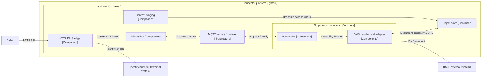

# Connector platform: architecture and communication contract

As of: 15 October 2026. Status: local, source-based design attempt for the new Markitect vocabulary. The user wants to check System, Container, Component and their relations on a complete request/reply example. The introduction of these architecture Kinds and the target candidates that follow are not yet conclusively accepted language contracts.

## Starting point and source status

The canonical model describes the intended project. The existing application provides illustrative material and concrete counter-probes here. Observed code does not become the desired specification through this analysis alone. In particular, its limitations are not adopted as accepted goals.

Local reference examined: `C:\Users\EduardMarkgraf\STP\STP.Dms.Cloud.Api`, HEAD `37f8986f36fbdc76bcabd4f8616f7747e4fd98d8`. The examined areas `src/` and `docs/` had no changes relative to HEAD. Other local changes and unversioned files were not used as reference material. Configuration with credentials was not read. The reference was only read; no application, no DMS, broker, cloud account and no integration tests were started.

The reference calls itself a POC. The current host registers DMS functions. UserManagement and Winsolvenz come from the user's desired overall example; their connection is not claimed as implemented in this repository. A successful real DMS operation is also not proven here: without DMS configuration, the registration can use a fake connection.

The source evidence is at the end of this page. The example first arose as a local analysis and was included in the documentation, on user request, together with the complete design state. The referenced application itself and its configuration are not shipped.

## Project purpose and scope

**Project — Connector project:** A common cloud API makes selected functions of standalone on-premise systems accessible. The solution translates external requests into versioned internal jobs, addresses the right customer environment, performs the work there and returns results to the original caller.

The target description covers both the access and communication rules and the desired architecture. File names, classes and assemblies are source evidence, not an automatically prescribed realization. Work assignments to agents and development processes via pull requests are not needed for this description.

## Systems and their boundaries

| Identity and Kind | Description | Status in the example |
| --- | --- | --- |
| `connector-platform` — System | Common access, routing and integration solution. Its boundary comprises cloud API and on-premise connector as well as the communication and storage services assigned to it. The boundary crosses the cloud/on-premise boundary. | Chosen working delimitation for this draft. |
| `dms` — System | Standalone document management with its own behavior and permissions. The platform uses its published or technically accessible contracts. | Connected in the reference; actual live operation not checked here. |
| `user-management` — System | Standalone local user management with offered operations still to be determined. | Desired extension; concrete connection open. |
| `winsolvenz` — System | Standalone domain application with offered operations still to be determined. | Desired extension; concrete connection open. |
| `identity-provider` — System | Supplies the identity and authoritative tenant information for access to the cloud API. | Connected in the reference via STP-IAM. |

External here means outside the chosen Connector system boundary. It describes neither the network location nor automatically foreign organizational ownership. DMS runs on-premise and nevertheless remains a standalone neighboring system.

## Runtime units and inner building blocks

### Applications and infrastructure

| Identity | Role and responsibility | C4 classification |
| --- | --- | --- |
| `cloud-api` | Standalone API application. Authenticates callers, resolves tenant and operation, translates Request into Command and Result into Response. | Container. |
| `onprem-connector` | Standalone application in a customer environment. Establishes the connection to the MQTT service outbound, receives jobs and uses local systems. | Container. |
| `content-staging` | Logical temporary object store for file transfers via time-limited URLs. | Data store container; implemented as S3 in the source, locally possibly MinIO. |
| `mqtt-runtime` | Separate MQTT broker or managed MQTT service that provides the communication infrastructure. | Standalone runtime infrastructure. Strict C4 presents logical topics/communication relationships and broker provisioning separately; see below. |

According to the user's specification, API, MQTT service and connector are separate processes or runtime environments. The physical broker instance does not thereby become an internal API module. In a C4 view, request/reply topics can appear as logical communication resources or as named communication relationships; in addition, the broker process belongs in the deployment view. Its prescribed existence and separation must not disappear from the overall model in the process.

**Open language point:** Is our Container term explicitly to include infrastructure processes as well, or does it follow the strict C4 projection with a separate deployment description? This attempt makes the decision visible. It does not silently introduce a fourth architecture Kind and does not designate the broker as a C4 Component.

### Components within the API

| Identity — Component | Responsibility and contracts |
| --- | --- |
| `api-access` | Authentication, tenant resolution and coarse access check. Supplies the trusted caller context to the endpoint processing. |
| `dms-http-edge` | Offers the HTTP DMS operations. Validates their inputs, forms Commands and presents results in the external response format. |
| `command-dispatcher` | Prepares the internal exchange, manages MessageId, reply address, waiting state, deadlines and bounded retries. |
| `api-mqtt-adapter` | Translates logical addresses into MQTT topics; publishes requests and delivers incoming replies to the dispatcher. |
| `api-content-staging` | Organizes permissions and URLs for direct file transfers to the object store. |
| `connector-monitor` | Receives heartbeats and capabilities of the connectors; configuration-dependent version/availability decisions. |

### Components within the on-premise connector

| Identity — Component | Responsibility and contracts |
| --- | --- |
| `connector-mqtt-adapter` | Connects outbound to the broker and provides the logical request/reply address operations. |
| `command-responder` | Receives and validates envelopes, limits concurrency, selects a handler on the basis of the complete capability and publishes the reply. |
| `dms-command-handling` | Executes the DMS operations and produces domain Results. |
| `dms-adapter` | Provides the required DMS functions via the DMS integration and uses the user context for local permissions. |
| `connector-content-transfer` | Transfers document content via given URLs instead of as an MQTT payload. |
| `connector-heartbeat` | Reports connector version and available capabilities to the cloud. |

This granularity is a proposal, not an obligation to have one Component per class or library. For example, the same MQTT adapter code is used in both applications; its two runtime uses are not an additional application. Likewise, a domain capability may need contributions from several Components and from both applications.



This combined overview shows architecture boundaries and logical communication. It is not a single strict C4 level diagram. MQTT adapters and further cross-cutting building blocks are combined into the participating Components for readability. The optional opposite direction and the extension systems are described separately in the text.

The reference currently offers seven DMS capabilities: list documents, upload, download, resolve by contexts, read metadata, read version history and search contexts. Their names are `dms.documents.list.v1`, `upload.v1`, `download.v1`, `resolve.v1`, `get.v1`, `history.v1` under the same document prefix as well as `dms.contexts.search.v1`.

## Interfaces, Concepts and relations

System/Container/Component describe the architecture structure. The complete contract additionally uses terms already discussed, such as Interface, Concept, UseCase, Rule and Scenario. A completely described project does not consist of the static architecture hierarchy alone.

### Named contract surfaces — Interface

| Identity | What the contract stipulates | Participants |
| --- | --- | --- |
| `public-dms-api` | HTTP operations, authentication, inputs, successful responses and errors. | Caller uses; HTTP edge provides. |
| `command-exchange` | Versioned Commands/Results, envelopes, address formation, reply address, reply matching, deadlines and delivery boundaries. | Dispatcher and responder each take one role of the same contract. |
| `mqtt-transport` | Publishing, subscription, topic mapping and transport behavior. The broker interprets no DMS capability. | MQTT adapters use; MQTT service provides transport. |
| `dms-access` | DMS operations required for the selected UseCases and error/permission semantics. | DMS provides; DMS adapter uses. |
| `content-transfer` | Access-authorized transfer via short-lived object URLs and their validity. | API organizes; connector and caller transfer data to/from the store. |

`Interface` is tried out here as cooperation between software building blocks and systems. That is broader than the previous working definition, which describes solely the Actor access to UseCases. The existing definition page is thereby not changed automatically.

### Named meanings — Concept

Required project terms are tenant, target environment, capability, Command, Result, RequestEnvelope, ResponseEnvelope, logical RequestInbox, ReplyInbox, MessageId, CorrelationId and connector/API instance. A Command describes a concrete operation request; its Result describes the domain result. The envelope supplements the transport contract. Whether each of these terms needs a Definition of its own depends on its independent use.

In the source, `Capability` has the four coordinates Product, Module, Operation and Version. The segment `Module = documents` is a domain operation grouping. It justifies neither an architecture Kind Module nor a mandatory one-to-one assignment to a Component.

### Relationships with concrete meaning

| Relationship | Example | What it expresses |
| --- | --- | --- |
| System contains Container | Platform contains API and connector. | Belonging to the solution, no statement about the network location. |
| Container contains Component | API contains dispatcher. | Functional contribution within this runtime boundary. |
| Component offers Interface | HTTP edge offers public DMS API. | Responsibility for a described contract. |
| Component uses Interface | DMS adapter uses DMS access. | Dependency on a contract of the neighboring system. |
| Component contributes to UseCase | HTTP edge, dispatcher, responder and DMS adapter contribute to “List documents”. | A behavior extends across several runtime units. |
| Rule applies to contract/Definition | Reply matching applies to Command exchange. | The obligation reaches the relevant contributions. |
| Check examines expectation | Simultaneous requests each receive their own reply. | Declared check assignment, not yet an executed result. |

Publish/subscribe, input mapping and response formation are initially made precise within the communication contract and the UseCase. The table does not introduce a new universal graph edge type for every activity verb. Before a machine-readable language contract, direction, permitted targets and derived consequences of each chosen relation are to be determined.

## Topic selection and reply contract

The source makes two different routing decisions:

1. **Where to?** The target environment determines the logical RequestInbox and from it the MQTT topic. In the cloud-to-customer case, this is the tenant.
2. **What?** The capability within the envelope determines the handler on the receiver. Product, domain module group, operation and version are not additional topic segments in the current MQTT path.

| Purpose | Logical address / data | MQTT mapping of the source |
| --- | --- | --- |
| Request for customer | `RequestInbox([tenantId])` | `stp/dms/{tenantId}` |
| Competing connector receivers | `SharedRequestInbox([tenantId])` | `$share/replicas/stp/dms/{tenantId}` as subscription filter |
| Reply to API instance | `ReplyInbox([cloud], instanceId)` | `stp/dms/cloud/{instanceId}` |
| Operation selection | `Capability(dms, documents, list, v1)` | Envelope field, no further routing topic. |

The fixed prefix `stp/dms` is a transport/policy contract in the source; the `dms` contained in it is not inserted dynamically from Capability.Product. A later product change must not confuse these two levels. Further target axes and multipart addresses are possible in the routing core; they do not replace the tenant addressing actually used.

The connector publishes a reply to the logical address reconstructed from `ReplyTarget` and `ReplyInstance`. These are application fields of the envelope. The examined path uses no automatic MQTT RPC function for this.

The response retains the **MessageId of the request**. The dispatcher uses this ID as the key of the waiting request. The **CorrelationId** is additionally preserved and serves end-to-end tracing, also across possible further hops. In the examined dispatcher it is not the key for local reply delivery.

The shared subscription distributes one delivery to a matching connector subscriber of the common pool. No guarantee arises from this that a domain job is executed exactly once across connection drops, retries and several replicas.

## UseCase: list documents of a folder

The following description is a target candidate derived from the actual processing path. The values are synthetic examples.

**Expectation:** An authorized caller receives the document metadata of the chosen folder in the DMS of their customer environment. They receive either the successful result or a defined error. Calling another customer environment must not be made possible by a freely set routing entry.

| Step | Contribution and statement |
| --- | --- |
| 1 | Caller sends `POST /v1/dms/documents/list` with `FolderId = root` and `PageSize = 100`. |
| 2 | API checks identity and required scope. The tenant is determined in the current code from the authenticated token context; the older README example with `X-Tenant-Id` is not a reliable current source for this. Example tenant: `tenant-demo`. |
| 3 | HTTP edge validates the input and forms `ListDocumentsCommand`. HTTP request and Command are separate descriptions with explicit mapping. |
| 4 | Dispatcher adopts `Capability = dms.documents.list.v1`, addresses `tenant-demo`, generates or adopts the IDs and registers the waiting exchange before publication. |
| 5 | RequestEnvelope carries for example `MessageId = m1`, `CorrelationId = c1`, `ReplyTarget = [cloud]`, `ReplyInstance = api-A`, SchemaVersion, capability, diagnostic target, deadline header and encoded Command. The diagnostic field Target itself is not the transport address already used. |
| 6 | API MQTT adapter publishes to `stp/dms/tenant-demo`. A connector receives via `$share/replicas/stp/dms/tenant-demo`. |
| 7 | Responder validates envelope and version, limits the amount of work and looks for the handler for the complete capability. |
| 8 | DMS handler uses the DMS adapter. The adapter executes the queries against DMS with the user context. If the DMS configuration is missing, the reference host can use a fake connection instead; this is no live-DMS evidence. |
| 9 | Handler produces a ListDocumentsResult with document metadata and, where applicable, continuation information. Transport success and domain result status are separate. |
| 10 | Responder forms ResponseEnvelope with `MessageId = m1` and `CorrelationId = c1` and publishes to `stp/dms/cloud/api-A`. |
| 11 | The reply address leads to the reply inbox of API instance `api-A`. Its dispatcher finds the waiting exchange via `m1` and decodes the Result. The technical access restriction on topics is additionally to be determined. |
| 12 | HTTP edge forms ListDocumentsResponse or the defined error and ends the HTTP request. |

```mermaid
sequenceDiagram
    participant Caller as Caller
    participant API as Cloud API / instance api-A
    participant MQTT as MQTT broker
    participant Connector as On-premise connector
    participant DMS as DMS
    Note over API: Subscribe to reply inbox before the exchange
    Note over Connector: Subscribe to tenant inbox as shared subscription
    Caller->>API: HTTP request for tenant-demo
    Note over API: Map request to Command; register waiter m1
    API->>MQTT: Request on stp/dms/tenant-demo
    MQTT->>Connector: Delivery to one subscriber
    Note over Connector: Choose handler by capability
    Connector->>DMS: Read documents in user context
    DMS-->>Connector: Metadata / domain error
    Connector->>MQTT: Reply on stp/dms/cloud/api-A with m1
    MQTT-->>API: Reply to api-A
    Note over API: Find waiting request via MessageId m1
    API-->>Caller: HTTP response / defined error
```

The arrows show message flow, not network connections to be opened inbound at the customer. The MQTT connection of the connector is established outbound. In this path the HTTP request waits for a Result; the MQTT communication itself uses asynchronous messages.

## Rules, errors and boundaries

This table separates the observed mechanism from the target quality still to be decided from it. Configuration defaults are no statement about the active customer configuration.

| Item | Source finding | Consequence for the target description |
| --- | --- | --- |
| Tenant | Current HTTP code uses the token context. Older orientation additionally names a header. | Determine a single authoritative origin and describe access boundaries at the MQTT addresses. |
| Versions and unknown operations | Unsupported RequestEnvelope version is dead-lettered. A validly decoded unknown capability receives an error reply. | Describe error paths separately; an invalid message does not automatically have an evaluable reply contract. |
| Success | Envelope status and domain result status are different. A successful handler call can return a domain error result. | Transport success must not be presented as domain success. |
| Error mapping | Domain permission denial becomes HTTP 403, not-found 404, other domain errors typically 502. Dispatcher timeout becomes 504, dispatcher shutdown 503. | Describe the concrete external effect per operation and error type. Source is the current exception/result path, not older documentation alone. |
| Waiting period | Default 30 seconds per dispatch attempt; default two attempts with bounded delay. | Do not claim a blanket total deadline of 30 seconds. Determine HTTP abort, retry budget and total deadline separately. |
| Deadline | Each attempt receives a new absolute deadline. Responder can reject outdated jobs before work begins. | Take clock deviation and already running work into account. A timeout does not prove non-execution and does not trigger an automatic DMS rollback. |
| Retry | Dispatch retry uses the same MessageId. An optional HTTP idempotency key can preserve the ID across a repeated HTTP call. | Determine scope, conflict handling and retention of the idempotency key. |
| Idempotency | Default store is in memory per process, with bounded retention and size. The same HTTP key with a different body is not checked for a payload conflict. | No general exactly-once promise. Behavior across replicas, restarts and contradictory retries is open. |
| Replicas | All connectors of the same target pool share the request inbox; handlers are chosen by capability only afterwards. | Either every receiver of the pool must master the relevant capabilities or the distribution must take ability and version into account. Heterogeneous replicas are a counter-probe. |
| Reply state | Waiters live in the memory of the API instance. InstanceId is newly generated at start by default. Late replies without waiter are ignored. | Describe restart and lost replies visibly; do not claim automatic takeover by another API instance. |
| MQTT | Publish/subscribe QoS is configurable, default 1; connection re-establishment and bounded publish retries exist. | Transport delivery, application execution and durability are expectations of their own. Broker ACK is no DMS success message. |
| Concurrency | Responder has a bounded inbox and worker count, default 16. | Decide load behavior, order and waiting times; do not derive an automatic order guarantee from the topic. |
| Authentication / encryption | The hosts have optional additional hop authentication and payload encryption. Active settings were not collected. | Describe the desired security profile as an obligation; existing registration options are no proof that it is active. |

## Further necessary views of the example

**Document content:** Upload and download need an additional data path via object store and time-limited URLs. The MQTT envelopes transport jobs, metadata and transfer information; a diagram with only API, broker and connector leaves the documented file transfer incomplete. Access, tenant binding, expiry and cleanup of the temporarily stored files are contracts of their own.

**Role direction:** For configurable multipart export staging, the connector can also be dispatcher and the cloud API also responder. The role “sender of a job” is not an unchangeable property of the system type cloud or on-premise. The reusable Command exchange must permit both directions where the UseCase concerned provides for it.

**Optional local forwarding:** ProxyHandler and the LSB/product addressing show a prepared further forwarding in a customer environment. They are not claimed here as active in the normal DMS host. If it is chosen, the UseCase needs a further hop with its own MessageId, preserved end-to-end CorrelationId and associated reply and error rules.

**Operation:** Connector heartbeat, available capabilities, versions and API gating are provided for in the source. For a complete operations description, availability and version compatibility are otherwise missing. No required workflow for software development follows from this.

## Check scenarios for model completeness

The following checks are design assignments. The local source analysis does not execute them. Existing test files serve as additional evidence of which expectations are already formulated in the project.

| Scenario | Expectation / Check |
| --- | --- |
| Normal list call | HTTP request, Command, tenant address, chosen handler, Result and HTTP response agree in content and responsibility. |
| Two simultaneous calls on the same API instance | Each waiter receives its own Result via the associated MessageId; replies may arrive in a different order. |
| Two API instances | ReplyInbox leads to the issuing instance, not to an arbitrary waiting process. |
| Foreign tenant | Through freely chosen inputs, a caller can neither trigger foreign jobs nor subscribe to foreign replies. |
| Other product or domain module | Topic selection and complete capability are checked independently; an identical operation name produces no handler collision. |
| Heterogeneous connector replicas | A job reaches a receiver that can execute the required capability and version, or a defined rejecting behavior. |
| Retry / restart | Retry effect corresponds to the explicitly chosen idempotency guarantee; a repeated write job produces no silently promised exactly-once property. |
| Timeout, late reply, API restart | Pending state and domain execution uncertainty remain visible; a late reply is not treated as a reply to a new job. |
| Unknown capability / broken envelope | Defined error reply or dead-letter path; no invented successful reply. |
| Larger file | Content runs via the provided storage path; expired URL, permission error and necessary cleanup are described. |

## Result for the vocabulary

System, Container and Component give the example clear solution, runtime and function boundaries. The term Module is not additionally needed for the architecture structure of this example. This does not yet confirm its general dispensability; in particular, a capability name segment and a code library are different items from a Component.

For a sufficient project description, Interface as internal/external contract, UseCase for the operation effect, Concept for messages and identities as well as Rule for reply matching, deadline and error semantics are additionally needed. Scenario and Check make the expected consequences concrete. A new universal Command, Topic or Workflow Kind is not yet justified by this example; the independent need for such Definitions is to be checked against the expression and the use.

The most important open language questions are:

1. **Container and infrastructure:** How do broker process, logical topics, deployment environment and instances belong in the typed target description without equating logical and physical views?
2. **Interface:** Does a common contract suffice for request, reply, roles and rules, and how are its contributions assigned to the Components?
3. **Parameterized addresses:** How are topic families, and reply addresses formed from runtime values, described, without needing a model definition per concrete tenant, job or process start?
4. **Behavior across several building blocks:** How does a UseCase reference its contributions, translations and check obligations, so that a contract change reaches the affected senders and receivers?
5. **Guarantees:** Which reply-matching, retry, compatibility and abort rules are actually desired? The existing POC implementation does not anticipate these decisions.

The example does not justify the inclusion of agent mandates, concrete source files or PR workflows in the new canonical project vocabulary.

## Source evidence

All project paths below lie under the local reference named above and were read at the fixed HEAD. The paths are provenance; they are not expected Artifacts of the proposed model.

| Item | Reference path and entry point |
| --- | --- |
| HTTP request to Command, target and Result | `src/STP.Dms.Cloud.Dms/Documents/List/V1/ListDocumentsEndpoint.cs`, line 39 ff.; `src/STP.Dms.Cloud.Common/Endpoints/Capabilities/CapabilityEndpoint.cs`, line 37; `TenantResolution.cs`, line 12. |
| Identity of the operation | `src/STP.Dms.Core/Capability.cs`; `src/STP.Dms.Core.Dms/Capabilities.cs`; `src/STP.Dms.Core.Dms/Documents/List/V1/`. |
| Logical addresses / topic mapping | `src/STP.Dms.Core.Broker/Address.cs`; `src/STP.Dms.Core.Broker.Mqtt/MqttTopics.cs`, lines 11 and 17–21. |
| Dispatch, ReplyInbox and waiter | `src/STP.Dms.Core.Routing/Dispatch/Dispatcher.cs`, lines 45, 49, 93, 149–151 and 157 ff. |
| Handler selection, response and reply address | `src/STP.Dms.Core.Routing/Respond/Responder.cs`, lines 54, 210 and 302 ff. |
| Envelope fields | `src/STP.Dms.Core.Routing/Common/Envelope/RequestEnvelope.cs` and `ResponseEnvelope.cs`. |
| Deadline / retry | `src/STP.Dms.Core.Routing/DispatcherOptions.cs`; `Dispatch/Middlewares/RetryDispatchMiddleware.cs` and `DeadlineDispatchMiddleware.cs`; `Respond/Middlewares/DeadlineRespondMiddleware.cs`. |
| Idempotency and boundaries | `src/STP.Dms.Core.Routing/Respond/Idempotency.cs`; `ResponderOptions.cs`; `Common/IdempotencyContext.cs`. |
| MQTT behavior | `src/STP.Dms.Core.Broker.Mqtt/MqttBroker.cs`, from line 95; `MqttBrokerOptions.cs`. |
| DMS connection / fake boundary | `src/STP.Dms.OnPremise.Dms/Common/DmsModuleExtensions.cs`, `DmsConnection.cs`, `IDmsConnection.cs`; `Documents/List/V1/ListDocumentsHandler.cs`. |
| Actual host composition | `src/STP.Dms.Cloud.Api/Program.cs`; `src/STP.Dms.OnPremise.Connector/ConnectorHost.cs`, lines 49 and 73. |
| External errors | `src/STP.Dms.Cloud.Common/Endpoints/Capabilities/DispatchExtensions.cs` and `ProblemExceptionHandler.cs`. |
| File transfer / opposite direction | `src/STP.Dms.Cloud.Common/Endpoints/Capabilities/Export/ExportCapabilityEndpoint.cs`, from line 86; cloud host with optional ExportStaging. |
| Existing tests, not executed | `tests/STP.Dms.Core.Broker.Mqtt.Tests/MqttTopicsTests.cs`; `tests/STP.Dms.Cloud.Common.Tests/DispatcherRepliesTests.cs`; further dispatcher/timeout/concurrency tests. |
| Explanations and older statements | `docs/orientation.md`, `docs/architecture/flow.md`, `components.md`, `scaling.md`, `cross-cutting-concerns.md`. Current code takes precedence in the case of a proven deviation, in particular for tenant resolution. |

External term sources: [C4 abstractions](https://c4model.com/abstractions), [Container](https://c4model.com/abstractions/container), [Component](https://c4model.com/abstractions/component), [Queues and topics](https://c4model.com/abstractions/queues-and-topics), [Deployment](https://c4model.com/diagrams/deployment) and [dynamic views](https://c4model.com/diagrams/dynamic). C4 contributes the delimitations and views; the concrete platform mapping and the open Markitect language questions are the conclusion of this design attempt.

Back to the [term overview](README.md) and the [common design state](consolidation.md).
