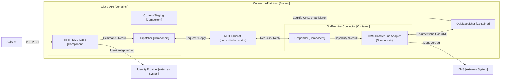

# Connector-Plattform: Architektur und Kommunikationsvertrag

Stand: 15. Oktober 2026. Status: lokaler, quellengestützter Designversuch für das neue Markitect-Vokabular. Der Nutzer möchte System, Container, Component und ihre Relationen an einem vollständigen Request-/Reply-Beispiel prüfen. Die Einführung dieser Architektur-Kinds und die nachfolgenden Sollkandidaten sind noch keine abschließend akzeptierten Sprachverträge.

## Ausgangspunkt und Quellenstatus

Das kanonische Modell beschreibt das beabsichtigte Projekt. Die bestehende Anwendung liefert hier Anschauungsmaterial und konkrete Gegenproben. Beobachteter Code wird nicht allein durch diese Analyse zur gewünschten Spezifikation. Insbesondere seine Einschränkungen werden nicht als akzeptierte Ziele übernommen.

Untersuchte lokale Referenz: `C:\Users\EduardMarkgraf\STP\STP.Dms.Cloud.Api`, HEAD `37f8986f36fbdc76bcabd4f8616f7747e4fd98d8`. Die untersuchten Bereiche `src/` und `docs/` hatten keine Änderungen gegenüber HEAD. Andere lokale Änderungen und nicht versionierte Dateien wurden nicht als Referenzmaterial verwendet. Konfiguration mit Zugangsdaten wurde nicht eingelesen. Die Referenz wurde ausschließlich gelesen; keine Anwendung, kein DMS, Broker, Cloudkonto und keine Integrationstests wurden gestartet.

Die Referenz bezeichnet sich als POC. Der aktuelle Host registriert DMS-Funktionen. UserManagement und Winsolvenz stammen aus dem gewünschten Gesamtbeispiel des Nutzers; ihre Anbindung wird in diesem Repository nicht als umgesetzt behauptet. Auch ein erfolgreicher echter DMS-Betrieb ist hier nicht nachgewiesen: Die Registrierung kann ohne DMS-Konfiguration eine Fake-Verbindung verwenden.

Die Quellenbelege stehen am Ende dieser Seite. Das Beispiel entstand zunächst als lokale Analyse. Mit dem anschließenden Nutzerauftrag, den vollständigen Designstand für einen Remote-Handoff zu sichern, wird auch dieser Designversuch in die Dokumentationsbranch aufgenommen. Die referenzierte Anwendung selbst und ihre Konfiguration werden nicht mitgeliefert.

## Projektzweck und Umfang

**Project — Connector-Projekt:** Eine gemeinsame Cloud-API macht ausgewählte Funktionen eigenständiger On-Premise-Systeme zugänglich. Die Lösung übersetzt externe Anfragen in versionierte interne Aufträge, adressiert die richtige Kundenumgebung, führt die Arbeit dort aus und liefert Ergebnisse an den ursprünglichen Aufrufer zurück.

Die Zielbeschreibung umfasst sowohl die Zugriffs- und Kommunikationsregeln als auch die gewünschte Architektur. Dateinamen, Klassen und Assemblies sind Quellenbelege, keine automatisch vorgeschriebene Realisierung. Arbeitsaufträge an Agents und Entwicklungsprozesse über Pull Requests werden für diese Beschreibung nicht benötigt.

## Systeme und ihre Grenzen

| Identität und Kind | Beschreibung | Status im Beispiel |
| --- | --- | --- |
| `connector-platform` — System | Gemeinsame Zugangs-, Routing- und Integrationslösung. Ihre Grenze umfasst Cloud-API und On-Premise-Connector sowie die ihr zugeordneten Kommunikations- und Speicherdienste. Die Grenze überschreitet die Cloud-/On-Premise-Grenze. | Gewählte Arbeitsabgrenzung für diesen Entwurf. |
| `dms` — System | Eigenständige Dokumentenverwaltung mit ihrem eigenen Verhalten und Berechtigungen. Die Plattform verwendet ihre veröffentlichten beziehungsweise technisch zugänglichen Verträge. | In der Referenz angebunden; tatsächlicher Livebetrieb hier nicht geprüft. |
| `user-management` — System | Eigenständige lokale Benutzerverwaltung mit noch festzulegenden angebotenen Operationen. | Gewünschte Erweiterung; konkrete Anbindung offen. |
| `winsolvenz` — System | Eigenständige Fachanwendung mit noch festzulegenden angebotenen Operationen. | Gewünschte Erweiterung; konkrete Anbindung offen. |
| `identity-provider` — System | Liefert die Identität und autoritativen Mandanteninformationen für den Zugriff auf die Cloud-API. | In der Referenz über STP-IAM angebunden. |

Extern bedeutet hier außerhalb der gewählten Connector-Systemgrenze. Es beschreibt weder den Netzwerkstandort noch automatisch fremdes organisatorisches Eigentum. DMS läuft On-Premise und bleibt dennoch ein eigenständiges Nachbarsystem.

## Laufzeiteinheiten und innere Bausteine

### Anwendungen und Infrastruktur

| Identität | Rolle und Verantwortung | C4-Einordnung |
| --- | --- | --- |
| `cloud-api` | Eigenständige API-Anwendung. Authentifiziert Aufrufer, löst Mandant und Operation auf, übersetzt Request in Command und Result in Response. | Container. |
| `onprem-connector` | Eigenständige Anwendung in einer Kundenumgebung. Baut die Verbindung zum MQTT-Dienst ausgehend auf, empfängt Aufträge und verwendet lokale Systeme. | Container. |
| `content-staging` | Logischer temporärer Objektspeicher für Dateiübertragungen über zeitlich begrenzte URLs. | Datenspeicher-Container; Implementierung in der Quelle S3, lokal ggf. MinIO. |
| `mqtt-runtime` | Separater MQTT-Broker beziehungsweise verwalteter MQTT-Dienst, der die Kommunikationsinfrastruktur bereitstellt. | Eigenständige Laufzeitinfrastruktur. Strenges C4 stellt logische Topics/Kommunikationsbeziehungen und Brokerbereitstellung getrennt dar; siehe unten. |

API, MQTT-Dienst und Connector sind nach Nutzervorgabe getrennte Prozesse beziehungsweise Laufzeitumgebungen. Die physische Brokerinstanz wird dadurch nicht zu einem internen API-Modul. In einer C4-Sicht können Request-/Reply-Topics als logische Kommunikationsressourcen oder als benannte Kommunikationsbeziehungen erscheinen; der Brokerprozess gehört zusätzlich in die Bereitstellungssicht. Seine vorgeschriebene Existenz und Trennung dürfen dabei nicht aus dem Gesamtmodell verschwinden.

**Offener Sprachpunkt:** Soll unser Container-Begriff ausdrücklich auch Infrastrukturprozesse aufnehmen oder folgt er der strengen C4-Projektion mit separater Bereitstellungsbeschreibung? Dieser Versuch macht die Entscheidung sichtbar. Er führt nicht stillschweigend einen vierten Architektur-Kind ein und bezeichnet den Broker nicht als C4-Component.

### Components innerhalb der API

| Identität — Component | Verantwortung und Verträge |
| --- | --- |
| `api-access` | Authentifizierung, Mandantenauflösung und grobe Zugriffsprüfung. Liefert den vertrauenswürdigen Aufruferkontext an die Endpunktverarbeitung. |
| `dms-http-edge` | Bietet die HTTP-DMS-Operationen an. Validiert ihre Eingaben, bildet Commands und stellt Ergebnisse im externen Responseformat dar. |
| `command-dispatcher` | Bereitet den internen Austausch vor, verwaltet MessageId, Antwortadresse, Wartezustand, Fristen und begrenzte Wiederholungen. |
| `api-mqtt-adapter` | Übersetzt logische Adressen in MQTT-Topics; veröffentlicht Requests und liefert eingehende Replies an den Dispatcher. |
| `api-content-staging` | Organisiert Berechtigungen und URLs für direkte Dateiübertragungen zum Objektspeicher. |
| `connector-monitor` | Empfängt Lebenszeichen und Fähigkeiten der Connectoren; konfigurationsabhängige Versions-/Verfügbarkeitsentscheidungen. |

### Components innerhalb des On-Premise-Connectors

| Identität — Component | Verantwortung und Verträge |
| --- | --- |
| `connector-mqtt-adapter` | Verbindet sich ausgehend mit dem Broker und stellt die logischen Request-/Reply-Adressoperationen bereit. |
| `command-responder` | Empfängt und validiert Envelopes, begrenzt Parallelität, wählt einen Handler anhand der vollständigen Capability und veröffentlicht die Antwort. |
| `dms-command-handling` | Führt die DMS-Operationen aus und erzeugt fachliche Results. |
| `dms-adapter` | Stellt die benötigten DMS-Funktionen über die DMS-Integration bereit und verwendet den Benutzerkontext für lokale Berechtigungen. |
| `connector-content-transfer` | Überträgt Dokumentinhalt über vorgegebene URLs statt als MQTT-Nutzlast. |
| `connector-heartbeat` | Meldet Connector-Version und verfügbare Fähigkeiten an die Cloud. |

Diese Granularität ist ein Vorschlag, keine Pflicht zu einer Component pro Klasse oder Bibliothek. Beispielsweise wird derselbe MQTT-Adaptercode in beiden Anwendungen verwendet; seine beiden Laufzeitverwendungen sind keine zusätzliche Anwendung. Ebenso kann eine fachliche Capability Beiträge mehrerer Components und beider Anwendungen benötigen.



Diese kombinierte Übersicht zeigt Architekturgrenzen und logische Kommunikation. Sie ist kein einzelnes strenges C4-Level-Diagramm. MQTT-Adapter und weitere Querschnittsbausteine sind für die Lesbarkeit in den beteiligten Components zusammengefasst. Die optionale Gegenrichtung und die Erweiterungssysteme werden im Text gesondert beschrieben.

Die Referenz bietet derzeit sieben DMS-Capabilities: Dokumente auflisten, hochladen, herunterladen, anhand von Kontexten auflösen, Metadaten lesen, Versionshistorie lesen und Kontexte suchen. Ihre Namen sind `dms.documents.list.v1`, `upload.v1`, `download.v1`, `resolve.v1`, `get.v1`, `history.v1` unter demselben Dokumentpräfix sowie `dms.contexts.search.v1`.

## Interfaces, Concepts und Relationen

System/Container/Component beschreiben die Architekturgliederung. Der vollständige Vertrag verwendet zusätzlich bereits diskutierte Begriffe wie Interface, Concept, UseCase, Rule und Scenario. Ein vollständig beschriebenes Projekt besteht nicht allein aus der statischen Architekturhierarchie.

### Benannte Vertragsflächen — Interface

| Identität | Was der Vertrag festlegt | Beteiligte |
| --- | --- | --- |
| `public-dms-api` | HTTP-Operationen, Authentifizierung, Eingaben, erfolgreiche Antworten und Fehler. | Aufrufer verwendet; HTTP-Edge stellt bereit. |
| `command-exchange` | Versionierte Commands/Results, Envelopes, Adressbildung, Antwortadresse, Zuordnung, Fristen und Zustellgrenzen. | Dispatcher und Responder übernehmen jeweils eine Rolle desselben Vertrags. |
| `mqtt-transport` | Veröffentlichung, Abonnement, Topicabbildung und Transportverhalten. Der Broker interpretiert keine DMS-Capability. | MQTT-Adapter verwenden; MQTT-Dienst stellt Transport bereit. |
| `dms-access` | Für die ausgewählten UseCases benötigte DMS-Operationen und Fehler-/Berechtigungssemantik. | DMS stellt bereit; DMS-Adapter verwendet. |
| `content-transfer` | Zugriffsberechtigte Übertragung über kurzlebige Objekt-URLs und deren Gültigkeit. | API organisiert; Connector und Aufrufer übertragen Daten zum/vom Speicher. |

`Interface` wird hier als Zusammenarbeit zwischen Softwarebausteinen und Systemen erprobt. Das ist weiter als die bisherige Arbeitsdefinition, die allein den Actor-Zugang zu UseCases beschreibt. Die bestehende Definitionsseite wird damit nicht automatisch geändert.

### Benannte Bedeutungen — Concept

Benötigte Projektbegriffe sind Mandant, Zielumgebung, Capability, Command, Result, RequestEnvelope, ResponseEnvelope, logische RequestInbox, ReplyInbox, MessageId, CorrelationId und Connector-/API-Instanz. Ein Command beschreibt eine konkrete Operationsanforderung; sein Result beschreibt das fachliche Ergebnis. Die Envelope ergänzt den Transportvertrag. Ob jeder dieser Begriffe eine eigene Definition braucht, hängt von seiner unabhängigen Verwendung ab.

`Capability` hat in der Quelle die vier Koordinaten Product, Module, Operation und Version. Das Segment `Module = documents` ist eine fachliche Operationsgruppierung. Es begründet keinen Architektur-Kind Module und keine zwingende Eins-zu-eins-Zuordnung zu einer Component.

### Beziehungen mit konkreter Bedeutung

| Beziehung | Beispiel | Was sie ausdrückt |
| --- | --- | --- |
| System enthält Container | Plattform enthält API und Connector. | Zugehörigkeit zur Lösung, keine Aussage zum Netzwerkstandort. |
| Container enthält Component | API enthält Dispatcher. | Funktionaler Beitrag innerhalb dieser Laufzeitgrenze. |
| Component bietet Interface | HTTP-Edge bietet öffentliche DMS-API. | Verantwortung für einen beschriebenen Vertrag. |
| Component verwendet Interface | DMS-Adapter verwendet DMS-Zugriff. | Abhängigkeit von einem Vertrag des Nachbarsystems. |
| Component trägt zu UseCase bei | HTTP-Edge, Dispatcher, Responder und DMS-Adapter tragen zu „Dokumente auflisten“ bei. | Ein Verhalten erstreckt sich über mehrere Laufzeiteinheiten. |
| Rule gilt für Vertrag/Definition | Antwortzuordnung gilt für Command-Austausch. | Die Verpflichtung erreicht die relevanten Beiträge. |
| Check untersucht Erwartung | Gleichzeitige Requests erhalten jeweils ihre eigene Antwort. | Deklarierter Prüfauftrag, noch kein ausgeführtes Ergebnis. |

Publish/Subscribe, Eingabeabbildung und Antwortbildung werden zunächst innerhalb des Kommunikationsvertrags und des UseCases präzisiert. Die Tabelle führt nicht für jedes Tätigkeitsverb einen neuen universellen Graphkantentyp ein. Vor einem maschinellen Sprachvertrag sind Richtung, erlaubte Ziele und abgeleitete Folgen jeder gewählten Relation zu bestimmen.

## Topicwahl und Antwortvertrag

Die Quelle trifft zwei verschiedene Routingentscheidungen:

1. **Wohin?** Die Zielumgebung bestimmt die logische RequestInbox und daraus das MQTT-Topic. Im Cloud-zu-Kunde-Fall ist das der Mandant.
2. **Was?** Die Capability innerhalb der Envelope bestimmt auf dem Empfänger den Handler. Produkt, fachliche Modulgruppe, Operation und Version sind im aktuellen MQTT-Pfad keine zusätzlichen Topicsegmente.

| Zweck | Logische Adresse / Daten | MQTT-Abbildung der Quelle |
| --- | --- | --- |
| Request für Kunde | `RequestInbox([tenantId])` | `stp/dms/{tenantId}` |
| Konkurrierende Connector-Empfänger | `SharedRequestInbox([tenantId])` | `$share/replicas/stp/dms/{tenantId}` als Abonnementfilter |
| Antwort an API-Instanz | `ReplyInbox([cloud], instanceId)` | `stp/dms/cloud/{instanceId}` |
| Operationsauswahl | `Capability(dms, documents, list, v1)` | Envelope-Feld, kein weiteres Routingtopic. |

Der feste Präfix `stp/dms` ist in der Quelle ein Transport-/Policyvertrag; das darin stehende `dms` wird nicht dynamisch aus Capability.Product eingesetzt. Ein späterer Produktwechsel darf diese beiden Ebenen nicht verwechseln. Weitere Zielachsen und mehrteilige Adressen sind im Routingkern möglich; sie ersetzen die tatsächlich verwendete Mandantenadressierung nicht.

Der Connector veröffentlicht eine Antwort an die aus `ReplyTarget` und `ReplyInstance` rekonstruierte logische Adresse. Dies sind Anwendungsfelder der Envelope. Der untersuchte Pfad verwendet dafür keine automatische MQTT-RPC-Funktion.

Die Response behält die **MessageId des Requests**. Der Dispatcher verwendet diese ID als Schlüssel der wartenden Anfrage. Die **CorrelationId** wird zusätzlich erhalten und dient der übergreifenden Nachverfolgung, auch über mögliche weitere Hops. Sie ist im untersuchten Dispatcher nicht der Schlüssel für die lokale Antwortzustellung.

Die Shared Subscription verteilt eine Zustellung auf einen passenden Connector-Abonnenten des gemeinsamen Pools. Daraus entsteht keine Garantie, dass ein fachlicher Auftrag über Verbindungsabbrüche, Wiederholungen und mehrere Replikas genau einmal ausgeführt wird.

## UseCase: Dokumente eines Ordners auflisten

Die folgende Beschreibung ist ein Sollkandidat, der aus dem tatsächlichen Verarbeitungspfad gewonnen wird. Die Werte sind synthetische Beispiele.

**Erwartung:** Ein berechtigter Aufrufer erhält die Dokumentmetadaten des gewählten Ordners im DMS seiner Kundenumgebung. Er erhält entweder das erfolgreiche Ergebnis oder einen definierten Fehler. Der Aufruf einer anderen Kundenumgebung darf durch eine frei gesetzte Routingangabe nicht ermöglicht werden.

| Schritt | Beitrag und Aussage |
| --- | --- |
| 1 | Aufrufer sendet `POST /v1/dms/documents/list` mit `FolderId = root` und `PageSize = 100`. |
| 2 | API prüft Identität und erforderlichen Scope. Der Mandant wird im aktuellen Code aus dem authentifizierten Tokenkontext bestimmt; das ältere README-Beispiel mit `X-Tenant-Id` ist dafür keine verlässliche aktuelle Quelle. Beispielmandant: `tenant-demo`. |
| 3 | HTTP-Edge validiert die Eingabe und bildet `ListDocumentsCommand`. HTTP-Request und Command sind getrennte Beschreibungen mit expliziter Abbildung. |
| 4 | Dispatcher übernimmt `Capability = dms.documents.list.v1`, adressiert `tenant-demo`, erzeugt beziehungsweise übernimmt die IDs und registriert den wartenden Austausch vor der Veröffentlichung. |
| 5 | RequestEnvelope trägt beispielsweise `MessageId = m1`, `CorrelationId = c1`, `ReplyTarget = [cloud]`, `ReplyInstance = api-A`, SchemaVersion, Capability, Diagnostikziel, Fristheader und kodierten Command. Das Diagnosefeld Target selbst ist nicht die bereits verwendete Transportadresse. |
| 6 | API-MQTT-Adapter veröffentlicht auf `stp/dms/tenant-demo`. Ein Connector empfängt über `$share/replicas/stp/dms/tenant-demo`. |
| 7 | Responder validiert Envelope und Version, begrenzt die Arbeitsmenge und sucht den Handler für die vollständige Capability. |
| 8 | DMS-Handler verwendet den DMS-Adapter. Der Adapter führt die Abfragen mit dem Benutzerkontext gegen DMS aus. Bei fehlender DMS-Konfiguration kann der Referenzhost stattdessen eine Fake-Verbindung einsetzen; das ist kein Live-DMS-Nachweis. |
| 9 | Handler erzeugt ein ListDocumentsResult mit Dokumentmetadaten und gegebenenfalls Fortsetzungsinformation. Transporterfolg und fachlicher Resultstatus sind getrennt. |
| 10 | Responder bildet ResponseEnvelope mit `MessageId = m1` und `CorrelationId = c1` und veröffentlicht auf `stp/dms/cloud/api-A`. |
| 11 | Die Antwortadresse führt zur Reply-Inbox von API-Instanz `api-A`. Ihr Dispatcher findet über `m1` den wartenden Austausch und dekodiert das Result. Die technische Zugriffsbeschränkung auf Topics ist zusätzlich zu bestimmen. |
| 12 | HTTP-Edge bildet ListDocumentsResponse beziehungsweise den definierten Fehler und beendet die HTTP-Anfrage. |

```mermaid
sequenceDiagram
    participant Caller as Aufrufer
    participant API as Cloud-API / Instanz api-A
    participant MQTT as MQTT-Broker
    participant Connector as On-Premise-Connector
    participant DMS as DMS
    Note over API: Reply-Inbox vor dem Austausch abonnieren
    Note over Connector: Mandanten-Inbox als Shared Subscription abonnieren
    Caller->>API: HTTP-Request fuer tenant-demo
    Note over API: Request in Command abbilden; Waiter m1 registrieren
    API->>MQTT: Request auf stp/dms/tenant-demo
    MQTT->>Connector: Zustellung an einen Abonnenten
    Note over Connector: Handler nach Capability waehlen
    Connector->>DMS: Dokumente im Benutzerkontext lesen
    DMS-->>Connector: Metadaten / fachlicher Fehler
    Connector->>MQTT: Reply auf stp/dms/cloud/api-A mit m1
    MQTT-->>API: Antwort an api-A
    Note over API: Wartende Anfrage ueber MessageId m1 finden
    API-->>Caller: HTTP-Response / definierter Fehler
```

Die Pfeile zeigen Nachrichtenfluss, keine eingehend zu öffnenden Netzwerkverbindungen beim Kunden. Die MQTT-Verbindung des Connectors wird ausgehend aufgebaut. Die HTTP-Anfrage wartet in diesem Pfad auf ein Result; die MQTT-Kommunikation selbst verwendet asynchrone Nachrichten.

## Regeln, Fehler und Grenzen

Diese Tabelle trennt beobachteten Mechanismus und die daraus noch zu entscheidende Sollqualität. Konfigurationsdefaults sind keine Aussage über die aktive Kundenkonfiguration.

| Gegenstand | Quellenbefund | Konsequenz für die Sollbeschreibung |
| --- | --- | --- |
| Mandant | Aktueller HTTP-Code verwendet den Tokenkontext. Ältere Orientierung nennt zusätzlich einen Header. | Eine einzige autoritative Herkunft bestimmen und Zugriffsgrenzen an den MQTT-Adressen beschreiben. |
| Versionen und unbekannte Operationen | Unsupported RequestEnvelope-Version wird dead-lettered. Eine gültig dekodierte unbekannte Capability erhält einen Error-Reply. | Fehlerpfade getrennt beschreiben; eine ungültige Nachricht hat nicht automatisch einen auswertbaren Replyvertrag. |
| Erfolg | Envelope-Status und fachlicher Resultstatus sind verschieden. Ein erfolgreicher Handleraufruf kann ein fachliches Fehlerresultat liefern. | Transporterfolg darf nicht als fachlicher Erfolg ausgegeben werden. |
| Fehlerabbildung | Fachliche Berechtigungsverweigerung wird zu HTTP 403, Nichtgefunden zu 404, andere fachliche Fehler typischerweise zu 502. Dispatcher-Timeout wird zu 504, Dispatcher-Shutdown zu 503. | Pro Operation und Fehlerart konkrete Außenwirkung beschreiben. Quelle ist der aktuelle Exception-/Resultpfad, nicht allein ältere Dokumentation. |
| Wartefrist | Default 30 Sekunden pro Dispatchversuch; Default zwei Versuche mit begrenzter Verzögerung. | Keine pauschale Gesamtfrist von 30 Sekunden behaupten. HTTP-Abbruch, Wiederholungsbudget und Gesamtfrist separat festlegen. |
| Deadline | Jeder Versuch erhält eine neue absolute Deadline. Responder kann vor Arbeitsbeginn veraltete Aufträge abweisen. | Uhrabweichung und bereits laufende Arbeit berücksichtigen. Ein Timeout beweist keine Nichtausführung und löst keine automatische DMS-Rücknahme aus. |
| Wiederholung | Dispatch-Retry verwendet dieselbe MessageId. Ein optionaler HTTP-Idempotency-Key kann die ID über einen erneuten HTTP-Aufruf erhalten. | Geltungsbereich, Konfliktbehandlung und Aufbewahrung des Idempotenzschlüssels festlegen. |
| Idempotenz | Defaultspeicher ist pro Prozess im Speicher, mit begrenzter Aufbewahrung und Größe. Derselbe HTTP-Schlüssel mit anderem Body wird nicht auf einen Payloadkonflikt geprüft. | Keine allgemeine Exactly-once-Zusage. Verhalten über Replikas, Neustarts und widersprüchliche Wiederholungen ist offen. |
| Replikas | Alle Connectoren desselben Zielpools teilen die Request-Inbox; Handler werden erst danach nach Capability gewählt. | Entweder muss jeder Empfänger des Pools die relevanten Capabilities beherrschen oder die Verteilung muss Fähigkeit und Version berücksichtigen. Heterogene Replikas sind eine Gegenprobe. |
| Antwortzustand | Waiter liegen im Speicher der API-Instanz. InstanceId wird standardmäßig beim Start neu erzeugt. Verspätete Replies ohne Waiter werden ignoriert. | Neustart und verlorene Antworten sichtbar beschreiben; keine automatische Übernahme durch eine andere API-Instanz behaupten. |
| MQTT | Publish-/Subscribe-QoS ist konfigurierbar, Default 1; Verbindungswiederaufbau und begrenzte Publish-Retries existieren. | Transportzustellung, Anwendungsausführung und Dauerhaftigkeit sind eigene Erwartungen. Broker-ACK ist keine DMS-Erfolgsmeldung. |
| Parallelität | Responder hat eine begrenzte Inbox und Workerzahl, Default 16. | Lastverhalten, Reihenfolge und Wartezeiten entscheiden; keine automatische Reihenfolgegarantie aus dem Topic ableiten. |
| Authentifizierung / Verschlüsselung | Die Hosts haben optionale zusätzliche Hop-Authentifizierung und Payloadverschlüsselung. Aktive Einstellungen wurden nicht erhoben. | Gewünschtes Sicherheitsprofil als Verpflichtung beschreiben; vorhandene Registrierungsoptionen sind kein Beweis, dass es aktiv ist. |

## Weitere notwendige Sichten des Beispiels

**Dokumentinhalt:** Upload und Download benötigen einen zusätzlichen Datenpfad über Objektspeicher und zeitlich begrenzte URLs. Die MQTT-Envelopes transportieren Aufträge, Metadaten und Übertragungsinformationen; ein Diagramm ausschließlich mit API, Broker und Connector lässt den dokumentierten Dateitransfer unvollständig. Zugang, Mandantenbindung, Ablauf und Bereinigung der zwischengelagerten Dateien sind eigene Verträge.

**Rollenrichtung:** Für konfigurierbares Multipart-Export-Staging kann der Connector auch Dispatcher und die Cloud API auch Responder sein. Die Rolle „Sender eines Auftrags“ ist keine unveränderliche Eigenschaft des Systemtyps Cloud oder On-Premise. Der wiederverwendbare Command-Austausch muss beide Richtungen erlauben, wo der betreffende UseCase das vorsieht.

**Optionale lokale Weiterleitung:** ProxyHandler und die LSB-/Produktadressierung zeigen eine vorbereitete weitere Weiterleitung in einer Kundenumgebung. Sie werden hier nicht als im normalen DMS-Host aktiv behauptet. Wenn sie gewählt wird, braucht der UseCase einen weiteren Hop mit eigener MessageId, erhaltener übergreifender CorrelationId und zugehörigen Antwort- und Fehlerregeln.

**Betrieb:** Connector-Lebenszeichen, verfügbare Fähigkeiten, Versionen und API-Gating sind in der Quelle vorgesehen. Für eine vollständige Betriebsbeschreibung fehlen sonst Verfügbarkeit und Versionskompatibilität. Daraus folgt kein erforderlicher Workflow für die Softwareentwicklung.

## Prüfszenarien für die Modellvollständigkeit

Die folgenden Checks sind Entwurfsaufträge. Die lokale Quellenanalyse führt sie nicht aus. Vorhandene Testdateien dienen als zusätzliche Belege dafür, welche Erwartungen im Projekt bereits formuliert sind.

| Scenario | Erwartung / Check |
| --- | --- |
| Normaler List-Aufruf | HTTP-Request, Command, Mandantenadresse, gewählter Handler, Result und HTTP-Response stimmen in Inhalt und Zuständigkeit überein. |
| Zwei gleichzeitige Aufrufe auf derselben API-Instanz | Jeder Waiter erhält sein eigenes Result über die zugehörige MessageId; Antworten dürfen in anderer Reihenfolge ankommen. |
| Zwei API-Instanzen | ReplyInbox führt zur ausstellenden Instanz, nicht zu einem beliebigen wartenden Prozess. |
| Fremder Mandant | Aufrufer kann durch frei gewählte Eingaben weder fremde Aufträge auslösen noch fremde Antworten abonnieren. |
| Anderes Produkt oder fachliches Modul | Topicwahl und vollständige Capability werden unabhängig geprüft; ein gleicher Operationsname erzeugt keine Handlerkollision. |
| Heterogene Connector-Replikas | Ein Auftrag erreicht einen Empfänger, der die geforderte Capability und Version ausführen kann, oder ein definiertes ablehnendes Verhalten. |
| Wiederholung / Neustart | Wiederholungswirkung entspricht der ausdrücklich gewählten Idempotenzgarantie; ein wiederholter Schreibauftrag erzeugt keine stillschweigend zugesagte Exactly-once-Eigenschaft. |
| Timeout, späte Antwort, API-Neustart | Ausstehender Zustand und fachliche Ausführungsunsicherheit bleiben sichtbar; eine späte Antwort wird nicht als Antwort auf einen neuen Auftrag behandelt. |
| Unbekannte Capability / kaputte Envelope | Definierter Error-Reply beziehungsweise Dead-Letter-Pfad; keine erfundene erfolgreiche Antwort. |
| Größere Datei | Inhalt läuft über den vorgesehenen Speicherpfad; abgelaufene URL, Berechtigungsfehler und notwendige Bereinigung sind beschrieben. |

## Ergebnis für das Vokabular

System, Container und Component geben dem Beispiel klare Lösungs-, Laufzeit- und Funktionsgrenzen. Der Begriff Module wird für die Architekturgliederung dieses Beispiels nicht zusätzlich benötigt. Das bestätigt noch nicht seine generelle Entbehrlichkeit; insbesondere ein Capability-Namenssegment und eine Codebibliothek sind andere Gegenstände als eine Component.

Für eine ausreichende Projektbeschreibung werden außerdem Interface als interner/äußerer Vertrag, UseCase für die Operationswirkung, Concept für Nachrichten und Identitäten sowie Rule für Zuordnung, Frist und Fehlersemantik benötigt. Scenario und Check machen die erwarteten Folgen konkret. Ein neuer universeller Command-, Topic- oder Workflow-Kind ist durch dieses Beispiel noch nicht begründet; der unabhängige Bedarf solcher Definitionen ist am Ausdruck und an der Verwendung zu prüfen.

Die wichtigsten offenen Sprachfragen sind:

1. **Container und Infrastruktur:** Wie gehören Brokerprozess, logische Topics, Bereitstellungsumgebung und Instanzen in die typisierte Sollbeschreibung, ohne logische und physische Sichten gleichzusetzen?
2. **Interface:** Reicht ein gemeinsamer Vertrag für Request, Antwort, Rollen und Regeln, und wie werden seine Beiträge den Components zugeordnet?
3. **Parametrisierte Adressen:** Wie werden Topicfamilien und aus Laufzeitwerten gebildete Reply-Adressen beschrieben, ohne eine Modelldefinition pro konkretem Mandanten, Auftrag oder Prozessstart zu benötigen?
4. **Verhalten über mehrere Bausteine:** Wie referenziert ein UseCase seine Beiträge, Übersetzungen und Prüfpflichten, sodass eine Vertragsänderung die betroffenen Sender und Empfänger erreicht?
5. **Garantien:** Welche Zuordnungs-, Wiederholungs-, Kompatibilitäts- und Abbruchregeln werden tatsächlich gewünscht? Die vorhandene POC-Ausführung nimmt diese Entscheidungen nicht vorweg.

Das Beispiel begründet keine Aufnahme von Agentenmandaten, konkreten Quelldateien oder PR-Arbeitsabläufen in das neue kanonische Projektvokabular.

## Quellenbelege

Alle folgenden Projektpfade liegen unter der oben genannten lokalen Referenz und wurden am fixierten HEAD gelesen. Die Pfade sind Provenienz; sie sind keine erwarteten Artifacts des vorgeschlagenen Modells.

| Gegenstand | Referenzpfad und Einstieg |
| --- | --- |
| HTTP-Request zu Command, Ziel und Result | `src/STP.Dms.Cloud.Dms/Documents/List/V1/ListDocumentsEndpoint.cs`, Zeile 39 ff.; `src/STP.Dms.Cloud.Common/Endpoints/Capabilities/CapabilityEndpoint.cs`, Zeile 37; `TenantResolution.cs`, Zeile 12. |
| Identität der Operation | `src/STP.Dms.Core/Capability.cs`; `src/STP.Dms.Core.Dms/Capabilities.cs`; `src/STP.Dms.Core.Dms/Documents/List/V1/`. |
| Logische Adressen / Topicabbildung | `src/STP.Dms.Core.Broker/Address.cs`; `src/STP.Dms.Core.Broker.Mqtt/MqttTopics.cs`, Zeilen 11 und 17–21. |
| Versand, ReplyInbox und Waiter | `src/STP.Dms.Core.Routing/Dispatch/Dispatcher.cs`, Zeilen 45, 49, 93, 149–151 und 157 ff. |
| Handlerauswahl, Response und Replyadresse | `src/STP.Dms.Core.Routing/Respond/Responder.cs`, Zeilen 54, 210 und 302 ff. |
| Envelope-Felder | `src/STP.Dms.Core.Routing/Common/Envelope/RequestEnvelope.cs` und `ResponseEnvelope.cs`. |
| Frist / Wiederholung | `src/STP.Dms.Core.Routing/DispatcherOptions.cs`; `Dispatch/Middlewares/RetryDispatchMiddleware.cs` und `DeadlineDispatchMiddleware.cs`; `Respond/Middlewares/DeadlineRespondMiddleware.cs`. |
| Idempotenz und Grenzen | `src/STP.Dms.Core.Routing/Respond/Idempotency.cs`; `ResponderOptions.cs`; `Common/IdempotencyContext.cs`. |
| MQTT-Verhalten | `src/STP.Dms.Core.Broker.Mqtt/MqttBroker.cs`, ab Zeile 95; `MqttBrokerOptions.cs`. |
| DMS-Anbindung / Fake-Grenze | `src/STP.Dms.OnPremise.Dms/Common/DmsModuleExtensions.cs`, `DmsConnection.cs`, `IDmsConnection.cs`; `Documents/List/V1/ListDocumentsHandler.cs`. |
| Tatsächliche Hostzusammensetzung | `src/STP.Dms.Cloud.Api/Program.cs`; `src/STP.Dms.OnPremise.Connector/ConnectorHost.cs`, Zeilen 49 und 73. |
| Außenfehler | `src/STP.Dms.Cloud.Common/Endpoints/Capabilities/DispatchExtensions.cs` und `ProblemExceptionHandler.cs`. |
| Dateitransfer / Gegenrichtung | `src/STP.Dms.Cloud.Common/Endpoints/Capabilities/Export/ExportCapabilityEndpoint.cs`, ab Zeile 86; Cloud-Host mit optionalem ExportStaging. |
| Vorhandene Tests, nicht ausgeführt | `tests/STP.Dms.Core.Broker.Mqtt.Tests/MqttTopicsTests.cs`; `tests/STP.Dms.Cloud.Common.Tests/DispatcherRepliesTests.cs`; weitere Dispatcher-/Timeout-/Concurrency-Tests. |
| Erläuterungen und ältere Aussagen | `docs/orientation.md`, `docs/architecture/flow.md`, `components.md`, `scaling.md`, `cross-cutting-concerns.md`. Aktueller Code geht bei belegter Abweichung vor, insbesondere bei Mandantenauflösung. |

Externe Begriffsquellen: [C4-Abstraktionen](https://c4model.com/abstractions), [Container](https://c4model.com/abstractions/container), [Component](https://c4model.com/abstractions/component), [Queues und Topics](https://c4model.com/abstractions/queues-and-topics), [Deployment](https://c4model.com/diagrams/deployment) und [dynamische Sichten](https://c4model.com/diagrams/dynamic). C4 trägt die Abgrenzungen und Sichten bei; die konkrete Plattformabbildung und die offenen Markitect-Sprachfragen sind die Schlussfolgerung dieses Designversuchs.

Zurück zur [Begriffsübersicht](README.md) und zum [gemeinsamen Designstand](consolidation.md).
