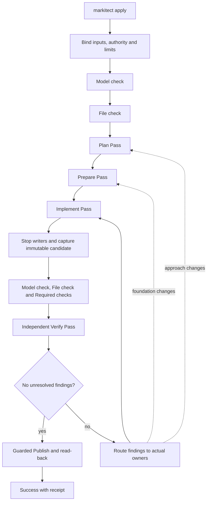

# Apply workflow and recursive Manager passes

**Status: accepted target, 20 October 2026.** The owner adopted the proposals and subsequent corrections from the complete conversation and requested an implementation handoff. [DEC-064](../../concepts/register.md#dec-064-checked-recursive-apply-passes-and-manager-teams) records the adoption; the [source record](../../concepts/sources/terminology-and-file-accounting-20261020.md) preserves its provenance. This document owns the resulting behavior. Later explicit corrections take precedence over earlier alternatives in that record.

This is an accepted design, not an implementation claim. The inspected integrated base is Main `a0928a1b7a95ebbc23836e5a5f472b29d233466e`. The [runtime contract](manager-apply-runtime.md) describes its earlier behavior; the [closing evidence](../../validation/apply-extract-closeout-20261020.md) describes actual runs. The [Claude handoff](../../development/claude-apply-implementation-handoff-20261020.md) owns the bounded implementation assignment and acceptance evidence. Canonical self-model changes belong to that implementation, alongside code and current guides.

## Purpose and vocabulary

Apply realizes the complete bound model through accountable delegation, checked ownership, integration and independent assessment. Complete, faithful realization takes priority over minimizing effort or Turns. More Agents and more checks alone do not prove semantic correctness. The intended Haiku and Luna use must be evaluated through complete workflows, without weakening any gate for a cheaper provider.

| Term | One meaning |
| --- | --- |
| Apply | The Command and complete workflow invoked by `markitect apply`. |
| Run | One invocation bound to fixed model inputs, a starting stand, authority and finite limits. |
| Pass | One recursive traversal for a defined purpose across the required Manager tree. This is the English term for Durchlauf. |
| Turn | One admitted provider work interval. Ending a Turn never establishes completion. |
| Model check | Deterministic validation and resolution of the canonical model. |
| File check | Separate deterministic validation of file accounting, Definition links and ownership. |
| Execute | The group of Plan, Prepare and Implement Passes. It is part of Apply. |
| Verify | A separate independent, read-only assessment Pass after Implement. |
| Publish | Guarded application of the verified exact candidate and destination read-back. This does not commit, merge or push. |
| Orchestrator | The deterministic controller that binds inputs, schedules work, accepts results, routes messages, checks evidence and controls publication. |
| Runtime | Execution infrastructure: containers, providers, mounts, sessions and project checks. A host is a literal machine or execution environment. |
| Candidate | An immutable captured project stand with its model, ownership and registry bindings. |
| Manager | The logical owner of one required local Package; Root coordinates the whole model and owns only its explicitly assigned artifacts. |

Remove competing current operation names `Compile` and `Reconcile` from product commands, APIs, types, configuration, reports, tests and active documentation. Name the formal operation Model check and the full workflow Apply. A shared engine used by Extract is a neutral Pass engine, not an artifact-publishing Apply. Replace Host where it means the controller with Orchestrator; execution infrastructure uses Runtime. Literal machine hosts, provider-mandated fields, historical evidence and quotations retain their actual meaning. Ordinary language about a Go compiler is not a competing product operation. No compatibility aliases are required.

## Complete workflow

Every forward Pass and every correction Pass must meet its own completion condition and pass Model check and File check before the next Pass starts. These are mandatory gates, not Agent opinions. Initial failure ends Apply before Agent work. At a later acceptance boundary, a failed Model check or File check stops the Run without Publish; it does not start an accounting/model repair loop. Preserve diagnostics and work for explicit correction outside that failed Run. Registered, correctly owned artifacts with incorrect behavior can be corrected by their owners within a valid Run.

Required project checks assess implementation behavior. Their failures are retained as evidence and findings for authorized owner correction; they cannot be waived into success. The model determines which checks apply and when their required result is due. Plan and Prepare do not falsely claim a complete application must already pass its final behavioral tests.

The Run binds the committed source, model and lock inputs, execution settings, request, authority and limits. Protected inputs cannot change during Apply. Root ends the Run if it judges the model erroneous or contradictory. New intent requires a model correction outside the Run and a new bound Apply. A conforming existing stand still goes through the workflow; accepted preservation and no-change results replace unnecessary rewrites, not required participation or evidence.

## Ownership and file accounting

### Required organization and explicit areas

The model determines one Root and one Manager for every required local Package, including empty and intermediate responsibilities. An Agent cannot prune this tree. Logical Package structure does not prescribe a physical repository layout. `src/`, `tests/`, `docs/`, technology conventions and other layouts remain possible.

Ownership assigns repository-relative directories and exact files to Managers. A directory covers its descendants. The most specific matching path wins; an exact-file assignment is more specific than a containing directory. Conflicting assignments at equal specificity and files without an owner fail File check. Root may have an explicit broad area, but cannot silently absorb another Manager's domain. Permission checks must account for deeper exclusions when a broad directory contains another owner's file or directory.

Ownership answers who may write; registry entries explain what observed artifacts realize. These are related checks, not interchangeable authorities. Every Manager can look up the same effective owner for any path, including a new path before writing it. Ignore entries do not grant write rights.

All Agents, including local helpers and reviewers, may read the complete project stand. Their briefs emphasize their own obligations and identify foreign material as context with its owner. Small initial context does not restrict project read access. Each Agent runs in its own Linux container. Mounts and enforced write capabilities permit changes only in its assigned subset and authorized local registry; canonical/control inputs and every other area remain protected. An unsupported ownership shape must refuse execution, never silently degrade to prompt-only restrictions.

### Authored local registries and one derived view

Each Manager writes only its own local registry. Root has a local registry for Root's files, not a globally authored registry. Repository-relative paths are accepted, resolving the earlier package-relative alternative.

Registry selectors support exact files and whole directories. A bounded representation is an exact repository-relative path or a trailing-slash directory covering descendants. Full gitignore glob/negation semantics are not a requirement. Directory entries carry meaningful Definition links, form and reason; deterministic expansion covers observed eligible artifacts within the entry's effective ownership. Another Manager's more specific area is excluded. Overlap or inconsistent metadata cannot create two effective registrations for one file. Coverage by a directory does not justify unrelated behavior or grant ownership of future paths.

Every observed project file must be classified exactly once: protected canonical/control input, registered artifact, or explicitly ignored file under the project ignore policy. Git administration is outside the project artifact tree. `.gitignore` does not provide Markitect accounting. Preserve protected-input and explicit-ignore safeguards; folder support in the registry does not silently broaden ignore rules. Missing paths, unexplained artifacts, invalid Definition links, duplicate accounting, ambiguous owners and wrong-owner registrations block. Diagnostic codes and locations remain machine-readable and explainable to the invoking AI.

The Orchestrator alone assembles the read-only project-wide registry view from checked local versions. It lives in Run evidence outside the authored project, can be exposed read-only and is available through lookup. It is not another model input, shared writable shard or second source of authority. It records exactly which local versions it includes.

New artifacts may appear during Prepare or Implement. Their effective owner must already be unambiguous. A valid directory entry may cover them; otherwise their owner updates its shard before presenting a basis or completion result. An unfinished editing interval is not an accepted boundary. It cannot release children or mark work Done.

### Safe acceptance while other Managers work

To accept a Manager's basis or completion:

1. Stop or exclude its writers from the submitted owned scope and local registry; observe the actual stop and capture stable versions.
2. Check those owned files and the local shard together, including consistency with current ownership and other accepted shards.
3. Assemble a coherent derived view from the checked versions and bind the accepted report to it.
4. Record the accepted event, then release dependent work.

Managers never race to rewrite a global registry. Disjoint scopes may continue in parallel; an assembled view identifies accepted versions and must not claim to represent other Managers' unfinished live edits. A changed accepted basis invalidates its consumers explicitly. At each Pass boundary, quiesce writers, capture the whole stand and perform full Model check and File check. Final Verify and Publish use one immutable complete candidate, not a mixture of live versions. An uncertain writer stop prevents capture or a replacement writer.

## One recursive Pass mechanism

Plan, Prepare, Implement and Verify are purposes of **one Pass process**, not four process implementations. Only the mandate, allowed effects, purpose-specific result payload and acceptance criteria vary. The result envelope, lifecycle, parent/child routing, scheduling, checks and acceptance mechanism are shared. No general workflow language or additional permanent hierarchy is needed.

Every Pass declares its purpose, required participants, model/input binding, own obligations, relevant context, ownership, starting prerequisites, allowed effects, required results and checks, dependencies and finite limits. Context includes provenance and inclusion reasons. Root receives explicit project and boundary obligations attributed to their actual Definition owners; it does not discover its mandate only from Required checks' `requiredBy` links.

### The base process

For every Manager, including Root and leaves, the order is:

1. **Receive:** bind the Pass mandate, own obligations, current inputs, dependencies and authority. Root starts after the Pass entry gates; every other Manager starts only against its accepted parent basis and required dependencies.
2. **Work locally:** perform the required own contribution and produce the basis children need for this purpose. This is a plan in Plan, a usable foundation in Prepare, own realization in Implement, and own assessment plus review context in Verify.
3. **Offer the basis:** submit an explicit semantic report. The Orchestrator checks the stable submitted scope and registry, result binding and declared prerequisites. Only its acceptance releases dependent children. In a read-only Pass the same gate checks the unchanged project bindings and the evidence result; no artificial project file is required.
4. **Delegate and remain available:** release eligible direct children with their mandates and the accepted basis. While they work, handle questions, route dependencies and inspect incoming proposals. A leaf follows this same step with an empty child set; it does not use a separate execution route.
5. **Review and integrate:** examine each direct child's proposed result for its purpose and fit. Return incomplete or incompatible work to that child within the current Pass; never do its work instead. Accept complete child results, then integrate their actual results, cross-child interactions and the own contribution.
6. **Offer the complete result:** submit the integrated responsibility with evidence and references to accepted child results. For a non-Root Manager, the Orchestrator validates the submission and notifies the parent for semantic acceptance. The parent accepts or returns it; only accepted complete work becomes Done. Root has no parent: its complete aggregate is accepted by the Orchestrator against the declared Pass requirements, not by inventing a superior Manager.
7. **Close the Pass:** once the entire required tree is accepted and no required proposal, question or dependency remains pending, the Orchestrator performs the whole-stand exit gates, seals the aggregate result and emits the Pass result. Closure is bound to the accepted versions and ordered events; a concurrent invalidation cannot be lost behind a stale success. The Apply workflow, outside the recursive process, chooses the next Pass or finishes the Run.

A submitted child result wakes its parent for review even while other children are working. The child waits on named parent acceptance; the parent must not wait for that child to be Done before reading its proposal. This prevents a completion/review deadlock without adding a PendingReview lifecycle state. Result submission, technical validation, semantic acceptance and Done are distinct observations.

An accepted own basis is not completion of the subtree. No Turn ending implicitly starts children. A parent does not plan or implement a child's responsibility. Every Manager may implement its own artifacts, whether it has children or not. All required responsibilities use the same result schema; agreement means coherent accepted results, not identical prose or manufactured consensus.

Children receive the Pass mandate, own applicable Definitions, labeled foreign context and owners, parent constraints and accepted foundations, owned write areas, local registry and derived view, relevant plans/dependencies, checks, tools, team profiles and remaining authority/limits. Model content and tool facts remain distinguishable from Agent suggestions.

Dependencies are explicit and observable. Accepted prerequisites and resource limits determine dispatch. Managers reason about semantic fit; the Orchestrator enforces declared conditions and does not pretend to infer arbitrary program semantics. Cyclic or orphaned waits must become a visible problem, never an endless stream of empty polling Turns.

### One contract, different purposes

| Purpose | Own contribution before child release | What parents review and integrate | Project rights |
| --- | --- | --- | --- |
| Plan | Own concrete approach and coordination context | Child plans, interfaces, coverage, dependencies and the integrated approach | Read-only |
| Prepare | Own usable and registered foundation | Child foundations and their actual usability together | Owned writes |
| Implement | Own realization and the accepted basis needed by children | Child realizations, obligation coverage and actual integration | Owned writes |
| Verify | Own independent assessment and review context for the immutable candidate | Child assessments, retained findings and cross-area correctness | Read-only, fresh reviewers |

The parent reviews a child's complete result in every purpose. This is the same integration responsibility, not an extra independent Verify after each local task. In Verify the executing roles themselves are independent reviewers; accepting a complete assessment must preserve its genuine findings. A negative assessment is not rejected merely to force a positive verdict. Completion of own basis still precedes child work; the final integrated result can only exist afterward. If child information requires revising an accepted basis, explicitly invalidate affected consumers and re-establish their prerequisites through this same process.

### Shared result and Pass identity

Every basis/result uses one envelope: Run and Pass identity, purpose, Manager, bound input/basis version, own obligation coverage, purpose-specific payload, accepted child-result references, dependency/question/finding references and check/evidence references. A complete result adds its integrated verdict. Exact field names and Go types are implementation choices; purpose-specific payloads do not authorize distinct state machines.

Use the same two substantive verdicts for every purpose: `Satisfied` means its stated objective is met; `NeedsCorrection` means the completed assessment/integration identifies required corrective work. Incomplete proposals stay work in the current Pass and are returned to their owners. Missing participation or an unresolved required question cannot be hidden behind either complete verdict. A failed deterministic gate is a Run failure, not a freely chosen NeedsCorrection result.

Aggregate verdicts preserve required child findings and unresolved obligations; Root cannot waive them. After whole-Pass exit gates, all participants receive the same sealed Pass result and aggregate verdict. Their local payloads need not be identical. The whole-tree outcome is not inferred from a collection of provider exit codes or local Done states.

Every repetition creates a new Pass identity, even when its purpose is again Implement or Verify. A sealed Pass result is immutable history. Managers receive a new assignment/state for the new Pass; earlier accepted evidence may support explicit preservation but cannot silently count as new participation. A return of a proposal before Pass closure is local revision within the same Pass, not an extra traversal. Reopening Done before closure explicitly invalidates the affected aggregate; after closure, correction uses a new Pass.

Apply composes these Passes in the required order and chooses the earliest necessary correction purpose. If an approach changes, use Plan and the needed subsequent Prepare/Implement; a foundation change uses Prepare and needed Implement; a local behavior correction may need only Implement. Then run a new complete Verify. All required Managers participate in each selected Pass; unaffected owners may explicitly preserve a still-valid result. There is no special correction engine or implicit skip of a whole responsibility.

## States, reports and events

| Manager state, per Pass | Meaning |
| --- | --- |
| Ready | Required start conditions hold and useful admitted work can be scheduled automatically. |
| Working | A Turn is active or a submitted result is being checked. |
| Waiting | A named answer, foundation, child result or other dependency is missing. The Manager can be woken by relevant work. |
| Done | Its complete Pass responsibility, including child integration and parent semantic acceptance where applicable, has been accepted for a recorded stand. |

Root initially becomes Ready; children initially wait for their declared basis. Ready automatically triggers dispatch when resources and finite limits permit. One Manager has at most one active Turn. Waiting parents can ask children questions and answer their own parent or children; relevant incoming work makes them Ready. Valid progress may lead Working back to Ready. A concrete changed prerequisite or finding can explicitly reopen Done, retaining the old result as historical evidence.

**Problem is a structured report/event, not a fifth scheduling state.** Agents classify problems and decide whether to resolve them locally or escalate to their direct parent. A model problem is one category; Root's model-error decision has the mandatory abort consequence. A deterministic failure retains its blocking force regardless of an Agent's classification.

Semantic reports cover progress, a named wait/question, a basis proposal, a completion proposal and a problem. They identify the actual result, obligations, input stand, evidence and needed action. Agents propose; the Orchestrator validates and accepts state changes. There is no unconditional Agent `set_state(Done)`.

Technical Turn results record provider exit, timeout, cancellation and stop certainty separately. Normal exit without a valid report is incomplete work, not implicit Done. No semantic state transition proves a container stopped.

Record accepted state changes and relevant facts as events, for example `manager.state_changed`, `basis.accepted`, `problem.raised` and `finding.recorded`. Exact identifiers and Go record shapes are implementation choices within this behavioral contract. Events carry Run, Pass, Manager, correlation and stand bindings, and enough ordering to reject stale/duplicate completion or answer effects. This requires reliable event handling, not a particular database or an event-sourcing framework.

Pass completion, its verdict and the Run outcome are separate:

- A Pass finishes its recursive work when all required complete results and parent integrations are accepted. Forward progress additionally requires its substantive acceptance criterion and deterministic gates.
- A reviewer can be Done after finding a defect. Verify's verdict is then negative and requires correction; Done does not assert a correct project.
- Run `Success` requires clean fresh Verify and an applied or no-change Publish receipt with read-back.
- Run `Failed` records a definite rejection, including failed Model/File check, Root's model-error decision or failed publication. A partial publication remains explicitly partial and unsuccessful.
- Run `Incomplete` records unfinished required work, unresolved waiting, cancellation or exhausted limits. It never presents unchecked work as success.

## Questions and escalation

Questions are allowed during Apply. A Manager answers within its authority and the model, or escalates to its parent. The parent may answer or forward the question upward. Root escalates to the AI that invoked Markitect, which can consult the user; the answer travels back down. The invoking AI is conceptually the user's interface, not the deterministic Orchestrator or the project's Root Manager.

Communication is exclusively along direct parent/child Manager edges in either direction. Cross-branch questions go up to the least common ancestor, down to the relevant owner, then back along that route. Preserve request/answer correlation and provenance. For Library, a lending question to catalog goes lending → Root → catalog → Root → lending. Sibling channels and helper shortcuts are not allowed.

Underspecification and implementation choices may be clarified, including through the user. No answer overrides a binding model rule. Root must end Apply if it judges the model erroneous or contradictory; neither a child, a helper nor an owner answer silently amends it. Clarifications are Run evidence; making them permanent intent is separate model authoring.

Expose pending Root questions to the invoking AI through the supported owner channel and accept only authorized answers for the exact Run/question. Waiting consumes the declared limits. Stale answers cannot advance another Run. Preserve evidence on interruption; do not invent same-Run recovery or revive old authority merely because a journal exists. Existing clean-restart guarantees remain unless separately implemented and proven.

## Plan Pass

**Result:** every Manager knows concretely what it must do, how it intends to do it, what it supplies and needs, who may start when, and what blocks it.

Root first supplies the project constraints, responsibility boundaries and questions relevant to coordination. Its Plan basis is context and an initial own approach, not a pre-created application skeleton. Each Manager then plans its own obligations, not those of its children. Its plan covers:

- Realize or preserve each applicable obligation, grouped meaningfully, with intended verification evidence.
- Own artifacts and interfaces, required inputs with their actual owners, provided outputs and usable foundations.
- Ordering, start conditions, named dependencies, blockers and assumptions needing clarification.
- For a parent, orchestration and integration of its children alongside its own work.

A high-level contribution does not replace a local concrete plan. A plan need not enumerate one file or test per Definition. Children need their own plan and relevant contracts, not everybody's complete plan; more detail is available through lookup and routed questions.

Parents review direct children's plans for complete responsibilities, compatible interfaces, sound dependencies, cross-area fit and ownership. They return gaps to the child that owns the plan. They do not author it on the child's behalf. Plans may change on new information through the same visible review and integration mechanism.

**Rights:** project artifacts are read-only. Plans live in Run evidence, not a second authoritative model or mandatory repository document.

**Acceptance:** all required concrete local plans and parent integrations are accepted; dependencies and startup conditions are coherent; required questions are answered; no unresolved prerequisite is hidden in Root's aggregate. Full Model check and File check pass. Scheduling can enforce these declared conditions deterministically without making the reasoning or implementation a fixed script.

## Prepare Pass

**Result:** actual owners have supplied usable foundations and contracts for the planned implementation.

Each parent prepares its own needed foundation first, checks and registers it, then releases dependent children. Owners create the interfaces, configuration, build basis, documentation/test scaffolding or other artifacts that their model and plan require. The repository structure follows project needs and technology conventions; Markitect prescribes no universal `packages/` skeleton. Root does not implement a child's domain policy as generic infrastructure.

Parents remain available while children prepare and integrate actual child foundations afterward. A sibling dependency is released only against a checked accepted basis, not a promise or an empty stub. Existing valid foundations may be preserved. Scaffolding does not count as a completed behavioral realization.

**Rights:** owned project artifacts and the owner's local registry may change. **Acceptance:** all required foundations are usable for their stated consumers, owners and interfaces agree, child work is integrated, and full Model check and File check pass. Phase-specific foundation checks must support usability; final behavior is not falsely required before Implement.

## Implement Pass

**Result:** every applicable model obligation is realized in the actual owned code, tests, documentation, configuration and integrated interactions.

Each Manager works only on its own scope and consumes other owners' implementations through the agreed contracts. Parents first perform their own work, release children against checked prerequisites, then integrate the actual results. They do not repair a child by taking over its files. Each owner maintains its registry as artifacts change.

Changed interfaces or foundations travel through the tree; affected accepted work is invalidated visibly. Return to Prepare or Plan when that basis or approach needs revision. A Manager's completion proposal includes obligation coverage, actual artifacts and relevant evidence. Mere activity, a successful provider exit or a registry row does not prove implementation completeness.

**Acceptance:** all required local implementations and parent integrations are accepted, no required obligation is silently omitted, and full Model check and File check pass. Then stop all writers and capture the immutable candidate for checks and Verify.

## Verify Pass and correction

Verify is a separate Pass after Implement. Parent integration during Plan, Prepare or Implement is not independent verification. Shared Pass machinery does not collapse these two responsibilities or add an identical closing review twice.

Use fresh independent, read-only reviewer contexts for the required responsibility tree, without author conversation history. Reviewers receive the bound model, candidate, applicable obligations, owner/context labels, required check evidence and retained findings. The common parent-first mechanism still applies: the parent reviews its own responsibility and provides review context, children independently assess theirs, and the parent integrates their findings and cross-area assessment. Reviewers never edit project artifacts.

Run Model check, File check and all applicable Required checks on that exact captured candidate. Agent review assesses semantic completeness, fidelity and integration that deterministic checks cannot prove. No current evidence is replaced by a test against another or a live changing stand.

A finding identifies its raising reviewer/responsibility, actual owner, relevant obligation, observed evidence and required correction or missing proof. Keep it until fresh independent assessment on a corrected candidate explicitly closes it with evidence and reason. An author cannot suppress it, and a new reviewer merely omitting it is not closure.

**Clean means no unresolved genuine findings.** A genuine finding is an observed model violation, a missing required realization/evidence item or a failed mandatory project check. Optional improvements outside the model are separately labeled notes, not failures. Do not downgrade a genuine finding into a note to get green. Record disputed findings and their reasoned independent resolution visibly.

Root and the responsible Managers route correction through the necessary Plan, Prepare and/or Implement Passes; a localized defect may need only Implement. No separate generic Repair Pass is required. After any correction, capture a new candidate and run fresh complete Verify and checks again. A green review of an old candidate cannot close the new Run result. Limits remain finite; unresolved findings at exhaustion yield Incomplete.

**Acceptance:** every required assessment and parent integration is complete, required checks pass on the candidate, no genuine finding remains open, and deterministic gates pass. Only then may Publish start.

## Tools and method guidance

Use a small provider-neutral Markitect surface alongside the provider's native read/edit/shell tools:

| Method | Purpose and authority |
| --- | --- |
| `look_up` | Retrieve own obligations, labeled foreign context, ownership, registry coverage, available accepted foundations, plans/dependencies, states and checks with source and stand bindings. |
| `check` | Run a permitted scoped check and return structured evidence. Only Orchestrator acceptance against stable bound inputs satisfies a mandatory gate; an Agent's live peek is not Pass completion. |
| `send` | Send a question, answer or information to a direct parent or child, with correlation. Root's owner boundary is separately authorized. |
| `report` | Submit progress, a named dependency, basis/completion proposal or classified problem for Orchestrator acceptance. |

`escalate` is the method of sending a classified issue and requested decision to the parent. It can be a thin tool convenience over `send`; it adds no alternate route or authority. Ask deterministic tools for known structural facts and use routed reasoning when interpretation or a decision is needed.

Skills provide reusable methods for planning, preparing, implementing, integration, review and escalation. They can expose concise metadata first and details when needed. They do not grant writes, alter the model, invent participants or override gates. This target does not require a separate copy of each provider-native tool or a general Agent framework.

## Configurable local Manager teams

The standard team template has a Manager, a bounded Worker and an independent Reviewer. These are roles inside one Manager responsibility, instantiated when needed, not three permanent processes or three artifact owners. The Manager may perform its own work; a Worker executes an explicitly delegated local task. The Reviewer slot supplies the fresh Verify role, not an author-controlled substitute for Verify or an extra identical review afterward.

Additional roles, such as Architect, test specialist or cross-cutting specialist, are configurable. Bind role instructions, supported provider/model profile, rights, budgets and result expectations explicitly. The intended Haiku/Luna use is configurable, not a reason to assume provider capabilities or invent a fallback model silently.

Every helper has its own container, project-wide read access and write capabilities restricted to an explicit subset of its Manager's area. Reviewers are read-only and isolated from author conversations. Overlapping scopes permit only one active writer; parallel helpers require disjoint write scopes. The local registry has one active writer. A Manager cannot continue writing the same files while a Worker edits them. A helper's completion does not complete the Manager or the Pass.

Helpers communicate through their owning Manager. Cross-Package communication continues only through the Manager tree. Independent reviewer findings are recorded by the Orchestrator and cannot be hidden by the authoring Manager. Runtime control of a reviewer is not a sibling reasoning channel.

A cross-cutting specialist may read the whole stand and advise its Manager. Binding meaning stays in the model; shared infrastructure is realized by its actual owner; local semantic use belongs to each local owner; cross-area integration belongs to parents and Verify. An Architect does not become an unmodeled policy authority or global writer.

## Library walkthrough

1. `markitect apply` binds the Library model and current committed stand. Model check and File check either pass or end the Run before Managers start.
2. Root starts Plan with project context and its own approach. Catalog and lending receive their own obligations and relevant context, propose their own plans and dependencies, and return them to Root. Root settles interface questions through the owners and accepts their integrated fit.
3. In Prepare, Root provides any Root-owned build/module foundation and registers it. Only its accepted checked basis releases dependent children. Catalog provides its catalog contract; lending consumes the accepted contract rather than recreating catalog logic. An existing correct foundation needs no rewrite.
4. In Implement, each owner realizes its obligations in its actual paths, including required tests/docs and registrations. A lending question for catalog travels through Root. Root integrates actual interactions after the children finish.
5. All writers stop. Deterministic checks and Required checks assess one captured candidate. Fresh reviewers perform the independent Verify Pass through the same tree.
6. A genuine lending defect returns to lending through Root. The required correction Passes run, then a new candidate receives complete fresh Verify. Only a clean candidate reaches guarded Publish and exact destination read-back.

This is a target walkthrough, not a new runtime result or a change to the historical Library evidence. The [independent Library expectations](library-example/evaluation-contract.md) remain outside Agent context.

## Supersession and implementation boundaries

| Earlier direction | Accepted replacement or preservation |
| --- | --- |
| DEC-042 preserved controller-related Host API/config names | Retain the Orchestrator meaning; remove competing current names across code and guides. Literal hosts and history remain. |
| DEC-056/058 one Execute/integration then Verify | Preserve Execute before independent Verify and the responsibility tree; Execute now contains Plan, Prepare and Implement using the common Pass mechanism. |
| DEC-059 Root-only exact-file ownership exceptions | Preserve enforced rights and the outside oracle; support the accepted directory/file specificity for every Manager or refuse unsupported execution honestly. |
| DEC-060 planning as a fallback | Preserve owner realization and parent coordination; concrete local Plan is now a normal Pass. |
| DEC-062 repairable initial accounting drift | Superseded. Initial File check is strict; no accounting repair exception. Registered semantic artifact defects remain legitimate Apply work. |
| DEC-063 blanket ban on owner questions and automatic abort for boundary underspecification | Superseded by routed clarification. Preserve binding model authority and mandatory Root abort for actual model error/contradiction. |
| Earlier discussion allowed folding final review into Implement | Superseded by the later explicit separate Verify Pass. |
| Earlier Continue/Ready/ModelProblem result proposal | Ready/Working/Waiting/Done scheduling, structured Problem, separate Pass verdict and Run outcome. |
| Earlier package-relative-only registry discussion and mirrored default | Repository-relative local entries and flexible layouts, explicit directory/file ownership. No compulsory mirrored physical layout. |
| Optional special repair Pass or extra review after every phase | Use the necessary normal correction Passes; no mandatory additional mechanism or duplicate Verify. |

Preserve fixed-input authority, protected files, actual writer-stop observation, candidate-bound evidence, guarded publication/read-back, finite honest failures and historical records. This work does not commission Extract redesign, a public workflow DSL, release, deployment, marketing or a broad provider benchmark. Shared engine changes must preserve Extract's separately owned behavior.

The added Passes, events and teams cost execution and coordination work. Their value must be judged by complete obligation coverage, fewer hidden assumptions, enforced ownership, retained findings and successful real owner workflows. Green structural checks cannot prove the prose model is consistent or complete, nor establish general provider reliability or human acceptance.
