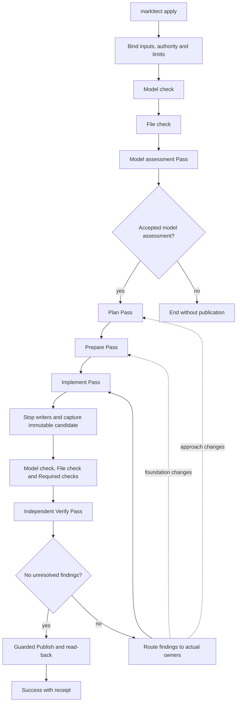

# Apply workflow and recursive Manager passes

**Status: accepted target, 20 October 2026.** The owner adopted the proposals and subsequent corrections from the complete conversation and requested an implementation handoff. [DEC-064](../../concepts/register.md#dec-064-checked-recursive-apply-passes-and-manager-teams) records the adoption; the [source record](../../concepts/sources/terminology-and-file-accounting-20261020.md) preserves its provenance. This document owns the resulting behavior. Later explicit corrections take precedence over earlier alternatives in that record.

**Implementation and refinement, 20 October 2026:** [PR #530](https://github.com/Glacius-Labs/Markitect/pull/530), Main `780dccb7`, implemented the base process. Its [first real-run report](../../validation/apply-pass-process-20261020.md) includes genuine repairs and a correction cycle, but also a Verified Depot result retaining a real defect, optional changes and a blocked Haiku run. The [runtime contract](manager-apply-runtime.md) describes that implemented baseline. The owner has adopted the [hardening refinement below](#evidence-driven-hardening-adopted-20-october-2026); the [hardening assignment](../../development/claude-apply-hardening-handoff-20261020.md) implements its receipt, evidence, disposition and waiting mechanics as described by the [runtime contract](manager-apply-runtime.md#probe-receipts), and its bounded evaluation is recorded in the [hardening report](../../validation/apply-hardening-20261020.md). That implementation supersedes draft [PR #536](https://github.com/Glacius-Labs/Markitect/pull/536), an incomplete candidate. The earlier implementation handoff and closing evidence retain their historical scope.

## Provisional direct baseline, 21 October 2026

**Owner decision:** use `direct` as the provisional baseline and retain `staged` as a comparison strategy ([source](../../concepts/sources/terminology-and-file-accounting-20261020.md#owner-selection-direct-and-next-experiments)). Direct runs Implement, then independent Verify, repeating Implement/Verify for genuine findings before guarded Publish/read-back. Managers plan and prepare their own areas inside Implement; parent-first checked basis release, child responsibility, tree communication and upward integration remain the same recursive Pass process. Staged retains explicit Plan, Prepare and Implement before Verify. Strategy changes composition, never ownership, gates, evidence or acceptance strength, and is selected explicitly and fixed for the Run. There is no evidence yet that staged is safer.

This amendment governs the selected next implementation. Session A of the [new handoff](../../development/claude-direct-runtime-handoff-20261021.md) integrated the reviewed direct composition of draft #545 with the current shared fixes as `strategy: direct` and kept the earlier composition as `strategy: staged` ([runtime contract](manager-apply-runtime.md#workflow-composition)); the container lifecycle change and the retest follow. Code, self-model and active runtime guides must be migrated together. The Plan/Prepare descriptions and staged diagram below remain the comparison contract; they no longer require separate Plan/Prepare Passes in direct. Execute means the selected strategy's work composition. Both strategies use the same common mechanism and fresh Verify; there is no separate direct engine or generic workflow language.

**Latest amendment, owner 21 October 2026:** the [mandatory assessment and closed Run policy below](#mandatory-model-assessment-and-closed-runs) supersedes the earlier optional experiment, interactive owner clarification and future single-Agent product direction. It is an accepted target; this documentation does not implement it. A owns production/self-model migration, C the assessment method and bounded validation. Container portability to Kubernetes remains a design requirement, not a Kubernetes implementation claim.

### Strategy boundary and future extension

**Accepted direction, owner 21 October 2026** ([source](../../concepts/sources/terminology-and-file-accounting-20261020.md#owner-adoption-exchangeable-apply-strategies)): tests and ordinary Apply select a strategy through the same product preparation and execution path. Selection and supported settings are validated before Agent work and bound to the Run with their effective values and implementation identity (the product build may supply that identity). Unknown strategies/settings refuse; a running Run cannot change strategy. Any future invocation override must participate in this same binding, not bypass it through the test harness. This defines no new CLI flag.

The architectural boundary is shared Run binding, deterministic Model/File entry checks and mandatory Model assessment, a selected realization strategy, and shared candidate assessment/publication. This adds no common Prepare Pass: direct keeps local planning/preparation inside Implement, while staged retains its Plan/Prepare Passes. Strategies organize work; they cannot waive Model check, File check, Model assessment, required checks, observed writer cessation, independent candidate-bound Verify, genuine-finding closure or guarded Publish/read-back. Direct and staged use the same recursive Pass engine and retain all current Manager responsibilities. Keep provider/model choice and container backend/lifecycle separate from the strategy's meaning. A later implementation may reuse the services through a small contract; this direction does not require moving the shared acceptance engine or inventing a generic strategy/plugin framework now.

Every production Apply strategy retains the required Manager tree and one Manager per Package. The earlier future single-Agent product direction is withdrawn by the latest owner decision. Direct/staged vary work composition inside the common recursive process, not participation or write authority. The ordinary `plan.md` plus Agent arm remains an external evaluation comparator; it is not an Apply strategy and its completion report alone is not Verified.

**Session A now:** prepare a small explicit selection/composition boundary for direct and staged, keep shared checks and publication outside strategy-specific policy, and demonstrate that tests exercise the same resolution path as Apply. Add discriminating source tests for unknown selections, bound strategy/settings in evidence and the different work sequences with the same acceptance guards. Keep Manager ownership and execution rights intact in the selection boundary. Do not add a single-Agent product implementation, placeholder accepted strategy, alternative ownership semantics, workflow language or additional provider series. Existing test grants and explicit start signals remain in force.

### Model context delivery and completeness

**Accepted direction, owner 21 October 2026** ([source](../../concepts/sources/terminology-and-file-accounting-20261020.md#owner-adoption-model-context-delivery)): automatically supply each Manager's binding own Definitions and the contracts selected as necessary context, including their content, rather than relying on the Agent to discover its obligations by opening files. Keep own obligations distinct from foreign context, identify owners and inclusion reasons, and provide deterministic lookup of additional Definitions from the same bound model. Supplementary reading grants no new duty or write authority. This is structured rendering of checked content, not an Agent-written summary that may drop a condition.

**Inspected source at Main `dec1de6e`:** context selection includes own Definitions, direct outgoing and local incoming model links, type/property contracts and explicit modeled scope; it does not traverse all further business links. Briefs render each selected Definition's identity/kind/title, body and structured fields. Root additionally receives a project-wide inventory, not every Definition's full text, and can look up full content. The initial conversation receives the Brief; resumed Turns reuse provider conversation state, while fresh Verify receives a new Brief. These source observations do not establish complete semantic relevance, actual provider delivery or retention after compaction. Existing selection behavior is not silently widened by this documentation.

Verify completeness at separate boundaries:

1. **Selection:** independently enumerate expected own obligations and necessary linked/scoped contracts for a small model, then compare with the actual selection and its reasons. A passing Model check does not prove every semantically relevant connection was modeled or selected. Missing cross-area context discovered semantically is a separate finding, not evidence that the renderer lost text.
2. **Representation:** selected full-content Definitions retain their body, structured values, reference targets and conditions, with stable identity/source bindings. Record which entries are supplied in full, which are inventory references, and which supplementary content is available through lookup. Root's inventory is intentional reference-only content; it must not be reported as full delivery or used to downgrade the required full content of its own obligations. Formatting may change, meaning and values may not.
3. **Delivery and continuity:** verify the actual prompt or tool-response payload crossing the provider adapter boundary against the selected/represented content, and bind that evidence to the Run, model/source revision, recipient, Turn and delivery form. A hash of a manifest or renderer output alone does not prove the adapter sent its content. Distinguish submitted payload, any provider acknowledgement and assumed conversation retention. Do not claim that a successful send proves understanding or that resumed conversation proves retention after compaction.

Binding required context must not be silently truncated or replaced by summaries to fit a limit. If it cannot fit, explicitly partition delivery and establish required content delivery before dependent work, or end incomplete with the missing/oversized context identified. Supplemental lookup is not an excuse to omit the mandatory packet. After a fresh context, or observable compaction/context loss, required content needs a reliable rehydration path from the same authority binding. If a provider hides its effective context/compaction, record that limit honestly; deterministic payload evidence is not proof of its internal memory. Reading an arbitrary changed working file is not a substitute for a bound Definition lookup.

Use a small coverage record in existing Run evidence, not a new registry of authority or a dashboard. The record relates required selection, full/reference-only representation and actual submissions/lookups; missing or mismatched required content cannot be labeled complete. Separate that technical completeness from behavior: an Agent can receive every obligation and still ignore one. Independent Verify and external outcome oracles remain necessary. The ordinary-Agent `plan.md` arm must preserve the same intended requirements and uncertainties, with its own visible full/reference/lookup accounting; it remains an evaluation comparator rather than a newly implemented single-Agent product strategy.

The [handoff's targeted checks](../../development/claude-direct-runtime-handoff-20261021.md#targeted-checks-model-context-completeness) cover rendering omissions, wrong bindings, actual adapter payload, fresh/resumed review context and limits/lookup. This adoption specifies acceptance criteria; this documentation does not implement a coverage recorder, change the provider adapter or establish these checks as passed.

## Mandatory Model assessment and closed Runs

**Accepted 21 October 2026** ([owner source](../../concepts/sources/terminology-and-file-accounting-20261020.md#owner-adoption-mandatory-assessment-and-closed-runs)). Both evaluated workflows silently chose a public name limit in A4. That observation challenges the assumption that an important missing decision will reliably become a useful interactive question. The owner now makes model authoring the place for such decisions: model-driven Manager workflows first assess their model, and cannot acquire missing intent through an external answer during execution.

The entry sequence is **bind authority and limits → deterministic Model check → File check → read-only Model assessment → selected work composition**. Every production Command that starts a model-driven Manager workflow uses this boundary, not just direct Apply. Static inspection commands do not start a team. Assessment is itself a purpose of the same recursive Pass mechanism, with parent-first own assessment basis, child assessment, parent challenge/integration and a sealed common result. It does not recursively pre-assess itself, repeat before every Turn or repeat before each artifact-correction Pass against unchanged authority. Its evidence binds the exact model, dependencies, mandate and assessment implementation; a new Run gets a new assessment, not unqualified reuse of an old green label.

Assess material contradictions, missing public/business decisions and unusable responsibility/interface contracts. The model must resolve these or explicitly delegate the choice. Ordinary implementation details remain Manager decisions. A blocking report names the source Definitions, concrete incompatible outcomes or contradiction, and why the decision cannot be derived or made within delegated freedom. Preferences, optional hardening, a finding quota and unsupported doubt are not blockers. Parents challenge both unsupported findings and unsupported acceptance. Accepted assessment means no unresolved material issue was found with the recorded coverage; it is not proof of exhaustive completeness and does not replace artifact Verify.

Use the existing lifecycle/result envelope. A completed assessment may report a negative conclusion; Done is not permission to start realization. For Model assessment, an accepted aggregate maps to the common Pass verdict `Satisfied`. An integrated, Root-confirmed material gap/error maps to `NeedsCorrection` with its purpose-specific finding payload and terminal Run `Failed`; it never starts an in-Run model-repair Pass. Unconfirmed findings remain proposals for investigation/return, and unresolved work at the limit remains `Incomplete`. Do not introduce additional Pass verdicts. Only an accepted aggregate assessment with no unresolved material model problem releases the selected work composition. Root-confirmed material gaps or contradictions end the Run Failed without publication. An unresolved investigation or exhausted limit stays Incomplete; definite technical failures retain their own failure classification rather than becoming fabricated model defects. A later confirmed model problem has the same abort effect even after a successful assessment. Model change happens outside the Run and requires a new bound Run; no answer, override, preloaded owner decision or configuration value may supply missing model intent behind this boundary.

**Extract boundary:** Extract creates a model candidate, so it cannot require an accepted target model before that candidate exists. Before its Manager work, assess the available mandate, model and constraints; assess the resulting candidate when available. Observed artifacts are evidence, not authority to invent missing business decisions. An unresolved material decision produces explicit model findings and an unaccepted draft, ends the Run without publication of an accepted model, and returns to model authoring outside the Run. This clarifies the common authority/question boundary; it commissions no broader Extract redesign or intake/Explore workflow.

The observable improvement is explicit: a material gap or contradiction blocks before realization when found in assessment; a later discovery blocks publication; a corrected model succeeds only in a new Run; complete models and expressly delegated choices do not trigger false aborts. Source/transport tests and independent provider controls must establish these separately. Earlier runs keep their original expectations and evidence.

## Purpose and vocabulary

Apply realizes the complete bound model through accountable delegation, checked ownership, integration and independent assessment. Complete, faithful realization takes priority over minimizing effort or Turns. More Agents and more checks alone do not prove semantic correctness. The intended Haiku and Luna use must be evaluated through complete workflows, without weakening any gate for a cheaper provider.

| Term | One meaning |
| --- | --- |
| Apply | The Command and complete workflow invoked by `markitect apply`. |
| Run | One invocation bound to fixed model inputs, a starting stand, authority and finite limits. |
| Pass | One recursive traversal for a defined purpose across the required Manager tree. This is the English term for Durchlauf. |
| Turn | One admitted provider work interval. Ending a Turn never establishes completion. |
| Model check | Deterministic validation and resolution of the canonical model. |
| File check | Separate deterministic validation of file accounting, Definition links and ownership. |
| Model assessment | Read-only semantic model assessment through the common Manager Pass, before realization; distinct from deterministic Model check. |
| Execute | The selected strategy's work composition: Implement in direct; Plan, Prepare and Implement in staged. Planning and preparation remain duties in both. |
| Verify | A separate independent, read-only assessment Pass after Implement. |
| Publish | Guarded application of the verified exact candidate and destination read-back. This does not commit, merge or push. |
| Orchestrator | The deterministic controller that binds inputs, schedules work, accepts results, routes messages, checks evidence and controls publication. |
| Runtime | Execution infrastructure: containers, providers, mounts, sessions and project checks. A host is a literal machine or execution environment. |
| Candidate | An immutable captured project stand with its model, ownership and registry bindings. |
| Manager | The logical owner of one required local Package; Root coordinates the whole model and owns only its explicitly assigned artifacts. |

Remove competing current operation names `Compile` and `Reconcile` from product commands, APIs, types, configuration, reports, tests and active documentation. Name the formal operation Model check and the full workflow Apply. A shared engine used by Extract is a neutral Pass engine, not an artifact-publishing Apply. Replace Host where it means the controller with Orchestrator; execution infrastructure uses Runtime. Literal machine hosts, provider-mandated fields, historical evidence and quotations retain their actual meaning. Ordinary language about a Go compiler is not a competing product operation. No compatibility aliases are required.

## Complete workflow

The following shows staged. Direct uses `Model check -> File check -> Model assessment -> Implement -> capture/checks -> Verify -> Publish`, with findings returning to Implement and fresh Verify. Local planning/preparation and the common recursive lifecycle apply within its Implement.

Every forward Pass and every correction Pass must meet its own completion condition and pass Model check and File check before the next Pass starts. These are mandatory gates, not Agent opinions. Initial failure ends Apply before Agent work. At a later acceptance boundary, a failed Model check or File check stops the Run without Publish; it does not start an accounting/model repair loop. Preserve diagnostics and work for explicit correction outside that failed Run. Registered, correctly owned artifacts with incorrect behavior can be corrected by their owners within a valid Run.

Required project checks assess implementation behavior. Their failures are retained as evidence and findings for authorized owner correction; they cannot be waived into success. The model determines which checks apply and when their required result is due. Plan and Prepare do not falsely claim a complete application must already pass its final behavioral tests.

The Run binds the starting commit, model and dependency locks, ownership, execution settings, ignore policy, request, authority and limits. These authority inputs remain immutable during Apply. The starting commit remains a fixed reference while project artifacts may evolve under the current Pass's write rights. Root ends the Run if it confirms a material missing model decision, error or contradiction. New intent requires a model correction outside the Run and a new bound Apply. A conforming existing stand still goes through the workflow; accepted preservation and no-change results replace unnecessary rewrites, not required participation or evidence.

Local registry shards are validated realization metadata, not immutable authority inputs. Their owner may update them in a write-enabled Pass; acceptance binds the changed shard and owned artifacts to a checked version. Such an authorized update does not mutate the bound model or invalidate the Run merely because accounting classifies the shard as a Markitect input. A shard cannot change ownership, ignore policy, execution rights or another Manager's metadata. The derived global registry remains read-only. Input classification for accounting does not by itself determine write authority.

## Conformance mandate and observation kinds

**Accepted refinement, owner 21 October 2026** ([source](../../concepts/sources/terminology-and-file-accounting-20261020.md#owner-adoption-conformance-mandate-and-observation-kinds)). Earlier evaluations found optional changes to conforming stands as well as missed genuine defects. Merely allowing a change within the model does not justify it in Apply. Apply establishes and evidences conformance; an already conforming stand is a successful preservation result, even when an Agent prefers a different design. Independent controls must first establish that the starting stand really conforms.

Every proposed artifact change must address a modeled obligation, a required check/evidence gap, or a necessary consequence of such work. Explain the missing fulfillment and why the change is needed, at a useful obligation/change-group level rather than a ledger for every line. Refactoring can be a necessary means of fulfillment; optional cleanup, extra features, speculative robustness and aesthetic improvements are not an Apply assignment. This is a proportionality test, not a smallest-diff rule: do enough to fulfill the obligation completely, preserve unrelated conforming behavior, and do not optimize for the fewest changed lines. A later improvement/inspection command needs its own mandate; this refinement implements no such command.

Assessment distinguishes **supported conformance**, **demonstrated nonconformance**, and **insufficient evidence**. These are reasoning/evidence distinctions inside the existing result contract, not three new Pass verdicts or scheduling states. Supported conformance can satisfy a Pass only when all existing participation, evidence and deterministic gates are met. A required correction uses `NeedsCorrection`; unresolved necessary evidence cannot be sealed as `Satisfied` and remains unfinished, with Run `Incomplete` at the finite limit. Root-confirmed model problems retain their terminal failure rule.

Use one collection of observations in existing Orchestrator-owned Run evidence, with these semantic kinds:

| Kind | Required basis | Effect on Apply |
| --- | --- | --- |
| Confirmed deviation | A binding obligation/required check, expected result, actual violation or specifically missing required realization/evidence, and affected owner/candidate | Blocks acceptance until corrected or independently disproved under the existing finding rules. |
| Suspected deviation | A concrete, plausible violation of a named obligation, with an observation or discriminating counterexample to investigate | Investigate within existing limits and classify. An unresolved relevant conformity question cannot become success or be parked as a suggestion. Unsupported general doubt alone is not a blocker. |
| Model problem | A sourced material gap/contradiction and why derivation or delegated freedom cannot resolve it | Route inside the tree; Root confirmation ends the Run without publication. Model authoring and a new Run happen outside execution. |
| Suggestion | An optional idea, improvement or additional risk beyond the fulfillment/evidence required by this mandate | May be recorded or omitted. Never blocks, dispatches correction, adds obligations or authorizes artifact writes in this Run. |

A blocking report must identify its authority, expected outcome, observed mismatch or concrete missing proof, and impact on fulfillment. Style preferences and generic best-practice claims alone are insufficient. This does not demand a separate explicit Definition for every bug: a violation can be derived from a modeled contract, with that derivation recorded. Conversely, perceived severity, repeated escalation or confidence does not create new model authority. Parents assess both the classification and the necessity of the proposed correction. Existing independent disposition of genuine/disputed findings and mandatory-check failures cannot be bypassed by relabeling them as suggestions.

An investigated suspicion either becomes a confirmed deviation/model problem, is resolved by evidence, or remains a concrete unresolved requirement for evidence. Record that disposition; do not manufacture an optional note to get green. An observation shown to be outside the mandate may remain a non-blocking suggestion with its rationale. Genuine unresolved findings remain retained. Resolved/rejected observations are not reopened on the same relevant inputs without new evidence or a changed obligation/candidate that affects the disposition. A new reviewer or reworded comment alone is not new evidence. This avoids repeated refinement without weakening complete fresh Verify or the immutable history of sealed Passes.

Keep source and candidate bindings, owning Manager, kind, rationale/evidence and disposition in the existing Run record. Reuse/link existing retained findings rather than creating a second authoritative backlog. Optional labels such as potential bug, idea, risk or improvement are views of this collection, not independent blocking queues. Notes are outside authored project artifacts and do not require Managers to add suggestion files or registry entries. Recording a suggestion is optional; there is no note quota and neither its omission nor its presence establishes conformance. This is a report contract, not a new database, dashboard or automatic follow-up system.

Model assessment follows the same discipline: assess whether the model is usable, materially consistent and sufficiently decisive for its mandate. Missing optional detail, an unfashionable architecture or explicitly delegated choices are not defects. Required model-content delivery remains complete; it does not require the model to prescribe every implementation detail. Every model-to-artifact Manager workflow retains the prior mandatory assessment boundary and closed-Run authority rules.

## Ownership and file accounting

### Required organization and explicit areas

The model determines one Root and one Manager for every required local Package, including empty and intermediate responsibilities. An Agent cannot prune this tree. Logical Package structure does not prescribe a physical repository layout. `src/`, `tests/`, `docs/`, technology conventions and other layouts remain possible.

Ownership assigns repository-relative directories and exact files to Managers. A directory covers its descendants. The most specific matching path wins; an exact-file assignment is more specific than a containing directory. Conflicting assignments at equal specificity and files without an owner fail File check. Root may have an explicit broad area, but cannot silently absorb another Manager's domain. Permission checks must account for deeper exclusions when a broad directory contains another owner's file or directory.

Ownership answers who may write; registry entries explain what observed artifacts realize. These are related checks, not interchangeable authorities. Every Manager can look up the same effective owner for any path, including a new path before writing it. Ignore entries do not grant write rights.

All Agents, including local helpers and reviewers, may read the complete project stand. Their briefs emphasize their own obligations and identify foreign material as context with its owner. Small initial context does not restrict project read access. Each Agent runs in its own Linux container. Mounts and enforced write capabilities permit changes only in its assigned subset and authorized local registry; immutable authority inputs and every other area remain protected. An unsupported ownership shape must refuse execution, never silently degrade to prompt-only restrictions.

### Authored local registries and one derived view

Each Manager writes only its own local registry. Root has a local registry for Root's files, not a globally authored registry. Repository-relative paths are accepted, resolving the earlier package-relative alternative.

Registry selectors support exact files and whole directories. A bounded representation is an exact repository-relative path or a trailing-slash directory covering descendants. Full gitignore glob/negation semantics are not a requirement. Directory entries carry meaningful Definition links, form and reason; deterministic expansion covers observed eligible artifacts within the entry's effective ownership. Another Manager's more specific area is excluded. Overlap or inconsistent metadata cannot create two effective registrations for one file. Coverage by a directory does not justify unrelated behavior or grant ownership of future paths.

Every observed project file must be classified exactly once: validated Markitect input, registered artifact, or explicitly ignored file under the project ignore policy. Markitect inputs include immutable authority inputs and owner-writable local registry metadata; neither may be registered or ignored as artifacts. Git administration is outside the project artifact tree. `.gitignore` does not provide Markitect accounting. Preserve protected-input and explicit-ignore safeguards; folder support in the registry does not silently broaden ignore rules. Missing paths, unexplained artifacts, invalid Definition links, duplicate accounting, ambiguous owners and wrong-owner registrations block. Diagnostic codes and locations remain machine-readable and explainable to the invoking AI.

The Orchestrator alone assembles the read-only project-wide registry view from checked local versions. It lives in Run evidence outside the authored project, can be exposed read-only and is available through lookup. It is not another model input, shared writable shard or second source of authority. It records exactly which local versions it includes.

New artifacts may appear during Prepare or Implement. Their effective owner must already be unambiguous. A valid directory entry may cover them; otherwise their owner updates its shard before presenting a basis or completion result. An unfinished editing interval is not an accepted boundary. It cannot release children or mark work Done.

### Safe acceptance while other Managers work

The common technical gate for a Manager's basis or completion is:

1. Stop or exclude its writers from the submitted owned scope and local registry; observe the actual stop and capture stable versions.
2. Check those owned files and the local shard together, including consistency with current ownership and other accepted shards.
3. Assemble a coherent derived view from the checked versions and bind the accepted report to it.
4. Bind the checked submission to its direct parent's semantic acceptance where applicable, then record the accepted event and release dependent work. Root has no parent; the Orchestrator validates its basis/result against the declared Pass requirements.

Managers never race to rewrite a global registry. Disjoint scopes may continue in parallel; an assembled view identifies accepted versions and must not claim to represent other Managers' unfinished live edits. A changed accepted basis invalidates its consumers explicitly. At each Pass boundary, quiesce writers, capture the whole stand and perform full Model check and File check. Final Verify and Publish use one immutable complete candidate, not a mixture of live versions. An uncertain writer stop prevents capture or a replacement writer.

## One recursive Pass mechanism

Plan, Prepare, Implement and Verify are purposes of **one Pass process**, not four process implementations. Only the mandate, allowed effects, purpose-specific result payload and acceptance criteria vary. The result envelope, lifecycle, parent/child routing, scheduling, checks and acceptance mechanism are shared. No general workflow language or additional permanent hierarchy is needed.

Every Pass declares its purpose, required participants, model/input binding, own obligations, relevant context, ownership, starting prerequisites, allowed effects, required results and checks, dependencies and finite limits. Context includes provenance and inclusion reasons. Root receives explicit project and boundary obligations attributed to their actual Definition owners; it does not discover its mandate only from Required checks' `requiredBy` links.

### The base process

For every Manager, including Root and leaves, the order is:

1. **Receive:** bind the Pass mandate, own obligations, current inputs, dependencies and authority. Root starts after the Pass entry gates; every other Manager starts productive Pass work only against its accepted parent basis and the dependencies required for that work. An already released Manager may still handle permitted messages while its productive work is blocked, under the action-specific admission rule below.
2. **Work locally:** perform the required own contribution and produce the basis children need for this purpose. This is a plan in Plan, a usable foundation in Prepare, own realization in Implement, and own assessment plus review context in Verify.
3. **Offer the basis:** submit an explicit semantic report. The Orchestrator checks the stable submitted scope and registry, result binding and declared prerequisites. For every non-Root Manager, the direct parent must also accept the basis semantically for its purpose and fit; its decision refers to that exact checked proposal. Only both acceptances allow the Orchestrator to release dependent children. Root's basis has no superior reviewer and is validated against the declared Pass requirements. In a read-only Pass the same gate checks the unchanged project bindings and the evidence result; no artificial project file is required.
4. **Delegate and remain available:** release eligible direct children with their mandates and the accepted basis. While they work, handle questions, route dependencies and inspect incoming proposals. A leaf follows this same step with an empty child set; it does not use a separate execution route.
5. **Review and integrate:** examine each direct child's proposed result for its purpose and fit. Return incomplete or incompatible work to that child within the current Pass; never do its work instead. Accept complete child results, then integrate their actual results, cross-child interactions and the own contribution.
6. **Offer the complete result:** submit the integrated responsibility with evidence and references to accepted child results. For a non-Root Manager, the Orchestrator validates the submission and notifies the parent for semantic acceptance. The parent accepts or returns it; only accepted complete work becomes Done. Root has no parent: its complete aggregate is accepted by the Orchestrator against the declared Pass requirements, not by inventing a superior Manager.
7. **Close the Pass:** once the entire required tree is accepted and no required proposal, question or dependency remains pending, the Orchestrator performs the whole-stand exit gates, seals the aggregate result and emits the Pass result. Closure is bound to the accepted versions and ordered events; a concurrent invalidation cannot be lost behind a stale success. The Apply workflow, outside the recursive process, chooses the next Pass or finishes the Run.

A submitted child basis or complete-result proposal wakes its parent for review even while other children are working. The child waits on named parent acceptance; the parent must not wait for that child to be Done before reading either proposal. Basis acceptance permits that child's own subtree to start but does not make the child Done. A rejected basis returns to its owner within the current Pass and cannot release descendants. This prevents a completion/review deadlock without adding a PendingReview lifecycle state. Submission, technical validation, semantic acceptance and Done are distinct observations.

An accepted own basis is not completion of the subtree. No Turn ending implicitly starts children. A parent does not plan or implement a child's responsibility. Every Manager may implement its own artifacts, whether it has children or not. All required responsibilities use the same result schema; agreement means coherent accepted results, not identical prose or manufactured consensus.

Children receive the Pass mandate, own applicable Definitions, labeled foreign context and owners, parent constraints and accepted foundations, owned write areas, local registry and derived view, relevant plans/dependencies, checks, tools, team profiles and remaining authority/limits. Model content and tool facts remain distinguishable from Agent suggestions.

Dependencies are explicit and observable. Accepted prerequisites and resource limits determine dispatch. Managers reason about semantic fit; the Orchestrator enforces declared conditions and does not pretend to infer arbitrary program semantics. Cyclic or orphaned waits must become a visible problem, never an endless stream of empty polling Turns.

### One contract, different purposes

| Purpose | Own contribution before child release | What parents review and integrate | Project rights |
| --- | --- | --- | --- |
| Model assessment | Own source-bound assessment and coordination context | Child assessments, material gaps/contradictions, delegated freedom and cross-area consistency | Read-only |
| Plan | Own concrete approach and coordination context | Child plans, interfaces, coverage, dependencies and the integrated approach | Read-only |
| Prepare | Own usable and registered foundation | Child foundations and their actual usability together | Owned writes |
| Implement | Own realization and the accepted basis needed by children | Child realizations, obligation coverage and actual integration | Owned writes |
| Verify | Own independent assessment and review context for the immutable candidate | Child assessments, retained findings and cross-area correctness | Read-only, fresh reviewers |

The parent reviews a child's basis and complete result in every purpose. This is the same integration responsibility, not an extra independent Verify after each local task. In Verify the executing roles themselves are independent reviewers; accepting a complete assessment must preserve its genuine findings. A negative assessment is not rejected merely to force a positive verdict. Completion and acceptance of own basis still precede child work; the final integrated result can only exist afterward. If child information requires revising an accepted basis, explicitly invalidate affected consumers and re-establish technical and parent semantic acceptance through this same process.

### Shared result and Pass identity

Every basis/result uses one envelope: Run and Pass identity, purpose, Manager, bound input/basis version, own obligation coverage, purpose-specific payload, accepted child-result references, dependency/question/finding references and check/evidence references. A complete result adds its integrated verdict. Exact field names and Go types are implementation choices; purpose-specific payloads do not authorize distinct state machines.

Use the same two substantive verdicts for every purpose: `Satisfied` means its stated objective is met; `NeedsCorrection` means the completed assessment/integration identifies required corrective work. Incomplete proposals stay work in the current Pass and are returned to their owners. Missing participation or an unresolved required question cannot be hidden behind either complete verdict. A failed deterministic gate is a Run failure, not a freely chosen NeedsCorrection result.

Aggregate verdicts preserve required child findings and unresolved obligations; Root cannot waive them. After whole-Pass exit gates, all participants receive the same sealed Pass result and aggregate verdict. Their local payloads need not be identical. The whole-tree outcome is not inferred from a collection of provider exit codes or local Done states.

Every repetition creates a new Pass identity, even when its purpose is again Implement or Verify. A sealed Pass result is immutable history. Managers receive a new assignment/state for the new Pass; earlier accepted evidence may support explicit preservation but cannot silently count as new participation. A return of a proposal before Pass closure is local revision within the same Pass, not an extra traversal. Reopening Done before closure explicitly invalidates the affected aggregate; after closure, correction uses a new Pass.

Apply composes these Passes in the required order and chooses the earliest necessary correction purpose. If an approach changes, use Plan and the needed subsequent Prepare/Implement; a foundation change uses Prepare and needed Implement; a local behavior correction may need only Implement. Then run a new complete Verify. All required Managers participate in each selected Pass; unaffected owners may explicitly preserve a still-valid result. There is no special correction engine or implicit skip of a whole responsibility.

## States, reports and events

| Manager state, per Pass | Meaning |
| --- | --- |
| Ready | At least one specifically permitted action is runnable with its own prerequisites and rights satisfied; it can be scheduled automatically. |
| Working | A Turn is active or a submitted result is being checked. |
| Waiting | A named answer, foundation, child result or other dependency is missing. The Manager can be woken by relevant work. |
| Done | Its complete Pass responsibility, including child integration and parent semantic acceptance where applicable, has been accepted for a recorded stand. |

Root initially becomes Ready; children initially wait for their declared basis. Ready automatically triggers dispatch when resources and finite limits permit. One Manager has at most one active Turn. Waiting parents can ask children questions and answer their own parent or children; relevant incoming work makes them Ready. Valid progress may lead Working back to Ready. A concrete changed prerequisite or finding can explicitly reopen Done, retaining the old result as historical evidence.

Admission distinguishes productive work from permitted message handling within this same lifecycle. For example, Lending may wait for Catalog's accepted interface while Catalog needs a routed answer from Lending. Once the parent basis has released Lending, that question may make it Ready for a communication-only Turn even though its implementation dependency is still missing. Such a Turn has read-only project access and only the authority needed for the routed exchange; it cannot write artifacts or registry shards, release children, or mark productive work complete. After handling the message, the Manager returns to Waiting if its productive dependencies still do not hold. The original dependency is not silently cleared. Scheduling still enforces one active Turn, actual writer-stop certainty and Run limits; Ready alone never grants write authority.

**Problem is a structured report/event, not a fifth scheduling state.** Agents classify problems and decide whether to resolve them locally or escalate to their direct parent. A model problem is one category; Root's confirmed material model-gap/error decision has the mandatory abort consequence. A deterministic failure retains its blocking force regardless of an Agent's classification.

Semantic reports cover progress, a named wait/question, a basis proposal, a completion proposal, a parent's acceptance/return decision on an exact child proposal, and a problem. They identify the actual result, obligations, input stand, evidence and needed action. Agents propose; the Orchestrator validates and accepts state changes. There is no unconditional Agent `set_state(Done)`.

Technical Turn results record provider exit, timeout, cancellation and stop certainty separately. Normal exit without a valid report is incomplete work, not implicit Done. No semantic state transition proves a container stopped.

Record accepted state changes and relevant facts as events, for example `manager.state_changed`, `basis.accepted`, `problem.raised` and `finding.recorded`. Exact identifiers and Go record shapes are implementation choices within this behavioral contract. Events carry Run, Pass, Manager, correlation and stand bindings, and enough ordering to reject stale/duplicate completion or answer effects. This requires reliable event handling, not a particular database or an event-sourcing framework.

Pass completion, its verdict and the Run outcome are separate:

- A Pass finishes its recursive work when all required complete results and parent integrations are accepted. Forward progress additionally requires its substantive acceptance criterion and deterministic gates.
- A reviewer can be Done after finding a defect. Verify's verdict is then negative and requires correction; Done does not assert a correct project.
- Run `Success` requires clean fresh Verify and an applied or no-change Publish receipt with read-back.
- Run `Failed` records a definite rejection, including failed Model/File check, Root's confirmed material model-gap/error decision or failed publication. A partial publication remains explicitly partial and unsuccessful.
- Run `Incomplete` records unfinished required work, unresolved waiting, cancellation or exhausted limits. It never presents unchecked work as success.

## Questions and escalation

Questions remain allowed inside the Manager tree. A Manager answers from the bound model, available evidence or explicitly delegated freedom; otherwise it asks its direct parent. Parents may ask children, including while waiting for their results. Root can consult its children and resolve questions within the same authority. The invoking AI remains the user's interface, distinct from Root and the deterministic Orchestrator.

Communication is exclusively along direct parent/child Manager edges in either direction. Cross-branch questions go up to the least common ancestor, down to the relevant owner, then back along that route. Preserve request/answer correlation and provenance. For Library, a lending question to catalog goes lending → Root → catalog → Root → lending. Sibling channels and helper shortcuts are not allowed.

No interactive question or answer crosses Root to the user or invoking AI during a Run. If Root confirms that proceeding requires a material decision absent from the model, or finds a contradiction, it ends the Run Failed without publication and reports the source, unresolved decision and consequences. The user and their AI can then amend the model outside the Run and start a new Run. Retain work and evidence; never resume the failed Run through an answer endpoint or a hidden owner-decision input. An internal question is not automatically a model defect: derive the answer or exercise delegated freedom first.

Waiting is for actionable internal questions and prerequisites, with correlated events and finite limits; it is not a pending owner-answer state. Infrastructure, provider and evidence failures retain their own Failed/Incomplete classification and diagnostics, without inventing a need to change model intent. Reporting a terminated Run to the user is allowed; it does not create a continuation channel. Model authoring outside these execution Runs remains interactive.

## Plan Pass

**Result:** every Manager knows concretely what it must do, how it intends to do it, what it supplies and needs, who may start when, and what blocks it.

Root first supplies the project constraints, responsibility boundaries and questions relevant to coordination. Its Plan basis is context and an initial own approach, not a pre-created application skeleton. Each Manager then plans its own obligations, not those of its children. Its plan covers:

- Realize or preserve each applicable obligation, grouped meaningfully, with intended verification evidence.
- Own artifacts and interfaces, required inputs with their actual owners, provided outputs and usable foundations.
- Ordering, start conditions, named dependencies, blockers and assumptions needing clarification.
- For a parent, orchestration and integration of its children alongside its own work.

A high-level contribution does not replace a local concrete plan. A plan need not enumerate one file or test per Definition. Children need their own plan and relevant contracts, not everybody's complete plan; more detail is available through lookup and routed questions.

Parents review direct children's plans for complete responsibilities, compatible interfaces, sound dependencies, cross-area fit and ownership. They return gaps to the child that owns the plan. They do not author it on the child's behalf. Plans may change on new information through the same visible review and integration mechanism.

**Rights:** project artifacts are read-only. Plans live in Run evidence, not a second authoritative model or mandatory repository document.

**Acceptance:** all required concrete local plans and parent integrations are accepted; dependencies and startup conditions are coherent; required questions are answered; no unresolved prerequisite is hidden in Root's aggregate. Full Model check and File check pass. Scheduling can enforce these declared conditions deterministically without making the reasoning or implementation a fixed script.

## Prepare Pass

**Result:** actual owners have supplied usable foundations and contracts for the planned implementation.

Each parent prepares its own needed foundation first, checks and registers it, then releases dependent children. Owners create the interfaces, configuration, build basis, documentation/test scaffolding or other artifacts that their model and plan require. The repository structure follows project needs and technology conventions; Markitect prescribes no universal `packages/` skeleton. Root does not implement a child's domain policy as generic infrastructure.

Parents remain available while children prepare and integrate actual child foundations afterward. A sibling dependency is released only against a checked accepted basis, not a promise or an empty stub. Existing valid foundations may be preserved. Scaffolding does not count as a completed behavioral realization.

**Rights:** owned project artifacts and the owner's local registry may change. **Acceptance:** all required foundations are usable for their stated consumers, owners and interfaces agree, child work is integrated, and full Model check and File check pass. Phase-specific foundation checks must support usability; final behavior is not falsely required before Implement.

## Implement Pass

**Result:** every applicable model obligation is realized in the actual owned code, tests, documentation, configuration and integrated interactions.

Each Manager works only on its own scope and consumes other owners' implementations through the agreed contracts. Parents first perform their own work, release children against checked prerequisites, then integrate the actual results. They do not repair a child by taking over its files. Each owner maintains its registry as artifacts change.

Changed interfaces or foundations travel through the tree; affected accepted work is invalidated visibly. Return to Prepare or Plan when that basis or approach needs revision. A Manager's completion proposal includes obligation coverage, actual artifacts and relevant evidence. Mere activity, a successful provider exit or a registry row does not prove implementation completeness.

**Acceptance:** all required local implementations and parent integrations are accepted, no required obligation is silently omitted, and full Model check and File check pass. Then stop all writers and capture the immutable candidate for checks and Verify.

## Verify Pass and correction

Verify is a separate Pass after Implement. Parent integration during Plan, Prepare or Implement is not independent verification. Shared Pass machinery does not collapse these two responsibilities or add an identical closing review twice.

Use fresh independent, read-only reviewer contexts for the required responsibility tree, without author conversation history. Reviewers receive the bound model, candidate, applicable obligations, owner/context labels, required check evidence and retained findings. The common parent-first mechanism still applies: the parent reviews its own responsibility and provides review context, children independently assess theirs, and the parent integrates their findings and cross-area assessment. Reviewers never edit project artifacts.

Run Model check, File check and all applicable Required checks on that exact captured candidate. Agent review assesses semantic completeness, fidelity and integration that deterministic checks cannot prove. No current evidence is replaced by a test against another or a live changing stand.

A finding identifies its raising reviewer/responsibility, actual owner, relevant obligation, observed evidence and required correction or missing proof. Keep it until fresh independent assessment on the exact bound candidate explicitly closes it with evidence and reason. Closure distinguishes a genuine defect resolved on a corrected candidate from an unsupported or erroneous finding independently disproved on an unchanged candidate. Preserve the original finding, its candidate binding and the reasoned resolution. An author cannot suppress it, and a new reviewer merely omitting it is not closure. A disputed finding remains open until this independent disposition is recorded; a failed mandatory check retains its actual result and cannot be dismissed into a pass by opinion.

**Clean means no unresolved genuine findings.** A genuine finding is an observed model violation, a missing required realization/evidence item or a failed mandatory project check. Optional improvements, including model-permitted but unnecessary changes, are non-blocking suggestions under the [conformance mandate](#conformance-mandate-and-observation-kinds), not failures. Do not downgrade a genuine finding into a note to get green. Record disputed findings and their reasoned independent resolution visibly.

Root and the responsible Managers route correction through the necessary Plan, Prepare and/or Implement Passes; a localized defect may need only Implement. No separate generic Repair Pass is required. After any correction, capture a new candidate and run fresh complete Verify and checks again. A green review of an old candidate cannot close the new Run result. Limits remain finite; unresolved findings at exhaustion yield Incomplete.

An independently disproved finding requires no artificial artifact edit or work Pass. If its Verify Pass is already sealed, retain that result as history and perform a new complete Verify Pass with a new Pass identity; it may assess the same unchanged candidate. Do not reopen or rewrite the sealed result. Required checks still need valid passing evidence bound to that candidate, and every other genuine finding remains blocking. Only the current complete clean Verify can authorize Publish.

**Acceptance:** every required assessment and parent integration is complete, required checks pass on the candidate, no genuine finding remains open, and deterministic gates pass. Only then may Publish start.

## Tools and method guidance

Use a small provider-neutral Markitect surface alongside the provider's native read/edit/shell tools:

| Method | Purpose and authority |
| --- | --- |
| `look_up` | Retrieve own obligations, labeled foreign context, ownership, registry coverage, available accepted foundations, plans/dependencies, states and checks with source and stand bindings. |
| `check` | Run a permitted scoped check and return structured evidence. Only Orchestrator acceptance against stable bound inputs satisfies a mandatory gate; an Agent's live peek is not Pass completion. |
| `send` | Send a question, answer or information to a direct parent or child, with correlation. Root's owner boundary is separately authorized. |
| `report` | Submit progress, a named dependency, basis/completion proposal or classified problem for Orchestrator acceptance. |

`escalate` is the method of sending a classified issue and requested decision to the parent. It can be a thin tool convenience over `send`; it adds no alternate route or authority. Ask deterministic tools for known structural facts and use routed reasoning when interpretation or a decision is needed.

Skills provide reusable methods for planning, preparing, implementing, integration, review and escalation. They can expose concise metadata first and details when needed. They do not grant writes, alter the model, invent participants or override gates. This target does not require a separate copy of each provider-native tool or a general Agent framework.

## Configurable local Manager teams

The standard team template has a Manager, a bounded Worker and an independent Reviewer. These are roles inside one Manager responsibility, instantiated when needed, not three permanent processes or three artifact owners. The Manager may perform its own work; a Worker executes an explicitly delegated local task. The Reviewer slot supplies the fresh Verify role, not an author-controlled substitute for Verify or an extra identical review afterward.

Additional roles, such as Architect, test specialist or cross-cutting specialist, are configurable. Bind role instructions, supported provider/model profile, rights, budgets and result expectations explicitly. The intended Haiku/Luna use is configurable, not a reason to assume provider capabilities or invent a fallback model silently.

Every helper has its own container, project-wide read access and write capabilities restricted to an explicit subset of its Manager's area. Reviewers are read-only and isolated from author conversations. Overlapping scopes permit only one active writer; parallel helpers require disjoint write scopes. The local registry has one active writer. A Manager cannot continue writing the same files while a Worker edits them. A helper's completion does not complete the Manager or the Pass.

Helpers communicate through their owning Manager. Cross-Package communication continues only through the Manager tree. Independent reviewer findings are recorded by the Orchestrator and cannot be hidden by the authoring Manager. Runtime control of a reviewer is not a sibling reasoning channel.

A cross-cutting specialist may read the whole stand and advise its Manager. Binding meaning stays in the model; shared infrastructure is realized by its actual owner; local semantic use belongs to each local owner; cross-area integration belongs to parents and Verify. An Architect does not become an unmodeled policy authority or global writer.

## Library walkthrough

1. `markitect apply` binds the Library model and current committed stand. Model check and File check either pass or end the Run before Managers start.
2. Root starts Plan with project context and its own approach. Catalog and lending receive their own obligations and relevant context, propose their own plans and dependencies, and return them to Root. Root settles interface questions through the owners and accepts their integrated fit.
3. In Prepare, Root provides any Root-owned build/module foundation and registers it. Only its accepted checked basis releases dependent children. Catalog provides its catalog contract; lending consumes the accepted contract rather than recreating catalog logic. An existing correct foundation needs no rewrite.
4. In Implement, each owner realizes its obligations in its actual paths, including required tests/docs and registrations. A lending question for catalog travels through Root. Root integrates actual interactions after the children finish.
5. All writers stop. Deterministic checks and Required checks assess one captured candidate. Fresh reviewers perform the independent Verify Pass through the same tree.
6. A genuine lending defect returns to lending through Root. The required correction Passes run, then a new candidate receives complete fresh Verify. Only a clean candidate reaches guarded Publish and exact destination read-back.

This is a target walkthrough, not a new runtime result or a change to the historical Library evidence. The [independent Library expectations](library-example/evaluation-contract.md) remain outside Agent context.

The latest mandatory Model assessment precedes the work steps in this walkthrough; direct uses Implement for their local planning/preparation. Any material model gap discovered later also ends the Run without publication.

## Supersession and implementation boundaries

| Earlier direction | Accepted replacement or preservation |
| --- | --- |
| DEC-042 preserved controller-related Host API/config names | Retain the Orchestrator meaning; remove competing current names across code and guides. Literal hosts and history remain. |
| DEC-056/058 one Execute/integration then Verify | Preserve Execute before independent Verify and the responsibility tree; Execute now contains Plan, Prepare and Implement using the common Pass mechanism. |
| DEC-059 Root-only exact-file ownership exceptions | Preserve enforced rights and the outside oracle; support the accepted directory/file specificity for every Manager or refuse unsupported execution honestly. |
| DEC-060 planning as a fallback | Preserve owner realization and parent coordination; concrete local Plan is now a normal Pass. |
| DEC-062 repairable initial accounting drift | Superseded. Initial File check is strict; no accounting repair exception. Registered semantic artifact defects remain legitimate Apply work. |
| DEC-063 and the 20 October DEC-064 interactive owner-clarification amendment | The latest 21 October amendment permits questions only inside the Manager tree. Root-confirmed material gaps/errors abort; model authoring and a new Run follow outside execution. |
| Earlier discussion allowed folding final review into Implement | Superseded by the later explicit separate Verify Pass. |
| Earlier Continue/Ready/ModelProblem result proposal | Ready/Working/Waiting/Done scheduling, structured Problem, separate Pass verdict and Run outcome. |
| Earlier package-relative-only registry discussion and mirrored default | Repository-relative local entries and flexible layouts, explicit directory/file ownership. No compulsory mirrored physical layout. |
| Optional special repair Pass or extra review after every phase | Use the necessary normal correction Passes; no mandatory additional mechanism or duplicate Verify. |

Preserve fixed-input authority, protected files, actual writer-stop observation, candidate-bound evidence, guarded publication/read-back, finite honest failures and historical records. This work does not commission Extract redesign, a public workflow DSL, release, deployment, marketing or a broad provider benchmark. Shared engine changes preserve Extract's separately owned purpose while applying the explicit assessment/question boundary above.

The added Passes, events and teams cost execution and coordination work. Their value must be judged by complete obligation coverage, fewer hidden assumptions, enforced ownership, retained findings and successful real owner workflows. Green structural checks cannot prove the prose model is consistent or complete, nor establish general provider reliability or human acceptance.

## Evidence-driven hardening, adopted 20 October 2026

The [owner follow-up](../../concepts/sources/terminology-and-file-accounting-20261020.md#owner-adoption-evidence-driven-apply-hardening) adopts active counterexample review and requests assessment of the previous Claude proposals, an implementation handoff and concept integration on Main. This section refines the existing Pass contract; it adds no Pass, permanent review hierarchy or competing authority. The [runtime contract](manager-apply-runtime.md#probe-receipts) describes what the hardening assignment implemented; mechanics enforced by the Orchestrator do not by themselves establish better detection, which only evaluation on frozen inputs can show.

### Observation, assumption and intended improvement

In Depot `att5s-D-N` on `0db7f008`, 51 project tests and 21 outside checks passed, and fresh reviewers did real inspections, but a valid public name such as `-Bolt` was rejected before domain validation. Both reviewers and the outside oracle omitted that input class. A fresh conversation and a complete report therefore do not establish independent hypotheses or semantic completeness. The external eight-case discriminator subsequently passed 6/8 on that candidate and 8/8 on an earlier corrected control; this reproduces the defect, not an improved Markitect Run.

The Haiku Depot trace also contains an implicit dependency cycle: a descendant waits for its ancestor's complete result, while that result needs the descendant. Main's `planCycleLocked` already includes parent-first and child-integration edges. Current code and preserved traces must be checked before attributing an old failure to an unfixed mechanism.

PR #537 subsequently integrated the corrected trial references/oracles and the [64-run old-core baseline](../../validation/apply-trials-haiku-20261020.md). It reports both reviewers recognizing a contradiction but treating it as non-blocking in one run, and repeated natural-default policy gaps being missed. Those observations motivate evidence disposition and clarification controls; they do not establish the new Pass core's failure rate or the new method's efficacy. Validate the integrated controls before freezing the new series rather than repeating already completed fixture repairs or the old matrix.

Improvement means fewer missed genuine defects, preserved independently conforming areas, and productive event-driven progress, measured on frozen inputs. More observations, more tests, more findings or fewer Turns alone do not demonstrate it.

### Active counterexample assessment in the same Pass

1. **Derive expectations from authority.** For each applicable own obligation, identify its distinct claims, allowed freedom and plausible failure hypotheses. Apply uses the bound model; Extract checks a proposed model against fixed artifacts and documented intent. Existing code, tests and author summaries are evidence to inspect, not substitutes for those expectations. Record the claim, authoritative source and expected outcome before executing its probe. This is work/report content inside the same Pass, not a mandatory advance-expectations Pass or a restriction on project-wide read access. Recorded ordering cannot prove the reviewer's private reasoning was independent.
2. **Try to falsify each material claim.** Ask under which model-permitted conditions it could fail. Derive permitted unusual inputs, rejected inputs, exact boundaries, state transitions and relevant cross-area interactions from the actual obligation. Exercise public interfaces, including parsing/transport, persistence and integration when they can break the claim; an internal validator's test alone does not cover its public caller. No fixed checklist or generic number of cases proves completeness.
3. **Use independently recorded observations.** A reviewer links a precise claim/case, expected outcome and actual observation to a tool-produced receipt or a source-inspection reference. Global suite totals are supporting evidence, not coverage of a whole Definition. Reports must distinguish executed behavior, source inspection and inference. A completed report with unsupported success claims is returned.
4. **Challenge child evidence.** Before accepting a child's proposal, the parent examines the actual assertions/receipts and asks what plausible violation could still pass them. It performs its own discriminating cross-area checks and returns gaps to the responsible reviewer or owner through the normal tree. A parent does not reimplement the child's responsibility or add a second final Verify.
5. **Keep uncertainty honest.** A concrete unresolved question affecting a mandatory claim blocks a clean result. Investigate or route it through the tree; if investigation remains unresolved at the finite limit, the Run stays Incomplete. If Root confirms a missing material model decision or contradiction, the Run instead ends Failed immediately without publication. A suspicion is not automatically an observed artifact defect. An actually missing required realization/evidence item is a genuine finding; an optional improvement stays a note. Never invent findings to meet a quota, alter conforming artifacts to appear productive, or turn lack of confidence into a model change.

Assess a proposal against its current Pass mandate: Plan supports a planned approach and intended evidence; Prepare supports a usable foundation; Implement and Verify support realized behavior. A model-only start lacking final code/tests is not a Plan defect, and no early Pass must pretend it already supplied final behavioral proof.

The method applies to Managers accepting plans, bases and results as well as independent Verify. A parent's acceptance is a reasoned judgment about the exact checked proposal, not trust in its child's success label. Model check, File check, immutable candidates, independent finding closure and guarded Publish retain their existing force.

### Tool-produced evidence without false proof

Extend the small existing tool surface, preferably `check`, instead of adding a parallel review engine. A behavioral probe request binds the obligation/claim, authoritative expectation, candidate, execution profile/image and reproducible command or probe artifact. The Orchestrator/Runtime records the actual invocation, captured probe/assertion bytes (inline or through a retrievable immutable artifact reference with digest), start/stop certainty, exit/timeout result, output and candidate binding, and issues a reference that reports can use. A bare digest without retrievable bytes is insufficient for parent assessment. The Agent cannot create such a receipt by writing fields or quoting a shell transcript. Stale or mismatched receipts cannot support the current candidate. A passing process without inspected relevant assertions does not establish the claim.

A source-only claim can instead cite a captured candidate file digest and precise inspected location, with its reasoning and why behavioral execution is inapplicable; do not force architecture or documentation claims into artificial executable tests. The parent assesses whether that evidence suffices for the claim. Tool metadata verifies origin, bytes and execution, not truth of an expectation or completeness of the chosen cases.

Separate the application's observed exit/output from the probe's assertion verdict: a modeled refusal with application exit 2 can be a passing behavioral test when its assertions require that outcome. Infrastructure failure, timeout or uncertain stop cannot masquerade as that expected refusal. Work-phase shell observations or a live peek remain advisory unless captured against a stable, explicitly bound stand; do not mint authoritative evidence from racing writers. Verify uses the whole immutable candidate, and evidence from a different version needs fresh execution or an explicit validity argument accepted under the existing candidate-bound rules.

Retain every probe result in Orchestrator-owned evidence, including failures a report omits. A failed probe declared to assess a required claim needs an explicit disposition before clean assessment: a genuine violation follows finding correction; an erroneous expectation needs independent reasoned disproof; an infrastructure/evidence gap remains unresolved until positive evidence fills it: a passing exact rerun, or, for an error within the probe's own execution such as an exceeded time limit, an independently assessed passing receipt of the same obligation on the candidate (implementation clarification after the simplified-workflow comparison's A2 of 20 October 2026, whose mutation probes exceeded the time limit and could not be disposed of). Neither omission nor unilateral downgrading to an optional note disposes of it. Required-check failures keep their existing stronger non-waivable semantics. A receipt is a recorded observation, not automatic semantic proof; retain the common parent acceptance and finding-effect rules.

Probes execute in isolated containers using already permitted profiles/capabilities, project-wide reads, immutable candidate inputs and bounded scratch space. They grant no new ownership, network/credential capability, writable project mount or authority to alter tests/model/required checks. A scratch probe is Run evidence, not an unregistered project artifact. Preserve the original candidate and receipts. Tests of faulted control copies bind the changed-copy identity separately; they never masquerade as evidence about unchanged verified bytes.

### Disposition of the previous Claude proposals

The [trial report's topics](../../validation/apply-pass-process-20261020.md#topics-and-proposals) are observations and proposals, not prior adoption or measured fixes. The source/trace assessment gives this bounded disposition:

| Proposal or issue | Assessment and decision | Required evidence |
| --- | --- | --- |
| Missed defects and overreach | Highest priority. Use independently checked conforming references and deliberately faulty variants. Preserved faulty S-N/D-N references cannot establish preservation; PR #537 supplies corrected inputs to validate. Optional hardening never becomes required work merely because it is useful. | Faults rejected, conforming controls accepted, public behavior correct, optional changes absent; fresh closure of any genuine findings. |
| Wait for the needed basis instead of complete result | Adopt precise start conditions. Name the needed contract and stage, prefer its accepted basis when sufficient; a real need for a complete result remains valid. Reject implicit parent/child and declared cross-plan cycles. | Negative cycle controls plus valid ancestor-basis/other-branch-result cases; real dependency timestamps and accepted input versions. Existing Main guard is not claimed as a new fix. |
| Avoid repeated unproductive blocked Turns | Adopt event-driven waiting. An unchanged prerequisite alone cannot dispatch another Agent; an actual correlated question or changed prerequisite may. Preserve read-only communication while blocked. Diagnose message/answer loops from their event cause; do not suppress necessary questions or infer substantive writes from Ready. | No new Turn during an unchanged idle wait; one relevant exchange is handled read-only; productive work starts only after its real prerequisites. Measure work, communication and container/acceptance latency separately. |
| Exclude communication from budgets | Reject the blanket exemption. All Agent/helper/reviewer communication retains a finite whole-Run bound. Fix the cause of repeated work, not its accounting. | Finite bounded failure under a repeated-message/unsatisfiable-wait control; no success or publication after exhaustion. |
| Submit basis and complete result together | Conditional optimization, not established improvement and not a required speed target. Implement only if the same checked contribution already satisfies both contracts with no outstanding child/input/question/finding prerequisite. A proposal can offer both, but each acceptance and effect remains explicit and ordered; returning the result need not revoke a still-valid basis. A parent basis cannot release children before its own gate, and a complete result cannot be accepted before child integration. Use the same mechanism for every Manager; an empty child set is ordinary, not a leaf engine. Defer the optimization if it complicates these guarantees or lacks measured benefit. | Equivalent findings, returns, invalidation, accepted bytes and verdict under separate vs batched submission; reduced actual turn/container overhead on the same case. Code/trace reasoning alone does not establish the benefit. |
| Sonnet as default; Luna | Keep the current default. Sonnet was faster in a few runs but also missed the Depot defect; Luna has not been tested here. These samples do not establish either model's reliability or a model tournament. | Report exact model/profile per attempt; no default switch or additional family without a selected evaluation. |
| S-Q policy gap | Apply the material-decision rule below. The fixture label and old expected outcome are not authority. Inspect the actual linked Definitions and distinguish historical question/answer controls from the new abort/new-model controls. | Separate deliberate freedom, derivable behavior, an unresolved public policy and a real contradiction; oracle expectations follow current DEC-064. |

### Public policy, implementation freedom and S-Q

Managers may select implementation details within model-granted freedom. Existing code or a plausible conventional default does not settle an unresolved public business choice. If the complete linked model permits materially different public outcomes and does not delegate that decision, route the concrete alternatives and consequences through parents to Root. If Root confirms the gap, end Failed without publication; amend the model outside the Run and start a new Run. There is no same-Run owner clarification. Derivable behavior and delegated choices proceed without unnecessary escalation.

In the preserved S-Q, `issue` says on-hand decreases by units issued and remains within stock limits; the limits prohibit negative stock, while the explicit shortfall refusal is absent. The trial's intended distinction is refusal versus partial fulfillment. Both preserve nonnegative stock but differ publicly. An assessment must establish whether the complete wording uniquely constrains the requested issue or leaves that choice open; nonnegative alone and existing-code behavior do not settle partial fulfillment. If unresolved, investigate through the tree; a Root-confirmed material gap ends the Run under the latest rule. If an exact modeled arithmetic already excludes an alternative, follow it and document the derivation. Do not silently adopt partial fulfillment, refusal or an owner answer as a new permanent product policy. The selected fixture/oracle must make its intended gap unambiguous before it is used to grade Apply.

### Evaluation that can refute this refinement

Use the same known projects and freeze product/model/profile/image/check identities and independent expected outcomes before provider work. Include fresh Verify-only assessments of immutable faulty and conforming candidates through the existing Pass API in a test harness, without a new public Command: if Implement repaired a fault before Verify, that full Apply proves repair but not that Verify would detect it. Keep fault identities/answer keys out of Agent prompts and project context; evaluator-known injected faults are controls, not a claim of blind authorship or exhaustive coverage.

At minimum distinguish detection misses, false findings, unjustified changes, unanswered questions, actual correction/closure, completion and honest finite failure. Use positive and negative controls for checks so a green receipt cannot hide irrelevant assertions. Preserve every selected attempt, including failures and unrun cases after limits. Repeat only under the named finite assignment; more runs until green are not acceptance. The [handoff](../../development/claude-apply-hardening-handoff-20261020.md) selects the concrete cases, limits and reporting boundaries. One bounded series supplies evidence for its exact inputs, not general reliability.

## Deferred proposal: reuse Manager working containers

**Status: selected next slice, 21 October 2026; implementation and benefit unproved.** After assessing both series the owner selected direct and requested the container/retest handoff. The [new assignment](../../development/claude-direct-runtime-handoff-20261021.md) advances the earlier deferred proposal in the specified order ([original source](../../concepts/sources/terminology-and-file-accounting-20261020.md#owner-sequencing-manager-container-reuse)). [IDEA-018](../../concepts/register.md#idea-018-reuse-manager-working-containers) indexes it, and the [delivery plan](../../implementation-plan.md#container-reuse-after-the-current-evaluation) owns dispatch. The observation, guarantees and before/after separation below remain applicable; the older instruction to finish the comparison is now satisfied by its recorded assessment, not an obligation to rerun unproved cases before choosing a baseline.

**Observation and challenged assumption.** The current Claude adapter creates a container for each Agent Turn and observes its stop before returning; its home volume and resumed conversation carry context across Turns. Mounts encode that Turn's write capabilities. Repeated starts therefore do not mean a new Manager, but they add lifecycle work. It has not been shown that every Turn needs a new container or that container starts dominate Apply time; probe copies, parent acceptance and repeated Verify also contribute. No saving is established by the short container lifetimes alone.

**Proposed target.** Reuse one working container per Manager across its Turns within an Apply Run. A container, a provider process/conversation, a Turn and the Manager's accepted completion remain distinct lifecycles. Fresh independent Verify reviewers still get their own isolated environment and conversation for each Verify Pass; helpers and project checks retain their separate isolation. This proposal does not merge a review or a check into the author's working container.

The later design and implementation must preserve:

- Actual read and write capabilities for each activity, including read-only communication while productive work is blocked and removal of a Manager's write access to an active helper's delegated subset. A retained writable mount cannot be made read-only by a prompt. Define safe rights transitions; if a transition requires container replacement, record that explicit exception rather than silently broadening access.
- Observed cessation of all relevant writers and their descendants before accepting a stable contribution, capturing an immutable candidate or starting a replacement writer. An idle retained container is not proof that its background processes stopped. Timeout, cancellation, crash and uncertain stop remain bounded and cannot yield acceptance.
- Manager identity, Run/Pass/input bindings, tool-call correlation and fresh review isolation. Reusing a working container cannot resume an author conversation as an independent reviewer or carry it into another Run. End-of-Run disposal and failed-start/recovery behavior must be explicit.

**Sequence and evidence.** First finish only the remaining authorized simplified-workflow comparison work and assess its results together with the completed reference series, preserving source/input/image bindings and all unrun criteria as unproved. Select the workflow baseline from that assessment before changing its container lifecycle; keep the container change separate from the workflow comparison. Then implement reuse with relevant source and real-container checks of rights transitions, writer quiescence and failure handling. Finally repeat matched faulty, conforming, correction, clarification and contradiction cases against the selected baseline under a separately bounded evaluation assignment. The [hardening follow-up](../../implementation-plan.md#container-reuse-after-the-current-evaluation) adds A4, A2 and a Haiku pass to that retest and brings the probes' read-only candidate mount with this lifecycle change; it is a second change, recorded and measured separately from container starts. Keep model, inputs, provider/model and effective profiles comparable and record changed runtime-image identities. Measure correctness and preservation first, then actual container starts and peak concurrency by role, startup/materialization/cleanup time and total Run time. Retain failures; do not infer unchanged guarantees or a speedup from fewer starts. This documentation starts no implementation or provider Run and extends no current evaluation budget.
