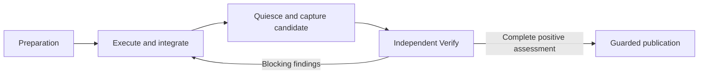

# Self-model proposal: preparation to publication

**Status:** owner-accepted model proposal, 19 October 2026, in the "Modelling" conversation. This document owns the proposed meaning, relationships and responsibility split for a future refinement of Markitect's self-model. It is not an already adopted canonical model revision.

**Scope:** documentation only. Canonical Definitions, execution controls, generated model views and implementation remain unchanged. This record supplies no skill implementation or installation, runtime dispatch, provider-run authority or additional approval phase. The [current Apply concept](manager-apply-concept.md#current-agreed-concept--19-october-2026) owns accepted behavior; the [runtime contract](manager-apply-runtime.md) describes its stated implemented scope. The [language contract](minimal-language/language-contract.md) remains unchanged.

## Owner acceptance and basis

After the six-term proposal, four behavioral contracts, preservation/change comparison and candidate example, the owner accepted the proposal and requested this record:

> Das passt. Halte den Modellvorschlag für Vorbereitung → Ausführung → Prüfung → Veröffentlichung in der bestehenden Dokumentation fest. Noch keine Änderungen am kanonischen Modell oder an der Implementierung.

The preceding analysis used Main [c50d27581ace2b0f3f2329f2d987cc710053079b](https://github.com/Glacius-Labs/Markitect/tree/c50d27581ace2b0f3f2329f2d987cc710053079b). It read all 38 canonical Definitions and examined structural preparation, registry associations and context previews. The model had no body links; the `product/run` preview included its own Rule and type contracts, but not the parent architecture Rule or the repository intent/evidence Rule. This is an observation about that fixed model and preview, not proof that an Agent necessarily ignores those duties during execution.

The self-model already states useful technical boundaries. The challenged assumption is that broad package Rules and complete file accounting alone make the intended workflow and its shared terms sufficiently explicit. The proposal makes central meanings separately addressable and relationships explicit while preserving accepted responsibilities and safeguards. A useful later observation would be a readable end-to-end account and context selections with justified required contracts, without indiscriminate all-to-all inclusion. No improvement in Agent behavior or effectiveness has been measured here.

The [modeling guidance](../modeling-skill-guidance.md) supplies the authoring criteria. [DEC-058](../../concepts/register.md#dec-058-apply-always-executes-before-independent-verify) already selects Execute first, followed by independent Verify. Adopting that behavior in the self-model is a separately identifiable pending migration, not a new process decision made by this proposal.

## One end-to-end workflow

Uncertainty, unresolved decisions and exhausted budget retain visible incomplete work. Preparation is not an initial semantic Verify round. Candidate capture is a necessary boundary in this flow, not a new approval ceremony.

## Six central meanings

The proposed homes below use the existing Package responsibilities. They introduce no new Packages or Managers. Concrete Definition IDs, vocabulary binding and representation remain later migration work; these terms are not new Core Kinds or runtime schemas.

| Term | Proposed meaning | Existing responsibility |
| --- | --- | --- |
| **Model stand (Modellstand)** | An exactly identified stand of canonical Definitions and their bound dependencies. It states the applicable intent for the realization being considered. Its identity binds content; it does not authenticate human approval. | `product/model` |
| **Repository stand (Repository-Stand)** | An exact capture of paths, modes and contents. It describes observed files without claiming that their meaning is correct. | `product/snapshot` |
| **Manager responsibility (Managerverantwortung)** | A Manager's persistent responsibility for one local Package, its realization and the integration of its direct children. | `product/organization` |
| **Apply assignment (Apply-Auftrag)** | A bounded assignment to reconcile realization against a particular model stand. It binds the starting repository stand, execution controls, applicable owner decisions and budget. It grants no authority to rewrite intent. | `product/run` |
| **Verification candidate (Prüfkandidat)** | A complete immutable result stand of integrated realization, including artifact accounting, bound to the assignment's basis. | `product/realization` |
| **Verification assessment (Prüfbeurteilung)** | An attributable assessment of a particular candidate against its model stand: examined responsibility, findings, required-check results and remaining uncertainty. | `product/run` |

These Definitions would describe meanings and constraints. Individual assignments, snapshots, candidates and results remain actual execution data, not live records maintained inside the canonical model.

A candidate uses a repository stand. Its additional meaning comes from being captured completely after integration and quiescence and becoming the subject of closing verification. This conceptual relationship does not require language inheritance or a new Core capability.

## Explicit relationships

The future Definitions should reference their actual subjects, with sentences carrying the relationship and its scope:

- An **Apply assignment** refers to one bound **model stand** and one captured starting **repository stand**.
- **Preparation** derives the required **Manager responsibilities** from the model and the applicable persistent organization choices.
- Each **Manager** realizes its own responsibility and integrates the results of its direct children.
- **Candidate capture** preserves the completely integrated result stand for independent verification, including its assignment basis and artifact accounting.
- Every **verification assessment** identifies its **candidate** and **model stand**. The overall assessment covers every required **Manager responsibility**.
- **Publication** takes only the positively assessed **candidate**, against the still-valid starting-source binding.

A reference alone grants neither ownership nor write authority and does not extend a Rule's scope. These relationships should make necessary contracts available with reasons, not make every Definition relevant to every Manager.

## Four behavioral contracts

### Preparation

Preparation captures explicitly selected inputs, compiles the model stand, checks complete artifact accounting and prepares organization, context and requested metadata. Its result explains the governing intent and starting stand, required Manager responsibilities, applicable controls/decisions/limits, and failed or missing observations.

It starts no Agent session, runs no project check and does not perform realization or publication. Static metadata preparation retains its existing precisely permitted observations; this proposal does not replace those contracts with a blanket claim of no external effects.

**Preserve:** complete capture, provenance, known-failure versus incomplete-observation distinctions and existing preparation effect boundaries.

**Change:** make preparation refer explicitly to model stand, repository stand and Manager responsibility instead of repeating their meanings within one broad Rule.

### Execute and integrate

Root begins reconciliation. Parents supply the concrete foundation their children need before dependent realization starts. Suitable existing foundations can remain unchanged. Independent areas can then progress in parallel; their dependencies and missing prerequisites are coordinated through the existing parent/child tree. Parents integrate their children's results.

Reconciliation preserves what fits, creates what is missing, corrects deviations and removes no-longer-justified realization under the existing removal rules. An unchanged result is valid work when the responsibility was assessed; it needs no artificial edit or separate route. Model uncertainty goes to the existing decision owner rather than being silently resolved by changing intent.

**Preserve:** persistent ownership, complete participation, the shared working basis and the accepted order of foundations, child work and integration.

**Change:** give execution its own contract, separate from closing verification and publication. Its output is initially an integrated working stand, not an automatically verified candidate.

### Independent Verify

Before candidate capture, writing work and relevant subprocesses must be quiescent. Uncertain capture cannot support publication. Every closing assessment and mandatory check uses the same immutable candidate. Verify conversations are fresh and do not receive the author's dialogue. Parents assess their own obligations and the actual interaction of their children as well as their reports.

Keep complete participation and a sufficient result distinct: every required responsibility is represented, blocking findings are independently closed on the current candidate, and required checks pass. Additional preferred test depth does not become mandatory merely because a reviewer prefers it. After repair, capture a new candidate and repeat the complete independent Verify round; do not add fine-grained reuse in this refinement.

**Preserve:** independent assessment, fixed verification basis, visible findings, the current check/evidence threshold and complete reassessment after correction.

**Change:** give these obligations an explicit verification contract. Individual Checks should identify the obligation examined and their bounded evidential meaning alongside the existing command contract. A command's success is not complete semantic proof.

### Guarded publication

A positive assessment is necessary, but the starting-source binding must still be valid. Publication transfers the verified candidate bytes and reads the actual result back. Multiple-file publication is not claimed atomic: partial effects and retained work remain visible. Apply does not commit, merge or push; human acceptance follows project policy.

**Preserve:** source-change guards, exact candidate binding, read-back and honest partial-effect reporting.

**Change:** make publication separately addressable within the existing Apply responsibility. This does not create a new service, Package or approval round.

## What changes in the existing self-model

| Existing Definition | Proposed treatment |
| --- | --- |
| `product/apply/read-only-preparation` | Preserve its behavioral boundary and reference the shared meanings and relationships explicitly. |
| `product/run/confirmed-run-history` | Separate execution, closing verification and publication obligations; make their shared assignment binding explicit. |
| `product/organization/delegated-context` | Preserve responsibility, communication and integration rules; reference the meaning of Manager responsibility. |
| `product/realization/artifact-accounting` | Preserve exact accounting and ownership rules; express their relation to the starting stand and verification candidate. |
| `product/ports-and-adapters` | Preserve the architecture rule and include it explicitly where the behavioral contracts need it. |
| `tooling/gates/*` Checks | Preserve commands; state verification targets and bounded evidential scope more clearly. |

The split is justified by meanings and reasons for change, not text length or a desired Definition count. Keep the current Package boundaries initially. Any later identity migration must update actual references and artifact bases coherently; a rename or split must not leave a competing authoritative statement behind.

This separates two changes: the proposed conceptual reorganization, and adoption of the already accepted Execute-first behavior. Neither is performed here. The current concept remains the behavioral owner; this proposal does not become an alternative execution protocol.

## Concrete candidate example

An assignment is to realize an accepted model stand. Preparation binds that model and the starting repository. Managers execute and integrate, then quiesce and capture **K1**.

Verify finds a blocking integration defect. The responsible Managers correct realization against the same model stand. A new candidate **K2** is captured. K1's assessments do not automatically close K2: the complete independent verification is repeated for K2.

If K2 receives a complete positive assessment, publication still checks the starting-source binding. A changed target repository is not blindly overwritten. If the model or control basis changes, the current concept requires a newly bound run rather than continuing under old intent. Budget exhaustion or an unresolved decision retains an incomplete result instead of waiving the conditions.

This example illustrates bindings and transitions. It introduces no new enum, record format, candidate identifier scheme or retry mechanism.

## Remaining migration work and evidence boundary

Before a separately authorized canonical migration, choose concrete Definition identities, the applicable vocabulary and imports, explicit links, and the corresponding registry-reference migration. Any selected standard-library Kinds retain their actual field contracts; this proposal does not assume that a library is installed or add fields to empty-spec Kinds. Representation and code/API names remain implementation choices within the accepted meanings.

The expected improvement is separately addressable meaning and explainable context across preparation, execution, verification and publication. Structural validity, semantic usefulness, runtime behavior and reduced human correction remain distinct observations. This documentation change supplies no implementation or evaluation run.

Return to the [canonical model and Apply design map](README.md) or the [Design map](../README.md).
