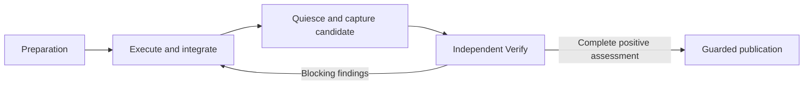

# Self-model proposal: preparation to publication

**Status:** owner-accepted model proposal, 19 October 2026, in the "Modelling" conversation. This document owns the proposed meaning, relationships and responsibility split for a future refinement of Markitect's self-model. It is not an already adopted canonical model revision.

**Scope:** documentation only. Canonical Definitions, execution controls, generated model views and implementation remain unchanged. This record supplies no skill implementation or installation, runtime dispatch, provider-run authority or additional approval phase. The [current Apply concept](manager-apply-concept.md#current-agreed-concept--19-october-2026) owns accepted behavior; the [runtime contract](manager-apply-runtime.md) describes its stated implemented scope. The [language contract](minimal-language/language-contract.md) remains unchanged.

## Owner acceptance and basis

After the six-term proposal, four behavioral contracts, preservation/change comparison and candidate example, the owner accepted the proposal and requested this record:

> Das passt. Halte den Modellvorschlag für Vorbereitung → Ausführung → Prüfung → Veröffentlichung in der bestehenden Dokumentation fest. Noch keine Änderungen am kanonischen Modell oder an der Implementierung.

The owner subsequently accepted the concrete identities, Package assignments, relationships and registry-migration design recorded below:

> Das passt. Halte die konkreten Definitionen, Package-Zuordnungen, Beziehungen und die Registry-Migration im bestehenden Modellvorschlag fest. Noch keine Änderungen am kanonischen Modell oder an der Implementierung.

The preceding analysis used Main [c50d27581ace2b0f3f2329f2d987cc710053079b](https://github.com/Glacius-Labs/Markitect/tree/c50d27581ace2b0f3f2329f2d987cc710053079b). It read all 38 canonical Definitions and examined structural preparation, registry associations and context previews. The model had no body links; the `product/run` preview included its own Rule and type contracts, but not the parent architecture Rule or the repository intent/evidence Rule. This is an observation about that fixed model and preview, not proof that an Agent necessarily ignores those duties during execution.

The self-model already states useful technical boundaries. The challenged assumption is that broad package Rules and complete file accounting alone make the intended workflow and its shared terms sufficiently explicit. The proposal makes central meanings separately addressable and relationships explicit while preserving accepted responsibilities and safeguards. A useful later observation would be a readable end-to-end account and context selections with justified required contracts, without indiscriminate all-to-all inclusion. No improvement in Agent behavior or effectiveness has been measured here.

The [modeling guidance](../modeling-skill-guidance.md) supplies the authoring criteria. [DEC-058](../../concepts/register.md#dec-058-apply-always-executes-before-independent-verify) already selects Execute first, followed by independent Verify. At the original analysis basis, adopting that behavior in the self-model was a separately identifiable pending migration, not a new process decision made by this proposal.

**Recording-basis update, 19 October 2026:** Main [7349ad20101c59183891a45984e153bcb1f29dc7](https://github.com/Glacius-Labs/Markitect/tree/7349ad20101c59183891a45984e153bcb1f29dc7) already contains Execute-first in `product/run/confirmed-run-history`, the parent-foundation obligations in `product/organization/delegated-context`, and declared-layout ownership enforcement in `product/realization/artifact-accounting`. Those independently integrated changes are not work performed by this documentation update. A later structural migration must preserve that current intent, including the distinction between enforcement with a layout and observed/trusted ownership without one. Keep the original fixed observations above historical; do not restore the old initial-Verify order while reorganizing the Definitions.

## One end-to-end workflow

Uncertainty, unresolved decisions and exhausted budget retain visible incomplete work. Preparation is not an initial semantic Verify round. Candidate capture is a necessary boundary in this flow, not a new approval ceremony.

## Six central meanings

The concrete identities below use the existing Package responsibilities and introduce no new Packages or Managers. Each of the six Definitions would use the ordinary project Kind `vocabulary/Concept`; their structured specs would remain empty. Their bodies carry meaning and explicit relationships. None represents an individual live run or observation.

The additional vocabulary Definition `vocabulary/Concept` would itself have Kind `markitect/core/Kind` and admit no structured Properties. Its meaning is: "Describes a subject of the intended project world, including its meaning, identity and relationships. Individual running processes and observed results are not canonical Definitions of that subject." This is the accepted local vocabulary choice for this proposal, not a new Core primitive or an assumed installed standard library. A later switch to a library Kind needs its own explicit identity and contract assessment.

| Term | Proposed meaning | Concrete identity and existing Package |
| --- | --- | --- |
| **Model stand (Modellstand)** | An exactly identified stand of canonical Definitions and their bound dependencies. It states the applicable intent for the realization being considered. Its identity binds content; it does not authenticate human approval. | `product/model/model-stand` |
| **Repository stand (Repository-Stand)** | An exact immutable capture of paths, modes and contents. It describes observed files without claiming that their meaning is correct. Its identity is distinct from the model digest. | `product/snapshot/repository-stand` |
| **Manager responsibility (Managerverantwortung)** | A Manager's persistent responsibility for one local Package, its realization and the integration of its direct children. Responsibility alone grants no extra contacts or writing rights. | `product/organization/manager-responsibility` |
| **Apply assignment (Apply-Auftrag)** | A bounded assignment to reconcile realization against a particular model stand. It binds the starting repository stand, execution controls, applicable owner decisions and budget. It grants no authority to rewrite intent. | `product/run/apply-assignment` |
| **Verification candidate (Prüfkandidat)** | A complete immutable result stand after integration and quiescence, including artifact accounting, bound to the assignment's basis. | `product/realization/verification-candidate` |
| **Verification assessment (Prüfbeurteilung)** | An attributable assessment of a particular candidate against its model stand: examined responsibility, findings, required-check results and remaining uncertainty. | `product/run/verification-assessment` |

These Definitions would describe meanings and constraints. Individual assignments, snapshots, candidates and results remain actual execution data, not live records maintained inside the canonical model.

A candidate uses a repository stand. Its additional meaning comes from being captured completely after integration and quiescence and becoming the subject of closing verification. This conceptual relationship does not require language inheritance or a new Core capability.

A model preview may inspect a draft or fixed source. The preparation contract below preserves that use: a preview does not thereby become an accepted Apply assignment or acquire a publication guard.

## Explicit relationships

The future Definitions should reference their actual subjects, with sentences carrying the relationship and its scope:

- An **Apply assignment** refers to one bound **model stand** and one captured starting **repository stand**.
- **Preparation** derives the required **Manager responsibilities** from the model and the applicable persistent organization choices.
- Each **Manager** realizes its own responsibility and integrates the results of its direct children.
- **Candidate capture** preserves the completely integrated result stand for independent verification, including its assignment basis and artifact accounting.
- Every **verification assessment** identifies its **candidate** and **model stand**. The overall assessment covers every required **Manager responsibility**.
- **Publication** takes only the positively assessed **candidate**, against the still-valid starting-source binding.

A reference alone grants neither ownership nor write authority and does not extend a Rule's scope. These relationships should make necessary contracts available with reasons, not make every Definition relevant to every Manager.

The concrete reference plan is:

| Definition | Referenced subjects and purpose |
| --- | --- |
| `product/model/model-stand` | `product/model/language-v1`: language meaning and validity of the bound model content. |
| `product/snapshot/repository-stand` | `product/snapshot/fixed-values`: exact paths, modes, contents and identities. |
| `product/organization/manager-responsibility` | `product/model/model-stand`: Package-related responsibility in the model. |
| `product/run/apply-assignment` | `product/model/model-stand`, `product/snapshot/repository-stand`, `product/organization/manager-responsibility`: intent, starting stand and required responsibilities. |
| `product/realization/verification-candidate` | `product/snapshot/repository-stand`, `product/run/apply-assignment`: captured result and assignment binding. |
| `product/run/verification-assessment` | `product/realization/verification-candidate`, `product/model/model-stand`, `product/organization/manager-responsibility`: exact assessed subject and scope. |
| `product/apply/read-only-preparation` | Model stand, repository stand, Manager responsibility and the existing capture/accounting contracts needed for preparation. |
| `product/run/execute-and-integrate` | Apply assignment, Manager responsibility and `product/organization/delegated-context`: bounded realization and coordination. |
| `product/run/independent-verification` | Candidate, assessment and `product/realization/artifact-accounting`: fixed subject, findings and closing accounting. |
| `product/apply/guarded-publication` | Assignment, candidate, assessment and `product/adapters/repository/repository-boundaries`: exact verified result and source guard. |
| `product/run/confirmed-run-history` | The four behavioral contracts and `repository/intent-and-evidence`: the overall sequence and intent/evidence boundary. |

The short subject names in this table refer to the full identities above. The future source must declare the necessary per-file imports and body links, with the sentence stating each relationship. Include `product/ports-and-adapters` explicitly where it bounds a behavioral contract. Do not add blanket reverse references from every concept to the whole cycle; understanding a repository stand does not require loading the entire execution organization.

## Four behavioral contracts

These use the existing Kind `vocabulary/Rule`, which already describes intended behavior or an invariant. Keep `product/apply/read-only-preparation`; add `product/run/execute-and-integrate`, `product/run/independent-verification` and `product/apply/guarded-publication`. Their structured specs remain empty.

### Preparation

**Definition:** `product/apply/read-only-preparation` (retained identity).

Preparation captures explicitly selected inputs, compiles the model stand, checks complete artifact accounting and prepares organization, context and requested metadata. Its result explains the governing intent and starting stand, required Manager responsibilities, applicable controls/decisions/limits, and failed or missing observations.

It starts no Agent session, runs no project check and does not perform realization or publication. Static metadata preparation retains its existing precisely permitted observations; this proposal does not replace those contracts with a blanket claim of no external effects.

**Preserve:** complete capture, provenance, known-failure versus incomplete-observation distinctions and existing preparation effect boundaries.

**Change:** make preparation refer explicitly to model stand, repository stand and Manager responsibility instead of repeating their meanings within one broad Rule.

Preserve preparation for previews as well as Apply. Only an appropriately bound Apply assignment enables execution and guarded publication; structural preview must not be narrowed to committed-only execution or silently gain publication authority.

### Execute and integrate

**Definition:** `product/run/execute-and-integrate` (new).

Root begins reconciliation. Parents supply the concrete foundation their children need before dependent realization starts. Suitable existing foundations can remain unchanged. Independent areas can then progress in parallel; their dependencies and missing prerequisites are coordinated through the existing parent/child tree. Parents integrate their children's results.

Reconciliation preserves what fits, creates what is missing, corrects deviations and removes no-longer-justified realization under the existing removal rules. An unchanged result is valid work when the responsibility was assessed; it needs no artificial edit or separate route. Model uncertainty goes to the existing decision owner rather than being silently resolved by changing intent.

**Preserve:** persistent ownership, complete participation, the shared working basis and the accepted order of foundations, child work and integration.

**Change:** give execution its own contract, separate from closing verification and publication. Its output is initially an integrated working stand, not an automatically verified candidate.

### Independent Verify

**Definition:** `product/run/independent-verification` (new).

Before candidate capture, writing work and relevant subprocesses must be quiescent. Uncertain capture cannot support publication. Every closing assessment and mandatory check uses the same immutable candidate. Verify conversations are fresh and do not receive the author's dialogue. Parents assess their own obligations and the actual interaction of their children as well as their reports.

Keep complete participation and a sufficient result distinct: every required responsibility is represented, blocking findings are independently closed on the current candidate, and required checks pass. Additional preferred test depth does not become mandatory merely because a reviewer prefers it. After repair, capture a new candidate and repeat the complete independent Verify round; do not add fine-grained reuse in this refinement.

**Preserve:** independent assessment, fixed verification basis, visible findings, the current check/evidence threshold and complete reassessment after correction.

**Change:** give these obligations an explicit verification contract. Individual Checks should identify the obligation examined and their bounded evidential meaning alongside the existing command contract. A command's success is not complete semantic proof.

### Guarded publication

**Definition:** `product/apply/guarded-publication` (new).

A positive assessment is necessary, but the starting-source binding must still be valid. Publication transfers the verified candidate bytes and reads the actual result back. Multiple-file publication is not claimed atomic: partial effects and retained work remain visible. Apply does not commit, merge or push; human acceptance follows project policy.

**Preserve:** source-change guards, exact candidate binding, read-back and honest partial-effect reporting.

**Change:** make publication separately addressable within the existing Apply responsibility. This does not create a new service, Package or approval round.

## Retained overall cycle identity

Keep `product/run/confirmed-run-history` as an ordinary `vocabulary/Rule`. A readable title such as "Apply reconciliation cycle" can change without changing its identity. Its remaining contract is real orchestration meaning, not an empty compatibility alias:

> An Apply assignment follows preparation, execution and integration, candidate capture, independent verification and guarded publication. Blocking findings lead to correction against the bound basis and a new complete verification. Unchanged realization is a valid result. Uncertainty and exhausted budget do not waive closing conditions.

Reference the four detailed contracts instead of copying all their obligations back into this Rule. Preserve any existing lifecycle or architectural constraint not transferred to a specific target under the obligation mapping. A Definition is not renamed merely because its old ID is less readable than its new title.

## What changes in the existing self-model

| Existing Definition | Proposed treatment |
| --- | --- |
| `product/apply/read-only-preparation` | Preserve its behavioral boundary and reference the shared meanings and relationships explicitly. |
| `product/run/confirmed-run-history` | Retain its identity and overall cycle/lifecycle contract; move detail into the three new Rules and the retained preparation Rule, with explicit assignment binding. |
| `product/organization/delegated-context` | Preserve responsibility, communication and integration rules; reference the meaning of Manager responsibility. |
| `product/realization/artifact-accounting` | Preserve exact accounting and ownership rules; express their relation to the starting stand and verification candidate. |
| `product/ports-and-adapters` | Preserve the architecture rule and include it explicitly where the behavioral contracts need it. |
| `tooling/gates/*` Checks | Preserve commands; state verification targets and bounded evidential scope more clearly. |

The split is justified by meanings and reasons for change, not text length or a desired Definition count. Keep the current Package boundaries initially. Any later identity migration must update actual references and artifact bases coherently; a rename or split must not leave a competing authoritative statement behind.

The original analysis separated conceptual reorganization from adoption of Execute-first. At its older basis, calling that combined migration purely meaning-preserving would have been wrong. At the recording basis noted above, Execute-first is already in the canonical Rule and must be preserved by a later structural migration. This documentation performs neither migration nor implementation. The current concept remains the behavioral owner; this proposal does not become an alternative execution protocol.

## Registry migration without ownership transfer

At the concrete analysis basis, Main [92d5d35795da6e5167bab0a2845053e8ad330df7](https://github.com/Glacius-Labs/Markitect/tree/92d5d35795da6e5167bab0a2845053e8ad330df7), 34 artifact associations referenced `product/run/confirmed-run-history`: 31 in `.markitect/registry/product/run/registry.yaml` and three in `.markitect/registry/product/apply/registry.yaml`. These counts were also checked at the recording basis above. They describe this exact inventory, not a permanent migration total.

Do not replace all those associations with one identical list. A file can realize several Definitions while retaining exactly one accountable owner and one registry entry. Preserve still-justified bases and add or replace precise bases according to actual behavior, not the filename alone.

The following is the accepted mapping design, subject to complete file-level assessment at the eventual migration head. Contract names refer to the exact identities in this document:

| Existing artifact | Proposed `realizes` treatment |
| --- | --- |
| `internal/apply/preparation.go` | Retain preparation; add concept bases only where the file actually realizes them. |
| `internal/apply/reconcile.go` | Retain the overall cycle and add Apply assignment and guarded publication, reflecting bound configuration, run orchestration and publication of a verified result. |
| `internal/apply/candidates.go` | Retain artifact accounting and add verification candidate, reflecting closing accounting against the captured start. |
| `internal/run/execute.go` | Use execute-and-integrate as the more precise behavioral basis; preserve a broader cycle basis only where still justified. |
| `internal/run/verify.go` | Use independent-verification and verification-assessment where their obligations are actually realized. |
| `internal/adapters/gitrepo/publisher.go` | Retain repository-boundaries and add guarded-publication for its preflight and source-bound publication contract. |
| Associated tests | Name the contracts actually examined and explain the bounded evidence supplied. |

For example, `publisher.go` remains owned and registered by the repository adapter responsibility even though it also realizes a `product/apply` contract. Cross-Package semantic links do not move the file or its registry shard. Shared fakes, test exports and cross-area tests need their own assessment; their names do not prove coverage of every new contract. Update each changed entry's reason to explain its real basis.

## Coherent migration procedure

Follow the existing [explicit model-migration contract](commands.md#model-restructuring-as-an-explicit-migration):

1. **Map obligations.** Assign every old obligation to its authoritative target, preserving subjects, conditions, exceptions, limits and current enforcement boundaries. The retained cycle owns the sequence; the detail contracts own their respective duties. Do not lose obligations while shortening bodies.
2. **Build one complete model candidate.** Add the local Concept Kind, six concept Definitions and three new Rules; update the retained Rules and necessary imports/links together. Respect the current Execute-first contract. The graph must have neither dangling references nor competing copies of an authoritative statement.
3. **Migrate registry associations selectively.** Preserve justified bases, replace or add precise ones and update reasons. Every artifact keeps one owner. The proposed migration needs no Package move or shard transfer.
4. **Inspect all binding forms.** Check imports, body links, typed references and control bindings. The existing `requiredBy: tooling/gates/go-tests` remains unchanged. Source-maintenance Checks are not silently converted into additional mandatory run Checks. Metadata migration does not authorize unrelated execution-policy changes.
5. **Validate and assess the complete candidate.** Check structure, exact file accounting, the derived organization and actual context selections. Assess the exact candidate model against unchanged realization with authorized read-only Verify; retain its genuine result and known deviations rather than manufacturing conformity or repairing code as part of this migration.
6. **Adopt before activating.** Activate newly bound contexts only after authorized adoption of the complete model and necessary metadata. Do not reshape a running assignment. Preserve historical tasks, evidence and original identities; previous approval does not automatically approve the new subject.

Canonical Definition files remain protected model inputs, not registered realization artifacts. After a separately authorized canonical change, regenerate the official readable view through its preview/digest-bound writer. Keep publication effects and read-back explicit; the migration design does not claim an atomic filesystem transaction or an available automatic model-writing operation.

Concrete IDs are stable in this proposal, so the mapping is primarily one retained identity to several explicitly linked contracts, not wholesale renaming. If a later decision does change an identity or Package, it needs an exact old-to-new mapping and complete reference/registry migration. An explicitly retained artifact with a reviewed new basis must not be mistaken for removed intent and deleted.

A changed model digest alone proves neither lost meaning nor successful meaning preservation. Evidence comes from the obligation mapping, coherent associations, review and honest assessment against the unchanged artifact basis.

## Concrete candidate example

An assignment is to realize an accepted model stand. Preparation binds that model and the starting repository. Managers execute and integrate, then quiesce and capture **K1**.

Verify finds a blocking integration defect. The responsible Managers correct realization against the same model stand. A new candidate **K2** is captured. K1's assessments do not automatically close K2: the complete independent verification is repeated for K2.

If K2 receives a complete positive assessment, publication still checks the starting-source binding. A changed target repository is not blindly overwritten. If the model or control basis changes, the current concept requires a newly bound run rather than continuing under old intent. Budget exhaustion or an unresolved decision retains an incomplete result instead of waiving the conditions.

This example illustrates bindings and transitions. It introduces no new enum, record format, candidate identifier scheme or retry mechanism.

## Remaining migration work and evidence boundary

The concrete identities, local vocabulary choice, directed relationships and registry-migration approach are now recorded above. Before a separately authorized canonical migration, assess the exact current inventory, write the complete Definition bodies/imports/links, and review the obligation and artifact mappings. The local Concept Kind is only proposed content here; no vocabulary file or standard-library installation is created. Any later selected library Kind retains its actual field contract and requires explicit binding. Code/API names remain implementation choices within the accepted meanings.

The expected improvement is separately addressable meaning and explainable context across preparation, execution, verification and publication. Structural validity, semantic usefulness, runtime behavior and reduced human correction remain distinct observations. This documentation change supplies no implementation or evaluation run.

Return to the [canonical model and Apply design map](README.md) or the [Design map](../README.md).
