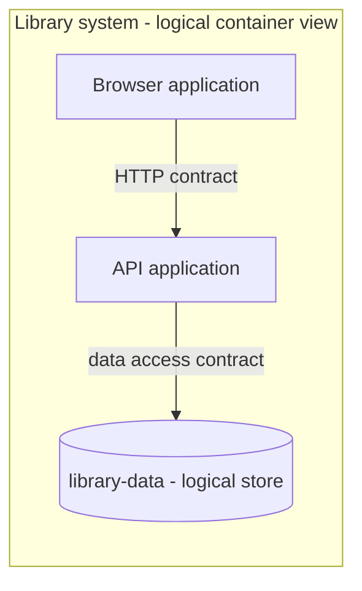
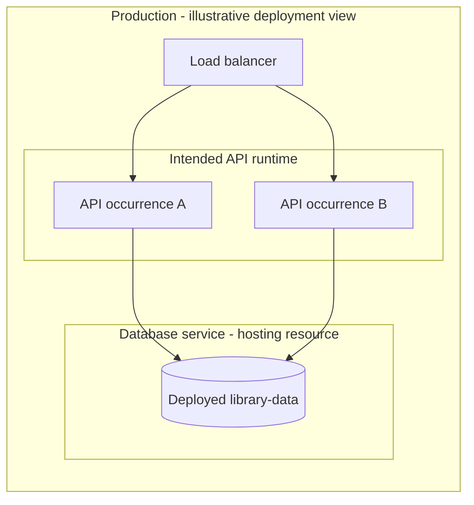

# Standard-library design discussion

Date: 17 October 2026. This is the owning discussion record for the proposed standard library. Per-Kind pages own their proposed Definition text. The [language specification](minimal-language/language-contract.md) remains the sole language contract. This record changes neither the compiler nor the Library fixtures and does not establish Apply or runtime evidence.

## Path to concept closure

The owner wants a clean concept integrated into Main, polished and then implemented when the Coordinator reaches its checkpoint. The following is the recommended closing sequence, not an expansion of the approved implementation scope. The foundation decisions are selected; the remaining companion contracts and reference-project recommendations are still proposals.

### Finish these design decisions

1. Review the final wording of the eight foundation Kinds together. Their separate term pages own that wording. Check that each has a distinct purpose, internal Interfaces need no invented Actor, a Check is a method rather than a result, and no relationship list or field has returned implicitly.
2. Close one bounded first companion scope for architecture, data and operation. Start from the discussed System, Application, DataStore, Environment and Deployment meanings; decide which operating-resource distinctions need their own Kind. Give every selected Kind one complete body, one owning Package and a dependency direction. Frontend/backend remain roles; C4 starts with reviewed views of the same project objects. Optional Instance and specific load-balancer/database Kinds need an actual additional contract. Do not implement every candidate in the topic map merely because it appears there.
3. Review the [data-and-view recommendations](standard-library-data-and-views.md) as reference-project choices. In particular, decide the proposed Deployment extension to logical stores and the intended transaction/failure boundaries. Keep the proposed PostgreSQL reference, maintenance migrations and recovery exercise separate from generic library obligations. A foundation release does not require every project to use that engine or operating method.
4. Walk one coherent Web Library model through the coverage table below. Every applicable obligation needs one clear owner and an examination method; a topic can use the foundation Kinds without receiving a new specialist Kind. Mark deliberately free realization choices and genuinely open project requirements explicitly.

| Coverage to close in the example | Existing approach or remaining question |
| --- | --- |
| Purpose, roles, behavior and domain invariants | Foundation Concepts, Actors, UseCases, Rules, Scenarios and Checks. |
| Frontend, backend, internal parts and external dependencies | Application/Component boundaries and Interface contracts; verify responsibility and relationship ownership. |
| Data, consistency, failure and schema evolution | Logical DataStore plus the proposed access, outcome and migration contracts. |
| Deployment, routing, capacity and operation | Environment/Deployment and relevant operating resources; explicit configuration needs, health, observability and recovery obligations. |
| Security and sensitive configuration | State trust boundaries, identity/access and data-protection obligations as applicable; model secret requirements/references rather than live secret values. A trusted local operator is not a web security design. |
| Repository and delivery | State relevant source/toolchain/dependency constraints, local setup, build/test and release expectations, documentation and applicable licensing obligations. Required artifacts belong to intent; actual file ownership belongs to the registry. |
| Architecture views and verification | One set of project identities, source-supported C4 meanings and Checks with observable success criteria. Execution results remain evidence. |

This coverage pass is a bounded design walkthrough, not a mandate to create all proposed companion Packages or a new exhaustive test programme. A second small domain example can resolve a concrete suspected Library-specific assumption; it is not an unconditional prerequisite for concept closure.

### Consolidate and integrate

After these decisions, make the current contract easy to read: one concise overview, the owning Kind definitions, the Package/version contract and the coherent example. Keep the source statements and superseded proposals as identifiable history, with links from the current text. Remove stale open-question claims and duplicate recommendation text without discarding the original decision evidence. Do not create another parallel specification.

Prepare a focused documentation PR against current Main, resolve substantive overlap with the ongoing Apply concept work, obtain independent complete-diff review and exact-head required CI, then integrate and read back Main under the repository's delivery rules. Documentation integration can carry explicitly deferred proposals; it must not present them as accepted contracts. Neither integration nor a clean branch proves that the Coordinator has reached its checkpoint.

The subsequent implementation assignment should identify the selected scope and integrated source, produce actual Definition files/manifests and exact dependency locks, and validate a complete consumer with the real compiler. Preserve the current Library M1/M2 acceptance target; any migration needs an explicit intent-preserving change. Implement the foundation first; add only the selected companion slice, rather than silently dispatching the whole topic map.

The concept is ready to hand over when the selected first scope has complete contracts, the example reveals no unresolved obligation essential to that scope, proposals and deferrals are visible, and the integrated documents agree. Physical source placement, packaging/release automation and routine implementation choices can be resolved during implementation within those contracts. Numeric operating targets, production readiness, the entire future vocabulary family and a deterministic C4 renderer are not concept-closure prerequisites. Reassessing spec remains observation during actual use.

## Source and selected decisions

Source: the owner's standard-library design discussion in this chat on 17 October 2026. Direct quotations below are owner statements; recommendations elsewhere are assistant proposals unless explicitly selected.

- Initial request: "Schaue dir das aktuelle Konzept und die Arbeiten an um Kontext zu sammeln. Dann lass uns das hier durchsprechen und designen. Erstelle mir einen gut durchdachten und designeten Vorschlag". The owner described reusable building blocks analogous to a programming-language standard library.
- The owner chose to examine the building blocks individually, beginning with Concept, Rule and UseCase in the Library example.
- The owner challenged the proposed UseCase.rules Property: "Welchen konkreten Mehrwert hat die rules-Property gegenüber den Links im Body? Gerade wenn die LendingPolicy dort gar nicht hineinpasst: Wäre es nicht einfacher, alle Beziehungen über die Körperlinks auszudrücken?"
- Selected decision: "Okay, dann bleiben wir bei Körperlinks und spec: {} für die drei." Thus Concept, Rule and UseCase use body links for their domain relationships and have empty structured field contracts. The selection does not approve every sentence of proposed Kind wording or settle other Kinds.
- Next requested subject: "Lass uns als Nächstes Actor und Interface am Bibliotheksbeispiel durchgehen. Welche Properties brauchen die wirklich?" Actor and Interface remain under discussion.
- Recording instruction: "Denke daran, alles festzuhalten, sodass wir das ins Konzept mit aufnehmen können und nichts vergessen." Keep selected decisions, proposals and unresolved questions distinguishable as the discussion continues.
- Further owner decision and question: "Interface sollte auch interne technische Verträge abdecken. Wie würde das am Bibliotheksbeispiel aussehen, und wie grenzen wir Interface dabei von Component ab?" Interface includes internal technical contracts. The concrete architecture and exact Property contracts below remain proposals.
- Further selection: "Okay, dann bleiben Actor, Interface und Component ebenfalls bei Körperlinks und spec: {}." This selects the empty structured contracts and body-link relationships for those three Kinds. It does not select the proposed internal Component split or every sentence of Kind wording.
- Next requested subject: "Lass uns als Nächstes Scenario und Check am Bibliotheksbeispiel durchgehen. Welche Properties brauchen die wirklich?" Their contracts below remain assistant proposals.
- Further selection: "Okay, dann bleiben Scenario und Check ebenfalls bei Körperlinks und spec: {}." This selects the same empty structured contracts and body-link relationships for the two verification Kinds. Exact wording remains a working formulation.
- The owner then asked: "Haben wir damit die wichtigsten Bausteine für die erste Standardbibliothek, oder fehlt noch etwas Wesentliches? Und ist dann hier alles mit empty spec?" The first-scope assessment below is an assistant recommendation, not a decision to publish or implement the library.
- Scope selection: "Okay, dann nehmen wir die acht Bausteine als ersten Umfang." The first scope is Concept, Rule, UseCase, Actor, Interface, Component, Scenario and Check.
- Next subject: "Lass uns als Nächstes die Paketstruktur und Versionierung der Standardbibliothek festlegen. Was schlägst du vor?" The distribution and version policy below remain proposals pending owner selection.
- Observation direction: "Wir sollten spec beobachten. Falls wir nie einen Anwendungsfall dafür haben, könnten wir überlegen ob wir das überhaupt brauchen". Retain this as an evidence-led simplification question during actual use. It is not a decision to remove spec or change the completed v1 baseline now.
- Package/version selection: "Dann übernehmen wir die Paketstruktur und Versionierung wie vorgeschlagen." This selects the markitect-standard distribution, its two initial Packages, and the version/release policy below. It does not publish a release or select the later companion-library candidates.
- Broader library requirement: "Unsere Standard Lib muss alles relevante beschreiben können, was normalerweise in einem Software Projekt bzw Repo auch dokumentiert und festgelegt sein muss. Es muss schließlich das Projekt beschreiben können." The owner explicitly named Frontend, Backend, C4 and Load Balancer, and allowed separate Packages. The eight-Kind foundation is therefore the first shared layer, not a claim that a complete software-project vocabulary family has already been designed. The proposed topic map below answers this broader requirement.
- Continuation: "Alles klar, dann halten wir das so fest und machen so weiter". The owner adopts the modular coverage direction and continuation with system/application/component/deployment/instance boundaries. Exact companion Kind contracts and the web example remain design work; this is not a change to existing M1 behavior or a deployment operation.
- Boundary selection: "Okay, dann halten wir diese Abgrenzungen fest." This selects the discussed System, Application, Component, Environment, Deployment and optional intended Instance distinctions, including the separation from runtime records. The owner then requested the logical data store, operating resources and C4 mapping in the Library example. The new data/resource contracts and mapping recommendations below remain proposals.
- The owner then asked to work out the quoted open C4/data-access/database/migration/failure/recovery points next ("Damm kümmere dich als nächstes darum"). The [detailed data-and-view contract](standard-library-data-and-views.md) records the resulting recommendations. This commissions design work; its new PostgreSQL reference choice and other detailed recommendations are not silently owner-selected.

## Current design state

| Subject | State | Owning detail |
| --- | --- | --- |
| Concept, Rule, UseCase: body links and empty spec | Owner-selected direction | [Concept](concept.md), [Rule](rule.md), [UseCase](use-case.md) |
| UseCase.rules and its Property definition | Dropped from the proposal following the owner's challenge and selection | Rationale below |
| Interface covers internal technical contracts as well as external interaction | Owner-selected direction | [Interface](interface.md), internal example below |
| Actor, Interface and Component: body links and empty spec | Owner-selected direction | [Actor](actor.md), [Interface](interface.md), [Component](component.md) |
| Scenario and general-purpose Check: body links and empty spec | Owner-selected direction | [Scenario](scenario.md), [Check](check.md), example below |
| Exactly the eight discussed Kinds as the first scope | Owner-selected direction | Scope assessment below |
| markitect-standard distribution, two initial Packages and version policy | Owner-selected direction | Package/version contract below |
| Broader project/repository coverage and modular extension | Owner adopts the modular coverage direction; exact companion contracts remain design work | Broader library section below |
| System/application/component and environment/deployment/instance boundaries | Owner-selected direction; exact Kind wording and companion identities remain working design | Runtime walkthrough below |
| Production library, migration and consumer behavior | Not implemented by this record | Existing fixtures remain unchanged |

The initial source assessment used Main `f8c1acaa169c9955d237e17cd245add963c155bd`. Before recording, the isolated documentation branch advanced to integrated Main `f23eaa2072226d905a8d79b8d6c20f419dfdc136`. These are source observations, not compatibility or execution evidence. The canonical v1 compiler and read-only preparation exist; full Apply remains separate delivery work.

## Initial proposal and its boundaries

The initial recommendation was an explicitly imported library of ordinary Definitions built on the unchanged Core. Its purpose is reusable meaning and contracts for authoring, realization and review. Imports confer no execution rights, and foreign library Packages create no local Manager slots.

The proposed first target was eight Kinds:

| Proposed Package | Kinds |
| --- | --- |
| markitect/software | Concept, Rule, Actor, UseCase, Interface, Component |
| markitect/verification | Scenario, Check |

Component would retain its earlier general, nestable meaning, including logical parts without a separate process. Scenario would describe an expected concrete situation, actions and result. Check would describe a verification procedure and success criteria; actual results remain execution evidence.

The initial optional structured relations were UseCase.actors, UseCase.rules, Interface.useCases, Component.parts, Component.interfaces, Scenario.useCases and Check.scenarios. The subsequent selection of empty specs for all eight Kinds drops these proposed fields. Their assessments below explain the choices rather than establish an implementation list. Reverse relationships need not be maintained twice.

A single proposed distribution model, `markitect-standard`, would carry both Packages and depend on the existing Core model. Exact manifest dependencies, per-file imports and the complete external lock would bind its contents. Bundled availability with explicit imports is proposed. No registry, automatic update selection or additional language mechanism is required for the first design.

Proposed version policy: preserve stable identities, keep published contents immutable and bind updates explicitly. Changes to Kind bodies can change obligations while preserving structural validity. New required fields and stronger obligations need explicit contract review. One version for both Packages simplifies use but couples their updates; this remains a tradeoff to decide.

HTTP, messaging, storage, deployment and architecture-specific vocabulary were suggested as later focused libraries. Project, System, Module, Workflow, Decision and Artifact were deferred pending their concrete purpose and existing open boundaries. A Project Kind is not required to establish model identity or a root. A Component relationship does not create Manager ownership; local Package topology does.

The existing optional modeled-scope mechanism can route a Rule stated to cover local Packages: execution configuration selects the Kind and Property carrying scope. No import or ordinary body link automatically activates a rule globally. This does not select an appliesTo Property for the three basic Kinds.

## Why the three basic Kinds need no rules list

The proposed Property had two additional capabilities: exact Rule target checking and an explicit relation meaning that a UseCase must satisfy those Rules. It could prove neither completeness of the list nor fulfillment by artifacts. In the Library, LendingPolicy is a separate Kind carrying applicable obligations; it cannot be a value of a reference Property targeting Rule.

The owner selected the simpler form. A sentence such as "Borrowing is allowed only when the member satisfies [[Members.eligibility]], the copy is available under [[Catalog.availability]], and the resulting open-loan count satisfies [[loan-policy]]" states the required relationship directly. Links identify their targets; the sentence states their meaning and applicability. No additional rules or uses list repeats them.

The selection concerns the domain relationships of Concept, Rule and UseCase. It does not eliminate the Core kind reference, typed values or useful custom Property contracts. A Kind can have meaningful common obligations in its body without declaring spec fields.

The existing [loan](library-example/m1/model/lending/loan.yaml), [availability](library-example/m1/model/catalog/availability.yaml), [eligibility](library-example/m1/model/members/eligibility.yaml), [borrow](library-example/m1/model/lending/borrow.yaml) and [return](library-example/m1/model/lending/return.yaml) provide the concrete example. They already use bodies and links with empty specs. A Concept describes intended meaning, not a particular live loan or a new record Kind. A Rule states a condition and its scope. A UseCase states an action, inputs, admission, results, refusals and preserved state.

The separate [LendingPolicy](library-example/m1/model/lending/lending-policy.yaml) declares structured parameters. Its [loan-policy](library-example/m1/model/lending/loan-policy.yaml) has maxOpenLoans 5 and loanPeriodDays 14. It remains directly linked from behavior; no wrapper Rule duplicates its obligations. Changing five to three stays a change to the existing single parameter owner.

Core v1 has exact nominal Kind targets and no inheritance or union reference target. Reusing Property Definitions in another Kind does not make it a subtype or automatically inherit another Kind's body. Generic analysis must not assume all applicable obligations have Kind Rule.

## Actor and Interface proposal

The current [Library scope](library-example/m1/model/library/library.yaml) already describes a trusted operator. Member is domain data, not a login account. The [callable interface](library-example/m1/model/library/callable-interface.yaml) already declares a local Go program with a JSON Lines contract; it currently has Kind software/Rule.

The initially proposed empty specs and body links for Actor and Interface have since been selected by the owner. Giving the particular existing role and interaction point their own Definitions remains an illustrative model change. It would make the role and boundary explicitly addressable without adding authentication, self-service, protocol, permissions or runtime behavior.

### Proposed operator

One proposed Definition file in Package library:

```yaml
imports:
  - package: markitect/software
    as: Software
id: operator
kind: Software.Actor
body: >-
  A trusted role operating [[library]] through [[callable-interface]].
  The operator supplies requests and observes their responses.
  It performs the supported registrations, membership status changes,
  borrowing, returns and inspections, and requests overdue notices.
  A member record does not grant this role, and this example requires
  no authentication or authorization mechanism.
spec: {}
```

An Actor describes a role, not a specific person, account or automatic grant of authority. A person or another system may fulfill a role. Do not invent a Member Actor without an intended direct interaction. This example assumes no separate human UI around the JSON Lines program.

### Proposed interface

One proposed Definition file in Package library, shown as a shortened contract excerpt:

```yaml
imports:
  - package: markitect/software
    as: Software
  - package: members
    as: Members
  - package: lending
    as: Lending
id: callable-interface
kind: Software.Interface
body: >-
  The local program boundary through which [[operator]] operates [[library]].
  Requests and responses are UTF-8 JSON Lines on standard input and output.
  It processes requests sequentially and writes and flushes exactly one
  response before reading the next request.
  Its operations include [[Members.register-member]], [[Lending.borrow]]
  and [[Lending.return]]. Expected refusals are observable and leave
  domain state unchanged. Diagnostics go to standard error.
spec: {}
```

The actual Library contract also includes every other operation, exact envelope and record fields, correlation, invalid-request handling, process lifetime and remaining constraints. A future model edit must preserve all of them. This excerpt is not a replacement fixture or a tested input set.

UseCases would identify the role through an explicit link, for example "[[Library.operator]] supplies a member identifier, a copy identifier and a borrowing date". The interface owns protocol and operation mapping; the UseCase owns domain effects and refusals. An Actor's link to the interface need not repeat its whole operation catalogue.

Changing callable-interface from Rule to Interface is a proposed Kind change under the same identity, not a new parallel owner. The existing file also contains Go, build and test requirements. Consider moving realization-wide requirements to the existing realization Rule while preserving one canonical owner and explicit links. Do not drop those requirements as part of a reclassification.

### Property assessment

| Candidate | Present reason to omit it |
| --- | --- |
| Actor.interfaces | Body links already identify how the role interacts. |
| Actor category, such as human or system | No current behavior consumes that classification; a role may have different fulfillers. |
| Actor permissions | The Library assumes a trusted operator and no authentication. An Actor declaration does not grant authority. |
| Interface.actors or Interface.useCases | Body links and the existing operation table identify participants and offered behavior. A second list would require maintenance. |
| Interface.protocol or version | The exact JSON Lines protocol and identifier are already binding prose; no structured consumer has been identified. |
| Interface.provider | The internal example states provider and consumer relationships in Component bodies; it requires no second structured list. |

A Property needs a demonstrated purpose beyond labeling existing prose. Exact schema generation, structured validation or independent parameter maintenance could supply such a purpose. A specialized protocol Kind could then declare its exact fields; it would not automatically inherit Interface behavior under v1.

## Internal contract and Component boundary

Owner-selected scope: Interface includes internal technical contracts. The earlier Actor-only working definition was too narrow. An internal consumer can be a Component without being recast as an Actor. The [Interface page](interface.md) owns the expanded definition; the [Component page](component.md) owns its responsibility distinction.

The new observation is the owner's explicit scope selection. Earlier [Library architecture exploration](../product-model-refinement/library-architecture-example.md) already used service and repository contracts, but its old format, frontend/backend/database choices and provider checks do not become current requirements. Current M1 [realization](library-example/m1/model/library/realization.yaml) deliberately leaves internal architecture free and requires no production database. The following is an illustrative architecture proposal, not a change to M1 or its Apply acceptance target.

| Definition | Proposed Kind | Owns |
| --- | --- | --- |
| operator | Actor | The role that operates the library. |
| callable-interface | Interface | The existing external JSON Lines interaction contract. |
| jsonl-adapter | Component | Translation between the external contract and internal calls. |
| lending-api | Interface | The internal lending call contract. |
| lending-service | Component | Responsibility for realizing borrowing and returns. |
| lending/borrow and lending/return | UseCase | The existing domain behavior, including conditions, effects and refusals. |

Both Components and Interfaces describe intended architecture. Neither is the source implementation itself. An Interface states expectations at an interaction boundary; a Component states which system part fulfills a responsibility. The same Component can offer multiple Interfaces, and its internal representation can change while those contracts stay valid. A separate Interface is useful where a deliberate boundary or consumer/provider agreement needs a stable, independently addressable owner; do not create one for every helper call.

### Proposed internal lending contract

One proposed Definition file in Package library:

```yaml
imports:
  - package: markitect/software
    as: Software
  - package: lending
    as: Lending
id: lending-api
kind: Software.Interface
body: >-
  An in-process contract for borrowing and returns.
  Borrow accepts a member identifier, a copy identifier and a borrowing date.
  It returns the created loan's identifier and due date, or a domain refusal,
  as specified by [[Lending.borrow]].
  Return accepts a loan identifier and a return date.
  It returns the loan result and distinguishes returned from already returned,
  as specified by [[Lending.return]].
  Each call completes before returning its outcome.
  This contract carries domain inputs and outcomes, without a JSON envelope
  or a transport correlation identifier.
spec: {}
```

The call semantics are a concrete proposed technical choice. Existing UseCases remain the owners of domain admission rules and effects. The contract does not copy the borrowing limit or independently redefine return eligibility. Exact Go signatures, type representation and package layout remain unspecified by this excerpt.

### Proposed consumer and provider

One proposed consumer Definition file in the same Package:

```yaml
imports:
  - package: markitect/software
    as: Software
id: jsonl-adapter
kind: Software.Component
body: >-
  Provides [[callable-interface]] and translates its requests and responses.
  For borrowing and returns, it consumes [[lending-api]].
  It maps request arguments to call inputs and call outcomes to JSON responses,
  preserving the external contract's ordering and error behavior.
  Domain admission and loan state transitions belong to [[lending-service]].
spec: {}
```

One proposed provider Definition file in the same Package:

```yaml
imports:
  - package: markitect/software
    as: Software
  - package: lending
    as: Lending
id: lending-service
kind: Software.Component
body: >-
  Provides [[lending-api]] and realizes [[Lending.borrow]] and [[Lending.return]]
  against the current library state, including their applicable obligations.
  It owns domain admission and loan state transitions for those operations.
  It does not parse JSON Lines or read or write standard input and output.
spec: {}
```

Only the borrowing/returning slice is expanded here. The adapter still has to satisfy every other operation of the external contract; this example does not select their internal providers. It introduces no persistence, extra process, frontend, dependency-injection framework or additional Manager. All of these Definition excerpts are design illustrations, not a complete compiled fixture.

The provider/consumer roles follow from explicit sentences, not from the link notation alone. The Core verifies target identity, not a formal provides/consumes relationship, actual code dependency direction or fulfillment. No universal single-provider rule or automatic provider selection is proposed. Component does not imply a source-language class or process; Interface does not imply a Go or C# interface declaration.

The owner has selected empty specs and body links for Component as well as Interface. The standard-library contract therefore adds no provides or consumes fields. A later demonstrated structured consumer could motivate a future proposal. A useful future observation would be that a consumer can be reviewed against this contract while its provider's internal representation changes, with no lost domain or external behavior. This discussion supplies no execution proof of that result.

## Scenario and Check proposal

The [worked cases](library-example/business-rules.md#worked-cases), [return UseCase](library-example/m1/model/lending/return.yaml), [availability Rule](library-example/m1/model/catalog/availability.yaml) and [independent evaluation contract](library-example/evaluation-contract.md) already distinguish expected behavior, a method of examination and actual evidence. The evaluation contract includes repeated-old-return case E08. It also states observable-state limits and separates runtime observations from source review.

Scenario describes a concrete expected case; Check describes how to examine an expectation and decide whether observations satisfy it. The [Scenario](scenario.md) and [Check](check.md) pages own the working Kind wording. The owner has selected empty specs and body links for both. Neither is an execution result. The observation supporting this choice is that the existing examples can express the distinction without the initially proposed Scenario.useCases or Check.scenarios fields.

The following two proposed Definition files would live in Package lending. They are design illustrations, not changes to M1 or a compiled fixture. The core domain and interface Definitions remain the source of their meaning.

### Proposed repeated-old-return Scenario

```yaml
imports:
  - package: markitect/verification
    as: Verification
  - package: members
    as: Members
  - package: catalog
    as: Catalog
id: repeated-old-return
kind: Verification.Scenario
body: >-
  Start with one registered active [[Members.member]] and one registered
  available [[Catalog.copy]], with no open loans.
  [[borrow]] the copy on 2026-10-01 and retain the resulting loan identifier
  as firstLoan. [[return]] firstLoan on 2026-10-02.
  Borrow the same copy again on 2026-10-03 and retain its new loan identifier
  as secondLoan. Both borrowings and the first return succeed.
  Return firstLoan again with the valid date 2026-10-04.
  The final operation reports already returned and changes no state.
  firstLoan remains closed with its original return date 2026-10-02.
  secondLoan remains open and unchanged, the member has exactly that one
  open loan, and the copy remains unavailable under [[Catalog.availability]].
spec: {}
```

firstLoan and secondLoan are names for captured results, not mandated generated identifier strings. The dates are example inputs; the expected old return date is owned by the case, not another loan policy. The case does not repeat the five/three admission limit and is applicable under both existing policies. It illustrates already accepted return behavior rather than adding a new rule.

### Proposed observation Check

```yaml
imports:
  - package: markitect/verification
    as: Verification
  - package: library
    as: Library
  - package: catalog
    as: Catalog
id: check-repeated-old-return
kind: Verification.Check
body: >-
  Examine [[repeated-old-return]] through [[Library.callable-interface]]
  in a fresh empty program process. Arrange the state using normal
  registration and loan operations, capturing the actual loan identifiers.
  Before and after the repeated old return, inspect both loan records,
  the member's open-loan list and count through [[inspect-loans]],
  and the copy through [[Catalog.inspect-copy]].
  Pass only when setup succeeds, the final response reports alreadyReturned,
  all observations satisfy the Scenario, and the before/after state agrees.
  A released copy, changed return date, closed second loan, incorrect count,
  malformed response or missing required observation prevents a pass.
  Retain the request/response trace and assertions against the exact candidate
  and model basis. Public observations do not establish absence of changes
  in inaccessible internal state.
spec: {}
```

The Check points to the Scenario for the expected behavior and adds the observation method. It does not copy the domain rule into a second independent catalogue. A concrete test, evaluator or review realizes this procedure. The record of a particular run holds actual candidate/model bindings, results and findings. Such a record belongs to evidence handling; no result file, status or execution timestamp is a Property of the intended Check.

A Check can also directly examine a Rule, Interface, Component or other Definition; a Scenario is not a mandatory intermediate node. A Scenario can receive different suitable Checks, for example public-interface observation and a source review examining a different aspect. These are meaningful distinctions only when their methods and claims actually differ. Linking a Check to a Scenario establishes neither test coverage nor successful execution.

### Property assessment

| Candidate | Assessment for the general-purpose Kinds |
| --- | --- |
| Scenario.given, when, then | Useful optional body headings; no structured editor, runner or consumer currently needs separate fields. |
| Scenario.useCases or Check.scenarios | Body links already identify the targets together with the precise statement about them. Typed lists would restrict targets without proving completeness or coverage. |
| Check.command | Not every method has a command. A required exact command may be model intent, but no universal command field is justified. See the existing narrower Kind below. |
| Check.testFiles | Actual realization files and their assignments belong to the registry; a particular required output can still be stated as intent where necessary. |
| Check.status, lastRun or observed result | These describe a particular execution, not the intended procedure. |
| Check.execution profile or operational budget | These are execution choices; a behavioral performance requirement would remain canonical intent. |

There is one concrete reason to retain structure in an existing narrower Kind: the repository's [maintenance Check](../../../.markitect/model/vocabulary/check.yaml) has a required command Property, with a [Library-oracle instance](../../../.markitect/model/tooling/gates/library-oracle.yaml). [Module configurations](../../../.markitect/README.md) bind hook/workflow bytes and selected pipeline scalars to literal commands. This is a demonstrated structured consumer. Do not remove that existing contract or assume that its source-maintenance meaning is universal. A specialized command-bearing Kind can coexist with the proposed general Check; v1 supplies no inheritance between them.

Routine Checks can use parameters from an exact selected model, with semantic review when expectations change. The existing independent Library experiment deliberately freezes separate five/three profiles; this proposal does not change those controls or create a second evaluator. Neither new Scenario nor Check Definitions are prerequisites newly added to the two-Apply target.

The owner has selected body links and empty specs for both general-purpose Kinds. Together with the previous selections, all eight discussed Kinds now have the selected empty structured field contract. No scenario execution, new test implementation or behavioral proof is supplied by this documentation.

## First scope assessment and empty specs

Owner-selected first scope: the eight discussed Kinds. They address domain meaning (Concept), obligations (Rule), behavior (UseCase), participating roles (Actor), interaction contracts (Interface), system responsibilities (Component), concrete expected cases (Scenario) and verification methods (Check). The supporting assessment was that the Library exposes no concrete need for another universal Kind at this point. The selected scope does not claim that this vocabulary will suit every project.

Project purpose and scope can be stated in a Concept for the overall project, as the current Library does. Realization constraints can be Rules. The current general Component meaning can describe logical system parts without adding System or Module solely for completeness. Rationale can accompany the owning Definition and decision history remains separately recorded. Workflow, Decision, Artifact and more specific architecture/domain types remain deferred until their distinct purpose is established. This does not resolve their older open questions by deleting those terms.

All eight selected standard Kinds declare `spec: {}`. Because a Kind's spec declares its instances' allowed structured fields, this is an empty field contract, not an open extension object. Definitions whose exact kind is one of these Kinds also have empty specs. They still have their identities, kind references, binding bodies, body links, imports and optional titles under the common envelope.

The library's value is shared named contracts and common expectations for authoring and assessment. Kind bodies state what a Concept, Rule, Interface or Check means. The compiler can establish identities, exact kind targets, valid links and the closed empty spec shape. It does not thereby prove correct natural-language classification, formal provides/consumes relations, business invariants or complete verification coverage. Keeping relationships in prose is a deliberate choice that preserves expressiveness and avoids duplicate lists while leaving more interpretation to semantic assessment.

Empty specs are not a rule for all project modeling, the Core or every future library. A project can declare a different Kind with structured Properties. The existing LendingPolicy declares maxOpenLoans and loanPeriodDays; its loan-policy instance sets 5 and 14. This gives exact field ownership, value types and cardinalities. It is not valid to add those fields directly to a standard Rule or Concept with an empty contract. Declaring a separate Kind is supported; no inheritance or automatic extension of the standard Kind follows. Any common meaning needed by that new Kind must be stated explicitly.

The Core's Kind and Property Definitions retain their nonempty structural contracts. The repository's narrower maintenance Check retains its command Property and actual tooling consumer. Future specialized HTTP, messaging or deployment models can introduce structured fields where a concrete use requires them. The standard library does not replace those mechanisms with prose.

Before a production library is ready, remaining work includes agreeing final Kind wording, producing the separate Definition files and manifests, binding exact dependencies/locks, and checking a complete consuming example. The owner has selected the foundation's model/Package identities and version policy below. Physical distribution and deliberate migration from the existing example/self-model vocabularies still need concrete implementation choices. Additional specialist vocabulary is addressed separately below. None of this record claims that such implementation, migration or validation has occurred.

<a id="package-and-version-proposal"></a>

## Package and version contract

Status: owner-selected direction, 17 October 2026, following the Package/version proposal. The names, common version and release/update convention below are selected; releases and implementation are not performed by this record. This applies the existing language contract rather than extending it. [Packages](minimal-language/language-contract.md#packages) are namespaces; [models](minimal-language/language-contract.md#models) are versioning/distribution units; the [lock](minimal-language/language-contract.md#lock) binds exact external contents. The compiler treats versions as exact labels and does not infer compatibility or select updates.

### One distribution model and two Packages

Selected model ID: `markitect-standard`. It owns exactly two populated Packages for the first scope:

| Package | Definitions |
| --- | --- |
| markitect/software | Actor, Component, Concept, Interface, Rule, UseCase |
| markitect/verification | Check, Scenario |

Both Packages share one release version. This keeps distribution, locks and updates simple for eight small contracts. The two namespaces distinguish software intent from its concrete expected cases and verification methods. The cost is a coordinated release even when only one Package changes. Independent models/versions can be considered if real independent use and release needs emerge; no further split is currently proposed.

Illustrative distribution layout, not an implemented source or installation path:

```text
standard/
  model.yaml
  model-lock.yaml
  model/
    markitect/
      software/
        actor.yaml
        component.yaml
        concept.yaml
        interface.yaml
        rule.yaml
        use-case.yaml
      verification/
        check.yaml
        scenario.yaml
```

Each Definition keeps its own file. The model root contains no Definitions directly. `markitect` is an unpopulated prefix, not an umbrella import. Model ID and physical folder do not create a Package prefix; the folders under root create the two exact Package identities. There are no kinds/properties/instances subtrees or version segments in those identities.

The selected first usable preview version is `0.1.0`; no release is published by this record:

```yaml
formatVersion: 1
id: markitect-standard
version: "0.1.0"
root: model
dependencies:
  markitect-core: "1.0.0"
```

Core remains separately owned by the existing `markitect-core` model and Package `markitect/core`. The standard distribution does not copy or redeclare its nine Definitions. Its only direct model dependency is Core. The eight standard Kinds currently need only Core imports; no software-to-verification or verification-to-software dependency is invented merely because both Packages are in the same model.

A consuming Library would replace its current software-basics dependency through an explicit migration, for example:

```yaml
formatVersion: 1
id: small-library
root: model
dependencies:
  markitect-core: "1.0.0"
  markitect-standard: "0.1.0"
```

The direct Core requirement is needed here because the Library declares its own LendingPolicy Kind and Properties using Core. A project that refers only to standard Kinds need not declare Core as a direct dependency just because the standard model needs it transitively. Every transitive model still needs explicit acquisition and its exact lock binding. An author's direct import of a Core Package always requires a direct Core model dependency.

Each consuming Definition imports its needed Packages, for example:

```yaml
imports:
  - package: markitect/software
    as: Software
  - package: markitect/verification
    as: Verification
```

This example only illustrates two possible imports; do not add unused imports to every Definition. `Software.Rule` and `Verification.Check` are recommended explicit references where they improve clarity. Importing markitect/software does not open markitect/verification, and importing a Package is not an installation instruction. There is no automatic umbrella/reexport facility or implicit update to the language.

The standard's lock binds Core. A consuming project's lock binds the complete reachable external set, including both markitect-standard and Core. Digests must be generated from real validated contents; none is invented in this proposal. Current acquisition still requires explicitly supplied dependency manifests. Bundled availability is a future distribution proposal, not an implemented resolver.

### Exact bindings and release policy

Keep the library version independent of the Markitect executable, the language/manifest formatVersion and the Core model version. The standard model can use version 0.1.0 with formatVersion 1 and Core 1.0.0. Release numbers do not become part of Package or Definition identity.

Before publishing, use an unpublished draft rather than repeatedly replacing a published version. Publish `0.1.0` only when the eight separate Definitions compile with actual dependencies/locks and a complete consuming example. Before 1.0, new previews still remain immutable and exactly pinned; incompatible contract revisions advance the middle component (for example 0.2.0) and explicitly state their effects.

Target `1.0.0` once the complete wording is selected and the real library passes relevant consumer validation under the selected identities and version policy. This is vocabulary stability, independent of whether the complete Apply product has shipped. No new provider run or release authority is supplied here.

After 1.0, use a three-part release convention:

| Change | Selected release increment |
| --- | --- |
| Editorial correction preserving the obligations, interpretation and accepted inputs | Patch, such as 1.0.1 |
| Additive content that preserves the existing supported contracts and name resolution | Minor, such as 1.1.0 |
| Changed meaning or obligations of an existing contract; renamed/moved/deleted identities; or a new field on an existing empty-spec Kind | Major, such as 2.0.0 |

The public contract includes body meaning and reference identities, not just spec shape. A new obligation in a Kind body can invalidate a previously correct realization without a compiler error; it therefore needs the same compatibility assessment as a structural change. An optional field also changes an existing empty field contract and is treated conservatively as a major change. Every intentional published content revision gets a new immutable version and digest; pure source formatting can preserve the canonical digest but is not grounds to replace a published artifact.

There is a specific name-resolution risk: Package imports expose short IDs even when an alias is supplied. Adding a Kind to an existing Package can make a consumer's previously unique short reference ambiguous. For example, adding Task could collide with a project's local Task. Alias qualification helps authors name foreign targets but does not make imports alias-only. An addition is therefore not automatically a minor change. Prefer a new explicit Package for a new subject area when that avoids changing an existing imported name set; otherwise classify the compatibility effect explicitly. The compiler does not prove this release classification.

Keep existing Package/ID pairs stable across releases; do not rename or move them for cosmetic organization. New HTTP or messaging distributions should own new populated Packages such as markitect/http, not append Definitions to the standard model's existing populated Packages from a second model. The current language gives a populated Package exactly one owning model per bound input set.

A consumer update changes the exact dependency requirement and regenerates the full external lock from validated sources. Then check structure and reassess semantic effects on applicable Definitions, realizations and evidence. A version label or unchanged local files does not prove those effects absent. One version per model ID is bound at a time; aliases do not allow mixing two standard-library versions. Old published contents and evidence remain tied to their original bindings.

This contract leaves storage/download locations, repository release tags and packaging automation for the distribution implementation. No versions are independently declared on Package imports and no range resolution, latest selector or automatic upgrade is introduced.

## Broader project and repository coverage

Owner requirement, 17 October 2026: the library must describe the relevant intent normally documented and specified for a software project/repository. The owner named frontend, backend, C4 and load balancing and welcomed separate Packages. The previous eight-Kind assessment addressed the first shared foundation. It did not establish completeness for this broader scope. This section proposes the next design direction without changing that selected foundation or the current Apply target.

The language can already express additional intent through bodies, links and project-defined Kinds. A useful standard-library family should also supply precise reusable vocabulary for common topics, so every project need not reinvent architecture and operation meanings. Completeness is about the applicable project obligations, not a prescribed UI, cloud platform or deployment style for every repository.

### Proposed topic map

The following companion names, distribution cuts and example contents are candidates for discussion, not approved Package identities, schemas or an implementation queue. The selected markitect-standard model retains its two Packages and shared version. Companion models can own new Packages and follow independent versions with exact dependencies; no second model can append Definitions to a populated Package owned by the foundation.

| Candidate distribution | Candidate Packages | Intent to describe |
| --- | --- | --- |
| markitect-standard, selected | markitect/software, markitect/verification | Domain meaning, obligations, behavior, actors, interaction, responsibilities, expected cases and examination methods. |
| markitect-architecture | markitect/architecture, markitect/c4 | System boundaries, applications, internal parts, external dependencies and optional precise C4 vocabulary/views. |
| markitect-web | markitect/web, markitect/http | Screens, navigation and interaction, API contracts, request/response and failure behavior, applicable UI constraints. |
| markitect-data | markitect/data, markitect/messaging | Data meaning and ownership, persistence expectations, migration and retention, messages/events, delivery and consistency expectations. |
| markitect-platform | markitect/deployment, markitect/networking, markitect/operations | Environments, deployments and instances, configuration needs, routing/load balancing, scaling, health, observability, backup/recovery and operating procedures. |
| markitect-security | markitect/security | Trust boundaries, identity/access requirements, sensitive-data handling and relevant security obligations. |
| markitect-engineering | markitect/engineering | Language/toolchain choices, dependency rules, source boundaries, build/test/release contracts, local setup and documentation obligations. |

Quality requirements such as response time, availability, accessibility or recoverability can already be Rules, Scenarios and Checks. A companion vocabulary should add precise reusable meaning where needed, not add a new Kind for every adjective. Likewise, a project's contribution or release process can be described as intended process; actual execution history stays outside intent. File assignments continue to use the realization registry, while a deliberately required output can be part of canonical intent.

### Frontend and backend

Frontend and backend are initially roles of particular system parts, not automatically new universal Kinds. A browser application can have the frontend role, an API application the backend role. They need explicit responsibilities, offered/consumed contracts, constraints and relevant user behavior. A CLI or library-only repository need not invent either one.

For example, a hypothetical web Library could declare a browser application, an API application, the existing lending logic and a data store. An Interface owns the HTTP contract; UseCases own domain behavior; Rules own access, architecture and quality constraints. A web vocabulary can supply more specific screen/API concepts if their distinct contracts help authoring or consumers. A new Frontend Kind is warranted only when it supplies a useful contract beyond the role sentence.

### C4 and the general Component

Keep the selected broad Component meaning. Offer C4 as an optional, explicit model vocabulary/view choice, not a hidden redefinition of the base Kind. The earlier [Connector example](connector-example.md) exposed this same boundary and remains historical design evidence, not a current schema or implemented source.

Official C4 distinguishes an [application/data-store container](https://c4model.com/abstractions/container), a [Component within a container](https://c4model.com/abstractions/component), and [deployment nodes/instances and supporting infrastructure](https://c4model.com/diagrams/deployment). A C4 container is not inherently a Docker container. C4 Components are not separate deployable units. A load balancer can be infrastructure in a deployment view. These external definitions explain why one generic containment tree cannot silently be called strict C4.

Earlier option, superseded as the first-support recommendation by the [later walkthrough](#c4-mapping-without-duplicate-project-objects): an optional markitect/c4 Package could offer SoftwareSystem, Container and Component with precise C4 contracts. Keep this option for a demonstrated additional contract; the current recommendation starts with views of neutral project Definitions. Under either approach Software.Component stays general, v1 supplies no inheritance, and a broad Component is not automatically a valid C4 Component.

C4 diagrams should be derived views of accepted Definitions and explicit relationships. They must not become an independently edited copy of architecture. Exact view definitions, required relationships and validation rules remain to design; a renderer or plugin gains no new canonical authority.

### Deployment and load balancing

Distinguish a logical application from its instances in an environment. In a proposed web Library, library-api is the logical backend; its production instances and the load balancer are separate intended deployment subjects. This keeps development, staging and production variations from duplicating domain meaning.

Earlier illustrative C4-specific candidate typing, superseded for first support by the [neutral-definition walkthrough](#one-coherent-example). These are not selected Definitions or a change to M1:

| Subject | Possible Kind | Meaning |
| --- | --- | --- |
| library-system | C4.SoftwareSystem | The modeled system boundary. |
| reader-web | C4.Container | Browser application in the frontend role. |
| library-api | C4.Container | API application in the backend role. |
| lending | C4.Component | Lending functionality within the API application. |
| catalog-db | C4.Container | The logical data store. |
| library-http-api | Software.Interface | Request, response and error contract between browser and API. |
| production | Deployment.Environment | An intended deployment environment. |
| api-instance-a and api-instance-b | Deployment.Instance | Intended instances of the same API application. |
| public-entry | Networking.LoadBalancer | The routing boundary serving those instances. |

Statements can then require that public-entry routes requests to the intended healthy API instances, reader-web uses library-http-api, and the browser has no direct access to catalog-db. A load-balancer contract can own routing, health decisions, connection/TLS boundaries and failure behavior as selected by the project. Those are intent choices, not requirements imposed on all projects by importing a library.

This example deliberately extends beyond the current local JSON Lines Library. It does not silently add a web frontend, persistence or production environment to M1/M2. It also does not establish the proposed Kinds, a live infrastructure inventory or deployment execution.

### What to settle before broader implementation

1. Confirm the common coverage areas and select a bounded first set of companion vocabularies. Agree what must be captured for the chosen project example and what stays a deliberate realization choice.
2. Define the boundaries between logical structure, interaction, data and deployment, including the optional C4 interpretation. Decide whether each candidate is a distinct Kind, a role, a reusable Rule or a derived view. Avoid independent copies of the same fact.
3. Define a small set of actual Kind contracts and explicit relationship meanings in each selected topic, with stable new Package ownership and exact dependency direction. Preserve the selected foundation; do not introduce inheritance or multi-kind instances implicitly.
4. Use a coherent web-project example to walk from user behavior through frontend/API/data to deployment, operation and repository realization. Check whether each relevant obligation has one canonical owner and understandable realization/verification context. This is a proposed design walkthrough, not a new study or execution grant.
5. Reassess spec only at actual uses. The eight base Kinds keep their selected empty specs. A companion may propose structured values if a concrete authoring, validation or processing need justifies them; neither empty nor nonempty specs are a blanket requirement for future vocabularies.

The eight base Kinds are ready for final wording and a concrete compiler/consumer fixture without waiting for every companion. The broader library family needs the above design work before claiming coverage of ordinary full software projects. Producing the family is not equivalent to modeling every vendor, framework or infrastructure resource in advance; extensible project-specific vocabulary remains part of the language.

Recommended next design slice: distinguish a system, an application/runtime boundary, an internal Component and a deployment/instance, then place frontend, backend and load balancing in that example. These choices determine the architecture/platform vocabulary more directly than adding a long list of technology names.

## System, application and deployment walkthrough

The owner selected the distinctions in this walkthrough on 17 October 2026. Exact Kind wording, example Definitions and companion Package identities remain working design. They preserve the selected eight-Kind foundation; they do not add Definitions to the Library fixture or select the complete companion taxonomy.

### Selected boundaries

| Term | Working meaning | Owns in the web Library |
| --- | --- | --- |
| System | A coherent software solution with an explicitly stated purpose, scope, responsibilities and external boundaries. | What belongs to the Library solution and what remains external. |
| Application | An executable software unit with a defined runtime boundary and offered/consumed contracts. | The browser application or API application, independent of a particular deployment. |
| Component | The selected general system-part concept; an internal responsibility can be described with it without a separate runtime boundary. | Lending logic within the API. |
| Environment | A context with its intended operating conditions and constraints. | Production versus local development, without copies of domain meaning. |
| Deployment | An intended arrangement of an application in an environment, with configuration, capacity, hosting and integration choices as required. | How the same API application should run in production. |
| Instance | A specifically distinguished intended occurrence within a deployment, when its identity or role matters. Actual runtime identities and observed state remain operational records. | A stable primary/standby role if the project requires one; not every transient process. |

The proposed System boundary does not follow automatically from a repository, model Package or Manager boundary. The model describes it explicitly. Frontend and backend remain roles, not automatically additional Kinds. A UseCase can span several Components or applications.

Application is a more specific architectural contract than the broad Component meaning, but v1 supplies no nominal inheritance. A particular API application would be one Definition with a chosen Kind; there is no need for a duplicate Software.Component Definition representing the same object. Required common meaning must be stated explicitly in any new Kind contract.

Deployment here means desired arrangement, not the historical act of deploying. An executed rollout, current pod list or observed failure belongs to records and evidence. Intended placement/configuration constraints remain canonical model content. Whether a distinct Deployment Kind, Environment Kind or stable Instance Kind is useful must be checked through the example before finalizing their exact contracts.

### One coherent example

The prospective web Library has the following subjects. Candidate names below are explanatory, not selected stable Package identities or a compiled fixture:

| Definition | Possible Kind | Statement |
| --- | --- | --- |
| library | Architecture.System | The solution includes a browser application, API and its supporting data responsibility. |
| library-web | Architecture.Application | The frontend presents the existing operator behavior and uses the Library HTTP contract. |
| library-api | Architecture.Application | The backend offers that contract and contains lending logic. |
| lending-logic | Software.Component | Realizes borrowing and returns within the API, with their domain rules. |
| library-http-api | Software.Interface | Owns the request/response contract; domain meaning stays linked to the UseCases. |
| production | Deployment.Environment | States the production context and applicable operating constraints. |
| api-production | Deployment.Deployment | Arranges library-api in production with at least two interchangeable instances. |
| public-entry | Networking.LoadBalancer | Serves the intended public entry and routes to suitable healthy instances of api-production. |

The data-store type and data contracts are intentionally not finalized by this slice. Two API replicas require shared or correctly coordinated lending state and an explicit admission consistency contract; independently running M1 processes each own local state and do not establish those guarantees across replicas. Deployment capacity alone does not solve this issue. The example adds no direct member self-service role and does not grant persistence or web behavior to the current local M1. If the existing library Concept were deliberately retyped as System later, preserve a single owner of purpose/scope rather than maintain duplicate competing descriptions.

Illustrative body relationship excerpts, not complete Definition files:

```text
library:
  [[library-web]] and [[library-api]] belong to this system.

library-api:
  Provides [[library-http-api]] and contains [[lending-logic]].

api-production:
  Runs [[library-api]] in [[production]] with at least two
  interchangeable application instances.

public-entry:
  Routes public requests for [[library-http-api]] only to suitable healthy
  instances of [[api-production]].
```

The sentences carry membership, offering, deployment and routing meaning; links carry explicit target identities. They are not new Core operators or automatic provider/routing validation. All exact imports, host placement and remaining domain constraints would be supplied in a complete consuming example.

### Avoid unnecessary instance Definitions

Refinement of the earlier two-instance illustration: two interchangeable replicas do not necessarily justify two separately named canonical Definitions. A desired capacity statement in api-production can describe them without maintaining api-instance-a and api-instance-b. Use explicit intended Instances when a difference such as role or fixed placement matters. Autoscaled or replaced process identities should not force model edits on every runtime change.

This reduces model upkeep. The tradeoff is that an individual occurrence is not separately referenceable unless the model explicitly needs and declares it. The proposed Instance concept therefore remains optional rather than mandatory for every deployment.

A desired replica count is a possible concrete spec use if a manifest generator or validator must consume an exact value. That consumer and its value contract would justify a Property proposal. The current illustration keeps it in prose; neither a replica Property nor empty specs for every companion Kind are selected here.

### Relation to C4 and the next distinction

The generic application/component/deployment distinctions are the first design step. An optional C4 vocabulary can subsequently state its exact system/container/component contracts and view rules. A logical data store is a separate subject from a running database host or its deployment. Do not silently force all generic Components into C4's narrower Component category or create duplicate architecture owners to populate two views.

Recommended next step: review these meanings, especially application versus Component and desired deployment versus actual runtime records, then refine logical data store, infrastructure/hosting and C4 mapping. Final companion Kind wording and fields should follow the concrete boundaries rather than be filled in for completeness.

## Logical data, operating resources and C4 walkthrough

Working proposal, 17 October 2026, following the owner's selected runtime distinctions. The prospective web Library is a separate design example; the local sequential, process-lifetime-only M1/M2 contract remains unchanged. No persistence, concurrency support, database, renderer or deployment has been implemented by this discussion.

### Proposed data and resource meanings

| Subject | Proposed meaning | Web Library example |
| --- | --- | --- |
| DataStore | A logical data-holding boundary with owned data and access, consistency and lifetime expectations. It need not choose an engine or host. | library-data owns the authoritative member, copy and loan state used by the API instances. |
| DatabaseService | The intended technical database service that can host logical stores, whether operated directly or obtained as a managed service. | database-service hosts library-data in production; exact product/version and service arrangement are not selected. |
| Storage resource | A separately governed persistence resource when the project must specify one. It is not the logical domain data itself. | A durable volume for a self-operated engine, if selected later. A managed service need not expose such a resource as a separate project-owned subject. |

The existing member, copy and loan Concepts own domain meaning. DataStore does not replace them with copies of their field descriptions or mean one database per Concept. Conversely, one logical DataStore does not require one physical database process, node or disk. Technology, hosting, availability and retained data have different owners and may vary independently where their contracts allow it.

The Store's consistency expectations do not magically follow from selecting a shared database. The following behavior is proposed for the multi-instance extension:

- All API instances use one authoritative logical lending state, without unrelated per-instance library state.
- Admission and the resulting loan state change behave as one coordinated decision across instances, preserving the existing availability and loan-policy obligations. No two successful admissions may create open loans for the same copy, and concurrent requests must preserve the member's applicable limit.
- Completed changes are visible to subsequent operations under the public contract whichever API instance handles them; routing a later inspection to another instance must not expose unrelated per-instance state.
- In normal fault-free operation, two valid concurrent requests for the same available copy through different instances produce one success and one refusal. The refused request leaves no partial changes. A check must observe the resulting loans and copy state, not just response statuses.
- Accepted changes remain accessible when an API instance is replaced. This does not yet select database-failure durability, disaster recovery loss/time objectives or backup policy.

The example neither prescribes a particular lock/transaction mechanism nor treats routing or a health check as consistency proof. It adds no automatic request replay or business-idempotency promise; transport retry semantics need a separate explicit contract. Actual failure/recovery behavior remains to design.

One illustrative DataStore Definition file, with candidate Package identities and an empty spec for this excerpt:

```yaml
imports:
  - package: markitect/data
    as: Data
  - package: members
    as: Members
  - package: catalog
    as: Catalog
  - package: lending
    as: Lending
id: library-data
kind: Data.DataStore
body: >-
  The authoritative logical store for [[Members.member]], [[Catalog.copy]]
  and [[Lending.loan]] state used by [[library-api]].
  Every instance of [[api-production]] uses this same logical state.
  Admission and committed state changes preserve [[Catalog.availability]]
  and [[Lending.loan-policy]] across instances.
  Accepted changes remain available when API instances are replaced.
  Domain record meaning remains with the referenced Concepts.
spec: {}
```

This excerpt is not a complete compiled fixture or an owner-selected DataStore schema. It supplies no engine, storage size, retention number or new claim that structured fields are unnecessary for every data vocabulary.

### Placement and a Deployment refinement

The accepted Deployment distinction was introduced for an application. The DataStore case motivates a proposed refinement: a Deployment can arrange an application or a logical DataStore in an environment and associate it with the appropriate operating resources. It describes the desired arrangement; actual rollout and runtime inventory remain records. The extension of subject scope is a proposal, not an implicit retyping of DataStore as Application.

In the example, api-production arranges library-api in production with the desired capacity. A separate data-production arranges library-data on database-service in that environment. Configuration and technology are fixed at their actual owner only when the project selects them. Multiple environments may realize the same logical store contract without duplicating its domain meaning.

The logical store itself does not contain environment-specific credentials, hostnames or physical topology by default. A managed database may combine several underlying operating resources behind one service contract. Introduce explicit host, volume, primary/standby or placement subjects only where their constraints matter to the project. Runtime replica IDs are not new canonical Definitions on every change.

### C4 mapping without duplicate project objects

Recommendation for the first C4 support: start from the neutral architectural Definitions and state the mapping and view requirements explicitly. The earlier standalone C4 Kind list was an option, not a selected requirement. This example does not require parallel C4.Container Definitions duplicating each Application and DataStore. Whether additional C4-specific Kinds add useful authoring contracts can be decided from later concrete needs; v1 still supplies no inheritance or multi-kind instances.

The following is a mapping for this example, not a universal classifier:

| Canonical subject | C4 representation |
| --- | --- |
| library System | Software system. |
| library-web and library-api Applications | Containers in the static container view. |
| library-data DataStore | A data-store Container, such as the logical database/schema. |
| lending-logic within library-api | A Component in that application's Component view, where its interface and runtime boundary satisfy the narrower C4 meaning. |
| database-service hosting the store | A deployment node in the production deployment view. |
| Intended occurrences of the API/store | Container instances placed on the intended deployment nodes; the view can represent them without separate author-maintained records for interchangeable replicas. |
| public-entry load balancer | Supporting infrastructure node in this deployment view. |
| data-production and api-production | Supply intended placement/configuration facts for the deployment view; Deployment is not automatically a C4 deployment-node box. |

C4 explicitly treats applications and logical databases/schemas as [Containers](https://c4model.com/abstractions/container). A [Component](https://c4model.com/abstractions/component) sits inside a container rather than being independently deployed. The [deployment view](https://c4model.com/diagrams/deployment) places instances on hosting/runtime nodes and may show supporting infrastructure. These external definitions constrain a claimed C4 view; they do not add compiler operators to Markitect.

An illustrative logical view contains the browser, API and logical store, while the internal lending part belongs to a separate component-level view. The load balancer and database host belong to the deployment view in this example. Keep those abstraction levels explicit rather than draw one mixed hierarchy and call it every C4 view.





These are explanatory sketches, not a selected host layout or generated evidence. The occurrences illustrate at least two intended API instances and do not require two individually maintained Instance Definitions. Actual node counts and placement policies remain open.

The canonical Definitions and their explicit sentences remain authoritative. A body link alone does not say contains, calls, hosts or routes. A future agent/tool can realize and review the requested C4 view against those statements. A purely deterministic renderer would need an explicit sufficient relationship contract; it cannot infer C4 edges from mere graph reachability. This is a concrete possible structured-spec use to examine if such a renderer becomes a requirement, not an already implemented capability or permission to add fields to the eight selected empty-spec Kinds.

### Remaining data/operation choices

The owner commissioned these points next. The [detailed data-and-view contract](standard-library-data-and-views.md) now owns the proposed first C4 generation/review method, atomic data-access interface, PostgreSQL reference approach, outcome/retry distinctions, maintenance migration procedure and backup/restore method. Numeric operating objectives still require project requirements. This walkthrough remains the initial boundary example rather than a competing detailed contract.

Recommendation for this slice: add the logical DataStore distinction, separate it from the technical database/hosting resources, broaden Deployment's subject scope explicitly, and begin C4 support with reviewed views of the same project Definitions. These recommendations remain under discussion; no complete new companion schema or database technology is selected here.

## Observe the value of spec

Owner direction, 17 October 2026: observe whether spec has a useful application. If actual use supplies no convincing case, reconsider whether it is needed. Do not invent structured fields merely to justify the existing mechanism.

Distinguish two questions as experience accumulates:

- Does structured model content provide a concrete benefit over a binding body and explicit links? Identify the value being maintained or consumed and what exact validation or processing requires it.
- Does requiring the literal empty spec mapping on every Definition provide enough value, even where no structured fields apply?

The Library's maxOpenLoans and loanPeriodDays and the repository's maintenance command are existing examples to examine, not sufficient proof of usefulness merely because they have been modeled. Keep examples, actual consumers and observed benefit distinct. Reconsideration should compare the simpler alternative and its effect on authoring, validation and realization.

Omitting an empty spec in author syntax and removing structured contracts altogether are different possible changes. The latter also affects Core Kind/Property definitions and their field/value contracts. The current v1 rule and the eight selected empty-spec contracts remain in effect during this observation. No compiler, fixture or canonical-language change, scheduled monitoring or separate study is introduced by this record.

## Remaining discussion

- The owner has selected all eight discussed Kinds as the first scope, each with empty spec and body-link relationships.
- Exact Kind wording remains a working formulation. Interface's internal/external scope is selected; the particular call contract and Component split remain illustrative architecture proposals.
- The markitect-standard model, its two initial Package identities and the stated version/update policy are selected. Actual distribution, exact source location, fixtures and release automation remain implementation work.
- Review the broader topic map and architecture/platform example before selecting any new companion Package or Kind.
- Review the [detailed data-and-view recommendations](standard-library-data-and-views.md), including the reference engine and explicit failure/recovery limits, separately from the already selected foundation.
- During actual modeling, observe the benefit of structured spec content and the cost of mandatory empty specs, as directed above.
- Preserve the Library's complete intent when proposing a vocabulary migration; do not alter the M1/M2 Apply acceptance target merely to demonstrate the standard library.
- Examine a small Tasks model after the Library to distinguish shared needs from Library-specific vocabulary. This is a proposed design check, not authorization for a study or proof of benefit.
- A useful result would reduce repeated basic definitions while preserving expressiveness and understandable Manager context. Compiler success and Definition counts do not measure that benefit.

## Recording practice

Continue this owner record and the relevant term pages as the discussion proceeds. Record owner selections explicitly; keep unselected recommendations and superseded proposals labeled. Actual vocabulary fixtures, locks and executable probes remain unchanged in this documentation increment. No generated model view or canonical self-model change is required for this documentation-only record.

Return to the [canonical-model design map](README.md).
