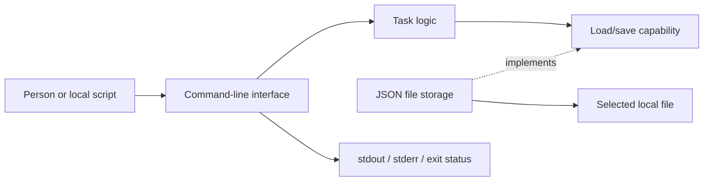

# Architecture

## Context and approach

Tasks runs as one short-lived process under the current OS user. The person or a local script supplies arguments; the process reads one selected file, performs an action, optionally saves and exits. The only external runtime resources are Python, the terminal and a local filesystem. There is no network boundary or server deployment.

The implementation baseline is Python 3.13 and standard-library modules only. Source execution avoids a package manager or service during ordinary use. A small package is sufficient; no plugin system, dependency-injection container or framework layers are required. [Decisions](decisions.md) records the alternatives and consequences.

## Responsibilities

| Area | Responsibility | Boundary |
|---|---|---|
| CLI | Parse invocation, select a file, translate outcomes and write output. | Does not decode JSON or decide state transitions. |
| Task logic | Validate task meaning and implement add/list/complete. | Does not print output or depend on a concrete JSON representation. |
| File storage | Load/validate/encode the collection and publish safe saves. | Does not choose user actions, allocation policy or messages. |

The domain data and validation helpers live with task logic. The startup module composes task logic with file storage and supplies arguments to the CLI. The task logic depends on a narrow load/save capability; the concrete adapter can be replaced by a test double. This is a small functional boundary, not a requirement for a class hierarchy.



## Normal command flow

1. Startup wires the real storage functions and prepares UTF-8 text output.
2. CLI parses all syntax and determines one file path without reading it.
3. Task logic validates action input, loads the full collection and performs the action.
4. For a mutation, storage publishes the complete new collection through the save procedure.
5. CLI formats the domain result only after the action has finished and returns the documented status.

List and repeated completion do not save. The action result distinguishes these cases from changed state. Use domain/storage outcomes or small explicit exceptions internally; do not make task logic depend on exit-code integers. The CLI owns their public mapping.

## Persistence and failure boundaries

The storage adapter validates the complete file before exposing any tasks. One mutation has one commit point: successful replacement of the selected file. Domain validation and serialization happen first. The [storage design](storage.md) owns the exact order, cleanup and guarantees.

A failed output stream can occur after a committed mutation. Preserve the committed file and report the output failure where possible. Never try to roll back the data merely because confirmation could not be printed. The [command reference](cli.md) owns that observable behavior.

## Source layout

The intended source package is small:

```text
tasks/
  __init__.py       package/version metadata
  __main__.py       composition and process entrypoint
  cli.py            arguments and output
  domain.py         task data and validation
  service.py        the three actions
  storage.py        JSON loading and safe replacement
tests/
  test_domain.py
  test_service.py
  test_storage.py
  test_cli.py
  test_restart.py
```

These are planned implementation paths. There is no code in the current documentation delivery. Tests may import individual modules; CLI tests invoke `python -m tasks` in separate processes. The developer procedures and non-code files are described in [Contributing](../CONTRIBUTING.md).

## Security and scale

OS account permissions are the access boundary. Task text is data, never executable input. Data files are unencrypted, and shell history/process arguments can contain entered text. The application has no telemetry or persistent diagnostic log. See [Operations](operations.md#privacy-and-file-access).

Full-file loading/saving deliberately trades scalability for simplicity. There is no concurrent-writer coordination; no atomic-replacement technique removes the lost-update risk of two simultaneous processes. Broader scale, concurrency or encrypted storage requires a new design decision and corresponding tests.
