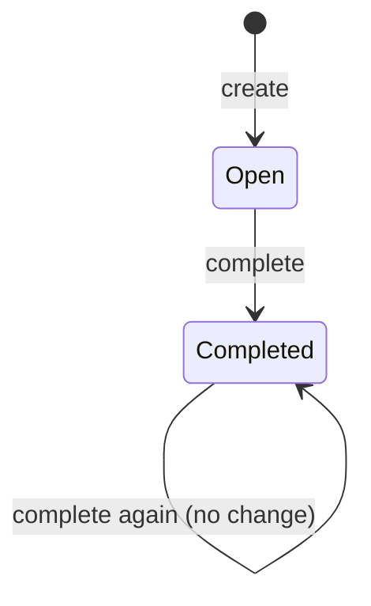

# Tasks and their lifecycle

## A task

A task is one recorded piece of work. It contains only a reference, text and state. There are no timestamps, account owners, dates or priorities in this version.

| Property | Meaning and rule |
|---|---|
| Reference | An integer from 1 through 9,223,372,036,854,775,807. Stable and unique within one task file. Commands display and accept its ASCII decimal form without signs or leading zeros. |
| Text | Nonblank, normalized, single-line Unicode text. Text is not an identity; duplicates are allowed. |
| State | Exactly `open` or `completed`. |

The reference is local to a selected file. Reference 1 in two different files does not identify one shared task. New references use one greater than the highest stored reference, or 1 in an empty collection. If that would exceed the reference range, adding is refused without a write. Other actions remain available.

## Text rules

Reject Unicode characters in general categories `Cc` (controls), `Cs` (surrogates), `Zl` (line separators) and `Zp` (paragraph separators) before trimming. This excludes tabs, CR/LF, terminal escape characters and invalid surrogate code points. Then remove leading and trailing characters for which Python 3.13 `str.isspace()` is true. Reject an empty result. Preserve other characters, internal spacing and letter case exactly; do not normalize Unicode composition.

There is no additional application-specific text-length limit. Shell argument limits and available memory still apply. A caller provides exactly one text argument, using shell quoting when it contains spaces. The application does not run task text as a command or interpret it as markup.

## Lifecycle

A new task starts open. Completing it changes only its state. Completing an already completed task succeeds without a change or storage write. Text and reference remain stable. Version 0.1 has no transition back to open and no removal operation.

An empty collection is valid. All stored references must be distinct; ordering in the JSON array has no domain meaning. Invalid persisted properties invalidate the complete file instead of causing individual tasks to disappear. The [storage format](storage.md) defines strict decoding and validation; the [command reference](cli.md) defines action results.
