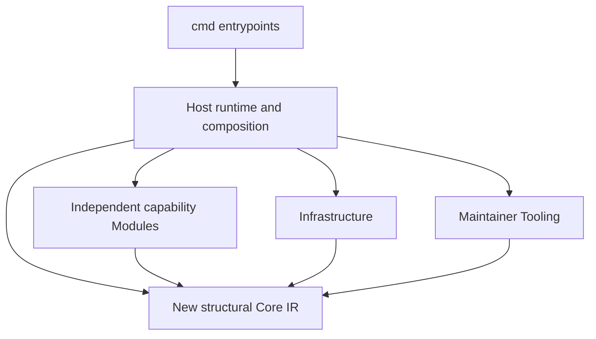

# Modules and static composition

This page owns the dependency rules between Markitect's packages and how they are composed. The [code map](code-map.md) lists every package with its layer, purpose and owning document. [Architecture](../architecture.md#layers) describes what each layer does and its known problems. The [clean-architecture consolidation decision](../design/clean-architecture-consolidation.md) records how this structure was introduced.

## Go capability packages

Go packages under `src/internal/modules/<name>` are implementation units, not installable manifests. The current capability packages are pure Git-hook and pipeline checks (`githooks` and `pipelines`, in the module layer). Application composes them through `src/internal/application/modulechecks`; those packages receive explicit values and perform no filesystem access or process execution. The project-model family is in `src/internal/core/projectmodel`, with pure `projectbriefing`, `projectcoverage` and `projectvalue` subpackages.

The module check's inputs have an exact Artifact contract. This repository's `tooling/module-verification` Artifact declares `.markitect/modules/githooks.config`, `.markitect/modules/pipelines.config`, `.githooks/pre-commit`, and `.github/workflows/ci.yaml` as exact paths in `spec.paths`. In general, each selected module config and every configured hook or workflow file must be a present, exact path in a canonical Artifact; prefix-only path ownership does not authorize an input. Host loads bytes from one selected snapshot and supplies compiled model facts, exact owner links and, for pipeline checks, expected check references. The modules validate configured digests, owner links and selected YAML scalar references; they do not install or execute hooks or workflows.

## Dependency direction

CLI packages import Host only. Host statically wires concrete functions, consumes Core IR, and supplies explicit configuration and exact artifact bytes or inventory facts. Infrastructure acquires/materializes source and supplies Core snapshot values. Tooling owns maintainer release, publication, licenses and import-gate algorithms; Host runtime composition invokes those algorithms. Examples, experiments and adopter fixtures are Harness, never production imports or dependency-law exemptions. `integration/run-markitect.go` is independently copied distribution Tooling; it uses the standard library and imports no Markitect package.

Each new capability package under internal/modules/<name> imports only the new Core and its own subtree among Markitect packages; it may use any third-party library that helps ([DEC-020](../concepts/register.md#dec-020-markitect-uses-any-library-that-helps)). It must not import a sibling package, Host, Infrastructure or Tooling; this restriction covers production files, tests and supported-platform variants. Host statically composes capabilities, but packages do not call back into Host or self-register. There is no dynamic loader, reflection framework, generic Module lifecycle or provider switch in Core. No layer is limited to the standard library; the import gate checks only imports between Markitect packages.

Project-model subpackages consume explicit values: coverage classifies a supplied census, briefings compare supplied revision models and query a minimal resolution view, and projectvalue owns shared project DTOs, selectors and binding identity. `application/projectcoverage` acquires the census through the caller's selected source acquisition. `application/projecthistory` acquires Git/history facts and owns persisted history, CAS and locks. Application composes those operations with Runtime's finite Host callbacks; Runtime does not import Application packages. Runtime retains run stores, budget accounting, verification, guarded Apply and recovery.

The code map's four product layers obey the following import direction, in addition to the package rules above:

| Importing layer | Permitted product layers |
| --- | --- |
| Core | Core |
| Infrastructure | Core, Infrastructure |
| Runtime | Core, Infrastructure, Runtime |
| Application | Core, Infrastructure, Runtime, Application |

Application may import Runtime and Core directly. Product packages may not import legacy packages. These rules apply equally to production, test and platform-specific Go files; they do not relax the separate coarse package boundaries.

Physical product directories name those four layers. The coarse import gate retains the existing composition roles: Application and Runtime are Host, the nested `core/projectmodel` family is one Module owner, and `infrastructure/guardedwrite` retains its Host boundary. Structural Core cannot import the project-model family; that family and the capability modules cannot import each other. Ordinary source Infrastructure and Tooling cannot import guardedwrite. Its Infrastructure fine label and guarded-selector rules still govern product callers. These classifications preserve the import graph through the directory moves; they grant no alias or edge exemption.

## Apply target dependencies

The [Apply architecture](../design/canonical-model/manager-apply-go-architecture.md) defines the replacement under root `cmd/` and `internal/`. The gate prepares that graph now; the current `src/` rules above remain active until the coordinated cutover. No target package may import a current package, and no current package may import a target package, including in tests. This also prevents reuse through old test helpers or maintenance composition.

| Target responsibility | Allowed other target responsibilities |
| --- | --- |
| `internal/model/` | None |
| `internal/snapshot/` | None |
| `internal/organization/` | Model, Snapshot |
| `internal/realization/` | Model, Snapshot |
| `internal/run/` | Model, Snapshot, Organization, Realization |
| `internal/apply/` | Model, Snapshot, Organization, Realization, Run |
| `internal/adapters/{cli,mcp,gitrepo,journal,codexappserver,checks}/` | Model, Snapshot, Organization, Realization, Run, Apply |
| `internal/adapters/process/` | None |
| `internal/bootstrap/` | All target responsibilities except command entrypoints |
| `cmd/markitect/` | Bootstrap |

The Codex App Server and Checks adapters may also import `internal/adapters/process/`, the concrete process lifetime helper selected in the [rebuild plan](../design/canonical-model/manager-apply-rebuild-plan.md). Other adapters may not import each other. Each responsibility may use its own subpackages; external tests may import their own package. The gate does not restrict third-party libraries (DEC-020).

Each target responsibility has a distinct `apply-*` code-map layer. The classifier uses complete path segments, including the named adapter families and command, so unknown areas such as `internal/common/`, `internal/adapters/other/` or `cmd/other/` fail. Every actual Go package, including a test-only or platform-only package, still needs its own exact code-map entry, purpose and owning document. A target package cannot borrow a current layer label. Missing entries and entries without actual packages fail. Product source under `cmd/` and `internal/` uses the root Go module; nested `go.mod` files fail instead of hiding packages from inventory. Existing inventory exclusions such as `testdata/` still apply. Empty target areas require no entries or producer stubs; this gate does not assert that any replacement behavior is implemented.

The coordinator updates the map and regenerates its page when reviewed producer packages integrate. The optional `foundation-layer` Artifact owns `internal/model/`, `internal/snapshot/`, `internal/organization/` and `internal/realization/`. The required `core-layer` Artifact still owns `src/internal/core/`; its required paths remain unchanged. Execution, adapter and command ownership is assigned with their later delivery cuts. Import classification does not grant implementation scope or artifact ownership.

## Responsibility map

The [code map](code-map.md) owns the package list. In short:

- **Core:** the structural compiler, snapshots and project-model views. The compiler receives explicitly selected, decoded inputs and returns structural results only.
- **Infrastructure:** Git and working-tree access, fixed snapshots and guarded writes. It owns Git acquisition and file-mode conversion.
- **Application:** the product's use cases and their CLI and MCP surfaces.
- **Runtime:** the inner roles in owned candidate workspaces.
- **Executables, tooling, bootstrap, harnesses, experiments and fixtures** complete the map.

The earlier map with its v0.13 compatibility rows is in the [history record](../history/development-modules-legacy-sections-20261010.md#responsibility-map).

## Adding, changing or removing a capability package

Create a capability package only for an independently owned capability with clear inputs, outputs and validation that does not belong in the semantic kernel or Host's shared orchestration. Before implementation, record its owner, exact subtree, Core-facing types, configuration, artifact-byte contract, tests, unsupported behavior and output ownership. Keep the implementation and unit tests inside that subtree. Request coordinator-owned Host wiring; do not edit shared DTOs, Core, Infrastructure, Tooling, CI or another capability package in such an assignment.

A capability package's concrete generic limitation is a request to the coordinator, not permission to edit Core. Include at least two concrete cases from distinct vocabularies, the current expression and exact failure, finite normalization/check/adapter alternatives, affected consumers, exact version/input behavior, diagnostics, digest/context/impact effects and a deterministic test. The coordinator decides whether shared semantics change and owns any Core edit before dependent package work proceeds.

Remove a capability package only after its Host wiring, canonical model references, generated-output ownership, tests and documentation are accounted for. Delete its private implementation and fixtures together, verify that no production or test imports remain, and rerun the architecture gate. Do not leave an empty package, stale generated output or an unused generic Core primitive simply because the package was removed.

## Mechanical dependency gate

The checker is at `src/internal/tooling/architecture`. It parses Go imports without compiling the inspected production source and examines all supported-platform files and unit tests. Its negative fixtures cover Core-to-Module, Module-to-sibling, Module-to-Host and CLI bypass; the policy also forbids Module-to-Infrastructure and Module-to-Tooling edges. Diagnostics identify the exact file, line and import. No exception allowlist may conceal a violation.

The gate validates the complete [code map](code-map.md) with `CheckCodeMap` before checking layer direction. Every Go package must have a valid layer and owning document, including packages with only test or platform-specific files. An incomplete or invalid map fails with a descriptive repository error (the standalone CLI returns exit 2); forbidden imports in a valid map return exit 1. Matrix fixtures cover all ten allowed and six forbidden product-layer directions, and repository fixtures prove that tests and platform files are inspected and omitted packages or unknown layers cannot bypass the gate.

`internal/testkit` is shared test-only support for the current and target source trees. Test files may import it; production files may not. The test kit may not import Markitect packages; its current helpers use only the standard library. The old product under `src/` and the target `cmd/` and `internal/` remain mutually isolated, including their tests; the shared test kit is the only common test dependency.

The gate also enforces guarded-write boundaries in production and test code. Product code may use only `Apply`, `ApplyChecked`, `ApplyOrderedChecked`, `ApplyRecordChecked`, `CaptureFiles` and `NewStoredNames`, together with the `Capture`, `Change`, `File`, `Result` and `StoredNames` types from `src/internal/infrastructure/guardedwrite`; lower-level filesystem primitives stay behind that boundary. The gate reports forbidden imports, names and dot imports. Its negative fixtures cover each product layer and guarded-write rule.

`TestRepositoryArchitecture` makes `go test ./...` exercise the repository scan. The named CI step and `markitect-check-architecture` executable run the architecture gate. This wiring does not establish a passing result; the coordinator reports the fixed candidate's gate outcome. A change is complete only after the gate passes at the exact head and independent review confirms the full diff.

## Historical module links

These retained anchors route existing links to the [history record](../history/development-modules-legacy-sections-20261010.md).

[Installable Modules](../history/development-modules-legacy-sections-20261010.md#installable-modules-and-go-capability-packages) belonged to the removed canonical alpha.

[Module-owned proposal contracts](../history/development-modules-legacy-sections-20261010.md#module-owned-proposal-contracts) belonged to the removed canonical alpha.

[Operational projection evidence](../history/development-modules-legacy-sections-20261010.md#operational-projection-evidence) belonged to the removed canonical alpha.

The physical `infrastructure/recordstore` package serves Application and Runtime through closed kind/id/role names and byte publication/lease operations. Domain codecs, CAS meanings and lifecycle authority stay in their callers; recordstore imports no guardedwrite or Runtime. Only exploration publication uses guardedwrite's bounded `ApplyRecordChecked` seam to retain the shared Host lease and sealed Git/source Capture. The import gate admits that selector without exposing low-level filesystem primitives. See [operational record storage](../architecture.md#operational-record-storage).
