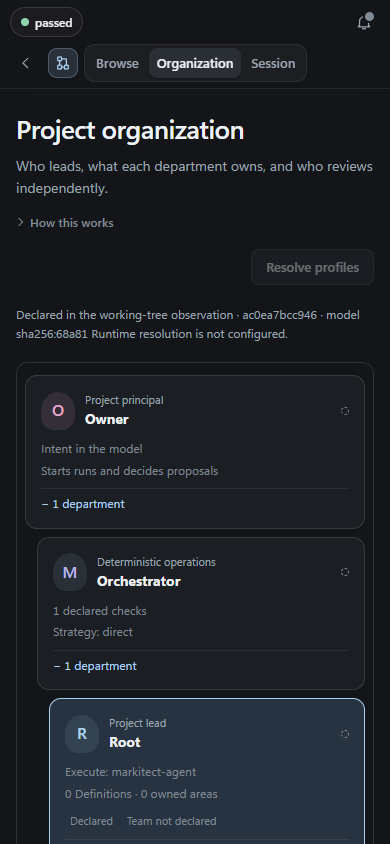
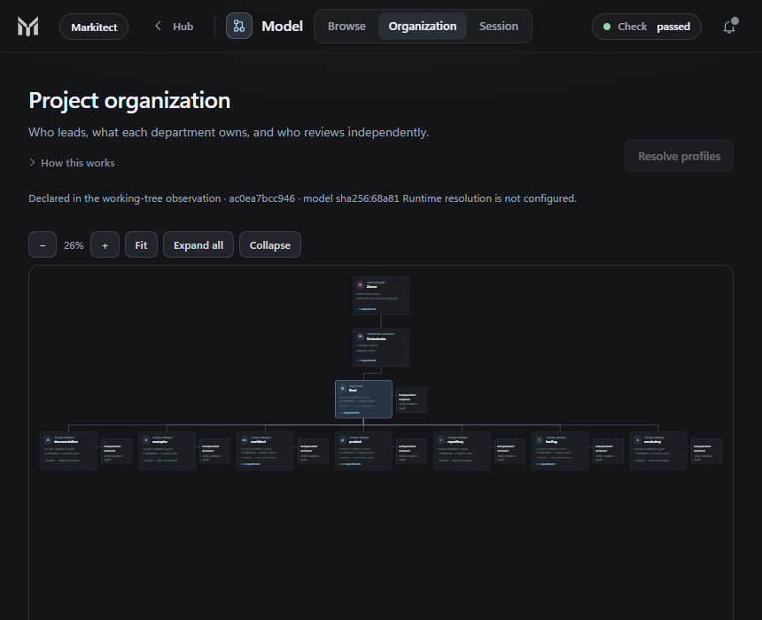
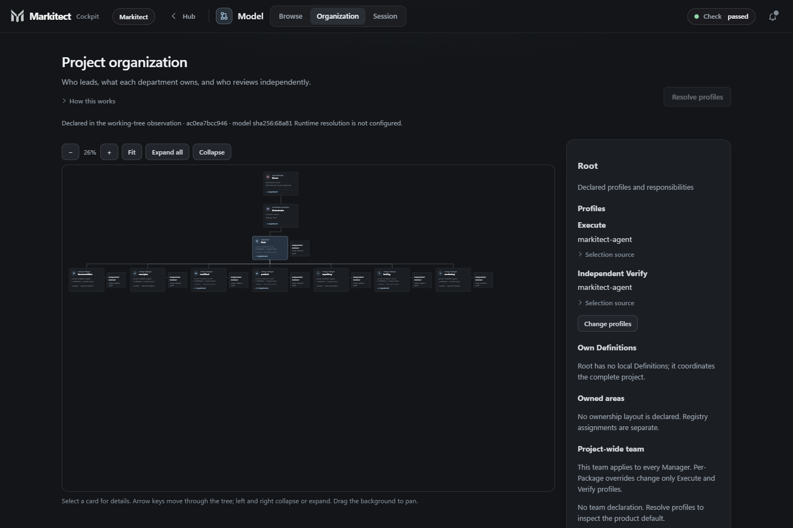

# Cockpit organization chart validation, 21 October 2026

Package 5 closes the source and local UI work in the
[handoff](../development/codex-cockpit-org-chart-handoff-20261021.md). It is
composed on actual Main `de1fb9b9` after the first four focused deliveries.
This is local source/browser evidence, not provider, release or owner acceptance.
The associated PR records this candidate's final review, exact head, merge and
Main read-back; automatic hosted CI remains paused.

## Delivered workflow and checks

The Model area offers Browse, Organization and Session. Organization starts
with declared facts, resolves profiles only on request, and links responsibility
and profile/team changes into the existing views. The Run inspector reuses the
chart with historical binding and usage. The hub's bounded Model thumbnail
reuses that same cached project observation, with no additional observation,
Runtime capture or request. Its HTTP test verifies the summary and one observer
call across repeated reads. README and validation navigation describe the flow.

| Package | Integrated delivery before this finishing candidate |
| --- | --- |
| [Read model](cockpit-organization-read-model-20261021.md) | [#584](https://github.com/Glacius-Labs/Markitect/pull/584), Main `d94a8769` |
| [Shared chart](cockpit-organization-chart-20261021.md) | [#586](https://github.com/Glacius-Labs/Markitect/pull/586), Main `06ac30b6` |
| [Organization tab](cockpit-organization-tab-20261021.md) | [#587](https://github.com/Glacius-Labs/Markitect/pull/587), Main `e26568f9` |
| [Recorded Run chart](cockpit-run-organization-20261021.md) | [#588](https://github.com/Glacius-Labs/Markitect/pull/588), Main `de1fb9b9` |

Each focused candidate received an independent complete-diff review, relevant
local checks, an exact-head merge and a Main tree read-back. Unrelated experiment
preparation #585 remains included. Package 5 adds only its thumbnail, guide,
navigation and registered validation screenshots.

Final local checks: full cockpit Go tests (including producer contracts,
historical/prefix cases and the thumbnail observation count), cockpit/bootstrap
vet, architecture CLI, structural preparation and product context, working and
fixed-head accounting, documentation links and diff checks. All 12 local,
dependency-free Node tests pass; Node is not required by CI. Earlier full
bootstrap and architecture package tests passed on the prepared combined source.
No broad suite or hosted CI result is implied.

## Actual browser observations

The actual embedded binary served loopback with explicit `--state` and `--repo`,
without a run configuration or Runtime profile. Starting Apply or a model
session was unavailable. Playwright exercised the checked one-local-Package
fixture `34628cb40e7f62cda05b42899456b6ed33cccd88` (Core supplied by its pinned
Markitect dependency) and Markitect's 23 local Packages. It checked Browse
links, Package profile preselection, project-wide team focus, keyboard movement
and collapse, pan/zoom/Fit, a low 860x400 window and 390/860/1440 px. The Model
tabs and status were checked for overlap; the document had no horizontal overflow.
Captures wait for the existing page/aside transitions to settle.
The empty Organization alert keeps its live region but no longer draws a
border/padding artifact; non-empty refusals retain their existing presentation.

The 390 px tab/status collision was corrected with separate header rows.
The first Go check rejected `.mjs` browser assets that source packaging omits;
the three modules now use the existing `.js` format without relaxing that gate.
The Run tests exposed and corrected pinning at the previous record end and
delayed animation on Play. An actual non-empty exchange moves while replaying
and retains its coordinates after Pause. These failed observations and their
bounded corrections are retained in the owning package records.

| Viewport | Checked view | Screenshot |
| --- | --- | --- |
| 390x844 | Indented tree, readable cards, separate Model tabs/status | [390 px](assets/cockpit-organization-20261021/organization-390.png) |
| 860x700 | Top-down organization with Fit controls | [860 px](assets/cockpit-organization-20261021/organization-860.png) |
| 1440x960 | Organization and selected responsibility | [1440 px](assets/cockpit-organization-20261021/organization-1440.png) |
| 1440x960 | One local Package with Root and leadership | [One Package](assets/cockpit-organization-20261021/one-package-1440.png) |







## Read-only real Run evidence

Only the existing WSL `events.jsonl` and `report.json` files were copied for
inspection; the original files were not modified. Their SHA-256 values are
listed below. Receipt files and transcripts were not copied: unavailable bytes
remain unavailable. These are earlier B0/B1 records, not the later A retest.

| Run | Actual UI observation | Screenshot |
| --- | --- | --- |
| `20261021T121802Z-377fea2c` (SA-B0-SN-3) | 207 records, verified/no change, 3 Passes, 18 turns; historical binding and reported usage | [Verified](assets/cockpit-organization-20261021/run-verified-1440.png) |
| Same Run, prefix 142, Probe R1 | Failed receipt at that boundary; six final receipts include two failures with later dispositions | [Failed probe](assets/cockpit-organization-20261021/run-failed-probe-1440.png) |
| `20261021T123238Z-ee56e08d` (SA-B1-SN-1) | 126 records, incomplete after uncertain stand capture | [Incomplete](assets/cockpit-organization-20261021/run-incomplete-1440.png) |
| `20261021T123851Z-2f742a15` (SA-B1-SQV-1) | 72 records, confirmed model problems; recorded chart in a narrow scrollable tree | [Model problem](assets/cockpit-organization-20261021/run-model-problem-chart-390.png) |

```text
SA-B0-SN-3 events sha256:90a30b485ed3e67115eece5277ea12bf742a6a7a792e4c7a1fa1cde117fc54fd
SA-B0-SN-3 report sha256:abb43862e1900c51806f54d9a872d6b52ebe2dd9fbab35ae96ab0e88a08af4bc
SA-B1-SN-1 events sha256:361ce5870a0c57f2f00485a95fd107fd01f3f8c5e4bc90794bbcdf44fd3de541
SA-B1-SN-1 report sha256:74a24a76cbb03ff96d8cadec2c0086f27423aa4f5ba7286c5a27894ac3448307
SA-B1-SQV-1 events sha256:cb067fdd332f06392b360e742f8ca4351041025995f9b323476160dca4baf1af
SA-B1-SQV-1 report sha256:bd000ceedd263ebae7ab726347086706b35c5ac58b6e888aad9e98bb509a9e4c
```

The browser checked that prefix 1 hides later report/usage, recorded profiles
are distinct from today's Markitect profiles, collapse survives boundary changes,
selection stays pinned, replay pauses the arrows, and reduced motion stays still.
The real-record script raised no page script errors. Existing rail, account,
timeline, aside and record controls remain present; long/narrow views scroll.

## Synthetic checks and remaining evidence limits

Synthetic HTTP metadata supplied explicit resolution progress, resolved models
and team limits, return to declarations and a refusal. No Runtime was contacted.
A separate component fixture covered missing historical binding, a suspected
observation and a wait. A derived synthetic append log and offline/reconnect
exercise checked both Manager and newest-event selections: 207 records received,
boundary still 60, selection retained and the Manager still collapsed. Expected
offline request errors belong to that synthetic outage; they are not CSP errors.

The three real Runs contain no suspected-observation example. That UI case is
therefore synthetic, not demonstrated on real provider evidence. No provider,
container, assessment, Apply or model-authoring session was started for this work.
No notification, installer, production, release or owner acceptance is claimed.
